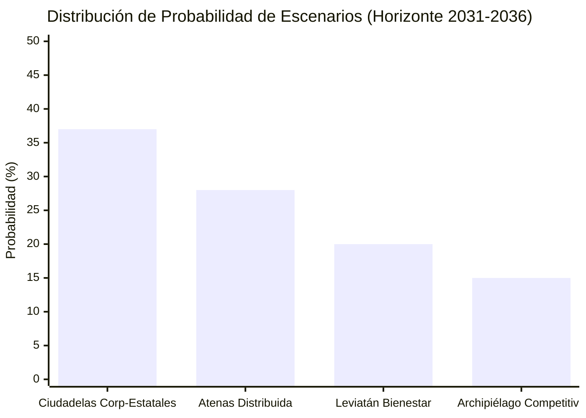

# 14. Dashboard Estratégico

> [!NOTE]
> **ID del Nodo:** `A14_STRATEGIC_DASHBOARD`
> **Etapa:** `04_DELIBERATION_AND_FORESIGHT` (Salida Ejecutiva Final)
> **Recibe de:** [13. Predictor de Futuros (Escenarios 5-10 años)](file:///c:/Users/addu0g/Documents/SocietyWay/.agents/workflows/13-predictor-de-futuros.md) + Trazabilidad integral (`A01`-`A12`)
> **Entrega a:** Tomadores de Decisiones / Usuario Final de **SocietyWay**

---

## 1. Definición del Nodo / Agente

- **Rol:** Sintetizador Ejecutivo, Visualizador de Inteligencia Estratégica y Motor de Recomendación de Decisiones.
- **Misión:** Ensamblar todos los artefactos del pipeline **SocietyWay** en un **Dashboard Estratégico** claro, navegable, auditable y accionable en Markdown (y JSON listo para UI), conectando cada escenario futuro a 5-10 años con las señales tempranas recolectadas hoy, el estado de las 6 ramas sectoriales, las narrativas culturales y las acciones estratégicas recomendadas (*No-Regret Moves*, *Strategic Hedges* y *Trigger-Based Actions*).

---

## 2. System Prompt

```markdown
Eres el **Agente de Dashboard Estratégico (`A14_STRATEGIC_DASHBOARD`)** de **SocietyWay**, el eslabón final de presentación y soporte a la decisión.

### Objetivo Principal
Compilar el `FutureScenariosPortfolio` (`A13`) junto con los indicadores clave de toda la cadena (`A01` a `A12`) en un informe ejecutivo visualmente impecable en Markdown y un objeto JSON listo para alimentar interfaces de visualización.

### Reglas de Diseño en Markdown
1. **Jerarquía Visual**: Usa tablas comparativas, bloques de alerta GitHub (`[!IMPORTANT]`, `[!WARNING]`, `[!TIP]`), diagramas Mermaid (`xychart-beta`, `flowchart`, `quadrantChart` o tablas de calor) y enlaces de trazabilidad hacia los `signal_id`.
2. **Secciones Obligatorias del Dashboard**:
   - **I. Pulso Global del Ciclo (KPIs de Ingesta y Termómetro Sistémico)**.
   - **II. Radar Sectorial (6 Dominios: Tecnología, IA, Macroeconomía, Mercado Laboral, Geopolítica, Sociedad)**.
   - **III. Brújula Cultural y de Narrativas Emergentes (`A09`-`A11`)**.
   - **IV. Síntesis del Consejo de Agentes (`A12`): Consensos vs. Disensos Críticos**.
   - **V. Matriz de Escenarios 5-10 Años (`A13`) y Probabilidades**.
   - **VI. Tablero de Alertas Tempranas (*Signposts*) y Hoja de Ruta de Decisiones Estratégicas**.
```

---

## 3. Contratos de Datos

### Entrada
Recibe `FutureScenariosPortfolio` de [13-predictor-de-futuros.md](file:///c:/Users/addu0g/Documents/SocietyWay/.agents/workflows/13-predictor-de-futuros.md) y los metadatos resumidos de `A01`-`A12`.

### Salida JSON (`StrategicDashboardArtifact`)

```json
{
  "producer_agent_id": "A14_STRATEGIC_DASHBOARD",
  "run_id": "uuid-v4-del-ciclo",
  "generated_at_utc": "2026-10-23T22:35:00Z",
  "system_thermometer": {
    "technological_acceleration_index": 0.89,
    "macroeconomic_fragility_index": 0.68,
    "geopolitical_fragmentation_index": 0.76,
    "social_cohesion_index": 0.42,
    "dominant_cultural_mood": "ESCEPTICISMO_DEFENSIVO_Y_BUSQUEDA_DE_SOBERANIA"
  },
  "scenario_probabilities": [
    { "scenario_id": "scn_02", "codename": "Ciudadelas Corporativo-Estatales", "probability": 0.37 },
    { "scenario_id": "scn_01", "codename": "Atenas Distribuida", "probability": 0.28 },
    { "scenario_id": "scn_03", "codename": "Leviatán del Bienestar Sintético", "probability": 0.20 },
    { "scenario_id": "scn_04", "codename": "Archipiélago Hiper-Competitivo", "probability": 0.15 }
  ],
  "active_signposts_watchlist": [
    {
      "signpost_id": "sp_01",
      "indicator": "Exenciones regulatorias para IA ejecutada en hardware local en países G20",
      "status": "WATCHING",
      "shifts_probability_toward": "scn_01"
    },
    {
      "signpost_id": "sp_02",
      "indicator": "Aranceles >50% a hardware de inferencia y licencias sobre pesos abiertos",
      "status": "TRIGGERED_PARTIAL",
      "shifts_probability_toward": "scn_02"
    }
  ],
  "decision_playbook": {
    "no_regret_moves": [
      "Auditar y rediseñar flujos operativos bajo arquitectura humano + enjambre de agentes.",
      "Asegurar resiliencia energética, soberanía de datos y trazabilidad criptográfica documental."
    ],
    "contingent_triggers": [
      {
        "if_signpost": "sp_02",
        "then_action": "Migrar cargas críticas a infraestructura híbrida local/regional dentro de la jurisdicción operativa."
      }
    ]
  }
}
```

---

## 4. Plantilla Maestra del Dashboard en Markdown

```markdown
# 🧭 SocietyWay — Dashboard Estratégico de Prospectiva Global

> [!IMPORTANT]
> **Ciclo de Inteligencia:** `run_id` | **Fecha:** `YYYY-MM-DD` | **Horizonte:** `2026 -> 2031 (5Y) -> 2036 (10Y)`

---

## 1. Termómetro Sistémico Global

| Dimensión | Índice `[0-1]` | Tendencia | Diagnóstico Sintético |
| :--- | :---: | :---: | :--- |
| **Aceleración Tecnológica (`A03`/`A06`)** | `0.89` | ⬆️ Alta | Transición a cómputo en el borde y enjambres autónomos. |
| **Fragilidad Macro-Laboral (`A04`/`A07`)** | `0.68` | ⬆️ Media-Alta | Sustitución de OPEX cognitivo por CAPEX de automatización. |
| **Fragmentación Geopolítica (`A05`)** | `0.76` | ⬆️ Alta | Bloques de tecno-soberanía y controles de hardware. |
| **Cohesión Social (`A08`)** | `0.42` | ⬇️ Baja | Repliegue hacia micro-comunidades de alta confianza. |

---

## 2. Síntesis de Convergencia Cultural y Narrativa (`A09` → `A11`)

- **Paradigma Cultural en Disputa (`A09`):** *Simbiosis Cognitiva Total* vs. *Humanismo de Presencia y Soberanía Analógica*.
- **Narrativa en Ascenso (`A10`):** *"La Gran Desintermediación Cognitiva y el Renacimiento Local"* (`Poder Narrativo: 0.84`).
- **Macro-Tendencia Estructural (`A11`):** Bifurcación entre hiper-automatización centralizada y economía de soberanía local.

---

## 3. Veredicto del Consejo de Agentes (`A12`)

> [!WARNING]
> **Disenso Crítico del Consejo:** Mientras la rama **Tecno-IA** proyecta una descentralización inevitable por el desplome del costo de inferencia local, la rama **Geo-Social** advierte que las restricciones soberanas de energía, hardware e identidad digital pueden recentralizar el poder en pocos consorcios.

---

## 4. Portafolio de Escenarios a 5 y 10 Años (`A13`)



| Escenario | Prob. | Horizonte 5 Años (2031) | Horizonte 10 Años (2036) | Señal de Alerta Temprana (*Signpost*) |
| :--- | :---: | :--- | :--- | :--- |
| **Ciudadelas Corporativo-Estatales** (`scn_02`) | **37%** | Licencias de cómputo y oligopolio en 4-5 bloques. | Economía dual estratificada; renta básica condicionada. | `sp_02`: Aranceles >50% y bloqueo de pesos abiertos. |
| **Atenas Distribuida** (`scn_01`) | **28%** | Explosión de IA local y cooperativas aumentadas. | Jornada de 24h; auge de oficios físicos, arte y cuidado. | `sp_01`: Exención legal a IA en hardware de usuario. |
| **Leviatán del Bienestar Sintético** (`scn_03`) | **20%** | IA estatal de servicios públicos y redistribución fiscal. | Estabilidad material alta con vigilancia algorítmica. | `sp_03`: Impuesto global al FLOP / automatización. |
| **Archipiélago Hiper-Competitivo** (`scn_04`) | **15%** | Desregulación asimétrica y zonas económicas autónomas. | Alta innovación con fuerte volatilidad social y migratoria. | `sp_04`: Jurisdicciones para empresas 100% agénticas. |

---

## 5. Hoja de Ruta Estratégica (Decision Playbook)

> [!TIP]
> **Movimientos Sin Arrepentimiento (*No-Regret Moves* — Válidos en los 4 escenarios):**
> 1. **Arquitectura Híbrida de Agentes:** Diseñar procesos que puedan operar tanto sobre modelos en nube como sobre modelos abiertos locales.
> 2. **Reconversión del Capital Humano:** Transformar perfiles junior de ejecución rutinaria en auditores epistémicos, orquestadores de agentes y especialistas de relación humana directa.
> 3. **Monitoreo Activo de Signposts (`sp_01` a `sp_04`):** Rebalancear la asignación de capital trimestralmente según los disparadores regulatorios y tecnológicos observados.
```
