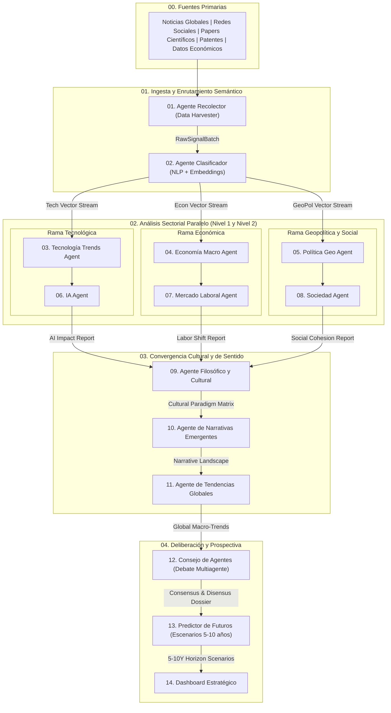

# 🌍 SocietyWay — Arquitectura del Workflow Multiagente

> [!IMPORTANT]
> **Documento Maestro de Orquestación (`AGENTS.md`)**
> Este archivo define la topología de ejecución, el grafo de dependencias, el catálogo de agentes y los contratos de datos globales que rigen el sistema de prospectiva estratégica **SocietyWay**.

---

## 📐 Topología del Workflow

### 1. Diagrama Estructural (ASCII Original)

```text
                     ┌────────────────────┐
                     │  Noticias Globales │
                     │  Redes Sociales    │
                     │  Papers Científicos│
                     │  Patentes          │
                     │  Datos Económicos  │
                     └─────────┬──────────┘
                               │
                               ▼
                  ┌────────────────────────┐
                  │ Agente Recolector      │
                  │ (Data Harvester)       │
                  └─────────┬──────────────┘
                            │
                            ▼
                  ┌────────────────────────┐
                  │ Agente Clasificador    │
                  │ NLP + Embeddings       │
                  └─────────┬──────────────┘
                            │
          ┌─────────────────┼──────────────────┐
          ▼                 ▼                  ▼
┌────────────────┐ ┌────────────────┐ ┌────────────────┐
│Tecnología      │ │Economía        │ │Política        │
│Trends Agent    │ │Macro Agent     │ │Geo Agent       │
└────────┬───────┘ └────────┬───────┘ └────────┬───────┘
         │                  │                  │
         ▼                  ▼                  ▼
┌────────────────┐ ┌────────────────┐ ┌────────────────┐
│IA Agent        │ │Mercado Laboral │ │Sociedad        │
│                │ │Agent           │ │Agent           │
└────────┬───────┘ └────────┬───────┘ └────────┬───────┘
         │                  │                  │
         └──────────────────┼──────────────────┘
                            ▼
                  ┌────────────────────────┐
                  │ Agente Filosófico      │
                  │ y Cultural             │
                  └─────────┬──────────────┘
                            │
                            ▼
                  ┌────────────────────────┐
                  │ Agente de Narrativas   │
                  │ Emergentes             │
                  └─────────┬──────────────┘
                            │
                            ▼
                  ┌────────────────────────┐
                  │ Agente de Tendencias   │
                  │ Globales               │
                  └─────────┬──────────────┘
                            │
                            ▼
                  ┌────────────────────────┐
                  │ Consejo de Agentes     │
                  │ (Debate Multiagente)   │
                  └─────────┬──────────────┘
                            │
                            ▼
                  ┌────────────────────────┐
                  │ Predictor de Futuros   │
                  │ Escenarios 5-10 años   │
                  └─────────┬──────────────┘
                            │
                            ▼
                  ┌────────────────────────┐
                  │ Dashboard Estratégico  │
                  └────────────────────────┘
```

### 2. Grafo de Flujo de Datos (Mermaid)



---

## 🗂️ Catálogo Modular de Especificaciones

Cada etapa y agente cuenta con su propio archivo Markdown de especificación técnica dentro de [`.agents/workflows/`](file:///c:/Users/addu0g/Documents/SocietyWay/.agents/workflows/), incluyendo **Rol**, **Fuentes/Herramientas**, **System Prompt** listo para producción y **Contratos de Entrada/Salida (JSON + Markdown)**:

| Fase | ID | Componente / Agente | Modo de Ejecución | Contrato de Salida | Especificación |
| :--- | :--- | :--- | :--- | :--- | :--- |
| **00** | `SRC` | **Fuentes de Datos Globales** | Conectores / Streams | `SourceEventStream` | [00-fuentes-datos.md](file:///c:/Users/addu0g/Documents/SocietyWay/.agents/workflows/00-fuentes-datos.md) |
| **01** | `A01` | **Agente Recolector (Data Harvester)** | Secuencial / Batch | `RawSignalBatch` | [01-agente-recolector.md](file:///c:/Users/addu0g/Documents/SocietyWay/.agents/workflows/01-agente-recolector.md) |
| **01** | `A02` | **Agente Clasificador (NLP + Embeddings)** | Secuencial / Router | `ClassifiedRoutingPayload` | [02-agente-clasificador.md](file:///c:/Users/addu0g/Documents/SocietyWay/.agents/workflows/02-agente-clasificador.md) |
| **02A** | `A03` | **Tecnología Trends Agent** | Paralelo (Rama A - N1) | `TechTrendsReport` | [03-tecnologia-trends-agent.md](file:///c:/Users/addu0g/Documents/SocietyWay/.agents/workflows/03-tecnologia-trends-agent.md) |
| **02B** | `A04` | **Economía Macro Agent** | Paralelo (Rama B - N1) | `MacroEconReport` | [04-economia-macro-agent.md](file:///c:/Users/addu0g/Documents/SocietyWay/.agents/workflows/04-economia-macro-agent.md) |
| **02C** | `A05` | **Política Geo Agent** | Paralelo (Rama C - N1) | `GeoPoliticsReport` | [05-politica-geo-agent.md](file:///c:/Users/addu0g/Documents/SocietyWay/.agents/workflows/05-politica-geo-agent.md) |
| **02A** | `A06` | **IA Agent** | Paralelo (Rama A - N2) | `AIDomainSynthesis` | [06-ia-agent.md](file:///c:/Users/addu0g/Documents/SocietyWay/.agents/workflows/06-ia-agent.md) |
| **02B** | `A07` | **Mercado Laboral Agent** | Paralelo (Rama B - N2) | `LaborMarketSynthesis` | [07-mercado-laboral-agent.md](file:///c:/Users/addu0g/Documents/SocietyWay/.agents/workflows/07-mercado-laboral-agent.md) |
| **02C** | `A08` | **Sociedad Agent** | Paralelo (Rama C - N2) | `SocietalDynamicsSynthesis` | [08-sociedad-agent.md](file:///c:/Users/addu0g/Documents/SocietyWay/.agents/workflows/08-sociedad-agent.md) |
| **03** | `A09` | **Agente Filosófico y Cultural** | Nodo de Convergencia (Fan-In) | `PhilosophicalCulturalMatrix` | [09-agente-filosofico-cultural.md](file:///c:/Users/addu0g/Documents/SocietyWay/.agents/workflows/09-agente-filosofico-cultural.md) |
| **03** | `A10` | **Agente de Narrativas Emergentes** | Secuencial | `EmergentNarrativesAtlas` | [10-agente-narrativas-emergentes.md](file:///c:/Users/addu0g/Documents/SocietyWay/.agents/workflows/10-agente-narrativas-emergentes.md) |
| **03** | `A11` | **Agente de Tendencias Globales** | Secuencial | `GlobalTrendsSynthesis` | [11-agente-tendencias-globales.md](file:///c:/Users/addu0g/Documents/SocietyWay/.agents/workflows/11-agente-tendencias-globales.md) |
| **04** | `A12` | **Consejo de Agentes (Debate Multiagente)** | Deliberativo / Multi-turn | `CouncilDeliberationRecord` | [12-consejo-de-agentes.md](file:///c:/Users/addu0g/Documents/SocietyWay/.agents/workflows/12-consejo-de-agentes.md) |
| **04** | `A13` | **Predictor de Futuros (Escenarios 5-10 años)** | Prospectivo / Simulación | `FutureScenariosPortfolio` | [13-predictor-de-futuros.md](file:///c:/Users/addu0g/Documents/SocietyWay/.agents/workflows/13-predictor-de-futuros.md) |
| **04** | `A14` | **Dashboard Estratégico** | Agregador / Presentación | `StrategicDashboardArtifact` | [14-dashboard-estrategico.md](file:///c:/Users/addu0g/Documents/SocietyWay/.agents/workflows/14-dashboard-estrategico.md) |

---

## 📦 Estándar Global de Contratos de Datos (Envelope Schema)

Todos los mensajes e intercambios entre agentes dentro de **SocietyWay** deben envolverse en el siguiente contrato base JSON (`AgentEnvelope`) además de producir un bloque narrativo en Markdown estructurado para trazabilidad humana:

```json
{
  "$schema": "https://societyway.local/schemas/agent-envelope-v1.json",
  "run_id": "uuid-v4-del-ciclo",
  "timestamp_utc": "2026-10-23T22:30:00Z",
  "producer_agent_id": "A01_DATA_HARVESTER",
  "consumer_agent_ids": ["A02_NLP_CLASSIFIER"],
  "trace_context": {
    "stage": "01_INGESTION",
    "confidence_score": 0.92,
    "source_signal_ids": ["sig_001", "sig_002"]
  },
  "payload": {},
  "markdown_summary": "## Resumen Ejecutivo del Nodo\n..."
}
```

---

## ⚙️ Reglas de Orquestación y Control de Calidad

1. **Trazabilidad Estricta (`source_signal_ids`)**: Ningún agente aguas abajo puede afirmar una tendencia o escenario sin referenciar los identificadores de señal (`signal_id`) originados en el [Agente Recolector](file:///c:/Users/addu0g/Documents/SocietyWay/.agents/workflows/01-agente-recolector.md).
2. **Ejecución Fan-Out / Fan-In**:
   - **Fan-Out**: El [Agente Clasificador](file:///c:/Users/addu0g/Documents/SocietyWay/.agents/workflows/02-agente-clasificador.md) particiona las señales en 3 flujos paralelos (`Tecnología`, `Economía`, `Política`), permitiendo señales multi-etiqueta cuando un evento cruza dominios.
   - **Encadenamiento Vertical**: Cada rama de Nivel 1 alimenta a su especialista de Nivel 2 (`Tecnología -> IA`, `Economía -> Mercado Laboral`, `Política -> Sociedad`).
   - **Fan-In (Sincronización)**: El [Agente Filosófico y Cultural](file:///c:/Users/addu0g/Documents/SocietyWay/.agents/workflows/09-agente-filosofico-cultural.md) actúa como barrera de sincronización; solo se dispara cuando `A06`, `A07` y `A08` han emitido sus reportes validados.
3. **Preservación del Disenso**: El [Consejo de Agentes](file:///c:/Users/addu0g/Documents/SocietyWay/.agents/workflows/12-consejo-de-agentes.md) tiene prohibido forzar un consenso artificial; debe documentar explícitamente las tesis en conflicto para alimentar los escenarios divergentes del [Predictor de Futuros](file:///c:/Users/addu0g/Documents/SocietyWay/.agents/workflows/13-predictor-de-futuros.md).
