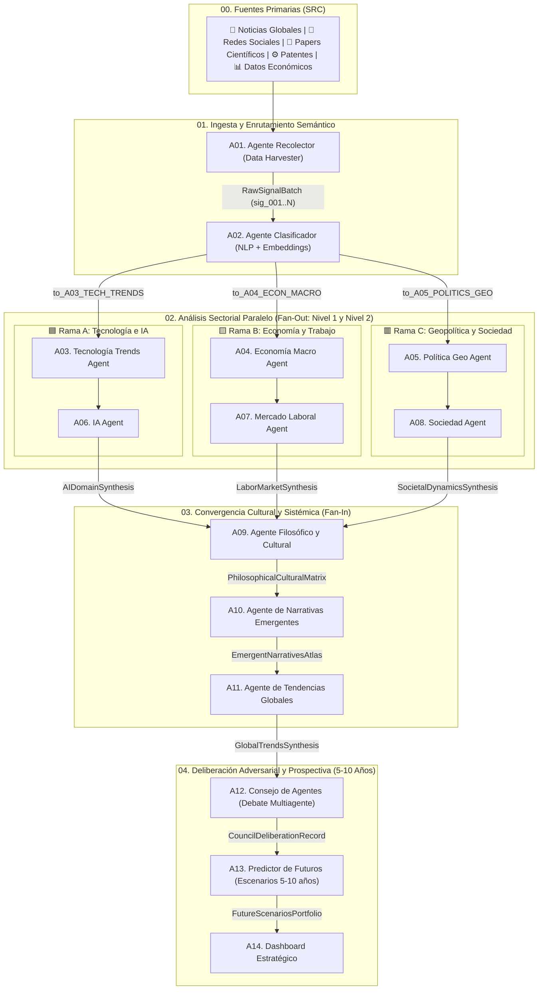

# 🌍 SocietyWay — Sistema Multiagente de Prospectiva Estratégica e Inteligencia de Futuros

> **De señales fragmentadas en tiempo real a escenarios estratégicos auditables a 5 y 10 años.**  
> **SocietyWay** es un motor de inteligencia prospectiva basado en una arquitectura de **14 agentes especializados** (organizados en etapas de *Ingesta*, *Fan-Out Sectorial Paralelo*, *Fan-In Cultural/Sistémico* y *Deliberación Adversarial*) diseñado para ayudar a estrategas, investigadores, empresas y tomadores de decisiones a anticipar transformaciones tecnológicas, económicas, geopolíticas y culturales sin caer en sesgos de confirmación.

---

## 🎯 ¿Cuál es la finalidad de SocietyWay y sus Agentes?

Los análisis tradicionales de tendencias suelen fallar por tres motivos: **aislamiento disciplinar** (los tecnólogos ignoran la macroeconomía y los economistas subestiman la cultura o la física tecnológica), **pérdida de trazabilidad** (afirmaciones sin respaldo empírico) y **consenso prematuro** (proyecciones lineales que ocultan cisnes negros).

**SocietyWay** resuelve este problema mediante una cadena cognitiva donde cada agente cumple un propósito específico e insustituible:

1. **Capturar y purificar la realidad empírica (`Fase 00 - 01`):** Extraer señales verificables desde 5 canales globales (Noticias, Redes Sociales, Papers Científicos, Patentes y Series Económicas), eliminando el ruido y agrupándolas matemáticamente por afinidad semántica.
2. **Descomponer el impacto en 3 ramas paralelas de doble profundidad (`Fase 02 — Fan-Out`):** Evaluar cada fenómeno simultáneamente desde la frontera dura (**Tecnología** $\rightarrow$ **IA**), la estructura material (**Macroeconomía** $\rightarrow$ **Mercado Laboral**) y el poder institucional (**Geopolítica** $\rightarrow$ **Sociedad**).
3. **Decodificar el sentido humano y el sistema-mundo (`Fase 03 — Fan-In`):** Sincronizar las tres ramas para entender cómo cambian los valores y la ética (**Filosofía y Cultura**), qué relatos colectivos movilizan al capital o a los votantes (**Narrativas Emergentes**) y qué bucles de retroalimentación gobiernan el sistema (**Tendencias Globales**).
4. **Debatir sin filtros y proyectar futuros accionables (`Fase 04 — Deliberación y Prospectiva`):** Hacer colisionar las tesis en un **Consejo de Agentes** adversarial para separar las *certezas invariantes* de las *incertidumbres críticas*, modelar un portafolio de **4 Escenarios Canónicos + 1 Cisne Negro a 5 y 10 años**, y entregar un **Dashboard Estratégico** con alertas tempranas (*Signposts*) y movimientos sin arrepentimiento (*No-Regret Moves*).

---

## 📐 Arquitectura y Topología del Workflow



---

## 🤖 Guía Detallada de los 14 Agentes y su Función

Cada agente tiene su especificación completa (Rol, Herramientas, *System Prompt* y Contratos JSON/Markdown) en el directorio [`.agents/workflows/`](./.agents/workflows/):

### Fase 00 & 01 — Captura y Enrutamiento Semántico
* **00. Fuentes de Datos Globales (`SRC`)** — [Especificación](./.agents/workflows/00-fuentes-datos.md)
  Define los 5 canales de entrada (`SRC_NEWS`, `SRC_SOCIAL`, `SRC_PAPERS`, `SRC_PATENTS`, `SRC_ECON`) y el esquema `SourceEventStream`.
* **01. Agente Recolector (`A01_DATA_HARVESTER`)** — [Especificación](./.agents/workflows/01-agente-recolector.md)
  * **Finalidad:** Filtra el ruido y el *clickbait*, elimina duplicados, califica la credibilidad de cada fuente (`0.0` a `1.0`), distingue señales tempranas débiles (`WEAK_EARLY_SIGNAL`) de señales dominantes (`DOMINANT_SIGNAL`) y asigna el identificador inmutable `signal_id` que garantiza la trazabilidad de todo el pipeline.
* **02. Agente Clasificador (`A02_NLP_CLASSIFIER`)** — [Especificación](./.agents/workflows/02-agente-clasificador.md)
  * **Finalidad:** Agrupa las señales aisladas en **clústeres semánticos**, extrae tripletas causales (`Sujeto -> Predicado -> Objeto`), mide novedad/momentum/polarización y calcula la afinidad con cada dominio (`TECH`, `ECON`, `GEOPOL`). Todo clúster con afinidad `>= 0.35` se enruta automáticamente a las ramas correspondientes (*multi-label routing*).

### Fase 02 — Análisis Sectorial Paralelo (*Fan-Out* en 3 Ramas)
* 🟦 **Rama A (Tecnología $\rightarrow$ Inteligencia Artificial):**
  * **03. Tecnología Trends Agent (`A03_TECH_TRENDS`)** — [Especificación](./.agents/workflows/03-tecnologia-trends-agent.md): Evalúa el nivel de madurez tecnológica (**TRL 1–9**), curvas S de adopción y cuellos de botella físicos, termodinámicos, de materiales o energéticos en hardware, biotecnología, energía y cómputo.
  * **06. IA Agent (`A06_IA_AGENT`)** — [Especificación](./.agents/workflows/06-ia-agent.md): Toma la infraestructura de `A03` y analiza la frontera algorítmica y cognitiva (sistemas multiagente, *World Models*, IA física/robótica, inferencia en el borde) y cómo desplaza la agencia y cognición humana.
* 🟨 **Rama B (Macroeconomía $\rightarrow$ Mercado Laboral):**
  * **04. Economía Macro Agent (`A04_ECON_MACRO`)** — [Especificación](./.agents/workflows/04-economia-macro-agent.md): Diagnostica el régimen monetario y fiscal, el costo del capital, los ciclos de inversión (**CAPEX vs. OPEX**), la inflación estructural y la reconfiguración de cadenas de suministro.
  * **07. Mercado Laboral Agent (`A07_LABOR_MARKET`)** — [Especificación](./.agents/workflows/07-mercado-laboral-agent.md): Traduce los flujos de capital de `A04` a nivel de **tareas ocupacionales** (O*NET/ESCO): qué tareas se destruyen, cómo se comprime el escalón de aprendizaje *junior*, qué nuevos oficios emergen y cómo cambia el reparto del PIB entre capital y trabajo.
* 🟥 **Rama C (Geopolítica $\rightarrow$ Sociedad):**
  * **05. Política Geo Agent (`A05_POLITICS_GEO`)** — [Especificación](./.agents/workflows/05-politica-geo-agent.md): Mapea la rivalidad entre bloques geopolíticos, aranceles, controles de exportación, leyes antimonopolio, soberanía tecnológica y presiones regulatorias/fiscales de los Estados.
  * **08. Sociedad Agent (`A08_SOCIETY_AGENT`)** — [Especificación](./.agents/workflows/08-sociedad-agent.md): Evalúa cómo las fuerzas geopolíticas de `A05` impactan la demografía (envejecimiento, natalidad, migración), la confianza en las instituciones, la salud mental y la cohesión social (`social_cohesion_index`).

### Fase 03 — Convergencia Cultural y de Sentido (*Fan-In*)
* **09. Agente Filosófico y Cultural (`A09_PHILOSOPHICAL_CULTURAL`)** — [Especificación](./.agents/workflows/09-agente-filosofico-cultural.md)
  * **Finalidad:** Actúa como **barrera de sincronización**. Solo se ejecuta cuando `A06`, `A07` y `A08` han terminado. Triangula tecnología, trabajo y sociedad para identificar desplazamientos profundos en la **epistemología** (qué consideramos verdadero), la **ética**, la **antropología** (el sentido de propósito humano) y la **estética**.
* **10. Agente de Narrativas Emergentes (`A10_EMERGENT_NARRATIVES`)** — [Especificación](./.agents/workflows/10-agente-narrativas-emergentes.md)
  * **Finalidad:** Transforma los dilemas filosóficos de `A09` en un **Atlas Memético y Discursivo**: identifica los relatos en ascenso, sus arquetipos (*Héroe vs. Villano*), su léxico clave y las contra-narrativas que disputan el consenso público y de mercado.
* **11. Agente de Tendencias Globales (`A11_GLOBAL_TRENDS`)** — [Especificación](./.agents/workflows/11-agente-tendencias-globales.md)
  * **Finalidad:** Fusiona los vectores materiales (`A01–A08`) con los vectores simbólicos (`A09–A10`) mediante **Dinámica de Sistemas**: define bucles reforzadores ($R$), fricciones equilibradoras ($B$), efectos de 2.º y 3.er orden, y redacta las **Mociones de Debate (`council_motion`)**.

### Fase 04 — Deliberación Adversarial y Prospectiva Ejecutiva
* **12. Consejo de Agentes (`A12_AGENT_COUNCIL`)** — [Especificación](./.agents/workflows/12-consejo-de-agentes.md)
  * **Finalidad:** Cámara deliberativa de **3 rondas adversariales** donde colisionan 5 asientos: *Delegado Tecno-IA*, *Delegado Macro-Laboral*, *Delegado Geo-Social*, *Delegado Filosófico-Cultural* y un *Agente Red-Team (Cisne Negro)*. Tiene **prohibido forzar un consenso artificial**: su misión es separar las **Certezas Invariantes** de los **2 Ejes Ortogonales de Incertidumbre Crítica**.
* **13. Predictor de Futuros (`A13_FUTURE_PREDICTOR`)** — [Especificación](./.agents/workflows/13-predictor-de-futuros.md)
  * **Finalidad:** Cruza los 2 ejes de incertidumbre de `A12` en una matriz $2 \times 2$ para construir **4 Escenarios Canónicos** (cuyas probabilidades suman `100%`) más **1 Escenario Comodín (*Wildcard / Cisne Negro*)**, detallando el estado del mundo a **5 años (`T+5`)** y **10 años (`T+10`)**, ganadores/perdedores e indicadores de alerta temprana (*Signposts*).
* **14. Dashboard Estratégico (`A14_STRATEGIC_DASHBOARD`)** — [Especificación](./.agents/workflows/14-dashboard-estrategico.md)
  * **Finalidad:** Compila toda la corrida en un tablero ejecutivo con el **Termómetro Sistémico Global**, gráficas de probabilidad, tabla de vigilancia de *Signposts* y el **Decision Playbook** (*Movimientos Sin Arrepentimiento / No-Regret Moves* y disparadores contingentes).

---

## 📂 Estructura del Repositorio

```text
SocietyWay/
├── AGENTS.md                        # Documento Maestro de Orquestación y Reglas Globales
├── README.md                        # Guía de propósito, arquitectura y uso del proyecto
├── .agents/
│   └── workflows/                   # Especificaciones modulares de los 14 agentes + fuentes
│       ├── 00-fuentes-datos.md
│       ├── 01-agente-recolector.md
│       ├── 02-agente-clasificador.md
│       ├── 03-tecnologia-trends-agent.md
│       ├── 04-economia-macro-agent.md
│       ├── 05-politica-geo-agent.md
│       ├── 06-ia-agent.md
│       ├── 07-mercado-laboral-agent.md
│       ├── 08-sociedad-agent.md
│       ├── 09-agente-filosofico-cultural.md
│       ├── 10-agente-narrativas-emergentes.md
│       ├── 11-agente-tendencias-globales.md
│       ├── 12-consejo-de-agentes.md
│       ├── 13-predictor-de-futuros.md
│       └── 14-dashboard-estrategico.md
└── runs/                            # Corridas estratégicas completas y auditables
    ├── 2026-10-23-sovereignty/      # Caso 1: Soberanía Financiera, Deuda y Automatización (2026-2036)
    │   └── 01..14-*.md
    └── 2026-10-23-facebook-2031/    # Caso 2: Futuro de Facebook y Meta Platforms a 5-10 años (2026-2036)
        └── 01..14-*.md
```

---

## 🚀 Cómo Usar SocietyWay Correctamente

### 1. Ejecutar una Nueva Corrida Completa de Prospectiva
Para lanzar el pipeline completo sobre cualquier industria, país, empresa o fenómeno global, abre tu asistente agéntico en este repositorio (que cargará automáticamente las reglas de [`AGENTS.md`](./AGENTS.md)) y solicita una corrida indicando el **tema** y el **horizonte temporal**.

**Ejemplos de prompts recomendados:**
* **Con ejecución en equipo paralelo (`/teamwork`):**
  > `/teamwork Ejecuta una corrida completa del workflow SocietyWay en runs/YYYY-MM-DD-energia-fusion/ sobre el impacto de la energía nuclear modular, redes eléctricas e IA industrial hacia 2031-2036.`
* **Con análisis profundo de segundo y tercer orden (`/boost`):**
  > `/boost ¿Qué sucederá en 5 años con la banca comercial minorista frente a los agentes financieros autónomos y las stablecoins/CBDCs?`

El orquestador ejecutará las **4 fases** respetando el orden topológico:
1. Creará la carpeta `runs/<fecha-tema>/`.
2. Ejecutará `A01` y `A02` para recolectar las señales base (`sig_...`) y enrutar los clústeres (`clu_...`).
3. Lanzará **en paralelo** las 3 ramas (`A03->A06`, `A04->A07`, `A05->A08`).
4. Sincronizará los resultados en `A09 -> A10 -> A11`.
5. Celebrará el debate del Consejo (`A12`), proyectará los escenarios (`A13`) y entregará el Dashboard (`A14`).

---

### 2.Cómo Leer e Interpretar una Corrida Estratégica
Si eres un tomador de decisiones, inversor o investigador revisando una carpeta dentro de [`runs/`](./runs/), te recomendamos este orden de lectura:

1. **Empieza por el final (`14-dashboard-estrategico-final.md`):** Te dará en 5 minutos el **Termómetro Sistémico**, las probabilidades de los 4 escenarios futuros, los indicadores de alerta temprana (*Signposts*) y el **Decision Playbook** (*No-Regret Moves*).
2. **Explora los escenarios y el debate (`13-predictor-futuros-2031-2036.md` y `12-consejo-de-agentes-acta.md`):** Comprende *por qué* los expertos sectoriales chocaron en el Consejo de Agentes y cuáles son los supuestos críticos que separan un escenario alcista de uno bajista.
3. **Audita la cadena de evidencia hacia atrás (`01` a `11`):** Cada afirmación en el Dashboard incluye etiquetas como `sig_...`, `tv_...`, `mv_...` o `phil_...`. Puedes rastrear cualquier escenario hasta el dato cuantitativo exacto, paper o patente original en `01-ingesta-recolector.md`.

---

### 3. Reglas de Oro para Modificar o Extender Agentes
Si deseas personalizar los prompts o agregar conectores en [`.agents/workflows/`](./.agents/workflows/), respeta siempre las **3 leyes de integridad de SocietyWay**:

1. **Ley de Trazabilidad Estricta (`source_signal_ids`):** Ningún agente de las fases `02`, `03` o `04` puede inventar datos ni formular una tendencia sin citar los IDs de señal (`sig_...`) recolectados en `A01`.
2. **Ley del Contrato Dual (Markdown + `AgentEnvelope` JSON):** Todo archivo generado por un agente debe contener tanto el análisis narrativo en Markdown para lectura humana como el bloque JSON validado bajo el esquema `AgentEnvelope` para consumo programático.
3. **Ley de Preservación del Disenso en `A12`:** Nunca edites el prompt del [Consejo de Agentes](./.agents/workflows/12-consejo-de-agentes.md) para que "llegue a un acuerdo cordial". El valor predictivo del sistema reside en hacer explícitas las contradicciones entre tecnología, economía, política y cultura.

---

## 📊 Casos de Estudio Incluidos en este Proyecto

Puedes explorar dos corridas completas de nivel producción ya generadas en el repositorio:

| Corrida (`run_id`) | Pregunta Estratégica | Escenario Modal Proyectado (`T+5 / T+10`) | Acceso Directo al Dashboard |
| :--- | :--- | :--- | :--- |
| **`run-20261023-sovereignty`** | *Soberanía Financiera, Deuda Soberana, Fragmentación de Bloques Comerciales y Automatización Industrial (2026–2036)* | **🏰 Ciudadelas de Baja Entropía (`38%`):** Fábricas *lights-out* con robótica de `$3.50–$5.50/h` y microrredes `SiC SST` (`<2 ms`) en un régimen de dominancia fiscal y liquidación bimodal (`mBridge` vs. `Agorá`). | [Ver Dashboard Soberanía](./runs/2026-10-23-sovereignty/14-dashboard-estrategico-final.md) |
| **`run-20261023-facebook-2031`** | *¿Qué sucederá en 5 años (2026–2031) con Facebook (App Azul) y Meta Platforms, y cuál es su ruta hacia 2036?* | **🟦 La Fortaleza Utilitaria y el Peaje Invisible (`36%`):** Facebook Core muta en TV sintética de alto ARPU senior (`51.4 años`), bóveda de `480M` de perfiles fallecidos y monopolio local en `Marketplace` (`1.38B MAU`), mientras `Advantage+` y `WhatsApp Agents` financian el CAPEX de IA y las gafas `Ray-Ban/Orion` + `sEMG`. | [Ver Dashboard Facebook 2031](./runs/2026-10-23-facebook-2031/14-dashboard-estrategico-final.md) |
