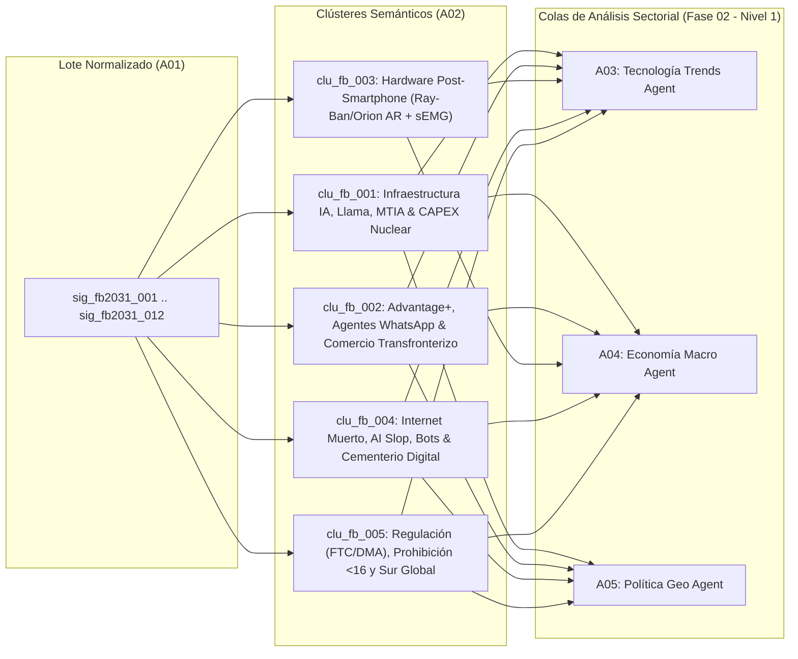

# 🧠 Mapa de Clasificación Semántica y Enrutamiento (`A02_NLP_CLASSIFIER`)

> [!NOTE]
> **Ciclo de Ejecución (`run_id`):** `run-20261023-facebook-2031`
> **Recibe de:** [`A01_DATA_HARVESTER`](file:///c:/Users/addu0g/Documents/SocietyWay/runs/2026-10-23-facebook-2031/01-ingesta-recolector.md) (`12` señales normalizadas)
> **Entrega a (Fan-Out Paralelo, umbral `>= 0.35`):**
> - `A03_TECH_TRENDS` (Tecnología, IA, Silicio, Hardware AR/sEMG, Arquitecturas de Recomendación)
> - `A04_ECON_MACRO` (CAPEX, Energía Nuclear, Monetización Advantage+, ARPU, Comercio Conversacional)
> - `A05_POLITICS_GEO` (Antimonopolio FTC/DMA, Prohibición <16 años, Demografía/Necrópolis Digital, Guerra Comercial)

---

## 1. Síntesis de Clustering Vectorial y Topología Semántica

Mediante embeddings densos (`text-embedding-3-large` / `multilingual-e5-large`) y agrupamiento jerárquico con solapamiento multi-etiqueta, las **12 señales atómicas (`sig_fb2031_001` a `sig_fb2031_012`)** se han sintetizado en **5 clústeres semánticos troncales (`clu_fb_001` a `clu_fb_005`)** que capturan las fuerzas estructurales que definirán el destino de **Facebook y Meta Platforms hacia 2031**.

### Matriz de Clústeres Detectados y Enrutamiento Multi-Rama (Regla `>= 0.35`)

| Cluster ID | Etiqueta Semántica del Clúster | Señales Asociadas (`signal_ids`) | Novelty | Momentum | Polarization | Afinidad `TECH` | Afinidad `ECON` | Afinidad `GEOPOL` | Colas de Destino (`>= 0.35`) |
| :--- | :--- | :--- | :---: | :---: | :---: | :---: | :---: | :---: | :--- |
| **`clu_fb_001`** | **Hegemonía de Infraestructura de IA: Pesos Abiertos (`Llama`), Silicio Propio (`MTIA`) y CAPEX Nuclear** | `sig_fb2031_002`, `sig_fb2031_004`, `sig_fb2031_005` | `0.91` | `0.96` | `0.62` | **`0.97`** | **`0.91`** | **`0.68`** | `A03`, `A04`, `A05` |
| **`clu_fb_002`** | **Hiper-Monetización Algorítmica (`Advantage+`), Agentes en WhatsApp y Shock Comercial Asiático** | `sig_fb2031_001`, `sig_fb2031_008`, `sig_fb2031_012` | `0.84` | `0.94` | `0.58` | **`0.84`** | **`0.98`** | **`0.79`** | `A03`, `A04`, `A05` |
| **`clu_fb_003`** | **Cómputo Ubicuo Post-Smartphone: Gafas AR (`Ray-Ban` / `Orion`) e Interfaz Neural `sEMG`** | `sig_fb2031_002`, `sig_fb2031_003` | `0.95` | `0.87` | `0.49` | **`0.98`** | **`0.76`** | `0.31` | `A03`, `A04` *(Excluye `A05` < 0.35)* |
| **`clu_fb_004`** | **Mutación Ontológica del Grafo Social: *Dead Internet*, *AI Slop*, Perfiles Sintéticos y Necrópolis Digital** | `sig_fb2031_004`, `sig_fb2031_006`, `sig_fb2031_007`, `sig_fb2031_008`, `sig_fb2031_009` | `0.93` | `0.92` | `0.91` | **`0.89`** | **`0.72`** | **`0.86`** | `A03`, `A04`, `A05` |
| **`clu_fb_005`** | **Cerco Soberano y Demográfico: Antimonopolio (`FTC`/`DMA`), Prohibición `<16` Años y Bifurcación Norte-Sur** | `sig_fb2031_009`, `sig_fb2031_010`, `sig_fb2031_011`, `sig_fb2031_012` | `0.82` | `0.90` | `0.88` | **`0.58`** | **`0.88`** | **`0.99`** | `A03`, `A04`, `A05` |

---

## 2. Diagrama de Enrutamiento Semántico (Fan-Out hacia Nivel 1)



---

## 3. Análisis de Tripletas Causales Extraídas por Clúster

### 🔹 `clu_fb_001` — Hegemonía de Infraestructura de IA: Pesos Abiertos (`Llama`), Silicio Propio (`MTIA`) y CAPEX Nuclear
- **Señales:** `sig_fb2031_002`, `sig_fb2031_004`, `sig_fb2031_005`
- **Mecanismo de Segundo y Tercer Orden:** Al liberar `Llama 4/5` con pesos abiertos, Meta destruye el margen bruto de los vendedores de APIs de LLMs cerrados ("comoditización del complemento"), mientras absorbe un CAPEX de `$72B–$95B/año` y asegura entre `1 y 4 GW` de energía nuclear base y silicio propio `MTIA` (300/400/450/500) para abatir su costo marginal de inferencia por debajo de cualquier competidor.

### 🔹 `clu_fb_002` — Hiper-Monetización Algorítmica (`Advantage+`), Agentes en WhatsApp y Shock Comercial Asiático
- **Señales:** `sig_fb2031_001`, `sig_fb2031_008`, `sig_fb2031_012`
- **Mecanismo de Segundo y Tercer Orden:** El motor generativo `Advantage+` convierte a Facebook e Instagram en una "caja negra" que diseña el anuncio, elige la audiencia y ejecuta la venta en WhatsApp vía agentes de IA, permitiendo alcanzar `$200.97B USD` en ingresos. Sin embargo, este flujo depende en ~10% de exportadores chinos (`Temu`/`Shein`) expuestos a shocks arancelarios y eliminación de exenciones *de minimis*.

### 🔹 `clu_fb_003` — Cómputo Ubicuo Post-Smartphone: Gafas AR (`Ray-Ban` / `Orion`) e Interfaz Neural `sEMG`
- **Señales:** `sig_fb2031_002`, `sig_fb2031_003`
- **Mecanismo de Segundo y Tercer Orden:** Las pérdidas acumuladas de `>$75B USD` en Reality Labs no fueron solo el costo fallido del metaverso VR, sino el subsidio de I+D para dominar la cadena de suministro óptica (carburo de silicio, proyectores uLED) y la interfaz neuromuscular de muñeca (`sEMG` con `<15 ms` de latencia), buscando independizar a Meta del duopolio iOS/Android hacia 2030.

### 🔹 `clu_fb_004` — Mutación Ontológica del Grafo Social: *Dead Internet*, *AI Slop*, Perfiles Sintéticos y Necrópolis Digital
- **Señales:** `sig_fb2031_004`, `sig_fb2031_006`, `sig_fb2031_007`, `sig_fb2031_008`, `sig_fb2031_009`
- **Mecanismo de Segundo y Tercer Orden:** La caída del `45%` en publicaciones de amigos reales en el muro abierto, combinada con la inundación de *AI Slop*, la inyección deliberada de perfiles de `AI Studio` y la acumulación de `420M–550M` de cuentas de usuarios fallecidos hacia 2031 (con patentes para simularlos algorítmicamente), transforma a Facebook de una "red social humana" en un **teatro sintético-memorial y riel utilitario (Marketplace/Grupos)**.

### 🔹 `clu_fb_005` — Cerco Soberano y Demográfico: Antimonopolio (`FTC`/`DMA`), Prohibición `<16` Años y Bifurcación Norte-Sur
- **Señales:** `sig_fb2031_009`, `sig_fb2031_010`, `sig_fb2031_011`, `sig_fb2031_012`
- **Mecanismo de Segundo y Tercer Orden:** La prohibición legal de acceso a menores de 16 años (liderada por Australia y replicada en jurisdicciones OCDE) institucionaliza el envejecimiento de Facebook Core en Occidente, mientras que la DMA europea erosiona el ARPU mediante la prohibición de "Consent or Pay" y la apertura forzosa de WhatsApp, consolidando una fractura geopolítica entre un Facebook regulado/geriátrico en el Norte Global y un Facebook hegemónico/infraestructural en el Sur Global.

---

## 4. Contrato de Salida JSON (`AgentEnvelope` + `ClassifiedRoutingPayload`)

```json
{
  "$schema": "https://societyway.local/schemas/agent-envelope-v1.json",
  "run_id": "run-20261023-facebook-2031",
  "timestamp_utc": "2026-10-23T22:12:00Z",
  "producer_agent_id": "A02_NLP_CLASSIFIER",
  "consumer_agent_ids": [
    "A03_TECH_TRENDS",
    "A04_ECON_MACRO",
    "A05_POLITICS_GEO"
  ],
  "trace_context": {
    "stage": "01_INGESTION_AND_ROUTING",
    "confidence_score": 0.94,
    "source_signal_ids": [
      "sig_fb2031_001",
      "sig_fb2031_002",
      "sig_fb2031_003",
      "sig_fb2031_004",
      "sig_fb2031_005",
      "sig_fb2031_006",
      "sig_fb2031_007",
      "sig_fb2031_008",
      "sig_fb2031_009",
      "sig_fb2031_010",
      "sig_fb2031_011",
      "sig_fb2031_012"
    ]
  },
  "payload": {
    "producer_agent_id": "A02_NLP_CLASSIFIER",
    "consumer_agent_ids": [
      "A03_TECH_TRENDS",
      "A04_ECON_MACRO",
      "A05_POLITICS_GEO"
    ],
    "embedding_model": "text-embedding-3-large / multilingual-e5-large",
    "semantic_clusters": [
      {
        "cluster_id": "clu_fb_001",
        "cluster_label": "Hegemonía de Infraestructura de IA: Pesos Abiertos (Llama), Silicio Propio (MTIA) y CAPEX Nuclear",
        "centroid_keywords": [
          "Llama 4/5 MoE",
          "open-weights",
          "MTIA 300/400/450/500",
          "CAPEX $72B-$95B",
          "energía nuclear 1-4 GW",
          "Meta Andromeda",
          "Meta Lattice"
        ],
        "signal_ids": [
          "sig_fb2031_002",
          "sig_fb2031_004",
          "sig_fb2031_005"
        ],
        "metrics": {
          "novelty_score": 0.91,
          "momentum_score": 0.96,
          "polarization_index": 0.62
        },
        "domain_affinity": {
          "TECH": 0.97,
          "ECON": 0.91,
          "GEOPOL": 0.68
        },
        "extracted_causal_triples": [
          {
            "subject": "Liberación de modelos fundacionales open-weights Llama 4/5",
            "predicate": "COMODITIZA_RENTAS_DE",
            "object": "Competidores de modelos propietarios cerrados y estandariza el ecosistema sobre arquitectura Meta"
          },
          {
            "subject": "Despliegue de silicio ASIC MTIA (300 a 500) y PPAs nucleares de 1-4 GW",
            "predicate": "REDUCE_ESTRUCTURALMENTE",
            "object": "Costo marginal por millón de tokens de inferencia y dependencia de márgenes de Nvidia"
          }
        ]
      },
      {
        "cluster_id": "clu_fb_002",
        "cluster_label": "Hiper-Monetización Algorítmica (Advantage+), Agentes Comerciales en WhatsApp y Shock Comercial Asiático",
        "centroid_keywords": [
          "Advantage+",
          "$200.97B ingresos",
          "ARPU asimétrico",
          "WhatsApp Business Agents",
          "AI Studio",
          "Temu/Shein",
          "aranceles de minimis"
        ],
        "signal_ids": [
          "sig_fb2031_001",
          "sig_fb2031_008",
          "sig_fb2031_012"
        ],
        "metrics": {
          "novelty_score": 0.84,
          "momentum_score": 0.94,
          "polarization_index": 0.58
        },
        "domain_affinity": {
          "TECH": 0.84,
          "ECON": 0.98,
          "GEOPOL": 0.79
        },
        "extracted_causal_triples": [
          {
            "subject": "Automatización creativa y de pujas end-to-end mediante Advantage+",
            "predicate": "DESINTERMEDIA_A",
            "object": "Agencias publicitarias tradicionales e impulsa el ARPU trimestral en Norteamérica sobre $68 USD"
          },
          {
            "subject": "Revocación de exenciones arancelarias de minimis y aranceles EE. UU.-China",
            "predicate": "AMENAZA_FLUJO_DE",
            "object": "$18B+ USD anuales en gasto publicitario transfronterizo de exportadores asiáticos (Temu/Shein)"
          }
        ]
      },
      {
        "cluster_id": "clu_fb_003",
        "cluster_label": "Cómputo Ubicuo Post-Smartphone: Gafas AR (Ray-Ban / Orion) e Interfaz Neural sEMG",
        "centroid_keywords": [
          "Ray-Ban Meta",
          "Orion AR",
          "carburo de silicio",
          "sEMG",
          "CTRL-labs",
          "Reality Labs -$75B",
          "HUD monocular"
        ],
        "signal_ids": [
          "sig_fb2031_002",
          "sig_fb2031_003"
        ],
        "metrics": {
          "novelty_score": 0.95,
          "momentum_score": 0.87,
          "polarization_index": 0.49
        },
        "domain_affinity": {
          "TECH": 0.98,
          "ECON": 0.76,
          "GEOPOL": 0.31
        },
        "extracted_causal_triples": [
          {
            "subject": "Acoplamiento de pulsera neuromuscular sEMG (<15 ms) con gafas inteligentes con display",
            "predicate": "HABILITA_TRANSICION_HACIA",
            "object": "Plataforma de cómputo ambiental post-smartphone libre de peajes de Apple y Google"
          },
          {
            "subject": "Déficit operativo acumulado >$75B en Reality Labs",
            "predicate": "FINANCIA_BARRERA_DE_ENTRADA_EN",
            "object": "Óptica de guías de onda de carburo de silicio (70° FOV) y sensores biométricos propietarios"
          }
        ]
      },
      {
        "cluster_id": "clu_fb_004",
        "cluster_label": "Mutación Ontológica del Grafo Social: Dead Internet, AI Slop, Perfiles Sintéticos y Necrópolis Digital",
        "centroid_keywords": [
          "Dead Internet Theory",
          "AI Slop",
          "perfiles sintéticos",
          "450M usuarios fallecidos",
          "Oxford Internet Institute",
          "gemelos digitales post-mortem",
          "erosión del muro abierto"
        ],
        "signal_ids": [
          "sig_fb2031_004",
          "sig_fb2031_006",
          "sig_fb2031_007",
          "sig_fb2031_008",
          "sig_fb2031_009"
        ],
        "metrics": {
          "novelty_score": 0.93,
          "momentum_score": 0.92,
          "polarization_index": 0.91
        },
        "domain_affinity": {
          "TECH": 0.89,
          "ECON": 0.72,
          "GEOPOL": 0.86
        },
        "extracted_causal_triples": [
          {
            "subject": "Inundación de AI Slop en el Feed y migración de amigos reales a DMs (-45% posteos abiertos)",
            "predicate": "CONVIERTE_A_FACEBOOK_CORE_EN",
            "object": "Un motor de entretenimiento sintético para cohortes mayores y un servicio utilitario (Marketplace/Grupos)"
          },
          {
            "subject": "Envejecimiento demográfico de cohortes 2004-2014 combinado con patentes de simulación de usuarios",
            "predicate": "GENERA_HACIA_2031",
            "object": "Una necrópolis digital de 420M-550M de perfiles fallecidos susceptibles de reactivación mediante IA"
          }
        ]
      },
      {
        "cluster_id": "clu_fb_005",
        "cluster_label": "Cerco Soberano y Demográfico: Antimonopolio (FTC/DMA), Prohibición <16 Años y Bifurcación Norte-Sur",
        "centroid_keywords": [
          "FTC antitrust",
          "EU DMA/DSA",
          "Consent or Pay",
          "prohibición menores 16 años",
          "Australia eSafety",
          "Sur Global",
          "soberanía de datos"
        ],
        "signal_ids": [
          "sig_fb2031_009",
          "sig_fb2031_010",
          "sig_fb2031_011",
          "sig_fb2031_012"
        ],
        "metrics": {
          "novelty_score": 0.82,
          "momentum_score": 0.90,
          "polarization_index": 0.88
        },
        "domain_affinity": {
          "TECH": 0.58,
          "ECON": 0.88,
          "GEOPOL": 0.99
        },
        "extracted_causal_triples": [
          {
            "subject": "Prohibiciones legales de acceso a menores de 16 años (Australia, UE, estados de EE. UU.)",
            "predicate": "BLOQUEA_ESTRUCTURALMENTE",
            "object": "El relevo generacional orgánico de Facebook e Instagram en democracias occidentales"
          },
          {
            "subject": "Aplicación de la DMA europea contra el modelo Consent or Pay e interoperabilidad en WhatsApp",
            "predicate": "COMPRIME_MARGEN_DE",
            "object": "Publicidad hiper-segmentada en Europa y fuerza la apertura del ecosistema cerrado de mensajería"
          }
        ]
      }
    ],
    "routed_queues": {
      "to_A03_TECH_TRENDS": [
        "clu_fb_001",
        "clu_fb_002",
        "clu_fb_003",
        "clu_fb_004",
        "clu_fb_005"
      ],
      "to_A04_ECON_MACRO": [
        "clu_fb_001",
        "clu_fb_002",
        "clu_fb_003",
        "clu_fb_004",
        "clu_fb_005"
      ],
      "to_A05_POLITICS_GEO": [
        "clu_fb_001",
        "clu_fb_002",
        "clu_fb_004",
        "clu_fb_005"
      ]
    }
  },
  "markdown_summary": "## Resumen Ejecutivo del Nodo A02 (NLP Classifier)\nLas 12 señales estratégicas de `A01` han sido vectorizadas y consolidadas en **5 clústeres semánticos (`clu_fb_001` a `clu_fb_005`)**. Aplicando el umbral de afinidad multi-dominio `>= 0.35`, las colas de enrutamiento hacia la Fase 02 quedan estructuradas así:\n- **`to_A03_TECH_TRENDS` (5 clústeres):** `clu_fb_001` (`0.97`), `clu_fb_002` (`0.84`), `clu_fb_003` (`0.98`), `clu_fb_004` (`0.89`), `clu_fb_005` (`0.58`).\n- **`to_A04_ECON_MACRO` (5 clústeres):** `clu_fb_001` (`0.91`), `clu_fb_002` (`0.98`), `clu_fb_003` (`0.76`), `clu_fb_004` (`0.72`), `clu_fb_005` (`0.88`).\n- **`to_A05_POLITICS_GEO` (4 clústeres):** `clu_fb_001` (`0.68`), `clu_fb_002` (`0.79`), `clu_fb_004` (`0.86`), `clu_fb_005` (`0.99`) — *(excluyendo `clu_fb_003` con afinidad `0.31 < 0.35`)*."
}
```
