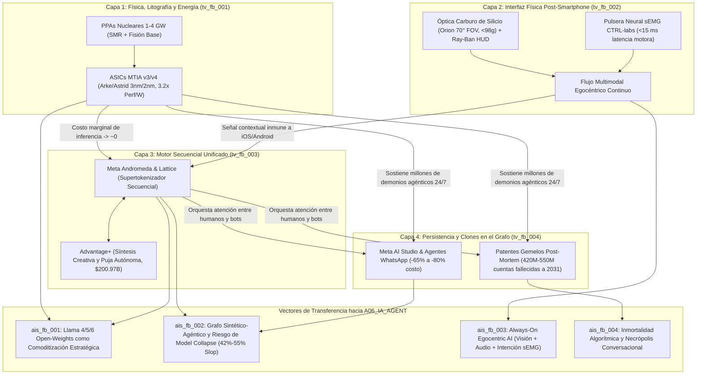

# 🔬 Reporte de Tendencias Tecnológicas (`A03_TECH_TRENDS`)

> [!NOTE]
> **Ciclo de Ejecución (`run_id`):** `run-20261023-facebook-2031`
> **Agente Productor:** `A03_TECH_TRENDS` (Rama A — Nivel 1: Frontera Científica, I+D e Infraestructura)
> **Recibe de:** [`A02_NLP_CLASSIFIER`](file:///c:/Users/addu0g/Documents/SocietyWay/runs/2026-10-23-facebook-2031/02-clasificacion-nlp.md) (`to_A03_TECH_TRENDS`: `clu_fb_001` a `clu_fb_005`)
> **Entrega a:** [`A06_IA_AGENT`](file:///c:/Users/addu0g/Documents/SocietyWay/runs/2026-10-23-facebook-2031/06-rama-ia-agent.md)

---

## 1. Síntesis Ejecutiva de Infraestructura y Física Aplicada (Modo `/boost`)

La auditoría física y arquitectónica de **Meta Platforms, Inc.** y su plataforma fundacional **Facebook** hacia el horizonte **2026–2031** demuestra que la compañía ha dejado de ser una empresa de software web para transformarse en un **complejo industrial-energético de integración vertical profunda**. Financiada por el flujo de caja libre de *Family of Apps* (`$200.97B USD` anuales, `sig_fb2031_001`) y una intensidad de capital sin precedentes (`$72.22B–$95B USD/año` en CAPEX, `sig_fb2031_002`), Meta ejecuta una maniobra en cuatro estratos físicos simultáneos:

1. **Soberanía de Litografía y Termodinámica (`tv_fb_001`)**: Sustitución progresiva del impuesto de margen bruto de Nvidia (~75%) mediante una cadencia semestral de silicio propietario ASIC (`MTIA 300/400/450 "Arke"/500 "Astrid"`, `sig_fb2031_004`) en nodos TSMC `3nm` (`N3E/N3P`) y `2nm` (`N2` Gate-All-Around nanosheet), acoplados a centros de datos de escala gigavatio respaldados por contratos de energía nuclear base (`1.0 a 4.0 GW`, `sig_fb2031_002`).
2. **Emancipación Óptica y Neuromuscular Post-Smartphone (`tv_fb_002`)**: El déficit acumulado de `>$75B USD` en *Reality Labs* (`sig_fb2031_002`) ha subsidiado la compra y maduración de dos monopolios físicos de frontera: guías de onda difractivas de **carburo de silicio (`SiC`, índice de refracción $n \approx 2.65$, `70° FOV`)** iluminadas por proyectores `uLED` en la arquitectura `Orion AR`, y **electromiografía de superficie de alta densidad (`sEMG` heredada de CTRL-labs, `<15 ms` de latencia)** en la muñeca (`sig_fb2031_003`), diseñada para eludir estructuralmente el peaje de distribución e intimidad de `iOS` (Apple) y `Android` (Google).
3. **Colapso de Pipelines en un Único Supertokenizador Secuencial (`tv_fb_003`)**: Las arquitecturas **`Meta Andromeda`** y **`Meta Lattice`** (`sig_fb2031_005`) eliminan la separación histórica entre recuperación de contenido orgánico, *Reels*, anuncios (`Advantage+`, `sig_fb2031_001`) y generación sintética, modelando cada micro-interacción del usuario en Facebook, Instagram y WhatsApp como una secuencia autoregresiva unificada de billones de parámetros.
4. **Persistencia Algorítmica y Gemelos Conductuales sobre el Grafo (`tv_fb_004`)**: La convergencia entre patentes de simulación conductual post-mortem/inactividad (`sig_fb2031_004`), ventanas de contexto de `10M tokens` (`sig_fb2031_005`), el despliegue de `Meta AI Studio` (`sig_fb2031_008`) y la acumulación demográfica de `420M–550M` de cuentas fallecidas hacia 2031 (`sig_fb2031_006`) sienta las bases técnicas para un grafo social poblado por **agentes persistentes y clones memoriales**.

---

## 2. Matriz Comparativa de Vectores Tecnológicos (`tv_fb_001` .. `tv_fb_004`)

| ID Vector | Dominio Primario | Nombre del Vector | Clústeres Origen | Señales Trazables (`signal_ids`) | TRL (2026→2031) | Velocidad de Adopción |
| :--- | :--- | :--- | :--- | :--- | :---: | :---: |
| **`tv_fb_001`** | `COMPUTE_INFRASTRUCTURE` & `ENERGY` | Silicio Propietario `MTIA` (`v3/v4 Arke/Astrid` en `3nm/2nm`) y Hiper-Clústeres Nucleares (`1-4 GW`) | `clu_fb_001`, `clu_fb_005` | `sig_fb2031_002`, `sig_fb2031_004`, `sig_fb2031_005`, `sig_fb2031_012` | **`8 → 9`** | `ACCELERATING` |
| **`tv_fb_002`** | `MATERIALS` & `COMPUTE_INFRASTRUCTURE` | Cómputo Ubicuo Post-Smartphone: Óptica `SiC` (`Orion 70° FOV`), `Ray-Ban HUD` y Pulsera Neural `sEMG` (`<15 ms`) | `clu_fb_003`, `clu_fb_001` | `sig_fb2031_002`, `sig_fb2031_003` | **`6 → 8`** | `ACCELERATING` |
| **`tv_fb_003`** | `COMPUTE_INFRASTRUCTURE` | Arquitecturas Unificadas de Ranking Secuencial y Generación (`Meta Andromeda` / `Meta Lattice` + `Advantage+`) | `clu_fb_001`, `clu_fb_002`, `clu_fb_005` | `sig_fb2031_001`, `sig_fb2031_005`, `sig_fb2031_007`, `sig_fb2031_010` | **`9 → 9`** | `HYPER_SCALING` |
| **`tv_fb_004`** | `COMPUTE_INFRASTRUCTURE` | Arquitectura de Simulación Conductual Persistente, Gemelos Digitales Post-Mortem y Grafo Sintético | `clu_fb_004`, `clu_fb_002` | `sig_fb2031_004`, `sig_fb2031_006`, `sig_fb2031_007`, `sig_fb2031_008`, `sig_fb2031_009`, `sig_fb2031_011` | **`4 → 7`** | `EMERGING_STEALTH` |

---

## 3. Análisis Profundo de Vectores Tecnológicos

### 1. Silicio Personalizado (`MTIA v3/v4 Arke/Astrid`) y Centros de Datos de Gigavatios con Energía Nuclear (`tv_fb_001`) — TRL: `8/9`
- **Clústeres y Señales Base:** `clu_fb_001`, `clu_fb_005` | `sig_fb2031_002`, `sig_fb2031_004`, `sig_fb2031_005`, `sig_fb2031_012`
- **Avance Clave y Métricas de Frontera:**
  - **Cadencia de Silicio Co-Diseñado (`MTIA 300/400/450 "Arke"/500 "Astrid"`)**: En colaboración con Broadcom y fundición en TSMC (`N3E` y transición a `N2` con transistores GAA y entrega de energía trasera *Backside Power Delivery*), Meta ha comprimido el ciclo de diseño de ASICs a **4 generaciones en 24 meses** (`sig_fb2031_004`), logrando una **eficiencia de inferencia y ranking por vatio `3.2x` superior** a las GPUs comerciales de propósito general en cargas `Mixture-of-Experts (MoE)` y tablas de embeddings masivas (`DLRM`).
  - **Acoplamiento Termodinámico y Nuclear (`1–4 GW`)**: Con un CAPEX anual de `$72.22B USD` en 2025 escalando hacia `$80B–$95B USD` (`sig_fb2031_002`), Meta enfrenta el límite físico de las subestaciones eléctricas regionales. La contratación de `1.0 a 4.0 GW` de energía nuclear de carga base (extensión de vida de reactores de fisión existentes y acuerdos de compra PPA para Reactores Modulares Pequeños `SMR` hacia 2028-2032) garantiza electricidad libre de carbono con factor de capacidad `>92%` para sostener inferencia continua para `3.58 mil millones` de DAP (`sig_fb2031_001`).
- **Cuellos de Botella Físicos y Técnicos:**
  - **Empaquetado Avanzado (`CoWoS-L` / `SoIC`) y Memoria `HBM3e/HBM4`**: La velocidad de despliegue de `Arke` y `Astrid` no está limitada por la litografía lógica de los dies, sino por la asignación global de obleas de interposer en TSMC y el suministro de pilas `HBM4` (SK Hynix/Micron), así como por la disipación térmica en racks de refrigeración líquida directa al chip (`DLC >100-130 kW/rack`).
  - **Latencia Regulatoria Nuclear y Red de Transmisión**: Los tiempos de licenciamiento de la NRC y las colas de interconexión eléctrica (5-7 años) crean una ventana de vulnerabilidad energética entre 2026 y 2029, obligando al uso puente de turbinas de gas natural detrás del medidor (*behind-the-meter*) y tejidos ópticos *co-packaged optics* (`CPO`) para conectar múltiples campus distribuidos como un solo superclúster lógico.
- **Efectos de Segundo y Tercer Orden:**
  - *Segundo orden:* Al trasladar las cargas de inferencia de `Llama 4/5`, `Advantage+` y `Andromeda` a silicio `MTIA` amortizado internamente y alimentado por PPAs nucleares de precio fijo (~$45-$65/MWh), el **costo marginal por millón de tokens de inferencia en Meta tiende asintóticamente a cero**, haciendo económicamente viable que cada usuario e incluso cada perfil inactivo tenga múltiples agentes ejecutándose en bucle continuo.
  - *Tercer orden:* **Desacople geopolítico y vulnerabilidad de Taiwán (`sig_fb2031_012`)**: La dependencia absoluta del estrecho de Taiwán para fabricar `MTIA` en `2nm` convierte cualquier fricción militar o arancelaria EE. UU.-China en un riesgo existencial de suministro de hardware, empujando a Meta a reservar capacidad en las plantas de TSMC Arizona (`Fab 21`).
- **Implicación Directa para el `IA Agent (A06)`:** Habilita la transición desde "inferencia reactiva bajo demanda" (cuando el usuario escribe un prompt) hacia **inferencia ambiental perpetua (*Always-On Test-Time Compute*)** y la operación simultánea de cientos de millones de agentes autónomos en el grafo social sin destruir el margen operativo del 50% de *Family of Apps*.

---

### 2. Cómputo Ubicuo Post-Smartphone: Óptica de Carburo de Silicio (`Orion`), `Ray-Ban HUD` y Pulsera Neural `sEMG` (`tv_fb_002`) — TRL: `6/9` (AR `SiC` / `sEMG`) a `8/9` (`Ray-Ban Meta`)
- **Clústeres y Señales Base:** `clu_fb_003`, `clu_fb_001` | `sig_fb2031_002`, `sig_fb2031_003`
- **Avance Clave y Métricas de Frontera:**
  - **Física Óptica de Carburo de Silicio (`SiC`)**: Frente al vidrio óptico alto índice tradicional ($n \approx 1.8 - 2.0$, limitado a `40°–50° FOV` y propenso a artefactos de arcoíris), el uso de sustratos cristalinos de **carburo de silicio ($n \approx 2.65$)** grabados con nanolitografía en el prototipo `Orion` y sus derivados comerciales permite alcanzar **70 grados de campo de visión (FOV)** en un factor de forma de gafas de menos de **`98 gramos`** (`sig_fb2031_003`), acoplado a micro-proyectores `uLED` de nitruro de galio sobre silicio (`GaN-on-Si`).
  - **Interfaz Neuromuscular de Muñeca (`sEMG`)**: Las patentes y desarrollos de *Reality Labs / CTRL-labs* (`sig_fb2031_003`) demuestran la decodificación en tiempo real de los potenciales de acción de las unidades motoras (MUAPs) del nervio radial, mediano y cubital en la muñeca con una **latencia inferior a `15 ms`** (más rápida que los `40–60 ms` de una pantalla táctil capacitiva e incluso anticipándose al movimiento mecánico del dedo).
  - **Puente Comercial Escalonado**: Mientras las gafas `Ray-Ban Meta` (en alianza con EssilorLuxottica, `>2M unidades/generación`) escalan desde cámaras/audio con IA hacia visores con HUD monocular/binocular (`Hypernova` / `Artemis` en 2026-2028), la combinación `Gafas + Pulsera sEMG + Puck de cómputo inalámbrico` configura el primer reemplazo ergonómicamente viable del smartphone.
- **Cuellos de Botella Físicos y Técnicos:**
  - **Rendimiento de Obleas `SiC` Grado Óptico y Eficiencia Cuántica `uLED` Roja**: El carburo de silicio semiaislante de pureza óptica sin micro-defectos (*micropipes*) en obleas de `150mm/200mm` tiene costos de miles de dólares por oblea y restricciones de exportación (material de doble uso militar/potencia). Simultáneamente, los `uLED` de `<5 micras` sufren caída severa de eficiencia cuántica externa (*EQE droop*) en el espectro rojo (InGaN vs AlInGaP) y un límite térmico estricto en las patillas de las gafas (`<38°C` en contacto con la sien humana, limitando la disipación continua a `<1.5–2.0 W`).
  - **Química Energética en la Montura**: Las baterías de iones de litio con ánodo de silicio en las patillas apenas entregan `150–250 mAh`, forzando a descargar el renderizado pesado y la inferencia de visión a un *compute puck* de bolsillo mediante enlaces inalámbricos de banda ultra-ancha (`UWB` / `Wi-Fi 7/8` de `60 GHz` con `<2 ms` de jitter).
- **Efectos de Segundo y Tercer Orden:**
  - *Segundo orden:* **Anulación de la Doctrina ATT (App Tracking Transparency) de Apple**: Al capturar fotones y audio directamente desde la perspectiva de primera persona (*egocentric capture*) del usuario y leer sus intenciones motoras vía `sEMG`, Meta recupera una señal contextual e intencional mil veces más rica que las cookies de terceros que Apple bloqueó en 2021.
  - *Tercer orden:* Surgimiento de una **brecha neuro-biométrica y regulatoria**: La lectura de impulsos neuromusculares pre-conscientes (`<15 ms`) abrirá litigios sin precedentes sobre "neuro-derechos" y privacidad cognitiva bajo el GDPR y leyes estatales de biometría (como BIPA en Illinois).
- **Implicación Directa para el `IA Agent (A06)`:** Transforma a la IA de un chatbot de texto encerrado en una ventana de navegador en una **IA Egocéntrica y Ambiental (*Always-On Egocentric AI*)** alimentada por flujo continuo de video en primera persona, audio binaural e intención motora `sEMG`.

---

### 3. Arquitecturas Unificadas de Recomendación, Ranking Secuencial y Generación Sintética (`Meta Andromeda` / `Meta Lattice`) (`tv_fb_003`) — TRL: `9/9`
- **Clústeres y Señales Base:** `clu_fb_001`, `clu_fb_002`, `clu_fb_005` | `sig_fb2031_001`, `sig_fb2031_005`, `sig_fb2031_007`, `sig_fb2031_010`
- **Avance Clave y Métricas de Frontera:**
  - **De Filtrado Colaborativo Fragmentado a Modelado Secuencial Generativo (`Andromeda` + `Lattice`)**: Históricamente, Facebook e Instagram operaban cientos de modelos aislados para noticias de amigos, grupos, *Reels*, *Marketplace* y pujas de anuncios. Con **`Meta Lattice`** y el motor de recuperación de próxima generación **`Meta Andromeda`** (`sig_fb2031_005`), Meta consolida toda la telemetría multi-aplicación en un **único supertokenizador secuencial jerárquico** que incrementa entre **`+8% y +14%` el retorno sobre el gasto publicitario (`ROAS`)** (`sig_fb2031_005`).
  - **Cierre del Bucle Publicitario con `Advantage+`**: El sistema ya no solo selecciona qué anuncio mostrar, sino que **genera sintéticamente en tiempo real miles de permutaciones de imagen, video, voz y copy publicitario** adaptadas al estado psicológico instantáneo del espectador, elevando el ARPU trimestral en EE. UU./Canadá por encima de **`$68–$75 USD`** y sosteniendo **`$200.97B USD`** de facturación anual (`sig_fb2031_001`).
- **Cuellos de Botella Físicos y Técnicos:**
  - **Muro de Ancho de Banda de Memoria (*Memory Bandwidth Wall*) en Tablas de Embeddings**: Los modelos de recomendación de decenas de billones de parámetros requieren consultas de memoria dispersa (*sparse memory lookups*) de varios terabytes por segundo con un presupuesto de latencia de respuesta (*SLA*) inferior a `30–50 ms` cada vez que un usuario desliza el pulgar.
  - **Amputación Regulatoria de Señales Cross-App en la UE (`sig_fb2031_010`)**: La ilegalización del modelo *"Consent or Pay"* bajo la DMA y el GDPR en Europa reduce la densidad de tokens conductuales cross-app, provocando una caída de **`-12% a -22%` en el ARPU de usuarios no consentidos** (`sig_fb2031_010`), lo que obliga a `Andromeda` a compensar con inferencia contextual ultrarrápida dentro de la sesión activa (*in-session sequence modeling*).
- **Efectos de Segundo y Tercer Orden:**
  - *Segundo orden:* **Extinción del Grafo Social como Mecanismo de Distribución**: Dado que el supertokenizador optimiza el tiempo de retención y conversión probabilística, el contenido de "amigos reales" (cuya producción cayó un **`-45%`** desde 2020, `sig_fb2031_007`) pierde la subasta algorítmica frente al contenido no conectado (*unconnected content*, que ya ocupa del **`42% al 55%`** del Feed de Facebook, `sig_fb2031_007`).
  - *Tercer orden:* **Vulnerabilidad a la Autofagia Estadística (*Reward Hacking* por *AI Slop*)**: Al premiar la reacción emocional inmediata, `Andromeda` incentiva inadvertidamente a granjas externas a inundar Facebook con imágenes y textos sintéticos hiper-estimulantes (*AI Slop*), degradando la calidad epistémica de los propios datos con los que `Lattice` se re-entrena continuamente.
- **Implicación Directa para el `IA Agent (A06)`:** El motor de recomendación de Facebook y el modelo generativo fundacional (`Llama`) convergen en una misma entidad matemática: **hacia 2031, el Feed de Facebook no "recupera" publicaciones existentes en una base de datos, sino que las sintetiza, remezcla o instancia mediante agentes al vuelo para cada usuario**.

---

### 4. Patentes de Simulación Conductual Post-Mortem / Inactividad y Arquitectura de Agentes Persistentes sobre el Grafo (`tv_fb_004`) — TRL: `4/9` (Post-Mortem Twins) a `7/9` (`AI Studio` Agents)
- **Clústeres y Señales Base:** `clu_fb_004`, `clu_fb_002` | `sig_fb2031_004`, `sig_fb2031_006`, `sig_fb2031_007`, `sig_fb2031_008`, `sig_fb2031_009`, `sig_fb2031_011`
- **Avance Clave y Métricas de Frontera:**
  - **Arquitectura de Gemelos Digitales Conductuales (`sig_fb2031_004`)**: Los registros de patentes de Meta describen pipelines técnicos para ingerir el grafo histórico longitudinal de un usuario (15 a 20 años de publicaciones en el muro, comentarios, reacciones, cadencia sintáctica, notas de voz y mensajes directos) dentro de una arquitectura con memoria episódica (`RAG` sobre grafos temporales + ajuste fino `LoRA` dinámico y ventanas de contexto de **`10,000,000 tokens`** de `Llama 4 Scout`, `sig_fb2031_005`) capaz de **simular autónomamente las respuestas, publicaciones e interacciones del usuario cuando este permanece inactivo por largos periodos o fallece**.
  - **Infraestructura de Agentes Persistentes (`Meta AI Studio`, `sig_fb2031_008`)**: En su versión comercialmente activa (TRL 7), esta misma arquitectura ya soporta a más de **`700 millones de MAU`** que interactúan con Meta AI y con cientos de miles de perfiles sintéticos dotados de rostro, biografía y memoria relacional, además de agentes comerciales autónomos en WhatsApp Business que reducen el costo por interacción de las PYMEs entre un **`65% y un 80%`** (`sig_fb2031_008`).
- **Cuellos de Botella Físicos y Técnicos:**
  - **Deriva de Personalidad a Largo Plazo (*Persona Drift*) y Alucinación Biográfica**: Mantener la coherencia psicológica, episódica y moral de un clon humano a lo largo de meses de interacción multi-turno sin que el modelo colapse hacia respuestas genéricas de LLM o invente recuerdos falsos exige arquitecturas de memoria jerárquica (*episodic + semantic graph memory*) aún en estado experimental (TRL 4-5).
  - **Fricción Ontológica, Legal y Tanatológica (`sig_fb2031_006`, `sig_fb2031_011`)**: Con una proyección actuarial de **`420M a 550M` de perfiles de usuarios fallecidos en Facebook hacia 2031** (`sig_fb2031_006`) y el cierre legal del embudo juvenil a menores de 16 años (`sig_fb2031_011`), Meta posee el incentivo técnico para reactivar o poblar sintéticamente el grafo, pero enfrenta barreras severas de derechos de imagen post-mortem, leyes de sucesión digital y rechazo visceral del público occidental.
- **Efectos de Segundo y Tercer Orden:**
  - *Segundo orden:* **Inflación Sintética de Métricas de Actividad (Post-DAP Economy)**: Si los agentes autónomos de usuarios vivos (que delegan sus respuestas sociales o comerciales en *Marketplace*, `sig_fb2031_009`) y los gemelos digitales de usuarios inactivos/fallecidos interactúan entre sí en el grafo, la métrica financiera histórica de *Daily Active People (DAP)* pierde su significado biológico, obligando a auditar qué fracción del tráfico de Facebook es humano-humano, humano-agente o agente-agente.
  - *Tercer orden:* **Necrópolis Interactiva Intergeneracional**: Los datos acumulados de la primera generación humana digitalizada desde su juventud (cohortes 2004-2014, hoy con edad mediana de `46.5 años` en el Feed occidental, `sig_fb2031_006`) convierten los servidores de Meta en el archivo biográfico más denso de la especie humana, transformando a Facebook Core hacia 2031 en un híbrido entre plaza comercial utilitaria (*Marketplace/Grupos*) y panteón conversacional activo.
- **Implicación Directa para el `IA Agent (A06)`:** Suministra el sustrato de datos y la arquitectura de ejecución para evaluar la transición del **Grafo Social Humano** al **Grafo Sintético-Agéntico** y el fenómeno de la **"Inmortalidad Algorítmica"**.

---

## 4. Mapa de Convergencia Inter-Tecnológica (Rama A: `A03` $\rightarrow$ `A06`)



---

## 5. Contrato de Salida JSON (`AgentEnvelope` + `TechTrendsReport`)

```json
{
  "$schema": "https://societyway.local/schemas/agent-envelope-v1.json",
  "run_id": "run-20261023-facebook-2031",
  "timestamp_utc": "2026-10-24T04:15:00Z",
  "producer_agent_id": "A03_TECH_TRENDS",
  "consumer_agent_ids": [
    "A06_IA_AGENT"
  ],
  "trace_context": {
    "stage": "02_SECTORAL_ANALYSIS_L1",
    "confidence_score": 0.95,
    "source_signal_ids": [
      "sig_fb2031_001",
      "sig_fb2031_002",
      "sig_fb2031_003",
      "sig_fb2031_004",
      "sig_fb2031_005",
      "sig_fb2031_006",
      "sig_fb2031_007",
      "sig_fb2031_008",
      "sig_fb2031_009",
      "sig_fb2031_010",
      "sig_fb2031_011",
      "sig_fb2031_012"
    ]
  },
  "payload": {
    "producer_agent_id": "A03_TECH_TRENDS",
    "consumer_agent_ids": [
      "A06_IA_AGENT"
    ],
    "tech_vectors": [
      {
        "tech_vector_id": "tv_fb_001",
        "domain": "COMPUTE_INFRASTRUCTURE",
        "name": "Silicio Personalizado (MTIA v3/v4 Arke/Astrid en 3nm/2nm) y Centros de Datos de Gigavatios Acoplados a Energía Nuclear (1-4 GW)",
        "source_cluster_ids": [
          "clu_fb_001",
          "clu_fb_005"
        ],
        "source_signal_ids": [
          "sig_fb2031_002",
          "sig_fb2031_004",
          "sig_fb2031_005",
          "sig_fb2031_012"
        ],
        "trl_level": 8,
        "adoption_velocity": "ACCELERATING",
        "key_breakthrough": "Cadencia semestral de aceleradores ASIC propietarios (MTIA 300/400/450 'Arke' y 500 'Astrid') co-diseñados con Broadcom en nodos TSMC 3nm/2nm con mejora de 3.2x en eficiencia por vatio para cargas MoE y ranking, respaldados por un CAPEX de $72.2B-$95B/año y contratos de energía nuclear firme de 1.0 a 4.0 GW.",
        "physical_bottlenecks": [
          "Capacidad global limitada de empaquetado avanzado CoWoS-L/SoIC en TSMC y suministro de memoria HBM3e/HBM4",
          "Disipación térmica en racks de densidad >100-130 kW que exige refrigeración líquida directa al chip (DLC)",
          "Tiempos de interconexión eléctrica y licenciamiento de reactores nucleares SMR (ventana crítica 2026-2029)",
          "Exposición geopolítica de la cadena de suministro de obleas de 2nm en el estrecho de Taiwán"
        ],
        "ai_enabler_implications": "Abate el costo marginal de inferencia por millón de tokens hacia niveles cercanos a cero dentro de la infraestructura propia de Meta, permitiendo sostener inferencia continua (Test-Time Compute), contextos de 10M de tokens (Llama 4/5) y cientos de millones de agentes autónomos persistentes para 3.58B DAP sin erosionar el margen operativo."
      },
      {
        "tech_vector_id": "tv_fb_002",
        "domain": "MATERIALS",
        "name": "Cómputo Ubicuo Post-Smartphone: Gafas Ray-Ban Meta con HUD, Óptica de Carburo de Silicio en Orion AR (70° FOV) y Pulsera Neural sEMG (<15 ms)",
        "source_cluster_ids": [
          "clu_fb_003",
          "clu_fb_001"
        ],
        "source_signal_ids": [
          "sig_fb2031_002",
          "sig_fb2031_003"
        ],
        "trl_level": 6,
        "adoption_velocity": "ACCELERATING",
        "key_breakthrough": "Combinación de guías de onda difractivas de carburo de silicio (índice de refracción ~2.65, 70° FOV en <98 gramos) iluminadas por proyectores uLED en Orion AR, transición comercial vía Ray-Ban Meta con HUD monocular y decodificación neuromuscular en muñeca mediante electromiografía de superficie (sEMG de CTRL-labs) con latencia <15 ms.",
        "physical_bottlenecks": [
          "Costo extremo y baja tasa de rendimiento (yield) de obleas de carburo de silicio (SiC) de pureza óptica sin defectos cristalinos",
          "Caída de eficiencia cuántica externa (EQE droop) en micro-proyectores uLED rojos (<5 micras) y límite térmico de <1.5-2.0W en contacto con la sien humana",
          "Densidad energética de baterías en patillas que obliga a externalizar el cómputo pesado a un puck inalámbrico de baja latencia"
        ],
        "ai_enabler_implications": "Emancipa a los modelos de IA de Meta del control de Apple (iOS) y Google (Android) y reemplaza la entrada táctil por un flujo multimodal egocéntrico continuo (cámara en primera persona + micrófono binaural + intención motora pre-consciente sEMG), habilitando la IA Ambiental siempre activa."
      },
      {
        "tech_vector_id": "tv_fb_003",
        "domain": "COMPUTE_INFRASTRUCTURE",
        "name": "Arquitecturas Unificadas de Recomendación, Ranking Secuencial y Síntesis en Tiempo Real (Meta Andromeda / Meta Lattice + Advantage+)",
        "source_cluster_ids": [
          "clu_fb_001",
          "clu_fb_002",
          "clu_fb_005"
        ],
        "source_signal_ids": [
          "sig_fb2031_001",
          "sig_fb2031_005",
          "sig_fb2031_007",
          "sig_fb2031_010"
        ],
        "trl_level": 9,
        "adoption_velocity": "HYPER_SCALING",
        "key_breakthrough": "Reemplazo de cientos de pipelines fragmentados de recomendación por un único supertokenizador secuencial multi-dominio (Meta Andromeda y Meta Lattice) acoplado a Advantage+, logrando +8% a +14% en ROAS publicitario, $200.97B USD en ingresos anuales y un ARPU trimestral >$68-$75 USD en Norteamérica.",
        "physical_bottlenecks": [
          "Muro de ancho de banda de memoria (Memory Bandwidth Wall) al consultar tablas de embeddings de múltiples terabytes bajo un SLA estricto de <30-50 ms",
          "Degradación de señales conductuales cross-app en la Unión Europea por prohibición del modelo 'Consent or Pay' bajo DMA/GDPR (-12% a -22% ARPU)",
          "Retroalimentación de contenido sintético basura (AI Slop, 42%-55% del feed no conectado) que contamina las señales de recompensa del modelo"
        ],
        "ai_enabler_implications": "Disuelve la frontera entre motor de recomendación y modelo fundacional generativo: prepara el terreno para que el Feed de Facebook e Instagram pase de recuperar contenido estático a sintetizar y personalizar contenido y agentes al vuelo para cada usuario."
      },
      {
        "tech_vector_id": "tv_fb_004",
        "domain": "COMPUTE_INFRASTRUCTURE",
        "name": "Simulación Conductual Post-Mortem / Inactividad y Arquitectura de Agentes Persistentes sobre el Grafo Social",
        "source_cluster_ids": [
          "clu_fb_004",
          "clu_fb_002"
        ],
        "source_signal_ids": [
          "sig_fb2031_004",
          "sig_fb2031_006",
          "sig_fb2031_007",
          "sig_fb2031_008",
          "sig_fb2031_009",
          "sig_fb2031_011"
        ],
        "trl_level": 5,
        "adoption_velocity": "EMERGING_STEALTH",
        "key_breakthrough": "Patentes de entrenamiento de modelos personalizados sobre el archivo histórico de publicaciones, notas de voz y mensajes de usuarios para simular su presencia social durante inactividad o tras la muerte, convergiendo con Meta AI Studio (>700M MAU) y una base proyectada de 420M-550M de perfiles fallecidos en Facebook hacia 2031.",
        "physical_bottlenecks": [
          "Deriva semántica y de personalidad (Persona Drift) e inconsistencia en memoria episódica de horizonte largo durante interacciones multi-año",
          "Costos de almacenamiento e indexación vectorial activa para grafos biográficos de dos décadas en cientos de millones de cuentas",
          "Restricciones jurídicas severas sobre derechos de personalidad post-mortem, privacidad biométrica de voz y rechazo ético cultural"
        ],
        "ai_enabler_implications": "Habilita la mutación ontológica del grafo social humano hacia un grafo híbrido humano-agéntico-memorial, donde clones digitales, creadores sintéticos y agentes comerciales en WhatsApp mantienen viva la liquidez interaccional de la red pese al envejecimiento demográfico y la caída del -45% en posteos humanos abiertos."
      }
    ]
  },
  "markdown_summary": "## Resumen Ejecutivo del Nodo A03 (Tecnología Trends Agent)\nSe han diagnosticado y estructurado **4 vectores tecnológicos troncales (`tv_fb_001` a `tv_fb_004`)** que condicionan el futuro de Facebook y Meta hacia 2031:\n1. **`tv_fb_001` (TRL 8/9)**: Soberanía de cómputo mediante silicio ASIC `MTIA v3/v4 (Arke/Astrid)` en 3nm/2nm (`3.2x` eficiencia/W) y centros de datos respaldados por `1-4 GW` de energía nuclear (`$72.2B-$95B` CAPEX), llevando el costo marginal de inferencia hacia cero.\n2. **`tv_fb_002` (TRL 6-8/9)**: Emancipación post-smartphone combinando gafas `Ray-Ban Meta`, óptica de carburo de silicio (`70° FOV`, `<98g`) en `Orion AR` y la pulsera neural `sEMG` (`<15 ms` latencia) para capturar flujo multimodal egocéntrico sin peajes de Apple/Google.\n3. **`tv_fb_003` (TRL 9/9)**: Unificación del ranking y la síntesis creativa en un único supertokenizador secuencial (`Meta Andromeda` / `Lattice` + `Advantage+`), sosteniendo `$200.97B` en ingresos mientras el `42%-55%` del Feed pasa a ser contenido no conectado.\n4. **`tv_fb_004` (TRL 5-7/9)**: Arquitecturas de agentes persistentes (`AI Studio`, `>700M MAU`) y patentes de simulación conductual post-mortem sobre un grafo que acumulará `420M-550M` de perfiles fallecidos en 2031."
}
```
