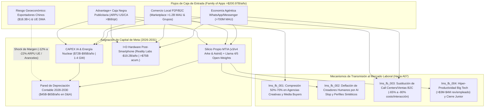

# 📈 Reporte Macroeconómico y de Estructura de Capital (`A04_ECON_MACRO`)

> [!NOTE]
> **Ciclo de Ejecución (`run_id`):** `run-20261023-facebook-2031`
> **Etapa:** `02_SECTORAL_ANALYSIS_L1` (Rama B — Nivel 1: Macroeconomía, Finanzas Corporativas y Asignación de Capital)
> **Recibe de:** [`A02_NLP_CLASSIFIER`](file:///c:/Users/addu0g/Documents/SocietyWay/runs/2026-10-23-facebook-2031/02-clasificacion-nlp.md) (`to_A04_ECON_MACRO`: `clu_fb_001` a `clu_fb_005`)
> **Entrega a:** [`A07_LABOR_MARKET`](file:///c:/Users/addu0g/Documents/SocietyWay/runs/2026-10-23-facebook-2031/07-rama-mercado-laboral.md)

---

## 1. Diagnóstico del Régimen Macro-Financiero de Facebook / Meta (Horizonte 2026–2031)

En el horizonte **2026–2031**, **Meta Platforms, Inc.** y su activo fundacional **Facebook Core** protagonizan una mutación estructural en su función de producción ($Y = A \cdot F(K, L)$): la compañía abandona el modelo de plataforma de software *asset-light* de la década de 2010 para convertirse en un **conglomerado industrial hiper-intensivo en capital físico ($K$)** (centros de datos de escala gigavatio, reactores nucleares SMR/PPAs de `1.0–4.0 GW`, silicio propietario `MTIA` en nodos 3nm/2nm y óptica de carburo de silicio), financiado íntegramente por el flujo de caja libre de una **vaca lechera publicitaria madura y demográficamente envejecida en Occidente (`>$200.97B USD` anuales)**.

### Parámetros del Régimen Macroeconómico Sectorial

| Dimensión Estructural | Estado Diagnóstico (`2026-2031`) | Dinámica Dominante |
| :--- | :--- | :--- |
| **Postura de Crecimiento Global** | `ASYMMETRIC_CORE_CASHCOW_FUNDING_INDUSTRIAL_AI` | Desacople entre el estancamiento demográfico del grafo social humano en la OCDE y la hiper-extracción algorítmica de ARPU (`>$68-$75/trimestre` en US/CA). |
| **Presión de Precios / Márgenes** | `AD_PRICING_POWER_VS_DEPRECIATION_SQUEEZE` | Deflación del costo marginal de creación publicitaria y atención al cliente para PyMEs vía IA, contrarrestada por una ola de depreciación contable (`D&A`) de `$45B–$65B/año` hacia 2028–2030. |
| **Asignación de Capital (CAPEX/OPEX)** | `MASSIVE_CAPEX_INTENSITY_38PCT_OF_REVENUE` | Sustitución radical de OPEX salarial humano (congelamiento de plantilla post-*Year of Efficiency*) por CAPEX de cómputo (`$72.22B–$95B/año`) y subsidio de hardware post-smartphone (`>$75B` hundidos en Reality Labs). |

---

## 2. Diagrama de Flujos de Capital y Transmisión Laboral (`A04` $\rightarrow$ `A07`)



---

## 3. Análisis Profundo de los 4 Vectores Macroeconómicos (`mv_fb_001` a `mv_fb_004`)

### 🔹 `mv_fb_001` — La "Vaca Lechera" de Facebook Core Financiando el Mayor Ciclo de CAPEX Industrial de la Historia Corporativa y el Reloj de la Depreciación en Wall Street
- **Clústeres y Señales de Origen:** `clu_fb_001`, `clu_fb_003`, `clu_fb_004` | [`sig_fb2031_001`](file:///c:/Users/addu0g/Documents/SocietyWay/runs/2026-10-23-facebook-2031/01-ingesta-recolector.md#L89-L105), [`sig_fb2031_002`](file:///c:/Users/addu0g/Documents/SocietyWay/runs/2026-10-23-facebook-2031/01-ingesta-recolector.md#L107-L123), [`sig_fb2031_003`](file:///c:/Users/addu0g/Documents/SocietyWay/runs/2026-10-23-facebook-2031/01-ingesta-recolector.md#L125-L141), [`sig_fb2031_004`](file:///c:/Users/addu0g/Documents/SocietyWay/runs/2026-10-23-facebook-2031/01-ingesta-recolector.md#L143-L158), [`sig_fb2031_006`](file:///c:/Users/addu0g/Documents/SocietyWay/runs/2026-10-23-facebook-2031/01-ingesta-recolector.md#L177-L192).
- **Tesis Macroeconómica y Financiera (1er, 2do y 3er Orden):**
  1. **Primer Orden (Extracción de Renta Monopólica del Grafo Heredado):** A pesar de que la edad mediana del usuario activo diario del Feed principal de Facebook en EE. UU. y la UE alcanza los `46.5 años` y la plataforma acumula rumbo a `420M–550M` de perfiles fallecidos hacia 2031 (`sig_fb2031_006`), el segmento *Family of Apps* (FoA) generó `$200.97B USD` en FY2025 (+22% YoY) sobre una base de `3.58 mil millones` de DAP y un margen operativo superior al `50%` (`sig_fb2031_001`). La cohorte demográfica de 40 a 70 años en Norteamérica posee el mayor poder adquisitivo disponible, sosteniendo un ARPU trimestral de `>$68–$75 USD` en EE. UU./Canadá (13 veces superior a los `<$5.50 USD` del Resto del Mundo).
  2. **Segundo Orden (La Pared de Depreciación Contable 2027–2029):** Ese flujo de caja se recicla en una intensidad de CAPEX sin precedentes que salta de `$39.23B` (2024) a `$72.22B` (2025) y `$80B–$95B/año` en 2026–2027 (`sig_fb2031_002`), sumado a más de `$75B` acumulados hundidos en *Reality Labs* (`-$19.19B/año` de pérdida operativa con apenas `$2.21B` de ingresos). En la contabilidad GAAP, el CAPEX no impacta el Estado de Resultados en el año en que se desembolsa en efectivo, sino a través de cargos de **Depreciación y Amortización (D&A)** durante la vida útil de los servidores (4 a 5.5 años). Entre **Q4 2027 y FY2029**, cuando se superpongan las cohortes de depreciación de los clústeres de GPUs/ASICs de 2025, 2026 y 2027, el gasto anual de D&A de Meta escalará hacia `$45B–$65B USD/año`, comprimiendo el margen operativo GAAP entre `600 y 950 puntos básicos` a menos que el ROIC incremental supere el `18%–22%`.
  3. **Tercer Orden (Estrategia de "Tierra Quemada" con `Llama` y Silicio `MTIA`):** ¿Por qué regala Meta los pesos de `Llama 4/5` (`sig_fb2031_005`) si invierte `$90B/año` en infraestructura? Porque a diferencia de AWS, Azure o Google Cloud, Meta no tiene un negocio de alquiler de nube pública. Al comoditizar el modelo fundacional, destruye el margen bruto de las APIs de OpenAI/Anthropic/Google, evita quedar cautivo de un proveedor de IA y traslada la captura de valor hacia su activo irreplicable: la distribución a `3.58B` de personas y el abatimiento de su costo de inferencia por vatio (`3.2x` vía chips propios `MTIA 300/400/450/500`, `sig_fb2031_004`) y energía nuclear base contratada (`1–4 GW`, `sig_fb2031_002`). Si hacia 2028 el crecimiento de ingresos cae por debajo del `12% YoY`, Wall Street forzará un **"Year of Efficiency 2.0"**: recorte del 40% en el presupuesto de VR metaverso de Reality Labs (preservando únicamente gafas `Ray-Ban Meta` / `Orion AR` y pulseras `sEMG`, `sig_fb2031_003`) y congelación absoluta de OPEX laboral.
- **Mecanismo de Transmisión al Mercado Laboral (`labor_transmission_mechanism`):** Para proteger el beneficio por acción (EPS) frente al muro de depreciación de `$45B–$65B/año` en CAPEX de IA, la dirección financiera de Meta y del sector Big Tech impone una **sustitución permanente de trabajo ($L$) por capital ($K$)**, elevando la métrica objetivo de ingresos por empleado por encima de `$3.0M–$4.0M USD` y bloqueando la apertura de plazas junior en ingeniería y operaciones (`lms_fb_004`).

---

### 🔹 `mv_fb_002` — Automatización Publicitaria Total (`Advantage+`): De Vender Espacios a Vender Conversiones Garantizadas por IA y Captura del Margen de Agencias
- **Clústeres y Señales de Origen:** `clu_fb_001`, `clu_fb_002` | [`sig_fb2031_001`](file:///c:/Users/addu0g/Documents/SocietyWay/runs/2026-10-23-facebook-2031/01-ingesta-recolector.md#L89-L105), [`sig_fb2031_005`](file:///c:/Users/addu0g/Documents/SocietyWay/runs/2026-10-23-facebook-2031/01-ingesta-recolector.md#L160-L175).
- **Tesis Macroeconómica y Financiera (1er, 2do y 3er Orden):**
  1. **Primer Orden (Unificación Algorítmica `Andromeda` + `Lattice`):** La integración de los motores predictivos secuenciales `Meta Andromeda` y `Meta Lattice` (`sig_fb2031_005`) con la suite generativa `Advantage+` (`sig_fb2031_001`) ha elevado la conversión publicitaria (ROAS) entre `+8% y +14%`. El anunciante ya no segmenta audiencias manualmente ni sube decenas de piezas gráficas; introduce únicamente una URL de producto, su margen objetivo y su tarjeta de crédito.
  2. **Segundo Orden (Absorción del "Agency Tax" del 15%–25%):** Históricamente, del presupuesto bruto de marketing de una PyME o marca DTC, entre un `15% y un 25%` se filtraba hacia agencias creativas, estudios de producción audiovisual, *copywriters* y *media buyers* humanos encargados de configurar campañas en Ads Manager. Al generar sintéticamente miles de variaciones de video, imagen y texto personalizadas en tiempo real para cada usuario individual, `Advantage+` reduce el costo de producción creativa a cero y **redirige ese 15%–25% de presupuesto directamente hacia la subasta de pujas de Meta**, explicando por qué el ARPU norteamericano supera los `$68–$75 USD/trimestre` (`sig_fb2031_001`) aun cuando el tiempo frente al Feed tradicional se estanca.
  3. **Tercer Orden (Opacidad de Precios y Subasta de "Caja Negra"):** Hacia 2031, Facebook e Instagram dejan de cotizar bajo métricas de medios tradicionales (CPM o CPC) para operar como un **impuesto privado sobre el comercio minorista (CPA / ROAS algorítmico)**. Al controlar simultáneamente la creación del anuncio, la atribución probabilística y el algoritmo de entrega, Meta extrae el excedente del productor de millones de comercios que carecen de canales alternativos de adquisición de clientes.
- **Mecanismo de Transmisión al Mercado Laboral (`labor_transmission_mechanism`):** Desintermediación estructural de la cadena de valor del marketing digital. El gasto empresarial que antes financiaba nóminas de agencias de publicidad, diseñadores gráficos comerciales y especialistas en pauta (*media buyers*) se convierte en renta de cómputo para Meta, comprimiendo entre un `50% y un 70%` la demanda de trabajo de entrada en servicios publicitarios (`lms_fb_001`).

---

### 🔹 `mv_fb_003` — Monetización de la Economía Agéntica en WhatsApp/Messenger y Resiliencia Utilitaria de `Facebook Marketplace` y `Grupos`
- **Clústeres y Señales de Origen:** `clu_fb_002`, `clu_fb_004`, `clu_fb_005` | [`sig_fb2031_007`](file:///c:/Users/addu0g/Documents/SocietyWay/runs/2026-10-23-facebook-2031/01-ingesta-recolector.md#L194-L209), [`sig_fb2031_008`](file:///c:/Users/addu0g/Documents/SocietyWay/runs/2026-10-23-facebook-2031/01-ingesta-recolector.md#L211-L226), [`sig_fb2031_009`](file:///c:/Users/addu0g/Documents/SocietyWay/runs/2026-10-23-facebook-2031/01-ingesta-recolector.md#L228-L243).
- **Tesis Macroeconómica y Financiera (1er, 2do y 3er Orden):**
  1. **Primer Orden (El Foso Utilitario de `Marketplace` y `Grupos` frente al Internet Muerto):** Aunque la publicación abierta entre amigos reales en el muro de Facebook ha caído un `-45%` desde 2020 y entre el `42% y el 55%` del Feed proviene de cuentas no conectadas saturadas de *AI Slop* (`sig_fb2031_007`), **Facebook Core no colapsa económicamente porque muta de red social a infraestructura de liquidez comunitaria**. *Facebook Marketplace* supera los `1.2 mil millones de MAU` (`sig_fb2031_009`), reteniendo a más del 50% de los usuarios jóvenes activos de la plataforma en EE. UU. y Europa que entran exclusivamente para compraventa local P2P (automóviles usados, alquileres, mobiliario) y coordinación en *Grupos* hiper-locales.
  2. **Segundo Orden (El Segundo Motor de Ingresos: SaaS Conversacional y Agentes en WhatsApp):** Mientras el ARPU del Resto del Mundo y APAC/LATAM en el Feed publicitario sigue siendo bajo (`<$5.50 USD/trimestre`, `sig_fb2031_001`), Meta desbloquea la monetización del Sur Global (India, Brasil, México, Indonesia, Filipinas, Nigeria) convirtiendo a **WhatsApp y Messenger en el sistema operativo transaccional de las PyMEs**. Con más de `700 millones de MAU` interactuando con *Meta AI* y agentes de *AI Studio* (`sig_fb2031_008`), los anuncios *Click-to-WhatsApp* y el cobro por conversaciones ejecutadas por agentes autónomos de ventas, catálogo y soporte generan un flujo de ingresos recurrentes que reduce el costo por interacción comercial entre un `65% y un 80%` respecto al trabajo humano.
  3. **Tercer Orden (Divergencia de Monetización Creador vs. Plataforma):** En el Feed abierto de Facebook, el programa de bonos de rendimiento (*Performance Bonus*) es capturado por granjas industriales de contenido sintético (*AI Slop*, `sig_fb2031_007`) que producen engagement barato para cohortes envejecidas, destruyendo el ingreso publicitario unitario del creador humano independiente pero manteniendo el inventario de impresiones de video (*Reels*/Feed) necesario para insertar anuncios de `Advantage+`.
- **Mecanismo de Transmisión al Mercado Laboral (`labor_transmission_mechanism`):** Doble choque laboral: (a) en el Sur Global y Occidente, los agentes autónomos en WhatsApp/Messenger sustituyen masivamente puestos de *call centers* (BPO N1/N2) y vendedores de mostrador digital (`lms_fb_003`), mientras (b) en la economía creativa, la inundación de *AI Slop* y perfiles sintéticos de `AI Studio` desmonetiza a la clase media de creadores humanos en el Feed abierto (`lms_fb_002`).

---

### 🔹 `mv_fb_004` — Vulnerabilidad Geoeconómica del Ingreso Publicitario: Exposición a Exportadores Chinos (`$18.3B+`), Fin de *De Minimis* y Cerco Regulatorio Europeo (`DMA` / Prohibición `<16`)
- **Clústeres y Señales de Origen:** `clu_fb_002`, `clu_fb_005` | [`sig_fb2031_010`](file:///c:/Users/addu0g/Documents/SocietyWay/runs/2026-10-23-facebook-2031/01-ingesta-recolector.md#L245-L260), [`sig_fb2031_011`](file:///c:/Users/addu0g/Documents/SocietyWay/runs/2026-10-23-facebook-2031/01-ingesta-recolector.md#L262-L277), [`sig_fb2031_012`](file:///c:/Users/addu0g/Documents/SocietyWay/runs/2026-10-23-facebook-2031/01-ingesta-recolector.md#L279-L294).
- **Tesis Macroeconómica y Financiera (1er, 2do y 3er Orden):**
  1. **Primer Orden (El Talón de Aquiles Chino de `$18.3B+ USD`):** Aunque Facebook, Instagram y WhatsApp están bloqueados en China continental, los anunciantes domiciliados en China (encabezados por *Temu/PDD Holdings*, *Shein*, vendedores cross-border y estudios de gaming móvil) escalaron hasta representar `$18.3B+ USD` anuales (`~9%–11%` de la facturación global de Meta, frente a `<$5B` en 2019, `sig_fb2031_012`). La revocación de la exención aduanera *de minimis* (paquetes `<$800 USD` en EE. UU. y `<€150` en la UE) y los nuevos aranceles bilaterales destruyen la ventaja de arbitraje logístico directo desde fábrica, provocando contracciones abruptas en las pujas publicitarias asiáticas dentro de las subastas de Meta en Norteamérica y Europa.
  2. **Segundo Orden (Impuesto Regulatorio Europeo y Erosión del ARPU bajo `DMA`/`GDPR`):** En la Unión Europea (~23% de los ingresos de Meta), la invalidación regulatoria del modelo binario *"Consent or Pay"* bajo la *Digital Markets Act (DMA)* y el GDPR (`sig_fb2031_010`) obliga a Meta a ofrecer feeds con anuncios contextuales menos personalizados. La pérdida de señales conductuales *cross-app* degrada el ARPU de los usuarios europeos no consentidos entre un `-12% y un -22%`, además de exponer a la empresa a multas de hasta el `10%–20%` de su facturación global (`$20B–$40B USD`) y a la interoperabilidad forzosa de WhatsApp con agentes de IA competidores.
  3. **Tercer Orden (Cierre Legal del Embudo Demográfico `<16 Años` y Descuento de Terminal Value):** La proliferación global de prohibiciones de acceso a redes sociales para menores de 16 años con verificación estatal/biométrica (iniciada en Australia y expandida a Reino Unido, UE y estados de EE. UU., `sig_fb2031_011`), sumada a los litigios de `>42` fiscales generales en EE. UU., amputa el costo de adquisición cero de las cohortes nacidas después de 2010. Financieramente, esto comprime el **Valor Terminal (Terminal Value)** en los modelos de flujo de caja descontado (DCF) de Facebook Core en Occidente, obligando a Meta a compensar el menor volumen de usuarios jóvenes con una mayor extracción de renta por transacción comercial B2C y una relocalización de anunciantes asiáticos hacia cadenas de *nearshoring* (México, Vietnam, Turquía).
- **Mecanismo de Transmisión al Mercado Laboral (`labor_transmission_mechanism`):** El encarecimiento arancelario (fin de *de minimis*) y la caída del ARPU conductual en Europa obligan a los comercios electrónicos y marcas transfronterizas a recortar drásticamente sus costos operativos de atención, logística y marketing humano, acelerando la adopción forzosa de agentes automatizados en WhatsApp (`lms_fb_003`) y la consolidación de operadores híbridos en *Facebook Marketplace* (`lms_fb_001`, `lms_fb_003`).

---

## 4. Síntesis Cuantitativa de Vectores Macro (`A04` $\rightarrow$ `A07`)

| Vector ID | Tema Estructural | Clústeres (`A02`) | Señales (`A01`) | Indicadores Críticos | Transmisión Directa a `A07` |
| :--- | :--- | :--- | :--- | :--- | :--- |
| **`mv_fb_001`** | **Vaca Lechera FoA (`>$200B`) vs. CAPEX Industrial de IA (`$72B-$95B/año`) y Muro de Depreciación** | `clu_fb_001`, `clu_fb_003`, `clu_fb_004` | `sig_fb2031_001`, `sig_fb2031_002`, `sig_fb2031_003`, `sig_fb2031_004`, `sig_fb2031_006` | FoA Rev `$200.97B`; CAPEX `$72.2B-$95B`; RL `-$75B` acum.; Nuclear `1-4 GW` | `lms_fb_004` (Eficiencia permanente, `>$3M-$4M` rev/empleado, cierre junior) |
| **`mv_fb_002`** | **Automatización Publicitaria Total (`Advantage+`) y Captura del Margen de Agencias** | `clu_fb_001`, `clu_fb_002` | `sig_fb2031_001`, `sig_fb2031_005` | ARPU US/CA `>$68-$75/qtr`; ROAS `+8% a +14%` vía Lattice/Andromeda | `lms_fb_001` (Compresión `50%-70%` en empleo de entrada en agencias/marketing) |
| **`mv_fb_003`** | **Economía Agéntica en WhatsApp/Messenger y Resiliencia Utilitaria de Marketplace/Grupos** | `clu_fb_002`, `clu_fb_004`, `clu_fb_005` | `sig_fb2031_007`, `sig_fb2031_008`, `sig_fb2031_009` | Marketplace `>1.2B MAU`; Meta AI `>700M MAU`; Costo B2C `-65% a -80%` | `lms_fb_002` (Crisis de creadores por *AI Slop*) y `lms_fb_003` (Sustitución de BPO/Call Centers) |
| **`mv_fb_004`** | **Vulnerabilidad Geoeconómica: Shock Chino (`$18.3B+`), Fin de *De Minimis* y Asedio UE (`DMA`/`<16`)** | `clu_fb_002`, `clu_fb_005` | `sig_fb2031_010`, `sig_fb2031_011`, `sig_fb2031_012` | Ad spend China `$18.3B+`; Impacto ARPU UE `-12% a -22%`; Ban `<16 años` | `lms_fb_001`, `lms_fb_003` (Automatización defensiva en e-commerce y reconfiguración B2C) |

---

## 5. Contrato de Salida JSON (`AgentEnvelope` + `MacroEconReport`)

```json
{
  "$schema": "https://societyway.local/schemas/agent-envelope-v1.json",
  "run_id": "run-20261023-facebook-2031",
  "timestamp_utc": "2026-10-23T22:25:00Z",
  "producer_agent_id": "A04_ECON_MACRO",
  "consumer_agent_ids": [
    "A07_LABOR_MARKET"
  ],
  "trace_context": {
    "stage": "02_SECTORAL_ANALYSIS_L1",
    "confidence_score": 0.95,
    "source_signal_ids": [
      "sig_fb2031_001",
      "sig_fb2031_002",
      "sig_fb2031_003",
      "sig_fb2031_004",
      "sig_fb2031_005",
      "sig_fb2031_006",
      "sig_fb2031_007",
      "sig_fb2031_008",
      "sig_fb2031_009",
      "sig_fb2031_010",
      "sig_fb2031_011",
      "sig_fb2031_012"
    ]
  },
  "payload": {
    "producer_agent_id": "A04_ECON_MACRO",
    "consumer_agent_ids": [
      "A07_LABOR_MARKET"
    ],
    "macro_regime_summary": {
      "global_growth_stance": "ASYMMETRIC_CORE_CASHCOW_FUNDING_INDUSTRIAL_AI",
      "inflation_pressure": "AD_PRICING_POWER_VS_DEPRECIATION_SQUEEZE_AND_B2C_DEFLATION",
      "capital_allocation_trend": "MASSIVE_SHIFT_TO_AI_SILICON_NUCLEAR_CAPEX_AND_PERMANENT_OPEX_DISCIPLINE"
    },
    "macro_vectors": [
      {
        "macro_vector_id": "mv_fb_001",
        "theme": "La 'Vaca Lechera' de Facebook Core (>$200B/año) Financiando el Mayor Ciclo de CAPEX Industrial ($72B-$95B/año en IA y >$75B en Reality Labs) y el Reloj de la Depreciación en Wall Street",
        "source_cluster_ids": [
          "clu_fb_001",
          "clu_fb_003",
          "clu_fb_004"
        ],
        "source_signal_ids": [
          "sig_fb2031_001",
          "sig_fb2031_002",
          "sig_fb2031_003",
          "sig_fb2031_004",
          "sig_fb2031_006"
        ],
        "affected_regions": [
          "US",
          "CA",
          "EU",
          "GLOBAL"
        ],
        "key_indicators": [
          {
            "indicator": "Ingresos Anuales Consolidados Family of Apps (FY2025)",
            "value": "$200.97B USD (+22% YoY, 3.58B DAP)"
          },
          {
            "indicator": "ARPU Trimestral Norteamérica (US/CA) vs. Resto del Mundo",
            "value": ">$68.00-$75.00 USD vs. <$5.50 USD (asimetría ~13x)"
          },
          {
            "indicator": "CAPEX Anual en Infraestructura de IA y Centros de Datos (2025-2027)",
            "value": "$72.22B a $95.00B USD/año (~36%-40% de los ingresos)"
          },
          {
            "indicator": "Pérdida Operativa Acumulada en Reality Labs y Demanda Nuclear Contratada",
            "value": ">$75.0B USD acumulados (-$19.19B/año) | 1.0 a 4.0 GW nucleares"
          },
          {
            "indicator": "Pared de Depreciación Contable (D&A) Proyectada 2028-2030",
            "value": "$45.0B a $65.0B USD/año sobre servidores de vida útil de 4-5.5 años"
          }
        ],
        "sectoral_winners": [
          "Fundiciones de Semiconductores y Co-diseño ASIC (TSMC, Broadcom / MTIA)",
          "Generación Eléctrica Nuclear Base y SMRs (Contratos PPA 1-4 GW)",
          "Cadena de Suministro Óptica AR (Carburo de Silicio, EssilorLuxottica)"
        ],
        "sectoral_losers": [
          "Proveedores de Modelos Fundacionales Cerrados por API (comoditizados por Llama 4/5)",
          "Divisiones de Software Metaverso VR Puro sin Tracción Comercial",
          "Plantillas Corporativas Administrativas e Ingeniería Junior en Big Tech"
        ],
        "labor_transmission_mechanism": "Para absorber un cargo anual de depreciación de $45B-$65B hacia 2028-2030 sin destruir el margen operativo GAAP, Meta institucionaliza un 'Year of Efficiency' permanente: sustituye OPEX salarial por CAPEX de cómputo (Llama-Code + MTIA), congela la contratación junior y exige una hiper-productividad superior a $3M-$4M de ingresos por empleado."
      },
      {
        "macro_vector_id": "mv_fb_002",
        "theme": "Automatización Publicitaria Total (Advantage+): De Vender Espacios Publicitarios a Vender Conversiones Garantizadas por IA, Capturando el Margen de Agencias y Medios",
        "source_cluster_ids": [
          "clu_fb_001",
          "clu_fb_002"
        ],
        "source_signal_ids": [
          "sig_fb2031_001",
          "sig_fb2031_005"
        ],
        "affected_regions": [
          "US",
          "EU",
          "APAC",
          "LATAM",
          "GLOBAL"
        ],
        "key_indicators": [
          {
            "indicator": "Incremento en Conversión Publicitaria (ROAS) por Arquitecturas Lattice y Andromeda",
            "value": "+8% a +14% sobre pipelines heredados"
          },
          {
            "indicator": "Captura del Margen de Intermediación de Agencias ('Agency Tax') por Advantage+",
            "value": "15% a 25% del presupuesto bruto de PyMEs redirigido a la subasta de Meta"
          },
          {
            "indicator": "Costo Marginal de Producción de Variantes Creativas Sintéticas en Tiempo Real",
            "value": "~$0.00 USD (generación multimodal automatizada por usuario)"
          }
        ],
        "sectoral_winners": [
          "Ecosistema Publicitario Automatizado de Meta (Advantage+)",
          "Comercios Direct-to-Consumer (DTC) y Micro-PyMEs sin Departamento de Marketing",
          "Infraestructura de Inferencia Secuencial (Andromeda / Lattice)"
        ],
        "sectoral_losers": [
          "Agencias de Publicidad Medianas y Pequeñas",
          "Consultoras de Compra de Medios (Media Buyers) y Tráfico Digital",
          "Estudios de Producción Fotográfica/Video Comercial de Catálogo y Medios Abiertos"
        ],
        "labor_transmission_mechanism": "Desintermediación directa del trabajo cognitivo-creativo en publicidad: dado que las PyMEs solo ingresan presupuesto y objetivo comercial mientras Advantage+ genera los anuncios y optimiza la puja, se destruye entre el 50% y el 70% de los puestos de entrada para media buyers, copywriters publicitarios, traffickers y diseñadores de performance."
      },
      {
        "macro_vector_id": "mv_fb_003",
        "theme": "Monetización de la Economía Agéntica en WhatsApp/Messenger y Resiliencia Utilitaria de Facebook Marketplace (>1.2B MAU) y Grupos como Riel Comercial P2P y B2C",
        "source_cluster_ids": [
          "clu_fb_002",
          "clu_fb_004",
          "clu_fb_005"
        ],
        "source_signal_ids": [
          "sig_fb2031_007",
          "sig_fb2031_008",
          "sig_fb2031_009"
        ],
        "affected_regions": [
          "US",
          "EU",
          "IN",
          "BR",
          "MX",
          "PH",
          "NG",
          "GLOBAL"
        ],
        "key_indicators": [
          {
            "indicator": "Usuarios Activos Mensuales de Facebook Marketplace",
            "value": ">1.2 mil millones MAU (principal ancla de retención <30 años en Occidente)"
          },
          {
            "indicator": "Interacción Mensual con Meta AI y Agentes de AI Studio",
            "value": ">700 millones MAU"
          },
          {
            "indicator": "Reducción del Costo por Interacción Comercial en PyMEs vía Agentes en WhatsApp",
            "value": "-65% a -80% frente a soporte telefónico o chat humano"
          },
          {
            "indicator": "Proporción del Feed de Facebook Proveniente de Cuentas No Conectadas / IA y Caída de Posteos de Amigos",
            "value": "42%-55% contenido no conectado | -45% caída en publicaciones de amigos reales"
          }
        ],
        "sectoral_winners": [
          "Comercio Conversacional B2C en WhatsApp Business y Messenger",
          "Comercio Secundario Local y Economía Circular en Facebook Marketplace",
          "Granjas Automatizadas de Contenido Sintético e Integradores de Agentes PyME"
        ],
        "sectoral_losers": [
          "Contact Centers y BPO Tradicional en el Sur Global (Filipinas, India, LATAM)",
          "Portales de Clasificados Tradicionales (Craigslist, eBay local)",
          "Creadores de Contenido Humanos de Nivel Medio Desplazados por AI Slop"
        ],
        "labor_transmission_mechanism": "Provoca una bifurcación severa: por un lado, los agentes autónomos de negocio en WhatsApp desplazan masivamente a operadores humanos de call centers y ventas B2C (-65% a -80% en costo unitario); por otro, el desvío de los bonos de plataforma hacia granjas de AI Slop y perfiles de AI Studio desmonetiza a los creadores humanos medios, mientras surgen oficios híbridos como 'Entrenadores de Personalidad Agéntica' y 'Comerciantes Híbridos de Marketplace'."
      },
      {
        "macro_vector_id": "mv_fb_004",
        "theme": "Vulnerabilidad Geoeconómica del Ingreso Publicitario: Exposición de $18.3B+ al E-Commerce Chino (Temu/Shein), Fin de De Minimis y Cerco Regulatorio en la UE (DMA) y OCDE (<16 Años)",
        "source_cluster_ids": [
          "clu_fb_002",
          "clu_fb_005"
        ],
        "source_signal_ids": [
          "sig_fb2031_010",
          "sig_fb2031_011",
          "sig_fb2031_012"
        ],
        "affected_regions": [
          "US",
          "CN",
          "EU",
          "AU",
          "UK"
        ],
        "key_indicators": [
          {
            "indicator": "Ingresos Publicitarios Anuales de Meta Provenientes de Anunciantes en China",
            "value": "$18.3B+ USD (~9%-11% de los ingresos totales de Meta)"
          },
          {
            "indicator": "Erosión Estimada del ARPU Europeo por Prohibición de 'Consent or Pay' (DMA/GDPR)",
            "value": "-12% a -22% en el segmento de usuarios no consentidos"
          },
          {
            "indicator": "Exposición Sancionatoria Máxima bajo DMA y Barrera Demográfica Legal",
            "value": "Multas de hasta 10%-20% global ($20B-$40B) | Prohibición legal <16 años"
          }
        ],
        "sectoral_winners": [
          "Plataformas Logísticas de Nearshoring y Almacenes Locales (México, Sudeste Asiático, Europa del Este)",
          "Proveedores de Verificación Biométrica/Estatal de Edad y RegTech de Cumplimiento",
          "Modelos de Publicidad Contextual e Inferencia Privada On-Device"
        ],
        "sectoral_losers": [
          "Arbitraje de E-Commerce Ultra-Rápido Directo de Fábrica (Temu, Shein, dropshippers)",
          "Brokers de Datos de Terceros y AdTech Dependiente de Tracking Cross-App en la UE",
          "Ecosistemas de Marketing Juvenil e Influencers Adolescentes (<16 años)"
        ],
        "labor_transmission_mechanism": "La compresión de márgenes comerciales por el fin de la exención arancelaria de minimis y la pérdida de eficacia de segmentación en la UE fuerzan a los exportadores y comercios minoristas a compensar el mayor costo de adquisición de clientes (CAC) eliminando plantillas humanas de atención y marketing, acelerando la subcontratación algorítmica en Advantage+ y WhatsApp."
      }
    ]
  },
  "markdown_summary": "## Resumen Ejecutivo del Nodo A04 (Economía Macro Agent)\nEl análisis macro-financiero hacia 2031 demuestra que Meta opera bajo una tensión de asignación de capital histórica: utiliza el flujo de caja hiper-rentable de **Facebook Core y Family of Apps (`$200.97B USD/año`, `3.58B` DAP, ARPU US/CA `>$68-$75/trimestre`)** para financiar **`$72B-$95B/año` en CAPEX de IA/energía nuclear (`1-4 GW`)** y absorber **`>$75B` de pérdidas acumuladas en Reality Labs** (`mv_fb_001`). Hacia 2028-2030, la entrada en vigor de una pared de depreciación contable de `$45B-$65B/año` obligará a sostener márgenes mediante tres motores: (1) la captura del `15%-25%` del presupuesto de agencias vía automatización total en **`Advantage+`** (`mv_fb_002`), (2) la monetización de **`>700M MAU` en agentes de WhatsApp/Messenger** combinada con el foso utilitario de **`Facebook Marketplace` (`>1.2B MAU`)** (`mv_fb_003`), y (3) la mitigación del shock geoeconómico sobre **`$18.3B+` de gasto publicitario chino (`Temu`/`Shein`)** y la erosión de `-12% a -22%` en el ARPU europeo no consentido bajo la `DMA` (`mv_fb_004`)."
}
```
