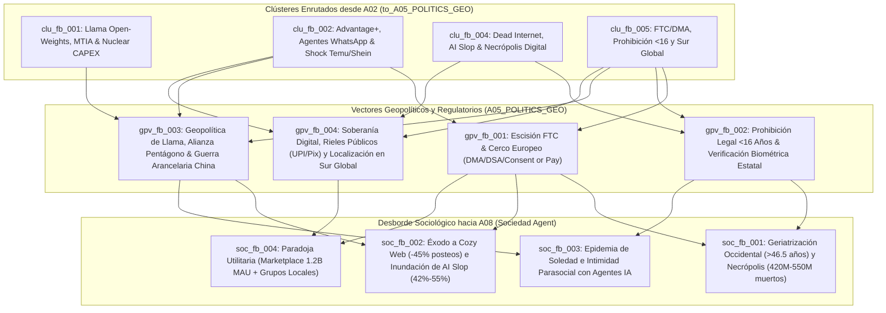

# 🌐 Reporte de Geopolítica, Gobernanza y Regulación (`A05_POLITICS_GEO`)

> [!NOTE]
> **Ciclo de Ejecución (`run_id`):** `run-20261023-facebook-2031`
> **Agente Productor:** `A05_POLITICS_GEO` (Rama C — Nivel 1: Geopolítica, Antimonopolio y Soberanía Digital)
> **Recibe de:** [`A02_NLP_CLASSIFIER`](file:///c:/Users/addu0g/Documents/SocietyWay/runs/2026-10-23-facebook-2031/02-clasificacion-nlp.md) (`to_A05_POLITICS_GEO`: clústeres `clu_fb_001`, `clu_fb_002`, `clu_fb_004`, `clu_fb_005`)
> **Entrega a:** [`A08_SOCIETY_AGENT`](file:///c:/Users/addu0g/Documents/SocietyWay/runs/2026-10-23-facebook-2031/08-rama-sociedad-agent.md) (Rama C — Nivel 2: Dinámicas Demográficas y Sociológicas)
> **Estado del Orden Geopolítico (2026–2031):** `MULTIPOLAR_TECHNO_NATIONALISM_AND_SPLINTERNET`

---

## 1. Resumen Ejecutivo Geopolítico (Modo `/boost`)

Entre **2026 y 2031**, **Meta Platforms, Inc.** y su plataforma fundacional **Facebook (`Blue App`)** dejan de ser tratadas por los Estados-nación como "empresas de medios digitales" para ser intervenidas como **infraestructura cuasi-estatal de soberanía cognitiva, comercial y de seguridad nacional**. El análisis de los cuatro clústeres enrutados a `A05` (`clu_fb_001`, `clu_fb_002`, `clu_fb_004`, `clu_fb_005`) demuestra que el futuro de Facebook hacia 2031 está determinado por una pinza geopolítica y regulatoria de cuatro vectores (`gpv_fb_001` a `gpv_fb_004`):

1. **Asedio Antimonopolio y Desacoplamiento Regulatorio Transatlántico (`gpv_fb_001`):** Mientras en EE. UU. la **FTC** empuja remedios estructurales o conductuales que amenazan el subsidio cruzado de atención y datos entre **Instagram/WhatsApp** y **Facebook Core** (`sig_fb2031_010`), en la **Unión Europea** la aplicación simultánea de la **DMA, DSA, GDPR y AI Act** destruye el modelo binario *"Consent or Pay"*, imponiendo una compresión estructural del **ARPU europeo de `-12% a -22%`** en usuarios no consentidos y forzando la interoperabilidad de WhatsApp con agentes de IA rivales (`sig_fb2031_001`, `sig_fb2031_010`).
2. **Clausura Legal del Embudo Demográfico Adolescente (`gpv_fb_002`):** El precedente legislativo de **Australia (prohibición estricta a menores de 16 años)** se expande entre 2026 y 2030 hacia la UE, Reino Unido y más de 42 estados de EE. UU. bajo presión de litigios de salud pública comparables al acuerdo maestro del tabaco (`sig_fb2031_011`). Al exigir verificación de edad biométrica o vía billetera de identidad estatal (*eID*) a nivel de sistema operativo, los Estados amputan legalmente el canal de adquisición generacional temprana (`13–16 años`), sellando el envejecimiento irreversible de Facebook Core en Occidente (`sig_fb2031_006`, `sig_fb2031_009`).
3. **Realpolitik de Pesos Abiertos (`Llama`), Complejo Militar-Industrial y Guerra Comercial (`gpv_fb_003`):** Para blindarse frente al riesgo de desmembramiento por la FTC, Meta ejecuta un giro de *realpolitik* en Washington: posiciona a **`Llama 4/5`** (`sig_fb2031_005`), sus hiper-clústeres de **1–4 GW de energía nuclear** (`sig_fb2031_002`) y su silicio **`MTIA`** (`sig_fb2031_004`) como el estándar soberano de IA de EE. UU. y la OTAN frente a arquitecturas chinas (DeepSeek/Qwen). En contrapartida, sufre el daño colateral de la guerra arancelaria EE. UU.–China y el fin de la exención aduanera *de minimis* (`<$800 USD`), que pone en riesgo **`$15B–$20B USD` anuales** (`~9%–11%` de su facturación global) provenientes de exportadores asiáticos como Temu y Shein (`sig_fb2031_012`).
4. **Hegemonía Neocolonial vs. Soberanía Digital en el Sur Global (`gpv_fb_004`):** En India, Brasil, Sudeste Asiático y África, la combinación **Facebook Core + WhatsApp Business Agents** (`sig_fb2031_008`, `sig_fb2031_009`) opera como el sistema nervioso de comercio PYME, identidad y política electoral. Sin embargo, hacia 2031 estos Estados imponen leyes severas de localización de cómputo, impuestos a servicios digitales (DST), peajes de red y rieles públicos soberanos (como **UPI/ONDC en India** y **Pix en Brasil**) que capturan la capa de pagos e impiden que Meta eleve su ARPU del Resto del Mundo (`<$5.50 USD` vs. `>$68 USD` en EE. UU., `sig_fb2031_001`).

---

## 2. Mapa Topológico de Presión Geopolítica y Regulatoria (2026–2031)



---

## 3. Análisis Profundo de Vectores Geopolíticos y Regulatorios (`gpv_fb_001` a `gpv_fb_004`)

### 🏛️ 1. Riesgo de Escisión Estructural Antimonopolio (`FTC`) y Asfixia de Interoperabilidad en la UE (`DMA` / `DSA` / `AI Act`) (`gpv_fb_001`)
- **Eje Estratégico:** `REGULACION` | **Riesgo de Escalada:** `0.86`
- **Trazabilidad:** Clústeres `clu_fb_002`, `clu_fb_005` | Señales `sig_fb2031_001`, `sig_fb2031_005`, `sig_fb2031_010`
- **Actores e Instrumentos:** Comisión Federal de Comercio de EE. UU. (`FTC`), Corte Federal del Distrito de Columbia, Comisión Europea (`DG COMP` / `DG CNECT`), Comité Europeo de Protección de Datos (`EDPB`); instrumentos: litigio antimonopolio Sección 2 de la Sherman Act, *Digital Markets Act* (`DMA`, multas de hasta el `10%–20%` del ingreso global, equivalentes a `$20B–$40B USD`), *Digital Services Act* (`DSA`), *GDPR* y *EU AI Act*.
- **Análisis de Primer, Segundo y Tercer Orden (`/boost`):**
  1. **Primer Orden (Choque contra el Modelo de Negocio):** En la Unión Europea, la prohibición definitiva del esquema binario *"Consent or Pay"* obliga a Meta a ofrecer una versión gratuita de Facebook e Instagram basada exclusivamente en anuncios contextuales sin rastreo conductual cruzado (`sig_fb2031_010`). Esto reduce el **ARPU europeo entre un `-12% y -22%`** en el segmento de usuarios que rechazan el seguimiento, ensanchando la brecha con Norteamérica (`>$68–$75 USD/trimestre`, `sig_fb2031_001`). Simultáneamente, la DMA obliga a WhatsApp y Messenger a abrir sus APIs de mensajería y a permitir que chatbots de IA de terceros operen en igualdad de condiciones con Meta AI (`sig_fb2031_010`).
  2. **Segundo Orden (¿Qué pasa con la "App Azul" de Facebook si pierde el subsidio cruzado de Instagram/WhatsApp?):** El juicio federal de la FTC busca demostrar que Meta mantuvo ilegalmente su monopolio de redes sociales personales mediante la compra defensiva de Instagram (2012) y WhatsApp (2014). Incluso si hacia 2028–2030 el resultado judicial no es una venta forzosa al 100%, sino una **separación funcional de datos y prohibición de subsidio cruzado de atención** (un *firewall* regulatorio entre los grafos de Instagram, WhatsApp y Facebook Core), el impacto sobre la app azul de Facebook es sísmico. Hoy, la arquitectura unificada de recomendación **`Meta Lattice` y `Andromeda`** (`sig_fb2031_005`) entrena un único supertokenizador secuencial con las señales de intención de compra de Instagram y la frecuencia de uso de WhatsApp para inyectar liquidez publicitaria (`Advantage+`, `sig_fb2031_001`) en el inventario más barato y abundante del Feed de Facebook. Si Facebook Core es aislada de los datos frescos de cohortes jóvenes de Instagram y de la conversión transaccional de WhatsApp (*Click-to-WhatsApp Ads*), **pierde entre el `18% y el 25%` de su ROAS publicitario** (`sig_fb2031_005`) y queda expuesta desnuda como una plataforma demográficamente envejecida.
  3. **Tercer Orden (Degradación Algorítmica y "Balkanización" del Producto):** Para compensar la caída de atribución por restricciones de privacidad en la UE (`DMA`/`GDPR`) y posibles cortafuegos de la FTC en EE. UU., Facebook Core se ve forzada a maximizar el tiempo en pantalla dentro de su propio contenedor cerrado mediante estímulos de hiper-retención de bajo costo: inundación de video sintético, páginas automatizadas y monetización agresiva de *AI Slop* (`sig_fb2031_007`), mientras retrasa o bloquea el lanzamiento en Europa de sus modelos multimodales más avanzados y de funciones de gemelos digitales (`sig_fb2031_004`) por temor a sanciones del *EU AI Act*.
- **Efecto de Desborde hacia `A08 (Sociedad Agent)` (`societal_spillover`):** La divergencia regulatoria crea una **ciudadanía digital de dos velocidades**: usuarios europeos con feeds menos adictivos pero tecnológicamente capados, frente a usuarios estadounidenses y del Sur Global sometidos a una extracción algorítmica intensificada y a la degradación del muro público en un casino de contenido sintético (`soc_fb_001`, `soc_fb_002`).

---

### 🔞 2. Prohibición Legal de Redes Sociales a Menores de 16 Años y Verificación Biométrica/Estatal Obligatoria (`gpv_fb_002`)
- **Eje Estratégico:** `REGULACION` | **Riesgo de Escalada:** `0.91`
- **Trazabilidad:** Clústeres `clu_fb_004`, `clu_fb_005` | Señales `sig_fb2031_006`, `sig_fb2031_009`, `sig_fb2031_011`
- **Actores e Instrumentos:** Gobierno de Australia (*Online Safety Amendment - Social Media Minimum Age Act*), más de 42 Fiscales Generales Estatales y `>1,000` distritos escolares en EE. UU., Reino Unido (*Ofcom / Online Safety Act*), Unión Europea (Francia, España, países nórdicos impulsando mayoría de edad digital a los 15–16 años); instrumentos: prohibición estatutaria de cuentas para `<16 años`, verificación obligatoria de edad vía biometría facial o billeteras de identidad estatal (*eID* / Apple & Google OS-level age tokens) y litigios de responsabilidad civil por diseño algorítmico adictivo (`sig_fb2031_011`).
- **Análisis de Primer, Segundo y Tercer Orden (`/boost`):**
  1. **Primer Orden (El Fin del Estándar COPPA de 1998):** Durante casi tres décadas, la arquitectura de crecimiento de internet se basó en el umbral de **13 años** de la ley COPPA estadounidense, con validación por simple autodeclaración de fecha de nacimiento. Entre 2025 y 2028, el "Efecto Bruselas" es reemplazado por el **"Efecto Canberra"**: la ley australiana que prohíbe el acceso a menores de 16 años (sin exención parental y con multas multimillonarias a las plataformas) se convierte en el estándar bipartidista en las democracias de la OCDE (`sig_fb2031_011`).
  2. **Segundo Orden (Amputación Estructural del Embudo de Adquisición Generacional):** Históricamente, el efecto de red de Meta dependía de capturar al usuario entre los 12 y 15 años, cuando se forma por primera vez su grafo social de pares fuera del núcleo familiar. Con la adopción de Facebook ya deprimida al **`32%` entre adolescentes de 13–17 años en EE. UU. (y `<12%` de uso diario del feed)** (`sig_fb2031_009`), la prohibición legal a `<16 años` corta de raíz el conducto de entrada tanto en Facebook como en Instagram. Cuando un joven cumple 16 o 18 años en 2029–2031, su coordinación social ya vive en plataformas de videojuegos, mensajería efímera o agentes locales de IA; **no existe un "regreso orgánico" al News Feed de Facebook**.
  3. **Tercer Orden (Fin del Anonimato Civil y Aceleración de la Necrópolis Digital):** Para cumplir con la ley y evitar indemnizaciones masivas en los litigios de más de 42 estados de EE. UU. (`sig_fb2031_011`), todos los usuarios —incluidos los adultos— se ven obligados a pasar por controles de estimación de edad biométrica o vinculación con documentos estatales de identidad. Esto normaliza la vigilancia de identidad civil en Occidente, mientras que demográficamente congela la base de usuarios de Facebook Core desde abajo: al no entrar cohortes jóvenes (`<16–24 años`) y envejecer las cohortes históricas (`2004–2014`), la **edad mediana del usuario activo diario del Feed de Facebook en EE. UU./UE supera los `46.5 años`** y las muertes anuales de usuarios superan las nuevas altas juveniles, acelerando la formación de un cementerio de **`420M a 550M` de perfiles fallecidos hacia 2031** (`sig_fb2031_006`).
- **Efecto de Desborde hacia `A08 (Sociedad Agent)` (`societal_spillover`):** Institucionalización legal de la **"geriatrización" de Facebook Core** (`soc_fb_001`) y creación de una generación adolescente que socializa en canales subterráneos no regulados o con compañeros sintéticos de IA locales (`soc_fb_003`).

---

### 🦅 3. Geopolítica de los Pesos Abiertos (`Llama`), Alianza de Seguridad Nacional en EE. UU. y Shock Comercial Asiático (`gpv_fb_003`)
- **Eje Estratégico:** `TECNO_SOBERANIA` | **Riesgo de Escalada:** `0.81`
- **Trazabilidad:** Clústeres `clu_fb_001`, `clu_fb_002`, `clu_fb_005` | Señales `sig_fb2031_002`, `sig_fb2031_004`, `sig_fb2031_005`, `sig_fb2031_012`
- **Actores e Instrumentos:** Departamento de Defensa de EE. UU. (`Pentágono`), agencias de inteligencia (`IC`), Departamento de Comercio (`BIS`), contratistas de defensa (Palantir, Anduril, Lockheed Martin, Booz Allen), República Popular China, exportadores transfronterizos (`Temu / PDD Holdings`, `Shein`); instrumentos: controles de exportación de pesos de modelos fundacionales y chips (`AI Diffusion Rules`), contratos de energía nuclear (`1–4 GW PPAs`), abolición de la exención arancelaria *de minimis* (`$800 USD` en EE. UU. / `€150` en UE) y aranceles punitivos (`sig_fb2031_002`, `sig_fb2031_012`).
- **Análisis de Primer, Segundo y Tercer Orden (`/boost`):**
  1. **Primer Orden (El Escudo Geopolítico de `Llama`):** Meta invierte entre **`$72.2B y $95B USD` anuales en CAPEX**, contrata de **1 a 4 GW de capacidad nuclear** (`sig_fb2031_002`) y despliega cuatro generaciones de silicio propio **`MTIA 300/400/450/500`** (`sig_fb2031_004`) para entrenar la serie **`Llama 4 / Llama 5` MoE** (`sig_fb2031_005`) y regalar sus pesos abiertos al mundo. Geopolíticamente, Meta autoriza explícitamente al Pentágono, agencias de inteligencia de EE. UU. y contratistas militares (Anduril, Palantir) a ajustar (*fine-tune*) `Llama` para logística militar, ciberdefensa y mando y control. El cálculo político de Mark Zuckerberg es claro: **convertir a Meta en un activo indispensable para la hegemonía tecnológica estadounidense frente a los modelos open-weights chinos**, haciendo que un desmembramiento agresivo por parte de la FTC sea visto por el Consejo de Seguridad Nacional como un acto de sabotaje propio.
  2. **Segundo Orden (El Dilema de Proliferación y Controles de Exportación del BIS):** La paradoja de los pesos abiertos (`open-weights`) es que una vez publicados en internet, no respetan fronteras. Investigadores vinculados al EPL chino y actores estatales adversarios destilan y adaptan variantes de `Llama` (`sig_fb2031_012`). Hacia 2027–2030, los halcones de seguridad nacional en Washington presionan al *Bureau of Industry and Security* (`BIS`) para imponer umbrales de cómputo (`>10^26` o `>10^27 FLOPs`) que prohíban la liberación irrestricta de pesos de frontera. Esto obliga a Meta a transitar hacia un modelo de **"Pesos Abiertos Bifurcados" (Tiered Sovereign Open-Weights)**: versiones destiladas abiertas globalmente y pesos completos de frontera restringidos a entidades verificadas dentro de la alianza *Five Eyes* / OTAN.
  3. **Tercer Orden (El Shock Fiscal de los `$18.3B+ USD` de Publicidad China en Facebook):** Mientras Meta se alinea con Washington en IA y defensa, sufre una herida económica directa en el frente comercial. Aunque Facebook está bloqueado en China desde 2009, los exportadores chinos (`Temu`, `Shein`, electrónica y gaming) inyectaron **`$18.3B+ USD` anuales (`~9%–11%` de los ingresos globales de Meta)** comprando anuncios en Facebook e Instagram para vender directamente a consumidores occidentales (`sig_fb2031_012`). La revocación de la exención aduanera *de minimis* (`<$800 USD` en EE. UU. y `<€150` en la UE) y los nuevos aranceles destruyen el arbitraje logístico de Temu y Shein, provocando una contracción de **`$6B a $10B USD` en demanda de subastas publicitarias occidentales**. Para tapar ese agujero de ingresos en el Feed de Facebook, Meta relaja aún más los filtros sobre anunciantes de arbitraje algorítmico y granjas de contenido sintético (*AI Slop*), acelerando la contaminación del grafo (`sig_fb2031_007`).
- **Efecto de Desborde hacia `A08 (Sociedad Agent)` (`societal_spillover`):** El encarecimiento de bienes de consumo importados para las clases medias/bajas occidentales que compraban vía anuncios de Facebook coincide con la saturación del Feed por anuncios generativos de baja calidad y estafas automatizadas (`soc_fb_002`).

---

### 🌍 4. Soberanía Digital en el Sur Global: Infraestructura Cívica vs. Nacionalismo de Datos y Rieles Públicos (`gpv_fb_004`)
- **Eje Estratégico:** `BLOQUES_COMERCIALES` / `TECNO_SOBERANIA` | **Riesgo de Escalada:** `0.77`
- **Trazabilidad:** Clústeres `clu_fb_002`, `clu_fb_004`, `clu_fb_005` | Señales `sig_fb2031_001`, `sig_fb2031_008`, `sig_fb2031_009`
- **Actores e Instrumentos:** Gobiernos y bancos centrales de **India** (`MeitY`, `RBI`, protocolo `UPI` y red de comercio abierto `ONDC`), **Brasil** (`Banco Central do Brasil - Pix`, `STF`, `LGPD`), **Indonesia**, **Nigeria**, **Filipinas** y **México**; instrumentos: leyes de localización forzosa de datos, impuestos digitales nacionales (`DST`), mandatos de interoperabilidad sobre sistemas de pagos y comercio conversacional, y órdenes judiciales de bloqueo por moderación electoral.
- **Análisis de Primer, Segundo y Tercer Orden (`/boost`):**
  1. **Primer Orden (Facebook y WhatsApp como el Estado de Facto en el Sur Global):** De los **`3.58 mil millones` de DAP** de Meta (`sig_fb2031_001`), más del 70% reside en Asia-Pacífico, Latinoamérica, África y Medio Oriente. En países como Filipinas, Indonesia, Nigeria, India, Brasil y México, **Facebook Core + WhatsApp** no son percibidos como "redes sociales de ocio", sino como el sistema operativo de la economía informal, el registro de identidad comercial de las PYMEs y el canal primario de campañas políticas y remesas (`sig_fb2031_009`). Con el despliegue de **`Meta AI Studio` y agentes autónomos en WhatsApp Business** (`>700M MAU`, `sig_fb2031_008`), las microempresas reducen entre un **`65% y un 80%`** su costo por interacción comercial, consolidando un monopolio operativo sobre el comercio conversacional.
  2. **Segundo Orden (La Respuesta Soberana: Infraestructura Pública Digital - DPI):** A diferencia de la UE (que regula mediante multas burocráticas), potencias emergentes como **India y Brasil responden construyendo rieles públicos soberanos (`UPI`, `ONDC`, `Pix`)** que obligan a Meta a operar como un mero *front-end* de mensajería sin permitirle capturar la comisión financiera (*take-rate*) de la transacción. Esto explica y perpetúa hacia 2031 la brutal **asimetría de monetización de `~13x`**: un ARPU trimestral de **`<$5.50 USD` en el Resto del Mundo frente a `>$68–$75 USD` en EE. UU./Canadá** (`sig_fb2031_001`).
  3. **Tercer Orden (Choque Electoral, Agentes Sintéticos y Localización de Cómputo):** En los ciclos electorales de 2026–2031 en el Sur Global, la capacidad de desplegar miles de agentes conversacionales persuasivos en dialectos locales vía WhatsApp y Grupos de Facebook (`sig_fb2031_008`) desata crisis de soberanía política. Cortes supremas (siguiendo el modelo del `STF` brasileño) e instituciones electorales imponen a Meta la obligación de alojar servidores de inferencia dentro del territorio nacional, entregar trazabilidad criptográfica y asumir responsabilidad penal local bajo amenaza de apagones temporales de servicio.
- **Efecto de Desborde hacia `A08 (Sociedad Agent)` (`societal_spillover`):** Bifurcación sociológica planetaria: mientras en Occidente Facebook es un archivo geriátrico y un tablón de clasificados (`Marketplace`), en el Sur Global es una megápolis hiperactiva donde humanos, comercios informales y millones de agentes sintéticos de IA coexisten sin separación entre esfera pública, mercado laboral y vida privada (`soc_fb_003`, `soc_fb_004`).

---

## 4. Matriz Sintética de Impacto Geopolítico sobre Facebook Core y Meta (Horizonte 2031)

| Vector ID | Eje Principal | Jurisdicciones Clave | Señales (`source_signal_ids`) | Impacto Cuantitativo Directo (2026–2031) | Efecto Estructural sobre Facebook Core ("Blue App") |
| :--- | :--- | :--- | :--- | :--- | :--- |
| **`gpv_fb_001`** | `REGULACION` (Antimonopolio & Privacidad) | EE. UU. (`FTC`), Unión Europea (`DMA`/`DSA`/`AI Act`) | `sig_fb2031_001`, `sig_fb2031_005`, `sig_fb2031_010` | Multas potenciales `10%-20%` ingresos (`$20B-$40B`); caída de **`-12% a -22%` en ARPU UE** no consentido; riesgo de pérdida de `-18% a -25%` ROAS si se aísla de IG/WA. | Pérdida de subsidio cruzado de datos jóvenes de Instagram; degradación del feed hacia hiper-monetización sintética para sostener márgenes. |
| **`gpv_fb_002`** | `REGULACION` (Biopolítica & Menores) | Australia, EE. UU. (`>42 AGs`), Reino Unido, UE | `sig_fb2031_006`, `sig_fb2031_009`, `sig_fb2031_011` | Edad mínima legal sube de **13 a 16 años**; adopción teen cae bajo `<32%` (`<12%` uso diario); edad mediana sube a **`>46.5 años`**. | **Cierre definitivo del relevo generacional**; consolidación de Facebook Occidental como plataforma de Gen X/Boomers y necrópolis digital (`420M-550M` fallecidos). |
| **`gpv_fb_003`** | `TECNO_SOBERANIA` (IA, Defensa & Comercio) | EE. UU. (`DoD`/`BIS`) vs. China (`Temu`/`Shein`) | `sig_fb2031_002`, `sig_fb2031_004`, `sig_fb2031_005`, `sig_fb2031_012` | CAPEX `$72.2B-$95B/año` y `1-4 GW` nucleares; **`$18.3B+ USD` (~10% ingresos)** de anunciantes chinos en riesgo por fin de *de minimis*. | `Llama` protege a Meta en Washington, pero el desplome de anuncios de exportadores chinos fuerza a llenar el inventario de Facebook con arbitraje de *AI Slop*. |
| **`gpv_fb_004`** | `BLOQUES_COMERCIALES` (Sur Global & DPI) | India, Brasil, LATAM, SEA, África | `sig_fb2031_001`, `sig_fb2031_008`, `sig_fb2031_009` | Brecha ARPU **`>$68 USD` (US) vs. `<$5.50 USD` (RoW)**; `>700M MAU` en agentes IA; ahorro PYME del `65%-80%` en WhatsApp. | Facebook Core + WhatsApp se mantienen como infraestructura vital del Sur Global, pero los rieles públicos (`UPI`/`Pix`) limitan la captura de rentas financieras. |

---

## 5. Contrato de Salida JSON (`AgentEnvelope` + `GeoPoliticsReport`)

```json
{
  "$schema": "https://societyway.local/schemas/agent-envelope-v1.json",
  "run_id": "run-20261023-facebook-2031",
  "timestamp_utc": "2026-10-23T22:18:00Z",
  "producer_agent_id": "A05_POLITICS_GEO",
  "consumer_agent_ids": [
    "A08_SOCIETY_AGENT"
  ],
  "trace_context": {
    "stage": "02_SECTORAL_ANALYSIS_L1",
    "confidence_score": 0.93,
    "source_signal_ids": [
      "sig_fb2031_001",
      "sig_fb2031_002",
      "sig_fb2031_004",
      "sig_fb2031_005",
      "sig_fb2031_006",
      "sig_fb2031_007",
      "sig_fb2031_008",
      "sig_fb2031_009",
      "sig_fb2031_010",
      "sig_fb2031_011",
      "sig_fb2031_012"
    ]
  },
  "payload": {
    "producer_agent_id": "A05_POLITICS_GEO",
    "consumer_agent_ids": [
      "A08_SOCIETY_AGENT"
    ],
    "geopolitical_order_state": "MULTIPOLAR_TECHNO_NATIONALISM_AND_SPLINTERNET",
    "geopolitical_vectors": [
      {
        "geopol_vector_id": "gpv_fb_001",
        "axis": "REGULACION",
        "title": "Riesgo de Escisión Estructural Antimonopolio (FTC) y Cerco Europeo de Interoperabilidad y 'Consent or Pay' (DMA/DSA/AI Act)",
        "source_cluster_ids": [
          "clu_fb_002",
          "clu_fb_005"
        ],
        "source_signal_ids": [
          "sig_fb2031_001",
          "sig_fb2031_005",
          "sig_fb2031_010"
        ],
        "actors_involved": [
          "EE. UU. (FTC / DOJ / Corte Federal D.C.)",
          "Unión Europea (Comisión Europea / EDPB)",
          "Meta Platforms, Inc.",
          "Competidores de IA y Mensajería"
        ],
        "policy_instruments": [
          "Litigio federal antimonopolio buscando desinversión o murallas chinas de datos entre Instagram, WhatsApp y Facebook Core",
          "Digital Markets Act (DMA) con prohibición de 'Consent or Pay' y multas potenciales del 10%-20% de facturación global ($20B-$40B USD)",
          "Mandatos de interoperabilidad en WhatsApp para chatbots de IA de terceros y auditorías algorítmicas bajo DSA y EU AI Act"
        ],
        "escalation_risk": 0.86,
        "societal_spillover": "Si la app azul de Facebook pierde el subsidio cruzado de datos conductuales de Instagram y WhatsApp o se ve forzada a operar con feeds no personalizados en Europa (reduciendo el ARPU europeo entre -12% y -22%), Meta compensa la compresión de márgenes intensificando la extracción de atención mediante contenido sintético barato (AI Slop) en mercados menos protegidos, consolidando una ciudadanía digital fragmentada entre un espacio europeo hiper-regulado y un ecosistema global saturado de automatización publicitaria."
      },
      {
        "geopol_vector_id": "gpv_fb_002",
        "axis": "REGULACION",
        "title": "Prohibición Legal de Redes Sociales a Menores de 16 Años y Verificación Biométrica/Estatal de Edad Obligatoria",
        "source_cluster_ids": [
          "clu_fb_004",
          "clu_fb_005"
        ],
        "source_signal_ids": [
          "sig_fb2031_006",
          "sig_fb2031_009",
          "sig_fb2031_011"
        ],
        "actors_involved": [
          "Australia (eSafety Commissioner)",
          "Fiscales Generales de >42 Estados y >1,000 Distritos Escolares en EE. UU.",
          "Reino Unido (Ofcom) y Estados Miembros de la UE",
          "Proveedores de Sistemas Operativos (Apple / Google) y Billeteras de Identidad Estatal (eID)"
        ],
        "policy_instruments": [
          "Elevación estatutaria de la edad mínima de acceso a redes sociales de 13 (estándar COPPA) a 16 años cumplidos",
          "Verificación obligatoria de edad mediante biometría facial o tokens criptográficos de identidad estatal a nivel de sistema operativo",
          "Litigios masivos de responsabilidad civil por diseño algorítmico adictivo y daño a la salud mental adolescente"
        ],
        "escalation_risk": 0.91,
        "societal_spillover": "La amputación legal del embudo demográfico de 13 a 16 años corta de raíz la renovación generacional de Facebook Core en Occidente, empujando la edad mediana del Feed por encima de los 46.5 años, acelerando la acumulación de 420M-550M de perfiles fallecidos hacia 2031 y normalizando el fin del anonimato en internet mediante controles biométricos universales."
      },
      {
        "geopol_vector_id": "gpv_fb_003",
        "axis": "TECNO_SOBERANIA",
        "title": "Geopolítica de los Pesos Abiertos (Llama), Alianza con el Complejo de Seguridad Nacional de EE. UU. y Shock Arancelario sobre el Publicitario Chino",
        "source_cluster_ids": [
          "clu_fb_001",
          "clu_fb_002",
          "clu_fb_005"
        ],
        "source_signal_ids": [
          "sig_fb2031_002",
          "sig_fb2031_004",
          "sig_fb2031_005",
          "sig_fb2031_012"
        ],
        "actors_involved": [
          "Departamento de Defensa de EE. UU. (Pentágono) y Comunidad de Inteligencia",
          "Contratistas de Defensa (Anduril, Palantir, Lockheed Martin)",
          "Departamento de Comercio de EE. UU. (BIS)",
          "República Popular China y Exportadores Transfronterizos (Temu/PDD Holdings, Shein)"
        ],
        "policy_instruments": [
          "Adopción de modelos open-weights Llama 4/5 en sistemas de defensa de EE. UU. y aliados OTAN como escudo político frente al escrutinio antimonopolio doméstico",
          "Posibles controles de exportación del BIS sobre pesos abiertos de modelos de frontera (>10^26 FLOPs) ante su uso por adversarios geopolíticos",
          "Abolición de exenciones aduaneras 'de minimis' (<$800 USD en EE. UU. / <€150 en UE) y aranceles comerciales que golpean $18.3B+ USD anuales en gasto publicitario chino dentro de Meta",
          "Contratos de energía nuclear base (1-4 GW) y silicio propietario MTIA (300-500) como infraestructura crítica nacional"
        ],
        "escalation_risk": 0.81,
        "societal_spillover": "El alineamiento de Meta con el complejo militar-industrial estadounidense blinda su infraestructura de IA ($72.2B-$95B de CAPEX), pero la guerra comercial con China destruye miles de millones en publicidad de comercio electrónico barato (Temu/Shein), encareciendo el consumo popular en Occidente e incentivando a Meta a rellenar su inventario publicitario en Facebook con granjas de arbitraje algorítmico y contenido sintético."
      },
      {
        "geopol_vector_id": "gpv_fb_004",
        "axis": "BLOQUES_COMERCIALES",
        "title": "Soberanía Digital en el Sur Global: Facebook y WhatsApp como Infraestructura Cívica frente a Rieles Públicos (UPI/Pix) y Localización de Datos",
        "source_cluster_ids": [
          "clu_fb_002",
          "clu_fb_004",
          "clu_fb_005"
        ],
        "source_signal_ids": [
          "sig_fb2031_001",
          "sig_fb2031_008",
          "sig_fb2031_009"
        ],
        "actors_involved": [
          "India (MeitY, RBI, NPCI - UPI / ONDC)",
          "Brasil (Banco Central - Pix, Supremo Tribunal Federal)",
          "Estados del Sudeste Asiático (Indonesia, Filipinas), África (Nigeria) y Latinoamérica (México)",
          "Millones de PYMEs y Comerciantes Informales en Economías Emergentes"
        ],
        "policy_instruments": [
          "Infraestructura Pública Digital (DPI) estatal de pagos y comercio abierto (UPI/ONDC en India, Pix en Brasil) que impide el monopolio transaccional de Meta",
          "Leyes de residencia y localización obligatoria de datos e inferencia de IA dentro de fronteras nacionales",
          "Impuestos a Servicios Digitales (DST), órdenes judiciales de bloqueo por desinformación electoral y regulación de agentes autónomos de WhatsApp Business"
        ],
        "escalation_risk": 0.77,
        "societal_spillover": "Se profundiza la fractura Norte-Sur: mientras en el Norte Global Facebook se encoge hacia un archivo geriátrico y de compra-venta de segunda mano, en el Sur Global Facebook Core y los agentes de IA de WhatsApp funcionan como el internet mismo y el mercado laboral diario de miles de millones de personas, aunque con una monetización por usuario ~13 veces menor (<$5.50 USD vs >$68 USD) que somete a estas poblaciones a una automatización comercial sin supervisión humana."
      }
    ]
  },
  "markdown_summary": "## Resumen Ejecutivo del Nodo A05 (Política Geo Agent)\nEl análisis geopolítico y regulatorio hacia 2031 (`gpv_fb_001` a `gpv_fb_004`) demuestra que el destino de Facebook Core y Meta está regido por cuatro fuerzas estatales convergentes:\n1. **Asedio Antimonopolio y Regulatorio (`gpv_fb_001`):** El litigio de la FTC en EE. UU. amenaza el subsidio cruzado de datos entre Instagram/WhatsApp y la app azul de Facebook, mientras la DMA/DSA en la UE destruye el modelo *'Consent or Pay'*, comprimiendo el ARPU europeo entre `-12% y -22%`.\n2. **Clausura Demográfica Legal (`gpv_fb_002`):** La prohibición de acceso a menores de 16 años (modelo Australia expandido a EE. UU., UK y UE) con verificación biométrica/estatal amputa de raíz el embudo de adquisición adolescente, institucionalizando el envejecimiento de Facebook (`>46.5 años` de edad mediana).\n3. **Realpolitik de `Llama` y Guerra Comercial (`gpv_fb_003`):** Meta se blinda en Washington integrando `Llama 4/5`, su silicio `MTIA` y sus `1-4 GW` nucleares en el complejo de defensa de EE. UU., pero sufre el impacto de la guerra arancelaria contra China (abolición de *de minimis*), que amenaza `$18.3B+ USD` anuales de gasto publicitario de exportadores asiáticos (Temu/Shein).\n4. **Soberanía en el Sur Global (`gpv_fb_004`):** En India, LATAM, SEA y África, Facebook y los agentes de WhatsApp operan como infraestructura cívica y comercial indispensable, pero chocan con rieles públicos soberanos (`UPI`, `Pix`) y leyes de localización de datos que perpetúan una asimetría de ARPU de `~13x` (`<$5.50 USD` vs `>$68 USD`)."
}
```
