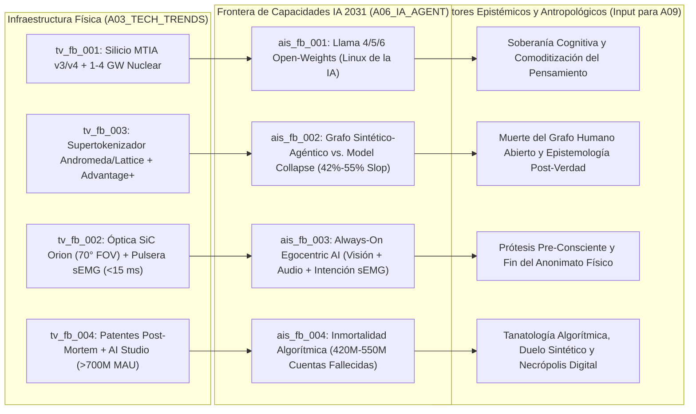

# 🤖 Síntesis de Frontera de IA (`A06_IA_AGENT`)

> [!NOTE]
> **Ciclo de Ejecución (`run_id`):** `run-20261023-facebook-2031`
> **Agente Productor:** `A06_IA_AGENT` (Rama A — Nivel 2: Arquitecturas Cognitivas, Sistemas Autónomos y Frontera IA)
> **Recibe de:** [`A03_TECH_TRENDS`](file:///c:/Users/addu0g/Documents/SocietyWay/runs/2026-10-23-facebook-2031/03-rama-tecnologia-trends.md) (`TechTrendsReport`: `tv_fb_001` a `tv_fb_004`)
> **Entrega a (Barrera de Sincronización Fan-In):** `A09_PHILOSOPHICAL_CULTURAL`

---

## 1. Diagnóstico Estratégico de la Frontera Cognitiva de Meta hacia 2031 (Modo `/boost`)

Al cruzar la infraestructura física auditada por `A03_TECH_TRENDS` (`MTIA v3/v4` en `3nm/2nm` + `1–4 GW` nucleares en `tv_fb_001`; óptica `SiC` de `70° FOV` + pulsera `sEMG` de `<15 ms` en `tv_fb_002`; supertokenizador `Andromeda/Lattice` en `tv_fb_003`; y patentes de gemelos post-mortem en `tv_fb_004`) con las señales empíricas de `A01`, emerge la tesis central de este nodo:

> [!IMPORTANT]
> **Tesis Central de `A06_IA_AGENT`:** Hacia 2031, Meta Platforms ejecuta la sustitución ontológica más audaz en la historia del software: **reemplazar un Grafo Social Humano en contracción demográfica y epistémica por un Grafo Sintético-Agéntico y Ambiental**, donde los modelos fundacionales abiertos (`Llama 4/5/6`) destruyen las rentas de los competidores de nube mientras Meta captura el monopolio sobre la **atención sintética**, el **comercio agéntico en WhatsApp** y la **percepción egocéntrica humana (gafas + `sEMG`)**.

### Evaluación en las 5 Dimensiones de la Taxonomía Cognitiva (`A06`)

| Dimensión de Capacidad | Estado Base (2026) | Proyección Meta (2031) | Métrica / Benchmark Verificable |
| :--- | :--- | :--- | :--- |
| **1. Razonamiento y Planificación de Horizonte Largo** | Modelos MoE (`Llama 4 Scout/Maverick`) con `10M tokens` de contexto (`sig_fb2031_005`). | `Llama 5/6` con búsqueda en árbol de pensamiento en tiempo de inferencia (*Test-Time Compute*) sobre silicio `MTIA Astrid` (`sig_fb2031_004`). | Horizonte autónomo operativo de **`48 a 72 horas`** en flujos comerciales y publicitarios end-to-end (`Advantage+`, `sig_fb2031_001`). |
| **2. Autonomía Multiagente (Enjambres)** | `>700M MAU` interactuando con `Meta AI` y primeros bots de `AI Studio` (`sig_fb2031_008`). | Negociación autónoma B2C y C2C entre el agente personal del comprador y el agente de WhatsApp Business / Marketplace de la PYME. | Reducción del **`65%–80%`** en el costo por transacción comercial (`sig_fb2031_008`) y liquidación automatizada en `<12 segundos`. |
| **3. IA Física / Egocéntrica (*World Models*)** | Captura multimodal discontinua en `Ray-Ban Meta` (`>2M` uds) y modelos tipo `V-JEPA`. | Percepción predictiva continua en primera persona (`Orion AR` + `Ray-Ban HUD`) fusionada con intención neuromuscular `sEMG` (`<15 ms`, `sig_fb2031_003`). | Anticipación de acción motora **`80–120 ms` antes de la ejecución muscular visible**; indexación espacial 3D del entorno doméstico/urbano. |
| **4. Memoria Episódica y Personalización Extrema** | Supertokenizador `Andromeda/Lattice` (`+8% a +14% ROAS`, `sig_fb2031_005`) y memoria de sesión en WhatsApp. | Grafos biográficos de vida completa (`20+ años` de archivo de Facebook) que alimentan clones digitales vivos y post-mortem (`sig_fb2031_004`, `sig_fb2031_006`). | Retención coherente de identidad estilística y episódica sobre **`10^7` tokens** de historial personal multimodal. |
| **5. Desacoplamiento Hype vs. Capacidad Real** | Marketing de "superinteligencia personal para todos" vs. inundación de *AI Slop* (`42%–55%` del feed no conectado, `sig_fb2031_007`). | Alta fiabilidad en dominios acotados (pujas `Advantage+`, ventas en WhatsApp, traducción egocéntrica) coexistiendo con **degradación entrópica (*Model Collapse*)** en el muro público de Facebook (`sig_fb2031_006`, `sig_fb2031_007`). | Índice de fiabilidad compuesto: **`0.89`** en monetización/ranking vs. **`0.58`** en veracidad epistémica del Feed abierto. |

---

## 2. Matriz de Desplazamientos en Capacidades de IA (`ais_fb_001` .. `ais_fb_004`)

| ID Shift | Vector Padre (`A03`) | Dominio de Capacidad | Título del Desplazamiento | Señales Trazables (`signal_ids`) | Índice de Fiabilidad |
| :--- | :---: | :--- | :--- | :--- | :---: |
| **`ais_fb_001`** | `tv_fb_001` | `AGENTIC_SWARMS` | Estrategia `Llama 4/5/6` Open-Weights: Comoditización Deliberada del Stack Competitivo ("El Linux/Android de la IA") | `sig_fb2031_002`, `sig_fb2031_004`, `sig_fb2031_005`, `sig_fb2031_012` | **`0.88`** |
| **`ais_fb_002`** | `tv_fb_003` | `SYNTHETIC_MEDIA` & `AGENTIC_SWARMS` | Transición del Grafo Social Humano al Grafo Sintético-Agéntico (`AI Studio`, Comercio en WhatsApp y Riesgo de *Model Collapse* por `42%-55%` de *AI Slop*) | `sig_fb2031_001`, `sig_fb2031_005`, `sig_fb2031_006`, `sig_fb2031_007`, `sig_fb2031_008`, `sig_fb2031_009` | **`0.84`** |
| **`ais_fb_003`** | `tv_fb_002` | `WORLD_MODELS` | IA Ambiental y Egocéntrica (*Always-On Egocentric AI*): Fusión de Visión en Primera Persona, Audio Binaural e Intención Motora `sEMG` (`<15 ms`) | `sig_fb2031_002`, `sig_fb2031_003`, `sig_fb2031_010` | **`0.79`** |
| **`ais_fb_004`** | `tv_fb_004` | `COMPANION_AI` | "Inmortalidad Algorítmica" y Clones Digitales Persistentes sobre la Necrópolis de `420M–550M` de Perfiles Fallecidos | `sig_fb2031_004`, `sig_fb2031_006`, `sig_fb2031_008`, `sig_fb2031_011` | **`0.68`** |

---

## 3. Análisis Profundo de los 4 Desplazamientos de IA hacia 2031

### 1. Estrategia `Llama 4/5/6` (Pesos Abiertos Multimodales y Agénticos) como Comoditización Deliberada del Stack de IA (`ais_fb_001`)
- **Vector Tecnológico Base:** `tv_fb_001` (`sig_fb2031_002`, `sig_fb2031_004`, `sig_fb2031_005`, `sig_fb2031_012`)
- **Impulsor Técnico y Fiabilidad (`0.88`):**
  - La arquitectura `Llama 4` (*Scout / Maverick*) y la hoja de ruta hacia `Llama 5/6` implementan topologías **Mixture-of-Experts (MoE) nativamente multimodales** con ventanas de contexto de hasta **`10,000,000 de tokens`** (`sig_fb2031_005`) y capacidades de ejecución agéntica mediante llamadas a herramientas y razonamiento en tiempo de prueba (*test-time compute*).
  - A diferencia de OpenAI, Anthropic o Google —cuyos modelos de negocio dependen de vender acceso por token mediante APIs o suscripciones de nube—, el negocio de Meta es la conversión de atención y comercio (`$200.97B USD`, `sig_fb2031_001`). Aplicando la máxima económica de Joel Spolsky (*"Commoditize your complement"*), Meta invierte `$72.2B–$95B/año` en CAPEX (`sig_fb2031_002`) para entrenar los mejores modelos fundacionales del mundo y **regalar sus pesos a la comunidad global**.
  - **Efecto de Segundo Orden (Estandarización de Facto)**: Al liberar `Llama 4/5`, millones de desarrolladores externos optimizan gratuitamente la cuantización, los kernels de inferencia en el borde, los marcos de seguridad y los adaptadores `LoRA` para la arquitectura exacta que Meta ejecuta internamente en sus chips propietarios **`MTIA 300/400/450 "Arke"/500 "Astrid"`** (`3.2x` eficiencia/vatio, `sig_fb2031_004`). Meta se convierte así en el **Linux/Android de los Modelos Fundacionales**: destruye el margen bruto de sus rivales de IA mientras captura toda la renta económica aguas arriba en su grafo propietario (`3.58B DAP`) y en su hardware (`Ray-Ban Meta` / `Orion`).
  - **Efecto de Tercer Orden (Fricción Geopolítica de Soberanía, `sig_fb2031_012`)**: La adopción masiva de pesos abiertos de `Llama` por parte de laboratorios, corporaciones e infraestructuras estatales en Asia y el Sur Global detona un choque con los halcones de seguridad nacional en Washington, quienes presionan hacia 2027–2030 para imponer controles de exportación sobre pesos de modelos superiores a umbrales de $10^{26}$ FLOPs de entrenamiento, obligando a Meta a bifurcar entre pesos abiertos "destilados" para el público y modelos frontera internos (`Llama-Internal`) exclusivos para sus propios centros de datos nucleares.
- **Impacto en la Agencia y Cognición Humana (Input para `A09`):** Democratiza la capacidad cognitiva sintética a escala planetaria (impidiendo un feudalismo de APIs cerradas), pero simultáneamente **ata la infraestructura cognitiva global a los sesgos de pre-entrenamiento, la ontología cultural californiana y la arquitectura técnica decidida unilateralmente por Meta FAIR**.

---

### 2. Del Grafo Social Humano al Grafo Sintético-Agéntico y el Riesgo de *Model Collapse* (`ais_fb_002`)
- **Vector Tecnológico Base:** `tv_fb_003` (`sig_fb2031_001`, `sig_fb2031_005`, `sig_fb2031_006`, `sig_fb2031_007`, `sig_fb2031_008`, `sig_fb2031_009`)
- **Impulsor Técnico y Fiabilidad (`0.84`):**
  - El motor secuencial unificado **`Meta Andromeda` / `Meta Lattice`** (`sig_fb2031_005`) ha desacoplado por completo el Feed de Facebook e Instagram de las conexiones sociales humanas. Con las publicaciones originales de amigos reales cayendo un **`-45%` desde 2020** y migrando a canales cerrados (WhatsApp/Messenger DMs), entre el **`42% y el 55%` del contenido servido en el Feed de Facebook proviene de cuentas no conectadas** recomendadas por IA (`sig_fb2031_007`).
  - Sobre este vacío relacional operan dos fuerzas opuestas:
    1. **Poblamiento Sintético Oficial (`Meta AI Studio` y Agentes de Negocio)**: Más de **`700 millones de MAU`** interactúan ya con Meta AI y perfiles autónomos de `AI Studio` (`sig_fb2031_008`). Hacia 2031, decenas de millones de "creadores sintéticos" y personajes con memoria persistente publican *Reels*, responden comentarios y mantienen conversaciones privadas para retener la atención del usuario, mientras en el Sur Global y mercados emergentes (India, Brasil, México, Filipinas, Nigeria; `sig_fb2031_008`, `sig_fb2031_009`) los **agentes autónomos de WhatsApp Business** ejecutan de principio a fin el catálogo, regateo, venta y cobro para millones de PYMEs con un **`65%–80%` de ahorro en costos** (`sig_fb2031_008`).
    2. **Contaminación Parasitaria (*AI Slop*) y *Model Collapse* (`sig_fb2031_006`, `sig_fb2031_007`)**: Granjas de contenido automatizadas explotan los incentivos de monetización (*Performance Bonus*) inyectando millones de imágenes y relatos emocionales sintéticos (*AI Slop*) diseñados para capturar clics de la cohorte de mayor edad en el Feed de Facebook (edad mediana **`46.5 años`** en EE. UU./UE, `sig_fb2031_006`).
  - **Desacoplamiento Hype vs. Realidad (El Dilema de la Autofagia de Datos)**: Tal como demuestran las extensiones empíricas sobre *Model Collapse* (Shumailov et al., `sig_fb2031_006`), cuando los modelos de recomendación (`Lattice`) y los modelos de lenguaje/visión (`Llama`) entrenan recursivamente sobre un flujo social donde más de la mitad del estímulo visual/textual y de los comentarios son generados por otros modelos, **la distribución estadística pierde sus colas de varianza humana genuina**, convergiendo hacia una hiper-realidad caricaturesca, polarizante y repetitiva. Para evitar la ceguera epistémica de sus modelos hacia 2031, Meta se ve forzada a tratar el muro público de Facebook como una **"zona radioactiva de baja entropía"** (útil solo para extraer rentas publicitarias vía `Advantage+`), mientras extrae el "oro de datos humanos frescos" de las conversaciones privadas metadateadas, transacciones reales en *Facebook Marketplace* (`>1.2B MAU`, `sig_fb2031_009`) y el flujo físico de las gafas `Ray-Ban/Orion`.
- **Impacto en la Agencia y Cognición Humana (Input para `A09`):** Materializa empíricamente la **Teoría del Internet Muerto (*Dead Internet Theory*)**. Erosión profunda de la confianza epistémica compartida: el ciudadano común en Facebook ya no sabe (ni eventualmente le importa) si el creador que admira, el comentarista con el que discute de política o el vendedor con el que negocia es un ser humano biológico o una instancia agéntica optimizada por `Andromeda` para maximizar dopamina y conversión.

---

### 3. IA Ambiental y Egocéntrica (*Always-On Egocentric AI*) vía Gafas AR y Pulsera `sEMG` (`ais_fb_003`)
- **Vector Tecnológico Base:** `tv_fb_002` (`sig_fb2031_002`, `sig_fb2031_003`, `sig_fb2031_010`)
- **Impulsor Técnico y Fiabilidad (`0.79`):**
  - El salto cualitativo más radical en la cognición de IA hacia 2031 no ocurre en los centros de datos, sino en el **punto de captura sensorial**. Hasta 2025, los LLMs eran "cerebros en una cubeta" ciegos al mundo físico del usuario salvo que este tomara una foto o escribiera un texto en el cristal de su teléfono.
  - Al combinar la adopción masiva de las gafas **`Ray-Ban Meta`** (y su evolución con HUD monocular/binocular hacia la óptica de carburo de silicio de **`70° FOV`** de **`Orion AR`**) con la **pulsera neural de electromiografía de superficie (`sEMG` de CTRL-labs, `<15 ms` de latencia)** (`sig_fb2031_003`), el asistente de Meta adquiere **percepción egocéntrica continua (*World Modeling* en primera persona)**:
    - **Ve lo que el usuario ve**: procesa el campo visual foveal y periférico para leer textos, reconocer rostros/objetos, recordar dónde dejó las llaves o superponer instrucciones holográficas sobre el mundo físico.
    - **Oye lo que el usuario oye**: mediante matrices de micrófonos con *beamforming* y conducción ósea/direccional, transcribe, traduce en tiempo real y susurra contexto social o datos de negociación al oído del usuario durante una conversación presencial.
    - **Lee la intención motora antes del movimiento**: la pulsera `sEMG` detecta el disparo de las motoneuronas espinales en la muñeca con `<15 ms` de latencia (`sig_fb2031_003`), permitiendo al usuario aceptar, descartar o escribir respuestas a la IA con un micro-impulso isométrico imperceptible con la mano dentro del bolsillo.
  - **Efecto de Segundo Orden (Ventaja de Datos Inalcanzable en *Embodied AI*)**: Mientras competidores intentan entrenar modelos del mundo físico (*World Models*) raspando videos de YouTube en tercera persona, decenas de millones de gafas Meta en la calle capturan millones de horas de **video egocéntrico multimodal emparejado con comandos neuromusculares humanos (`sEMG`)**. Este corpus propietario convierte a Meta en el líder inesperado en modelos de acción-percepción transferibles a la robótica humanoide doméstica hacia 2030.
- **Impacto en la Agencia y Cognición Humana (Input para `A09`):** Inaugura la **prótesis cognitiva pre-consciente y la asimetría epistémica cara a cara**. Cuando una persona equipa gafas Meta + `sEMG` en una cita, entrevista laboral o debate público, ya no actúa como un individuo cognitivo aislado, sino como un **ciborg conversacional** asistido en tiempo real. Desintegra la privacidad del espacio público físico (cualquier transeúnte es potencialmente indexado por la cámara de las gafas de otro) y difumina la frontera fenomenológica entre el pensamiento propio y la sugerencia susurrada por el modelo.

---

### 4. "Inmortalidad Algorítmica" y Clones Digitales sobre la Necrópolis de Facebook (`ais_fb_004`)
- **Vector Tecnológico Base:** `tv_fb_004` (`sig_fb2031_004`, `sig_fb2031_006`, `sig_fb2031_008`, `sig_fb2031_011`)
- **Impulsor Técnico y Fiabilidad (`0.68`):**
  - El cruce entre las proyecciones demográficas del **Oxford Internet Institute** —que sitúan entre **`420 millones y 550 millones`** el número de perfiles de usuarios fallecidos acumulados en Facebook para **2031** (`sig_fb2031_006`)—, la amputación legal de nuevas generaciones menores de 16 años en Occidente (modelo Australia/OCDE, `sig_fb2031_011`) y las **patentes de simulación conductual de Meta (`sig_fb2031_004`)** configura un fenómeno inédito en la historia de las civilizaciones: la **Necrópolis Digital Interactiva**.
  - Técnicamente, un usuario que utilizó Facebook, Instagram, Messenger y WhatsApp entre 2006 y 2030 ha dejado un rastro longitudinal de decenas de miles de mensajes de texto, modismos, reacciones emocionales, fotografías geolocalizadas y cientos de horas de notas de voz. Alimentando este corpus en un modelo `Llama 5/6` con ventana de contexto de `10M+ tokens` (`sig_fb2031_005`), síntesis de voz *zero-shot* y generación de video avatar en tiempo real, el sistema puede instanciar un **Gemelo Digital Biográfico** capaz de:
    1. **Modo de Inactividad / Delegación en Vida**: Responder felicitaciones de cumpleaños, mantener la presencia en grupos comunitarios o filtrar compradores en *Marketplace* cuando el usuario humano abandona la plataforma activa.
    2. **Modo Post-Mortem ("Legado Conversacional")**: Permitir que familiares, hijos o nietos conversen por texto, voz o realidad aumentada (`Orion`) con la simulación entrenada sobre la memoria episódica del difunto (`sig_fb2031_004`, `sig_fb2031_006`).
  - **Desacoplamiento Hype vs. Realidad**: Aunque el índice de fidelidad superficial (imitación de voz, léxico y anécdotas pasadas) alcanza niveles perturbadoramente altos (`>0.85`), la fiabilidad ontológica real es moderada (`0.68`) porque un modelo autorregresivo **no posee interioridad subjetiva ni crecimiento biográfico genuino**; es un espejo estadístico congelado en el pasado que, ante dilemas nuevos, interpola respuestas plausibles (alucinación empática).
- **Impacto en la Agencia y Cognición Humana (Input para `A09`):** Alteración antropológica radical de los **procesos de duelo humano, la finitud biográfica y la memoria intergeneracional**. Por primera vez, la muerte biológica se desacopla del silencio comunicativo en la red social. Surge el riesgo psicológico de **duelo congelado o dependencia parasocial post-mortem**, así como la instrumentalización comercial del afecto (¿puede el gemelo digital de un familiar fallecido recomendar un producto o mantener a sus deudos suscritos al ecosistema de Meta?).

---

## 4. Diagrama de Síntesis Cognitiva y Transición hacia `A09` (Fase 03 — Fan-In)



---

## 5. Contrato de Salida JSON (`AgentEnvelope` + `AIDomainSynthesis`)

```json
{
  "$schema": "https://societyway.local/schemas/agent-envelope-v1.json",
  "run_id": "run-20261023-facebook-2031",
  "timestamp_utc": "2026-10-24T04:18:00Z",
  "producer_agent_id": "A06_IA_AGENT",
  "consumer_agent_ids": [
    "A09_PHILOSOPHICAL_CULTURAL"
  ],
  "trace_context": {
    "stage": "02_SECTORAL_ANALYSIS_L2",
    "confidence_score": 0.94,
    "source_signal_ids": [
      "sig_fb2031_001",
      "sig_fb2031_002",
      "sig_fb2031_003",
      "sig_fb2031_004",
      "sig_fb2031_005",
      "sig_fb2031_006",
      "sig_fb2031_007",
      "sig_fb2031_008",
      "sig_fb2031_009",
      "sig_fb2031_010",
      "sig_fb2031_011",
      "sig_fb2031_012"
    ]
  },
  "payload": {
    "producer_agent_id": "A06_IA_AGENT",
    "consumer_agent_ids": [
      "A09_PHILOSOPHICAL_CULTURAL"
    ],
    "ai_capability_frontier": {
      "autonomous_horizon_hours": 72,
      "dominant_paradigm": "OPEN_WEIGHTS_MOE_COMMODITIZATION_AND_EGOCENTRIC_AGENTIC_GRAPH",
      "embodied_ai_maturity": "ALWAYS_ON_WEARABLE_GLASSES_WITH_SEMG_NEURAL_INTERFACE"
    },
    "ai_shifts": [
      {
        "ai_shift_id": "ais_fb_001",
        "parent_tech_vector_id": "tv_fb_001",
        "source_signal_ids": [
          "sig_fb2031_002",
          "sig_fb2031_004",
          "sig_fb2031_005",
          "sig_fb2031_012"
        ],
        "capability_domain": "AGENTIC_SWARMS",
        "title": "Estrategia Llama 4/5/6 (Pesos Abiertos Multimodales y Agénticos) como Comoditización Deliberada del Stack Competitivo",
        "technical_driver": "Arquitecturas Mixture-of-Experts (MoE) nativamente multimodales con ventanas de contexto de 10M+ tokens entrenadas mediante un CAPEX de $72.2B-$95B/año y servidas internamente sobre silicio ASIC propietario MTIA v3/v4 (Arke/Astrid, 3.2x eficiencia/W) y 1-4 GW de energía nuclear.",
        "reliability_index": 0.88,
        "human_agency_impact": "Convierte a Meta en el 'Linux/Android de los Modelos Fundacionales': destruye las rentas monopólicas de los proveedores de APIs cerradas y democratiza el acceso global a inteligencia agéntica, pero estandariza la infraestructura cognitiva planetaria bajo los pesos, ontología y arquitectura de hardware definidos por Meta."
      },
      {
        "ai_shift_id": "ais_fb_002",
        "parent_tech_vector_id": "tv_fb_003",
        "source_signal_ids": [
          "sig_fb2031_001",
          "sig_fb2031_005",
          "sig_fb2031_006",
          "sig_fb2031_007",
          "sig_fb2031_008",
          "sig_fb2031_009"
        ],
        "capability_domain": "SYNTHETIC_MEDIA",
        "title": "Transición del Grafo Social Humano al Grafo Sintético-Agéntico y Riesgo Técnico de Model Collapse por AI Slop (42%-55% del Feed)",
        "technical_driver": "Unificación algorítmica mediante Meta Andromeda/Lattice y Advantage+ ($200.97B ingresos) combinada con el despliegue masivo de perfiles autónomos de Meta AI Studio (>700M MAU) y agentes comerciales en WhatsApp Business (-65% a -80% costo por interacción), mientras el posteo humano en muros abiertos cae un -45%.",
        "reliability_index": 0.84,
        "human_agency_impact": "Materializa la 'Teoría del Internet Muerto' en la plaza pública de Facebook: desplaza la sociabilidad humana genuina hacia canales encriptados/DMs, normaliza las relaciones parasociales y comerciales con bots autónomos, y amenaza con degradar la entropía epistémica de los modelos (Model Collapse) si no se aísla el flujo sintético."
      },
      {
        "ai_shift_id": "ais_fb_003",
        "parent_tech_vector_id": "tv_fb_002",
        "source_signal_ids": [
          "sig_fb2031_002",
          "sig_fb2031_003",
          "sig_fb2031_010"
        ],
        "capability_domain": "WORLD_MODELS",
        "title": "IA Ambiental y Egocéntrica (Always-On Egocentric AI) vía Gafas Ray-Ban/Orion AR y Pulsera Neural sEMG (<15 ms)",
        "technical_driver": "Acoplamiento de captura visual en primera persona y audio binaural en gafas inteligentes (Ray-Ban Meta con HUD y óptica de carburo de silicio de 70° FOV en Orion) con la decodificación de potenciales de acción de unidades motoras en la muñeca mediante electromiografía de superficie (sEMG) con <15 ms de latencia.",
        "reliability_index": 0.79,
        "human_agency_impact": "Instaura un asistente cognitivo que 've lo que ves, oye lo que oyes y lee tus intenciones motoras antes de mover el dedo'. Crea una asimetría cognitiva radical en interacciones presenciales, erosiona el anonimato en el espacio físico y difumina la frontera fenomenológica entre la intención humana pre-consciente y la agencia algorítmica."
      },
      {
        "ai_shift_id": "ais_fb_004",
        "parent_tech_vector_id": "tv_fb_004",
        "source_signal_ids": [
          "sig_fb2031_004",
          "sig_fb2031_006",
          "sig_fb2031_008",
          "sig_fb2031_011"
        ],
        "capability_domain": "COMPANION_AI",
        "title": "Inmortalidad Algorítmica y Clones Digitales sobre un Cementerio Digital de 420M-550M de Perfiles Fallecidos hacia 2031",
        "technical_driver": "Entrenamiento e indexación episódica de largo contexto (10M+ tokens) sobre 20 años de historial biográfico, notas de voz y mensajes en Facebook/WhatsApp (bajo las patentes de simulación conductual de usuarios inactivos o fallecidos de Meta) en una plataforma cuya edad mediana en Occidente alcanza los 46.5 años y cuyo embudo <16 años se cierra legalmente.",
        "reliability_index": 0.68,
        "human_agency_impact": "Transforma a Facebook Core en un panteón conversacional interactivo. Altera los rituales antropológicos del duelo y la memoria intergeneracional al impedir el silencio comunicativo tras la muerte biológica, abriendo dilemas profundos sobre propiedad de la identidad post-mortem, duelo congelado y explotación comercial de la nostalgia."
      }
    ]
  },
  "markdown_summary": "## Resumen Ejecutivo del Nodo A06 (IA Agent)\nA partir de los vectores físicos de `A03`, se han sintetizado **4 desplazamientos estructurales en la frontera de IA (`ais_fb_001` a `ais_fb_004`)** que convergen hacia `A09_PHILOSOPHICAL_CULTURAL`:\n1. **`ais_fb_001` (Fiabilidad `0.88`)**: Comoditización deliberada del ecosistema de modelos fundacionales mediante `Llama 4/5/6` (MoE multimodal, `10M` tokens), convirtiendo a Meta en el Linux/Android de la IA mientras captura valor en el silicio `MTIA` y el grafo de `3.58B DAP`.\n2. **`ais_fb_002` (Fiabilidad `0.84`)**: Mutación del Grafo Social Humano al Grafo Sintético-Agéntico (`AI Studio` con `>700M MAU`, agentes de comercio en WhatsApp con ahorro del `65%-80%`), enfrentando el riesgo de *Model Collapse* por saturación de *AI Slop* (`42%-55%` del Feed no conectado y caída del `-45%` en posteos de amigos reales).\n3. **`ais_fb_003` (Fiabilidad `0.79`)**: Surgimiento de la *Always-On Egocentric AI* a través de las gafas `Ray-Ban/Orion AR` (`70° FOV SiC`) y la pulsera neural `sEMG` (`<15 ms`), dotando a la IA de visión en primera persona y lectura de intención motora pre-consciente.\n4. **`ais_fb_004` (Fiabilidad `0.68`)**: 'Inmortalidad Algorítmica' mediante gemelos digitales entrenados con 20 años de datos sobre una necrópolis digital que alcanzará `420M-550M` de cuentas fallecidas en Facebook hacia 2031."
}
```
