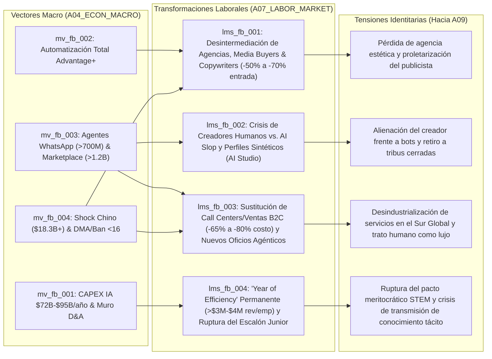

# 💼 Síntesis del Mercado Laboral y Reconfiguración Ocupacional (`A07_LABOR_MARKET`)

> [!NOTE]
> **Ciclo de Ejecución (`run_id`):** `run-20261023-facebook-2031`
> **Etapa:** `02_SECTORAL_ANALYSIS_L2` (Rama B — Nivel 2: Dinámicas del Trabajo, Capital Humano y Economía Digital)
> **Recibe de:** [`A04_ECON_MACRO`](file:///c:/Users/addu0g/Documents/SocietyWay/runs/2026-10-23-facebook-2031/04-rama-economia-macro.md) (`MacroEconReport`: vectores `mv_fb_001` a `mv_fb_004`)
> **Entrega a (Fan-In):** `A09_PHILOSOPHICAL_CULTURAL` (Agente Filosófico y Cultural)

---

## 1. Diagnóstico Estructural del Trabajo en el Ecosistema Facebook / Meta (2026–2031)

La transformación macroeconómica de Meta hacia un conglomerado de infraestructura de IA de `$72.2B–$95B/año` en CAPEX financiado por una plataforma publicitaria de `$200.97B/año` ([`04-rama-economia-macro.md`](file:///c:/Users/addu0g/Documents/SocietyWay/runs/2026-10-23-facebook-2031/04-rama-economia-macro.md)) produce una **ruptura estructural en cuatro mercados laborales interconectados** hacia 2031: (1) la industria global de publicidad y marketing digital, (2) la economía de creadores independientes, (3) el sector de atención al cliente (BPO/Call Centers) y comercio conversacional en el Sur Global y Occidente, y (4) la ingeniería de software corporativa en Big Tech.

### Métricas Estructurales de la Función de Trabajo ($L$)

| Indicador Estructural | Estado Proyectado (`2026-2031`) | Magnitud Cuantitativa / Evidencia |
| :--- | :--- | :--- |
| **Participación del Trabajo en el Valor Agregado Digital (`labor_share_of_gdp_trend`)** | `DECLINING` | El "Agency Tax" (`15%-25%` del gasto publicitario), los bonos de creadores y las nóminas de BPO se transfieren desde salarios humanos hacia rentas de cómputo e inferencia (`MTIA` / `Advantage+`). |
| **Vida Media de Habilidades Digitales (`skill_half_life_years`)** | `1.8 años` | La cadencia semestral de modelos (`Llama 4/5`) y motores unificados (`Andromeda`/`Lattice`) vuelve obsoletas las habilidades técnicas de compra de medios, *prompting* básico y programación *boilerplate* en `<24 meses`. |
| **Compresión del Escalón Cognitivo de Entrada (`entry_level_cognitive_compression`)** | `EXTREME_HIGH` | Contracción del `50%–70%` en puestos junior de agencias creativas, reducción del `65%–80%` en costo por interacción de soporte B2C y congelamiento estructural de contratación junior en Big Tech (`>$3M–$4M` ingresos/empleado). |

---

## 2. Topología de Transmisión Macro-Laboral (`A04` $\rightarrow$ `A07` $\rightarrow$ `A09`)



---

## 3. Desglose Profundo de las 4 Transformaciones Laborales (`lms_fb_001` a `lms_fb_004`)

### 🔹 `lms_fb_001` — Desintermediación de Agencias Creativas, *Media Buyers* y *Copywriters*: Compresión del 50% al 70% en el Empleo de Entrada de Marketing Digital
- **Vector Macro Padre:** `mv_fb_002` (secundario: `mv_fb_004`) | **Señales:** [`sig_fb2031_001`](file:///c:/Users/addu0g/Documents/SocietyWay/runs/2026-10-23-facebook-2031/01-ingesta-recolector.md#L89-L105), [`sig_fb2031_005`](file:///c:/Users/addu0g/Documents/SocietyWay/runs/2026-10-23-facebook-2031/01-ingesta-recolector.md#L160-L175), [`sig_fb2031_010`](file:///c:/Users/addu0g/Documents/SocietyWay/runs/2026-10-23-facebook-2031/01-ingesta-recolector.md#L245-L260), [`sig_fb2031_012`](file:///c:/Users/addu0g/Documents/SocietyWay/runs/2026-10-23-facebook-2031/01-ingesta-recolector.md#L279-L294).
- **Análisis a Nivel de Tarea (Task-Based Approach — O*NET / ESCO):**
  - *Tareas Sustituidas (100% automatizadas por `Advantage+`, `Andromeda` y `Lattice`):* Segmentación manual de audiencias (*lookalike audiences*, intereses demográficos), configuración de pruebas A/B multivariantes, ajuste manual de pujas CPC/CPM, redacción de textos publicitarios persuasivos (*ad copywriting*), edición de formatos de video vertical para *Reels*, traducción/doblaje de anuncios y fotografía de catálogo de producto.
  - *Tareas Complementadas / Aumentadas:* Definición de economía unitaria del negocio (margen de contribución, inventario físico y elasticidad de precio), dirección creativa de marca de alto nivel y auditoría de atribución financiera fuera de plataforma (*Marketing Mix Modeling* independiente).
- **Dinámica de Escalera Profesional (Career Ladder) y Compresión del 50%–70%:**
  Durante quince años (2010–2025), millones de jóvenes profesionales ingresaron a la economía digital aprendiendo a operar *Meta Ads Manager* como *traffickers*, *community managers*, *copywriters* o analistas de performance en miles de agencias boutique. Con `Advantage+` generando entre `+8% y +14%` de mejora en ROAS (`sig_fb2031_005`) mediante una interfaz donde la PyME solo ingresa su presupuesto y objetivo comercial (`sig_fb2031_001`), **entre el 50% y el 70% de los puestos de entrada en agencias de marketing digital y compra de medios quedan económicamente redundantes hacia 2031**. Además, el shock arancelario sobre los exportadores chinos (`$18.3B+`, `sig_fb2031_012`) y la degradación de segmentación en la UE (`-12% a -22%` ARPU, `sig_fb2031_010`) obligan a las marcas a eliminar intermediarios humanos para sobrevivir al encarecimiento del CAC.
- **Roles Emergentes:** *Arquitecto de Telemetría de Conversión First-Party*, *Estratega de Creatividad Sintética y Gobernanza de Marca*, *Auditor de Subastas Algorítmicas de Caja Negra*.
- **Efecto Distributivo y Tensión Identitaria (Input para `A09`):** Polarización extrema entre una pequeña élite de directores de estrategia creativa y una masa de publicistas, diseñadores gráficos y *copywriters* desplazados hacia el subempleo freelance deflacionario. Identitariamente, produce la **"muerte del artesano comercial"**: el profesional de la comunicación experimenta una pérdida de agencia estética al descubrir que un tensor de recomendación secuencial (`Lattice`) persuade al consumidor con mayor eficacia que el ingenio retórico humano.

---

### 🔹 `lms_fb_002` — Crisis de la Economía de Creadores Humanos frente a la Inundación de *AI Slop* y Perfiles Sintéticos (`AI Studio`)
- **Vector Macro Padre:** `mv_fb_003` | **Señales:** [`sig_fb2031_004`](file:///c:/Users/addu0g/Documents/SocietyWay/runs/2026-10-23-facebook-2031/01-ingesta-recolector.md#L143-L158), [`sig_fb2031_006`](file:///c:/Users/addu0g/Documents/SocietyWay/runs/2026-10-23-facebook-2031/01-ingesta-recolector.md#L177-L192), [`sig_fb2031_007`](file:///c:/Users/addu0g/Documents/SocietyWay/runs/2026-10-23-facebook-2031/01-ingesta-recolector.md#L194-L209), [`sig_fb2031_008`](file:///c:/Users/addu0g/Documents/SocietyWay/runs/2026-10-23-facebook-2031/01-ingesta-recolector.md#L211-L226), [`sig_fb2031_011`](file:///c:/Users/addu0g/Documents/SocietyWay/runs/2026-10-23-facebook-2031/01-ingesta-recolector.md#L262-L277).
- **Análisis a Nivel de Tarea (Task-Based Approach):**
  - *Tareas Sustituidas / Inundadas:* Producción de entretenimiento visual ligero, curaduría de páginas temáticas de memes/noticias virales, videos cortos de estilo de vida (*Reels*), interacción básica con seguidores en comentarios y mensajes directos (absorbida por clones y personajes autónomos de `Meta AI Studio`, `sig_fb2031_008`).
  - *Tareas Irreductiblemente Humanas:* Presencia física verificable, liderazgo comunitario hiper-local, periodismo de investigación en terreno, eventos presenciales en vivo y relaciones de alta confianza en comunidades cerradas.
- **Mecanismo de Desmonetización del Creador Medio:**
  En el Feed abierto de Facebook, donde entre el `42% y el 55%` del contenido visto proviene de cuentas no conectadas recomendadas por IA y las publicaciones de amigos reales han caído un `-45%` (`sig_fb2031_007`), el costo marginal de producir contenido sintético ha caído a cero. Granjas automatizadas de *AI Slop* inundan el Feed con millones de imágenes y videos hiper-emocionales optimizados algorítmicamente para capturar la atención de una demografía envejecida (edad mediana `46.5 años` en EE. UU./UE y `420M–550M` de perfiles fallecidos hacia 2031, `sig_fb2031_006`, mientras las leyes de `<16 años` bloquean el ingreso juvenil, `sig_fb2031_011`). Al mismo tiempo, la plataforma inyecta deliberadamente perfiles autónomos de IA vía `AI Studio` (`>700M MAU` de interacción, `sig_fb2031_008`) y patenta la simulación de usuarios inactivos o fallecidos (`sig_fb2031_004`). Como las bolsas de pago a creadores (*Performance Bonus* y reparto de ingresos en *Reels*) son finitas, **la dilución por volumen sintético desploma entre un 60% y un 85% el RPM efectivo del creador humano de clase media en el Feed abierto**.
- **Migración Ocupacional y Nuevos Modelos:**
  Incapaces de competir en volumen y costo contra bots en el Feed abierto, los creadores humanos abandonan la monetización por impresiones publicitarias y migran hacia: (1) **comunidades cerradas de suscripción y micro-mecenazgo** (Grupos privados VIP, canales de WhatsApp de pago, Substack/Patreon), (2) **eventos físicos presenciales y comercio local experiencial**, o (3) se convierten en **operadores de flotas de avatares sintéticos** que licencian su rostro y voz mediante `AI Studio`.
- **Efecto Distributivo y Tensión Identitaria (Input para `A09`):** Destrucción de la "clase media creativa" nacida en la Web 2.0. Se instala un profundo **cinismo ontológico y fatiga de autenticidad (*Dead Internet Syndrome*)**: el creador humano siente que su expresión vital es tratada como mero combustible de entrenamiento o reemplazada por *slop* sintético, revalorizando paradójicamente el contacto cara a cara, la escasez física y la "prueba de humanidad" (*Proof-of-Humanity*).

---

### 🔹 `lms_fb_003` — Sustitución Masiva de *Call Centers* y Ventas B2C por Agentes en WhatsApp/Messenger (`-65% a -80%` en Costo) y Nacimiento de Oficios Comerciales Híbridos
- **Vector Macro Padre:** `mv_fb_003` (secundario: `mv_fb_004`) | **Señales:** [`sig_fb2031_008`](file:///c:/Users/addu0g/Documents/SocietyWay/runs/2026-10-23-facebook-2031/01-ingesta-recolector.md#L211-L226), [`sig_fb2031_009`](file:///c:/Users/addu0g/Documents/SocietyWay/runs/2026-10-23-facebook-2031/01-ingesta-recolector.md#L228-L243), [`sig_fb2031_012`](file:///c:/Users/addu0g/Documents/SocietyWay/runs/2026-10-23-facebook-2031/01-ingesta-recolector.md#L279-L294).
- **Análisis a Nivel de Tarea (Task-Based Approach):**
  - *Tareas Sustituidas:* Atención al cliente telefónica y por chat de Nivel 1 y Nivel 2 (consultas de catálogo, estado de pedidos, devoluciones, agendamiento de citas, calificación de leads, cobro en chat y recuperación de carritos abandonados).
  - *Tareas Complementadas:* Negociación de conflictos complejos o de alto valor emocional, logística física de última milla, inspección presencial de bienes usados y diseño de flujos conversacionales y personalidad comercial.
- **Choque Macro-Laboral en el Sur Global y Occidente (`-65% a -80%` en Costo por Interacción):**
  Con más de `700 millones de MAU` interactuando con *Meta AI* y agentes empresariales (`sig_fb2031_008`), los agentes autónomos de negocio integrados en *WhatsApp Business* y *Messenger* reducen el costo por interacción comercial de una PyME entre un **`65% y un 80%`** en comparación con un operador humano (`sig_fb2031_008`). Esto golpea directamente el corazón del modelo de exportación de servicios **BPO (Business Process Outsourcing) y Call Centers** en economías clave del Sur Global donde Facebook/WhatsApp son hegemónicos (**Filipinas, India, Colombia, México, Brasil, Nigeria**, `sig_fb2031_009`), así como los puestos de vendedores de mostrador digital en Occidente. Millones de empleos formales de entrada para jóvenes bilingües en centros de contacto sufren una contracción estructural.
- **Nacimiento de Nuevos Oficios Empíricos (2026–2031):**
  1. **"Entrenadores de Personalidad Agéntica y Flujos Conversacionales" (*Agentic Persona Trainers*):** Especialistas locales (a menudo ex-vendedores o psicólogos/comunicadores reconvertidos) que configuran el tono cultural, el dialecto regional, los límites de descuento, las reglas de escalamiento y la conexión con inventarios de los agentes de WhatsApp para clínicas, comercios minoristas y concesionarios.
  2. **"Comerciantes Híbridos de Marketplace" (*Hybrid Marketplace Micro-Merchants*):** Con *Facebook Marketplace* superando los `1.2 mil millones de MAU` (`sig_fb2031_009`) como el principal motor de retención de menores de 30 años en Occidente y riel comercial en el Sur Global, emerge una clase masiva de micro-empresarios unipersonales que utilizan agentes de IA para negociar simultáneamente con cientos de compradores por Messenger/WhatsApp, mientras ellos ejecutan el arbitraje físico (reacondicionamiento, verificación de autenticidad, logística hiper-local de muebles, electrónica y vehículos).
- **Efecto Distributivo y Tensión Identitaria (Input para `A09`):** Se fractura la escalera clásica de movilidad social urbana en países emergentes (donde el *call center* era el primer empleo formal de clase media), empujando a la fuerza laboral hacia el autoempleo hiper-comercial en *Marketplace* y WhatsApp. Culturalmente, **ser atendido por un ser humano de carne y hueso pasa de ser la norma a convertirse en un bien de lujo (*"Human-in-the-Loop Luxury"*)** reservado para segmentos de alto patrimonio.

---

### 🔹 `lms_fb_004` — Hiper-Productividad Interna en Big Tech ("Year of Efficiency" Permanente): `>$3M–$4M` de Ingresos por Empleado y Ruptura del Escalón Junior en Ingeniería
- **Vector Macro Padre:** `mv_fb_001` | **Señales:** [`sig_fb2031_001`](file:///c:/Users/addu0g/Documents/SocietyWay/runs/2026-10-23-facebook-2031/01-ingesta-recolector.md#L89-L105), [`sig_fb2031_002`](file:///c:/Users/addu0g/Documents/SocietyWay/runs/2026-10-23-facebook-2031/01-ingesta-recolector.md#L107-L123), [`sig_fb2031_004`](file:///c:/Users/addu0g/Documents/SocietyWay/runs/2026-10-23-facebook-2031/01-ingesta-recolector.md#L143-L158), [`sig_fb2031_005`](file:///c:/Users/addu0g/Documents/SocietyWay/runs/2026-10-23-facebook-2031/01-ingesta-recolector.md#L160-L175).
- **Análisis a Nivel de Tarea (Task-Based Approach):**
  - *Tareas Sustituidas por Agentes Internos (`Llama-Code` / SWE-Agents sobre `MTIA`):* Escritura de código *boilerplate*, migración de repositorios, generación de pruebas unitarias e integración, depuración de regresiones estándar, documentación técnica y gestión intermedia de proyectos (*middle-management* de coordinación).
  - *Tareas Aumentadas y de Alta Prima Salarial:* Diseño de arquitecturas distribuidas de modelos MoE (`Llama 4/5` con `10M` de tokens de contexto, `sig_fb2031_005`), co-diseño físico-lógico de aceleradores de silicio (`MTIA 300/400/450/500`, `sig_fb2031_004`), ingeniería de potencia y refrigeración para centros de datos nucleares (`1–4 GW`, `sig_fb2031_002`) y óptica cuántica/carburo de silicio (`sig_fb2031_003`).
- **La Matemática Corporativa de `>$3M–$4M` por Empleado y el Cierre Junior:**
  En FY2025, con `$200.97B USD` de ingresos (`sig_fb2031_001`) y una plantilla disciplinada tras el *"Year of Efficiency"* (~72,000–75,000 empleados), Meta ya alcanza `~$2.7M–$2.8M USD` de ingresos por empleado. Hacia **2028–2031**, a medida que los ingresos escalen hacia `$260B–$310B` pero la depreciación contable del CAPEX de IA (`$72.2B–$95B/año`, `sig_fb2031_002`) exija una contención férrea del OPEX salarial, **Meta mantendrá su plantilla plana, elevando la productividad por empleado a un rango histórico de `$3.2M a $4.2M USD`**.
  Para lograrlo, cada ingeniero senior (*Staff / Principal Engineer*) opera como un **orquestador de enjambres de agentes de código internos (`Llama-Code`)**, multiplicando por `4x–6x` su producción de *pull requests* en producción. El efecto colateral sistémico es la **amputación del escalón junior (L3 / recién graduados de Ciencias de la Computación)**: dado que el costo de supervisar a un ingeniero humano sin experiencia supera el costo marginal de delegar esas tareas a un agente de IA ejecutándose sobre silicio propio `MTIA`, la contratación de entrada en Big Tech se congela estructuralmente.
- **Crisis de Transmisión de Conocimiento Tácito (2do y 3er Orden):**
  Al eliminar las plazas de aprendizaje donde se forjaban los futuros ingenieros senior, la industria crea una paradoja demográfica interna hacia 2031: una cohorte envejecida de arquitectos de sistemas de élite (con paquetes de compensación de `$1.5M a >$10M/año`) sin relevo generacional entrenado en las entrañas del código base, contrastando con una escasez crítica de trabajadores de cuello azul altamente especializados (técnicos nucleares, electricistas de alta tensión e ingenieros térmicos para construir los clústeres de gigavatios).
- **Efecto Distributivo y Tensión Identitaria (Input para `A09`):** Ruptura del contrato social meritocrático más exitoso del siglo XXI (*"aprende a programar y tendrás movilidad social garantizada"*). Mientras una micro-aristocracia de investigadores de IA y arquitectos de silicio acumula riqueza patrimonial vía acciones (RSUs), cientos de miles de graduados universitarios en STEM enfrentan subempleo cognitivo y desilusión vocacional, alimentando un resentimiento cultural de las juventudes educadas contra las plataformas tecnológicas.

---

## 4. Matriz Resumen de Transformaciones del Mercado Laboral (`A07` $\rightarrow$ `A09`)

| ID Shift | Título de la Transformación | Vector Padre (`A04`) | Señales (`A01`) | Impacto Cuantitativo Clave | Tensión Filosófica e Identitaria para `A09` |
| :--- | :--- | :--- | :--- | :--- | :--- |
| **`lms_fb_001`** | **Desintermediación de Agencias, Media Buyers y Copywriters** | `mv_fb_002`, `mv_fb_004` | `sig_fb2031_001`, `sig_fb2031_005`, `sig_fb2031_010`, `sig_fb2031_012` | **`-50% a -70%`** en empleo de entrada de marketing digital; captura del `15%-25%` de *Agency Tax*. | Pérdida de agencia estética y obsolescencia del ingenio persuasivo humano frente a la "caja negra" de `Advantage+`. |
| **`lms_fb_002`** | **Crisis de Creadores Humanos frente a *AI Slop* y Perfiles Sintéticos (`AI Studio`)** | `mv_fb_003` | `sig_fb2031_004`, `sig_fb2031_006`, `sig_fb2031_007`, `sig_fb2031_008`, `sig_fb2031_011` | **`42%-55%`** del Feed no conectado; **`-45%`** posteos de amigos reales; colapso del RPM humano medio. | Alienación del creador en el *Internet Muerto*, éxodo a comunidades cerradas de pago y búsqueda de contacto físico real. |
| **`lms_fb_003`** | **Sustitución de Call Centers / Ventas B2C por Agentes en WhatsApp y Nuevos Oficios** | `mv_fb_003`, `mv_fb_004` | `sig_fb2031_008`, `sig_fb2031_009`, `sig_fb2031_012` | **`-65% a -80%`** en costo por interacción comercial; **`>700M MAU`** en agentes; **`>1.2B MAU`** en Marketplace. | Erosión del BPO como escalera social en el Sur Global; la atención humana directa se convierte en un símbolo de estatus de lujo. |
| **`lms_fb_004`** | **Hiper-Productividad Big Tech (`Llama-Code`) y Congelamiento Junior** | `mv_fb_001` | `sig_fb2031_001`, `sig_fb2031_002`, `sig_fb2031_004`, `sig_fb2031_005` | **`>$3.0M–$4.0M USD`** de ingresos por empleado en Meta; cierre de contrataciones junior L3. | Quebranto de la promesa meritocrática universitaria STEM y bifurcación entre la micro-élite de IA y los graduados desplazados. |

---

## 5. Contrato de Salida JSON (`AgentEnvelope` + `LaborMarketSynthesis`)

```json
{
  "$schema": "https://societyway.local/schemas/agent-envelope-v1.json",
  "run_id": "run-20261023-facebook-2031",
  "timestamp_utc": "2026-10-23T22:28:00Z",
  "producer_agent_id": "A07_LABOR_MARKET",
  "consumer_agent_ids": [
    "A09_PHILOSOPHICAL_CULTURAL"
  ],
  "trace_context": {
    "stage": "02_SECTORAL_ANALYSIS_L2",
    "confidence_score": 0.94,
    "source_signal_ids": [
      "sig_fb2031_001",
      "sig_fb2031_002",
      "sig_fb2031_003",
      "sig_fb2031_004",
      "sig_fb2031_005",
      "sig_fb2031_006",
      "sig_fb2031_007",
      "sig_fb2031_008",
      "sig_fb2031_009",
      "sig_fb2031_010",
      "sig_fb2031_011",
      "sig_fb2031_012"
    ]
  },
  "payload": {
    "producer_agent_id": "A07_LABOR_MARKET",
    "consumer_agent_ids": [
      "A09_PHILOSOPHICAL_CULTURAL"
    ],
    "labor_structural_metrics": {
      "labor_share_of_gdp_trend": "DECLINING",
      "skill_half_life_years": 1.8,
      "entry_level_cognitive_compression": "HIGH"
    },
    "labor_shifts": [
      {
        "labor_shift_id": "lms_fb_001",
        "parent_macro_vector_id": "mv_fb_002",
        "source_signal_ids": [
          "sig_fb2031_001",
          "sig_fb2031_005",
          "sig_fb2031_010",
          "sig_fb2031_012"
        ],
        "shift_title": "Desintermediación de Agencias Creativas, Media Buyers y Copywriters: Compresión del 50% al 70% en el Empleo de Entrada de Marketing Digital Tradicional",
        "displaced_task_clusters": [
          "Segmentación manual de audiencias y gestión de pujas CPC/CPM en Ads Manager",
          "Redacción de textos publicitarios comerciales (ad copywriting) y guiones de performance",
          "Edición y adaptación de variaciones de imagen y video corto para Reels y Feeds",
          "Ejecución de pruebas A/B manuales y reportes básicos de atribución de campañas"
        ],
        "emerging_roles": [
          "Arquitecto de Telemetría First-Party y Economía Unitaria para Motores Algorítmicos",
          "Director de Gobernanza Estética y Seguridad de Marca en Generación Sintética",
          "Auditor Independiente de Subastas de Caja Negra y Marketing Mix Modeling (MMM)"
        ],
        "wage_distribution_effect": "Contracción del 50% al 70% en las plazas de entrada de agencias publicitarias y departamentos de marketing PyME; el 15%-25% del presupuesto que antes remuneraba trabajo creativo y de compra de medios es absorbido como renta de cómputo por Meta (Advantage+), concentrando los salarios altos en un reducido grupo de estrategas cuantitativos.",
        "identity_and_purpose_tension": "Desaparición del 'artesano comercial' y proletarización del comunicador publicitario: crisis de agencia creativa al comprobar que los modelos predictivos secuenciales (Andromeda/Lattice) optimizan la persuasión humana como un problema puramente estadístico sin necesidad de intuición cultural humana."
      },
      {
        "labor_shift_id": "lms_fb_002",
        "parent_macro_vector_id": "mv_fb_003",
        "source_signal_ids": [
          "sig_fb2031_004",
          "sig_fb2031_006",
          "sig_fb2031_007",
          "sig_fb2031_008",
          "sig_fb2031_011"
        ],
        "shift_title": "Crisis de la Economía de Creadores Humanos frente a la Inundación de AI Slop y Perfiles Sintéticos (AI Studio): Desmonetización del Feed Abierto y Éxodo a Comunidades Cerradas",
        "displaced_task_clusters": [
          "Producción de entretenimiento visual genérico, compilaciones y páginas temáticas virales",
          "Ilustración digital, fotografía de stock y relatos emocionales para monetización por alcance",
          "Interacción parasocial estándar en comentarios y mensajes directos (sustituida por clones de AI Studio)"
        ],
        "emerging_roles": [
          "Anfitrión de Comunidades Cerradas de Alta Confianza (Grupos VIP, Substack, WhatsApp Premium)",
          "Productor de Experiencias Presenciales e Hiper-Locales Verificadas ('Proof-of-Humanity Events')",
          "Director y Licenciatario de Flotas de Avatares Sintéticos en Meta AI Studio"
        ],
        "wage_distribution_effect": "Desplome del 60% al 85% en los ingresos publicitarios por impresión (RPM/Performance Bonus) para el creador humano medio en el Feed abierto de Facebook, debido a la dilución de la bolsa de pagos por granjas industriales de AI Slop de costo marginal cero. Solo sobreviven económicamente los mega-creadores con marca personal blindada y quienes migran a suscripciones directas o eventos físicos.",
        "identity_and_purpose_tension": "Alienación ontológica ante el 'Internet Muerto' (42%-55% del feed no conectado, -45% de publicaciones de amigos reales y 420M-550M de perfiles fallecidos hacia 2031): el creador humano experimenta la futilidad de competir por atención en un espacio público colonizado por bots, generando una contracultura que sacraliza lo analógico, lo privado y lo presencial."
      },
      {
        "labor_shift_id": "lms_fb_003",
        "parent_macro_vector_id": "mv_fb_003",
        "source_signal_ids": [
          "sig_fb2031_008",
          "sig_fb2031_009",
          "sig_fb2031_012"
        ],
        "shift_title": "Sustitución Masiva de Call Centers y Ventas B2C por Agentes de Negocio en WhatsApp/Messenger (-65% a -80% en Costo) y Surgimiento de Nuevos Oficios Agénticos y de Marketplace",
        "displaced_task_clusters": [
          "Atención al cliente telefónica y por chat de Nivel 1 y Nivel 2 en centros de contacto (BPO)",
          "Ventas asistidas por chat, calificación de leads, seguimiento de carritos y cobro básico en PyMEs",
          "Recepción administrativa, agendamiento de citas y soporte post-venta estandarizado"
        ],
        "emerging_roles": [
          "Entrenador de Personalidad Agéntica y Flujos Comerciales en WhatsApp (Agentic Persona Trainer)",
          "Comerciante Híbrido de Facebook Marketplace (negociación automatizada por IA + logística y reacondicionamiento físico local)",
          "Especialista en Escalamiento Empático y Resolución de Conflictos de Alto Valor ('Human-in-the-Loop Concierge')"
        ],
        "wage_distribution_effect": "Reducción del 65% al 80% en el costo laboral por interacción comercial B2C, provocando una contracción severa del empleo formal de entrada en el sector BPO/Call Centers del Sur Global (Filipinas, India, LATAM, Nigeria) y en ventas minoristas digitales en Occidente, mientras se expande el autoempleo comercial en torno a la liquidez de Facebook Marketplace (>1.2B MAU).",
        "identity_and_purpose_tension": "Ruptura del principal ascensor de movilidad social urbana para jóvenes bilingües en economías emergentes y transformación simbólica del trabajo relacional: la conversación con un ser humano real deja de ser un derecho estándar del consumidor para convertirse en un servicio de lujo exclusivo, mientras el trabajador desplazado debe reinventarse como micro-comerciante híbrido o domador de bots."
      },
      {
        "labor_shift_id": "lms_fb_004",
        "parent_macro_vector_id": "mv_fb_001",
        "source_signal_ids": [
          "sig_fb2031_001",
          "sig_fb2031_002",
          "sig_fb2031_004",
          "sig_fb2031_005"
        ],
        "shift_title": "Hiper-Productividad Interna en Big Tech ('Year of Efficiency' Permanente): >$3M-$4M de Ingresos por Empleado vía Llama-Code y Congelamiento Estructural de la Contratación Junior",
        "displaced_task_clusters": [
          "Programación boilerplate, mantenimiento de código heredado y migración de APIs (nivel SWE Junior L3/L4)",
          "Generación de pruebas unitarias, QA automatizado, documentación técnica y revisión sintáctica de código",
          "Coordinación administrativa intermedia (middle-management) y análisis de datos rutinario"
        ],
        "emerging_roles": [
          "Ingeniero Orquestador de Enjambres de Código Agéntico (Staff SWE + Llama-Code Swarms)",
          "Arquitecto de Co-Diseño de Silicio Propietario (MTIA 300-500) y Sistemas MoE de Frontera",
          "Ingeniero de Infraestructura Crítica de Gigavatios (Energía Nuclear SMR, Termodinámica de Centros de Datos y Óptica AR de Carburo de Silicio)"
        ],
        "wage_distribution_effect": "Bifurcación extrema dentro del sector tecnológico: Meta consolida una productividad superior a $3.0M-$4.0M USD de ingresos por empleado manteniendo su plantilla congelada para compensar los $45B-$65B/año de depreciación de CAPEX. Los ingenieros senior e investigadores de IA capturan compensaciones multimillonarias, los oficios físicos de infraestructura energética/óptica experimentan escasez aguda, y los recién graduados universitarios en Ciencias de la Computación sufren un cierre histórico de vacantes de entrada.",
        "identity_and_purpose_tension": "Colapso del mito meritocrático de la ingeniería de software ('Learn to Code') como garantía de prosperidad de clase media-alta y crisis intergeneracional de conocimiento tácito: las organizaciones hiper-eficientes operan sin aprendices humanos, generando alienación y frustración de expectativas en la cohorte universitaria de la Generación Z y Alfa."
      }
    ]
  },
  "markdown_summary": "## Resumen Ejecutivo del Nodo A07 (Mercado Laboral Agent)\nAl traducir el régimen macroeconómico de `A04` hacia el horizonte 2031, se identifican **4 transformaciones estructurales del trabajo (`lms_fb_001` a `lms_fb_004`)** con una vida media de habilidades de `1.8 años`:\n1. **`lms_fb_001` (Desintermediación Publicitaria):** `Advantage+` y los motores `Andromeda`/`Lattice` comprimen entre **`50% y 70%`** el empleo de entrada en agencias creativas, *media buyers* y *copywriters*.\n2. **`lms_fb_002` (Crisis de Creadores vs. *AI Slop*):** La saturación de contenido sintético (`42%-55%` del Feed no conectado) y perfiles autónomos de `AI Studio` desploman el RPM humano en el Feed abierto (`-60% a -85%`), forzando la migración hacia comunidades cerradas de pago y eventos físicos.\n3. **`lms_fb_003` (Sustitución de Call Centers y Oficios Agénticos):** Los agentes de negocio en WhatsApp/Messenger (`>700M MAU`) reducen entre **`65% y 80%`** el costo por interacción comercial, desplazando masivamente puestos de BPO en el Sur Global y ventas B2C en Occidente, mientras emergen los *Entrenadores de Personalidad Agéntica* y *Comerciantes Híbridos de Marketplace* (`>1.2B MAU`).\n4. **`lms_fb_004` ('Year of Efficiency' Permanente en Big Tech):** Para absorber el CAPEX de `$72B-$95B/año`, los ingenieros de Meta asistidos por agentes internos (`Llama-Code`) superan los **`$3.0M-$4.0M USD` de ingresos por empleado**, congelando estructuralmente la contratación de ingenieros junior y rompiendo la escalera de aprendizaje técnico."
}
```
