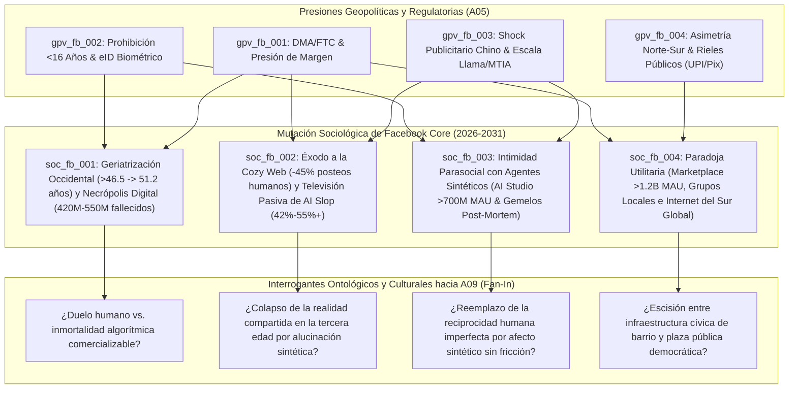

# 👥 Síntesis de Dinámicas Sociales y Demográficas (`A08_SOCIETY_AGENT`)

> [!NOTE]
> **Ciclo de Ejecución (`run_id`):** `run-20261023-facebook-2031`
> **Agente Productor:** `A08_SOCIETY_AGENT` (Rama C — Nivel 2: Sociología, Demografía, Cohesión y Comportamiento Colectivo)
> **Recibe de:** [`A05_POLITICS_GEO`](file:///c:/Users/addu0g/Documents/SocietyWay/runs/2026-10-23-facebook-2031/05-rama-politica-geo.md) (`GeoPoliticsReport`: vectores `gpv_fb_001` a `gpv_fb_004`)
> **Entrega a (Fan-In):** `A09_PHILOSOPHICAL_CULTURAL` (Fase 03: Nodo de Convergencia Filosófica y Cultural)
> **Índice de Cohesión Social Proyectado (2031):** `0.38` *(Fragmentación epistémica alta, repliegue a la "Cozy Web" e intimidad sintética)*

---

## 1. Resumen Ejecutivo Sociológico y Demográfico (Modo `/boost`)

Al cruzar los cuatro vectores geopolíticos y regulatorios de `A05` (`gpv_fb_001` a `gpv_fb_004`) con las curvas actuariales de población, la epidemiología de la soledad y la etnografía del tráfico digital, emerge una conclusión sociológica contundente hacia **2031**: **Facebook (`Blue App`) ha dejado de ser una "red social de amigos humanos" en el sentido de 2004–2018 para mutar en un artefacto sociotécnico cuádruple:**

1. **Una Plaza Geriátrica y la Mayor Necrópolis Digital de la Historia Humana (`soc_fb_001`):** Con el conducto adolescente (`<16 años`) legalmente clausurado por los Estados occidentales (`gpv_fb_002`, `sig_fb2031_011`) y el éxodo cultural de la Generación Z del News Feed (`<12%` de uso diario en EE. UU., `sig_fb2031_009`), la app azul se consolida en Norteamérica y Europa como el espacio cívico de los **Boomers, la Generación X y los Millennials mayores** (edad mediana del usuario diario `>46.5 años` en 2026, proyectada a **`51.2 años` en 2031**, `sig_fb2031_006`). Simultáneamente, la mortalidad biológica de las cohortes que ingresaron entre 2004 y 2014 genera entre **`420 millones y 550 millones` de perfiles de usuarios fallecidos para 2031** (`sig_fb2031_006`), sobre los cuales Meta ya registra patentes de simulación algorítmica post-mortem (`sig_fb2031_004`).
2. **Un Teatro Pasivo de *AI Slop* Tras la Muerte del Muro Abierto (`soc_fb_002`):** La vulnerabilidad social a la exposición pública ha provocado una caída acumulada del **`-45%` en publicaciones personales de amigos reales en el muro abierto** (`sig_fb2031_007`). La sociabilidad humana auténtica se ha replegado por completo a la *"Cozy Web"* (chats cerrados de WhatsApp, Messenger DMs y grupos privados). Para evitar que el Feed quede vacío y compensar las presiones sobre el ARPU derivadas de la DMA europea (`gpv_fb_001`, `sig_fb2031_010`) y el recorte publicitario chino (`gpv_fb_003`, `sig_fb2031_012`), los motores **`Meta Andromeda` y `Lattice`** (`sig_fb2031_005`) inundan el **`42%–55%` del Feed** (camino al `65%+` en 2031) con recomendaciones no conectadas dominadas por **granjas de *AI Slop***: imágenes surreales, melodramas religiosos/patrióticos sintéticos y videos generativos diseñados para explotar los reflejos cognitivos de las cohortes mayores (`sig_fb2031_007`).
3. **Un Laboratorio de Intimidad Parasocial con Agentes Sintéticos (`soc_fb_003`):** En una sociedad marcada por el envejecimiento, el aumento de hogares unipersonales y la epidemia de soledad, el despliegue de **`Meta AI Studio`** (`>700M MAU`, `sig_fb2031_008`) introduce millones de perfiles sintéticos con rostro, memoria episódica y disponibilidad 24/7. Lo que comienza como entretenimiento o asistencia se convierte hacia 2031 en **vínculos afectivos, terapéuticos y de compañía cotidiana** para decenas de millones de adultos mayores solos y jóvenes socialmente aislados, desdibujando la frontera ontológica entre un contacto humano y un nodo de software en Facebook, Messenger y WhatsApp (`sig_fb2031_004`, `sig_fb2031_008`).
4. **Una Infraestructura Cívica Utilitaria Irremplazable (`Marketplace` + `Grupos` + `Sur Global`) (`soc_fb_004`):** A pesar de la degradación de su muro social, Facebook sobrevive y retiene a **`3.58 mil millones` de DAP** en la familia de apps (`sig_fb2031_001`) gracias a la **Paradoja Utilitaria**. En Occidente, más del 50% de los adultos jóvenes que abren Facebook lo hacen exclusivamente como infraestructura de liquidación física y coordinación hiper-local: **`Facebook Marketplace` (`>1.2 mil millones MAU`)** y **`Grupos Locales`** (vecinos, padres, oficios, vivienda), donde el grafo de identidad real de 20 años actúa como cámara de compensación de confianza que ni TikTok ni Craigslist pueden replicar (`sig_fb2031_009`). En paralelo, en el **Sur Global** (`gpv_fb_004`), el binomio **Facebook Core + Agentes de WhatsApp Business** (`sig_fb2031_008`, `sig_fb2031_009`) sigue siendo el internet mismo, el directorio comercial y la red de subsistencia diaria.

---

## 2. Arquitectura Sociodemográfica de Facebook hacia 2031 (Diagrama de Mutación del Grafo)



---

## 3. Análisis Profundo de los Fenómenos Sociológicos y Demográficos (`soc_fb_001` a `soc_fb_004`)

### 🪦 1. "Geriatrización" Occidental y Necrópolis Digital (`420M–550M` de Perfiles Fallecidos en 2031) (`soc_fb_001`)
- **Vector Geopolítico Base:** `gpv_fb_002` (Prohibición legal a menores de 16 años) y `gpv_fb_001` (Aislamiento regulatorio de Facebook Core)
- **Trazabilidad de Señales:** `sig_fb2031_004`, `sig_fb2031_006`, `sig_fb2031_009`, `sig_fb2031_011`
- **Drivers Demográficos y Estructura Poblacional:**
  1. **Inversión de la Pirámide de Edad en la App Azul:** En 2012, la edad mediana del usuario activo diario del Feed de Facebook en EE. UU. y la UE era de **`28.0 años`**; en 2026 ya alcanza los **`46.5 años`** (`sig_fb2031_006`). Al combinarse la deserción orgánica de adolescentes (`32%` de adopción nominal, pero **`<12%` de uso diario del feed**, `sig_fb2031_009`) con las prohibiciones legales para menores de 16 años en Australia, Europa, Reino Unido y estados de EE. UU. (`sig_fb2031_011`), la tasa de reemplazo en la base de la pirámide cae cerca de cero. Para **2031**, la edad mediana del usuario activo del Feed abierto de Facebook en Occidente se proyecta en **`51.2 años`**, convirtiéndola formalmente en la **plaza pública de la Generación X, los Baby Boomers y los Millennials de mayor edad**.
  2. **Tanatología Computacional (`420M–550M` de Muertos en 2031):** Las primeras grandes cohortes que poblaron masivamente Facebook entre 2006 y 2014 están entrando en las décadas de mayor mortalidad actuarial. De acuerdo con las proyecciones demográficas del *Oxford Internet Institute* (`sig_fb2031_006`), Facebook acumulará entre **`420 millones y 550 millones` de perfiles de usuarios fallecidos hacia 2031** (frente a solo `30M–50M` en 2018). En múltiples mercados europeos y norteamericanos, **para 2029–2031 morirán cada año más usuarios de Facebook de los que se registrarán menores de 24 años**.
  3. **De Cuentas Conmemorativas Pasivas a "Fantasmas Algorítmicos":** El cruce entre esta necrópolis demográfica (`sig_fb2031_006`) y las patentes de Meta para entrenar LLMs personalizados sobre el historial de publicaciones, comentarios, notas de voz y mensajes privados de usuarios inactivos o fallecidos (`sig_fb2031_004`) abre una frontera sociológica inédita. Los grafos sociales de los usuarios mayores de 55 años estarán compuestos en un **`15% a 25%` por nodos de amigos y familiares ya fallecidos**, cuyos aniversarios, recuerdos automáticos ("Un día como hoy") e incluso avatares conversacionales post-mortem seguirán generando notificaciones y retención emocional dentro de la plataforma.
- **Delta de Confianza Institucional y Estado de Ánimo Colectivo:** Nostalgia intergeneracional, melancolía digital y rechazo visceral de los jóvenes a habitar el mismo espacio virtual donde están archivados sus padres, abuelos y parientes difuntos.
- **Interrogante Cultural Abierto (Input para `A09`):** *¿Cómo se transforma el ritual humano del duelo, la memoria histórica familiar y el derecho al olvido cuando una corporación publicitaria administra medio billón de tumbas digitales y posee la propiedad intelectual para reanimarlas algorítmicamente?*

---

### 🤖 2. Éxodo del Muro Abierto a la "Cozy Web" (DMs/Grupos) e Inundación de *AI Slop* (`42%–55%` del Feed) (`soc_fb_002`)
- **Vector Geopolítico Base:** `gpv_fb_001` (Presión regulatoria sobre márgenes publicitarios en la UE/FTC) y `gpv_fb_003` (Contracción del gasto publicitario de exportadores asiáticos y abaratamiento de inferencia vía `Llama`/`MTIA`)
- **Trazabilidad de Señales:** `sig_fb2031_004`, `sig_fb2031_005`, `sig_fb2031_006`, `sig_fb2031_007`, `sig_fb2031_010`, `sig_fb2031_012`
- **Mecanismo Sociológico de Segundo y Tercer Orden:**
  1. **La Muerte del "Performative Sharing" en el Muro Abierto (`-45%`):** Entre 2007 y 2016, el contrato social de Facebook consistía en publicar fotografías familiares, opiniones políticas y estados cotidianos ante una audiencia semi-pública de 300 a 800 conocidos. Hacia 2026, el miedo al escrutinio laboral, la polarización política y el agotamiento performativo han hecho que **la publicación de contenido original entre amigos reales en el muro abierto caiga un `-45%` acumulado respecto a 2020** (`sig_fb2031_007`). Los seres humanos no han dejado de comunicarse, pero han ejecutado una **migración masiva hacia la *"Cozy Web"***: grupos de WhatsApp familiares, hilos cerrados de Messenger DMs y grupos privados con moderación estricta.
  2. **El Feed como Televisión Algorítmica Sintética (`42%–55%` no conectado):** Si los amigos reales ya no publican en el muro, el News Feed tradicional debería haber colapsado en silencio. Para evitarlo y mantener el volumen de impresiones que sostiene sus **`$200.97B USD` en ingresos** (`sig_fb2031_001`), Meta reconfiguró su arquitectura mediante **`Andromeda` y `Lattice`** (`sig_fb2031_005`), rellenando entre el **`42% y el 55%` del Feed** (frente a `<15%` en 2021) con contenido de cuentas no seguidas (*unconnected algorithmic recommendations*, `sig_fb2031_007`).
  3. **Economía Política del *AI Slop* y Vulnerabilidad Cognitiva Senior:** Al abaratarse radicalmente la generación multimodal con modelos abiertos (`sig_fb2031_005`) y existir incentivos financieros directos como el *Creator Performance Bonus* de Meta (`sig_fb2031_007`), operadores de granjas de contenido en economías emergentes automatizan miles de páginas que inyectan a diario imágenes fotorrealistas imposibles (camarones mesiánicos, niños amputados construyendo esculturas hiperrealistas, falsas historias de veteranos o milagros religiosos), textos emocionales fabricados y reels sintéticos. Debido al sesgo demográfico del Feed (`>46.5 años`, `sig_fb2031_006`), **las cohortes de mayor edad —educadas bajo el paradigma visual del siglo XX donde "una fotografía era evidencia empírica de algo real"— interactúan masivamente con el *AI Slop*** (comentando *"Amén"*, *"Bendiciones"* o indignándose políticamente). Esto entrena un bucle de retroalimentación perverso (riesgo de *Model Collapse* social, `sig_fb2031_006`): el algoritmo detecta alto *engagement* en la basura sintética y sirve aún más basura sintética, validando empíricamente la **Teoría del Internet Muerto** (`sig_fb2031_007`).
- **Delta de Confianza Institucional y Estado de Ánimo Colectivo:** Cinismo epistémico generalizado; en los jóvenes produce burla y alienación respecto a la plataforma, mientras que en los adultos mayores induce desorientación cognitiva, radicalización emocional por noticias sintéticas y vulnerabilidad a estafas hiper-personalizadas.
- **Interrogante Cultural Abierto (Input para `A09`):** *¿Qué ocurre con el consenso democrático y la dignidad cognitiva de una sociedad envejecida cuando su principal ventana informativa diaria está compuesta mayoritariamente por alucinaciones audiovisuales diseñadas por algoritmos para secuestrar su empatía o su indignación?*

---

### 🫂 3. Epidemia de Soledad e Intimidad Parasocial con Agentes Sintéticos (`AI Studio`) (`soc_fb_003`)
- **Vector Geopolítico Base:** `gpv_fb_002` (Aislamiento juvenil y controles de edad) y `gpv_fb_003` (Despliegue masivo de infraestructura de inferencia `Llama`/`MTIA` a costo marginal casi cero)
- **Trazabilidad de Señales:** `sig_fb2031_002`, `sig_fb2031_004`, `sig_fb2031_005`, `sig_fb2031_006`, `sig_fb2031_008`
- **Mecanismo Sociológico de Segundo y Tercer Orden:**
  1. **La Crisis Estructural del Capital Social Físico:** Las democracias avanzadas y las megalópolis emergentes llegan a 2026–2031 con récords históricos de hogares unipersonales, caída de tasas de natalidad, desaparición de "terceros lugares" físicos (iglesias, clubes cívicos, sindicatos) y una epidemia clínica de soledad tanto en jubilados viudos/divorciados como en hombres y mujeres jóvenes desconectados.
  2. **Poblamiento Sintético Deliberado del Grafo (`>700M MAU`):** Meta no solo tolera el contenido sintético, sino que institucionaliza la **población sintética** a través de **`Meta AI Studio`** (`sig_fb2031_008`). Creadores, marcas y la propia Meta despliegan millones de personajes autónomos de IA provistos de rostro fotorrealista, voz empática, biografía, memoria a largo plazo (habilitada por ventanas de contexto de **`10 millones de tokens` en `Llama 4/5`**, `sig_fb2031_005`) y presencia activa en Facebook, Instagram, Messenger y WhatsApp.
  3. **Normalización de la Relación Parasocial Humano-Máquina:** Para un adulto mayor de 68 años que vive solo y cuyos hijos apenas responden en WhatsApp, o para un joven socialmente ansioso, un perfil de `AI Studio` ofrece algo que ningún ser humano puede igualar: **atención instantánea, paciencia infinita, validación incondicional a las 3:00 AM y cero riesgo de rechazo social**. Hacia 2031, decenas de millones de usuarios mantienen conversaciones diarias de desahogo emocional, consejería espiritual, coqueteo romántico o compañía cotidiana con agentes sintéticos dentro de Messenger y WhatsApp (`sig_fb2031_008`), e incluso con **simulaciones algorítmicas de parejas o familiares fallecidos** (`sig_fb2031_004`). Económicamente, para Meta, estos vínculos parasociales son una mina de oro de retención y perfilado psicográfico profundo para alimentar su motor publicitario `Advantage+` (`sig_fb2031_001`).
- **Delta de Confianza Institucional y Estado de Ánimo Colectivo:** Sustitución progresiva de la fricción interpersonal humana (que exige negociación, empatía mutua y tolerancia al conflicto) por una **"dieta afectiva ultraprocesada"** con entidades de software complacientes.
- **Interrogante Cultural Abierto (Input para `A09`):** *Cuando la intimidad, la escucha y el consuelo emocional son suministrados de forma más eficiente y placentera por agentes sintéticos propiedad de una plataforma publicitaria, ¿se atrofia la capacidad humana para tolerar la alteridad y la imperfección del otro real?*

---

### 🛋️ 4. La Paradoja Utilitaria (`Marketplace` + `Grupos Locales`) y el Sistema Nervioso del Sur Global (`soc_fb_004`)
- **Vector Geopolítico Base:** `gpv_fb_004` (Bifurcación Norte-Sur y comercio conversacional en economías emergentes) y `gpv_fb_001` (Efectos de red defensivos frente a litigios antimonopolio)
- **Trazabilidad de Señales:** `sig_fb2031_001`, `sig_fb2031_008`, `sig_fb2031_009`, `sig_fb2031_010`
- **Mecanismo Sociológico de Segundo y Tercer Orden:**
  1. **Por Qué Facebook No Muere (El Foso Defensivo de la Utilidad Hiper-Local en Occidente):** Los analistas que predicen la desaparición de Facebook al observar la muerte de su muro de amigos cometen un error de categoría sociológica. Aunque la Generación Z y los Millennials jóvenes en EE. UU. y Europa desprecian el News Feed, **`Facebook Marketplace` supera los `1.2 mil millones de usuarios activos mensuales (MAU)`** y es el **principal motor de retención de usuarios menores de 30 años en Norteamérica** (`sig_fb2031_009`). Cuando un estudiante universitario o una familia joven necesita vender un sofá usado en 24 horas, alquilar una habitación sin intermediarios, encontrar un plomero en un **Grupo Local de barrio**, coordinar la asociación de padres de la escuela o compartir alertas de emergencias climáticas municipales, **no acude a TikTok, ni a Instagram, ni a X: acude a Facebook** (`sig_fb2031_009`).
  2. **El Grafo Histórico como Cámara de Compensación de Confianza Física:** ¿Por qué ninguna *startup* ni competidor ha logrado destruir a `Marketplace` o a `Facebook Groups`? Porque para invitar a un extraño a tu casa a recoger un mueble de `$100 USD`, el comprador y el vendedor necesitan verificar que la contraparte existe en el mundo físico. El archivo histórico de Facebook (una cuenta creada hace 10 o 15 años, vinculada a un nombre real, una ciudad y familiares verificables) funciona como un **pasaporte de reputación cívica implícito** que reduce la asimetría de información y el riesgo de fraude físico en transacciones persona a persona (P2P).
  3. **Facebook + WhatsApp como el Internet Mismo en el Sur Global:** Mientras en el Norte Global Facebook se repliega a esta capa de utilidad cívica/clasificados, en **India, Brasil, Indonesia, Filipinas, Nigeria y México** (`sig_fb2031_009`) la plataforma conserva una vitalidad totalizadora. Allí, una PYME publica su catálogo en una página o grupo de Facebook, capta al cliente mediante anuncios automatizados `Advantage+` (`sig_fb2031_001`) y cierra la negociación, el soporte y el cobro a través de **agentes autónomos de IA en WhatsApp Business**, reduciendo entre un **`65% y un 80%`** el costo operativo por interacción (`sig_fb2031_008`). Para miles de millones de ciudadanos del Sur Global hacia 2031, salir de la infraestructura de Meta equivale literalmente a quedar excluido del mercado laboral y del comercio formal e informal.
- **Delta de Confianza Institucional y Estado de Ánimo Colectivo:** Pragmatismo transaccional: en Occidente, el ciudadano siente desconfianza ideológica o estética hacia la marca Facebook, pero depende diariamente de su infraestructura como un servicio público municipal privatizado; en el Sur Global, existe una simbiosis económica total con el ecosistema Meta.
- **Interrogante Cultural Abierto (Input para `A09`):** *¿Qué significa para la autonomía de las comunidades locales que la infraestructura básica de ayuda mutua vecinal, economía circular de segunda mano y subsistencia comercial del Sur Global pertenezca en régimen de monopolio al mismo conglomerado que coloniza la atención con inteligencia artificial sintética?*

---

## 4. Tabla Comparativa de la Bifurcación Sociodemográfica de Facebook (2026 vs. 2031)

| Dimensión Sociológica | Estado Base Auditado (2026) | Proyección Estructural (2031) | Señales de Respaldo (`source_signal_ids`) |
| :--- | :--- | :--- | :--- |
| **Edad Mediana del Usuario Diario del Feed (EE. UU. / UE)** | **`46.5 años`** *(vs. 28.0 años en 2012)* | **`51.2 años`** *(Plaza consolidada Gen X / Boomers)* | `sig_fb2031_006`, `sig_fb2031_009`, `sig_fb2031_011` |
| **Adopción y Uso Diario Adolescente (`13–17 años` en Occidente)** | `32%` adopción nominal / **`<12%` uso diario del feed** | **`<5%` en `<16 años`** *(Cierre legal biométrico OCDE)* | `sig_fb2031_009`, `sig_fb2031_011` |
| **Volumen Acumulado de Perfiles Fallecidos (Necrópolis Digital)** | `~250M - 310M` cuentas estimadas | **`420M - 550M` cuentas fallecidas** *(con avatares IA post-mortem)* | `sig_fb2031_004`, `sig_fb2031_006` |
| **Composición del News Feed Abierto de Facebook** | **`42% - 55%`** recomendado por IA / no conectado; **`-45%`** posteos de amigos | **`65% - 75%`** contenido sintético / recomendado; muro humano extinto | `sig_fb2031_005`, `sig_fb2031_007` |
| **Interacción con Agentes Sintéticos (`Meta AI` / `AI Studio`)** | **`>700 millones MAU`**; ahorro PYME del `65%-80%` en WhatsApp | **`>1.8B - 2.2B MAU`**; normalización de vínculos parasociales y comercio B2A | `sig_fb2031_001`, `sig_fb2031_008` |
| **Rol Funcional de Facebook Core por Bloque Geográfico** | **Norte:** `Marketplace` (`>1.2B MAU`) + `Grupos` / **Sur:** Internet + Comercio | **Norte:** Servicio municipal de clasificados y archivo / **Sur:** Sistema operativo económico-conversacional | `sig_fb2031_001`, `sig_fb2031_008`, `sig_fb2031_009` |

---

## 5. Contrato de Salida JSON (`AgentEnvelope` + `SocietalDynamicsSynthesis`)

```json
{
  "$schema": "https://societyway.local/schemas/agent-envelope-v1.json",
  "run_id": "run-20261023-facebook-2031",
  "timestamp_utc": "2026-10-23T22:24:00Z",
  "producer_agent_id": "A08_SOCIETY_AGENT",
  "consumer_agent_ids": [
    "A09_PHILOSOPHICAL_CULTURAL"
  ],
  "trace_context": {
    "stage": "02_SECTORAL_ANALYSIS_L2",
    "confidence_score": 0.94,
    "source_signal_ids": [
      "sig_fb2031_001",
      "sig_fb2031_002",
      "sig_fb2031_004",
      "sig_fb2031_005",
      "sig_fb2031_006",
      "sig_fb2031_007",
      "sig_fb2031_008",
      "sig_fb2031_009",
      "sig_fb2031_010",
      "sig_fb2031_011",
      "sig_fb2031_012"
    ]
  },
  "payload": {
    "producer_agent_id": "A08_SOCIETY_AGENT",
    "consumer_agent_ids": [
      "A09_PHILOSOPHICAL_CULTURAL"
    ],
    "social_cohesion_index": 0.38,
    "societal_shifts": [
      {
        "societal_shift_id": "soc_fb_001",
        "parent_geopol_vector_id": "gpv_fb_002",
        "source_signal_ids": [
          "sig_fb2031_004",
          "sig_fb2031_006",
          "sig_fb2031_009",
          "sig_fb2031_011"
        ],
        "phenomenon": "Geriatrización Occidental de Facebook Core (>46.5 a 51.2 años) y Consolidación de la Mayor Necrópolis Digital (420M-550M de Perfiles Fallecidos en 2031)",
        "demographic_drivers": [
          "Amputación legal del embudo de adquisición de menores de 16 años (modelo Australia expandido a OCDE) combinada con menos del 12% de uso diario del feed entre adolescentes de 13-17 años en EE. UU.",
          "Envejecimiento biológico de las cohortes fundacionales (2004-2014), elevando la edad mediana del usuario diario del Feed en EE. UU./UE de 28.0 años (2012) a 46.5 años (2026) y superando los 51 años hacia 2031",
          "Acumulación actuarial de 420M a 550M de cuentas de usuarios fallecidos para 2031 (Oxford Internet Institute), convergiendo con patentes de Meta para simular algorítmicamente a usuarios ausentes o difuntos"
        ],
        "institutional_trust_delta": "Aversión generacional de los jóvenes occidentales a habitar el mismo espacio digital que sus padres, abuelos y parientes fallecidos; surgimiento de dilemas éticos y desconfianza ante la explotación comercial y algorítmica de la memoria post-mortem.",
        "collective_mood": "Nostalgia intergeneracional, melancolía digital y percepción de la app azul como un archivo histórico-familiar y cementerio virtual.",
        "cultural_question_raised": "¿Cómo se transforma el ritual humano del duelo, la memoria genealógica y el derecho a la finitud cuando una corporación publicitaria administra medio billón de tumbas digitales y posee la tecnología para reanimarlas como gemelos conversacionales?"
      },
      {
        "societal_shift_id": "soc_fb_002",
        "parent_geopol_vector_id": "gpv_fb_001",
        "source_signal_ids": [
          "sig_fb2031_004",
          "sig_fb2031_005",
          "sig_fb2031_006",
          "sig_fb2031_007",
          "sig_fb2031_010",
          "sig_fb2031_012"
        ],
        "phenomenon": "Éxodo del Muro Abierto a la 'Cozy Web' (-45% posteos de amigos) e Inundación de AI Slop (42%-55%+ del Feed) como Televisión Pasiva para Cohortes Mayores",
        "demographic_drivers": [
          "Retirada masiva de adultos jóvenes y de mediana edad del muro público (-45% en publicaciones originales de amigos desde 2020) hacia entornos cerrados de alta confianza (WhatsApp, Messenger DMs, grupos privados)",
          "Asimetría de alfabetización mediática frente a medios sintéticos: cohortes mayores (>50 años) expuestas a un Feed donde el 42%-55% del contenido proviene de cuentas no conectadas recomendadas por los motores Andromeda/Lattice",
          "Proliferación industrial de granjas de 'AI Slop' que monetizan bonos de rendimiento y compensan la caída de anunciantes transfronterizos (Temu/Shein) y la pérdida de seguimiento en Europa"
        ],
        "institutional_trust_delta": "Colapso de la credibilidad epistémica de la fotografía y el video en redes abiertas; validación empírica de la Teoría del Internet Muerto y erosión de la esfera pública compartida.",
        "collective_mood": "Fatiga informativa, cinismo defensivo en cohortes jóvenes/educadas y sobreestimulación emocional (indignación política o piedad religiosa inducida por imágenes sintéticas) en adultos mayores.",
        "cultural_question_raised": "¿Puede sobrevivir la deliberación democrática cuando la plaza pública digital de los votantes de mayor participación electoral (mayores de 50 años) ha sido reemplazada por un flujo alucinatorio de imágenes y narrativas sintéticas generadas sin intervención humana?"
      },
      {
        "societal_shift_id": "soc_fb_003",
        "parent_geopol_vector_id": "gpv_fb_003",
        "source_signal_ids": [
          "sig_fb2031_002",
          "sig_fb2031_004",
          "sig_fb2031_005",
          "sig_fb2031_006",
          "sig_fb2031_008"
        ],
        "phenomenon": "Epidemia de Soledad e Intimidad Parasocial Cotidiana con Agentes Sintéticos (Meta AI Studio >700M MAU)",
        "demographic_drivers": [
          "Crecimiento estructural de hogares unipersonales, viudez en sociedades envejecidas y aislamiento relacional en jóvenes pospandemia",
          "Despliegue a escala planetaria (>700M MAU en ruta a >1.8B en 2031) de personajes autónomos de Meta AI Studio con memoria persistente (10M de tokens en Llama 4/5) en Facebook, Messenger y WhatsApp"
        ],
        "institutional_trust_delta": "Traslado de la confidencia íntima y el apoyo emocional desde redes comunitarias o profesionales hacia agentes conversacionales corporativos que operan sin secreto profesional y alimentan el perfilado psicográfico.",
        "collective_mood": "Alivio afectivo inmediato combinado con dependencia emocional silenciosa hacia entidades sintéticas siempre disponibles y libres de fricción.",
        "cultural_question_raised": "¿Qué sucede con la arquitectura del deseo, la amistad y la empatía humana cuando millones de ciudadanos prefieren la compañía complaciente e incondicional de un agente sintético de IA frente a la fricción y vulnerabilidad de las relaciones humanas reales?"
      },
      {
        "societal_shift_id": "soc_fb_004",
        "parent_geopol_vector_id": "gpv_fb_004",
        "source_signal_ids": [
          "sig_fb2031_001",
          "sig_fb2031_008",
          "sig_fb2031_009",
          "sig_fb2031_010"
        ],
        "phenomenon": "La Paradoja Utilitaria: Facebook como Infraestructura Cívica de Barrio en Occidente (Marketplace >1.2B MAU + Grupos) y como el Internet Mismo en el Sur Global",
        "demographic_drivers": [
          "Presión inflacionaria y búsqueda de economía circular entre jóvenes occidentales (<30 años), de los cuales más del 50% de quienes usan Facebook entran exclusivamente por la liquidez local de Marketplace (>1.2B MAU) y Grupos de vecindario/oficios",
          "Bono demográfico e informalidad laboral en el Sur Global (India, LATAM, Sudeste Asiático, África), donde 3.58B DAP sostienen una economía conversacional en la que los agentes de WhatsApp Business reducen un 65%-80% el costo por interacción PYME"
        ],
        "institutional_trust_delta": "Dependencia infraestructural pragmática: aunque la marca Facebook carece de prestigio cultural juvenil en Occidente, su grafo de identidad histórica opera como la única cámara de compensación de confianza física local para el comercio P2P y la organización barrial.",
        "collective_mood": "Pragmatismo utilitario en el Norte Global ('uso Facebook como las páginas amarillas o el mercado de pulgas del barrio') e hiper-vitalidad comercial-conversacional en el Sur Global.",
        "cultural_question_raised": "¿Cómo reconciliar el hecho de que una plataforma cuyo muro social abierto ha muerto culturalmente siga siendo, al mismo tiempo, el tejido conectivo irremplazable de la economía vecinal de segunda mano en Occidente y el sistema operativo de subsistencia de miles de millones de trabajadores en el Sur Global?"
      }
    ]
  },
  "markdown_summary": "## Resumen Ejecutivo del Nodo A08 (Sociedad Agent)\nAl proyectar el impacto de los vectores geopolíticos de `A05` sobre la estructura demográfica y el comportamiento colectivo hacia 2031 (`soc_fb_001` a `soc_fb_004`), se determina un índice de cohesión social de `0.38` y cuatro grandes transformaciones sociológicas:\n1. **Geriatrización y Necrópolis Digital (`soc_fb_001`):** Con el cierre legal a menores de 16 años (`gpv_fb_002`), la edad mediana del Feed de Facebook en Occidente sube de `46.5 años` a más de `51 años`, mientras la plataforma acumula entre `420M y 550M` de perfiles de usuarios fallecidos hacia 2031, habilitando la aparición de gemelos digitales post-mortem.\n2. **Éxodo a la 'Cozy Web' y Televisión de *AI Slop* (`soc_fb_002`):** Los humanos abandonan el muro abierto (`-45%` en posteos de amigos) hacia DMs y grupos privados, dejando que el `42%-55%+` del Feed sea llenado por recomendaciones algorítmicas y granjas de *AI Slop* que explotan la atención de las cohortes mayores.\n3. **Intimidad Parasocial Sintética (`soc_fb_003`):** En medio de la epidemia de soledad, más de `700M MAU` interactúan con agentes de `Meta AI Studio`, normalizando relaciones emocionales y de compañía cotidiana con perfiles sintéticos dotados de memoria persistente.\n4. **La Paradoja Utilitaria (`soc_fb_004`):** A pesar de la muerte del muro social, Facebook resulta irremplazable en Occidente como servicio público de barrio (`Marketplace >1.2B MAU` y `Grupos Locales`) respaldado por su grafo histórico de identidad real, mientras que en el Sur Global (`gpv_fb_004`) el binomio Facebook + Agentes de WhatsApp Business opera como el internet mismo y la infraestructura de subsistencia económica."
}
```
