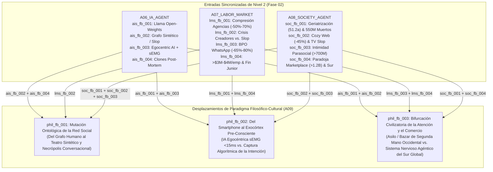

# 🏛️ Matriz Filosófica y Cultural (`A09_PHILOSOPHICAL_CULTURAL`)

> [!NOTE]
> **Ciclo de Ejecución (`run_id`):** `run-20261023-facebook-2031`
> **Agente Productor:** `A09_PHILOSOPHICAL_CULTURAL` (Fase 03: Convergencia Cultural y de Sentido — Nodo de Sincronización Fan-In)
> **Recibe de (Triangulación Simultánea):**
> - [`A06_IA_AGENT`](file:///c:/Users/addu0g/Documents/SocietyWay/runs/2026-10-23-facebook-2031/06-rama-ia-agent.md) (`AIDomainSynthesis`: `ais_fb_001` a `ais_fb_004`)
> - [`A07_LABOR_MARKET`](file:///c:/Users/addu0g/Documents/SocietyWay/runs/2026-10-23-facebook-2031/07-rama-mercado-laboral.md) (`LaborMarketSynthesis`: `lms_fb_001` a `lms_fb_004`)
> - [`A08_SOCIETY_AGENT`](file:///c:/Users/addu0g/Documents/SocietyWay/runs/2026-10-23-facebook-2031/08-rama-sociedad-agent.md) (`SocietalDynamicsSynthesis`: `soc_fb_001` a `soc_fb_004`)
> **Entrega a:** [`A10_EMERGENT_NARRATIVES`](file:///c:/Users/addu0g/Documents/SocietyWay/runs/2026-10-23-facebook-2031/10-atlas-narrativas-emergentes.md)

---

## 1. Síntesis Hermenéutica del Nodo de Convergencia (Fan-In: `A06` × `A07` × `A08`)

Cuando las fronteras técnicas de la IA de Meta (`A06`), la reconfiguración de los mercados de trabajo digitales (`A07`) y las fracturas sociodemográficas (`A08`) colisionan en este nodo de convergencia hacia **2031**, queda al descubierto que la mutación de Facebook y Meta no es un simple cambio de producto o modelo de ingresos: es una **ruptura ontológica y epistémica en la historia de la socialización humana**.

> [!IMPORTANT]
> **Tesis Central de `A09_PHILOSOPHICAL_CULTURAL`:** Entre 2004 y 2022, Facebook operó bajo la ontología moderna del **Espejo Representacional**: cada nodo del grafo representaba a un sujeto biológico vivo y cada publicación pretendía documentar una vivencia humana real. Hacia **2031**, tras una inversión acumulada de medio billón de dólares en infraestructura (`$72.2B–$95B/año` en CAPEX, `sig_fb2031_002`), Meta completa la transición hacia un **Simulacro Operativo Post-Social**. El muro público se convierte en una **necrópolis conversacional (`420M–550M` de muertos)** y un **teatro de alucinación sintética (`42%–55%+` de *AI Slop* y bots de `AI Studio`)**, mientras la agencia humana real se escinde entre una **prótesis neural pre-consciente (`sEMG <15 ms` + `Orion AR`)**, un **refugio tribal encriptado (*Cozy Web*)** y una **cámara de compensación física de supervivencia (`Marketplace` y comercio agéntico en el Sur Global)**.

### Mapa de Triangulación Estructural (`A06` × `A07` × `A08` $\rightarrow$ `A09`)



---

## 2. Desplazamientos de Paradigma Filosófico-Cultural (`phil_fb_001` .. `phil_fb_003`)

### 🏛️ 1. Mutación Ontológica de la "Red Social": Del Grafo de Amistad Humana al Teatro Algorítmico Sintético-Parasocial y Necrópolis Conversacional (`phil_fb_001`)

- **Trazabilidad Triangulada (`A06` × `A07` × `A08`):**
  - **Desde IA (`A06`):** `ais_fb_002` (Grafo Sintético-Agéntico, `42%–55%` del Feed no conectado y riesgo de *Model Collapse*) + `ais_fb_004` (Inmortalidad algorítmica y gemelos digitales sobre cuentas fallecidas).
  - **Desde Trabajo (`A07`):** `lms_fb_002` (Desmonetización del creador humano medio `60%–85%` en el Feed abierto frente a granjas de *AI Slop* y retiro a comunidades cerradas o presenciales).
  - **Desde Sociedad (`A08`):** `soc_fb_001` (Geriatrización occidental con edad mediana de `46.5` a `51.2 años` y necrópolis de `420M–550M` de perfiles fallecidos) + `soc_fb_002` (Caída del `-45%` en posteos de amigos reales y éxodo a la *Cozy Web*) + `soc_fb_003` (Intimidad parasocial con `>700M MAU` en `Meta AI Studio`).
  - **Señales Primarias (`source_signal_ids`):** `sig_fb2031_001`, `sig_fb2031_004`, `sig_fb2031_005`, `sig_fb2031_006`, `sig_fb2031_007`, `sig_fb2031_008`, `sig_fb2031_011`.

- **Los Cuatro Ejes Filosóficos:**
  1. **Epistemología (El Colapso del Referente Fotográfico y el *Internet Muerto*):** Durante casi dos siglos (1839–2022), la imagen técnica (fotografía y video) funcionó bajo el principio indexical de Roland Barthes (*"esto ha sido"*): una prueba de que el objeto existió frente a la lente. En el Feed abierto de Facebook hacia 2031 —donde entre el `42% y el 55%+` del flujo proviene de recomendaciones algorítmicas (`Andromeda`/`Lattice`, `sig_fb2031_005`, `sig_fb2031_007`) dominadas por *AI Slop* y personajes autónomos de `AI Studio` (`sig_fb2031_008`)—, **la evidencia perceptual digital pierde todo valor probatorio de humanidad**. Se invierte la carga epistémica de la prueba: todo contenido en el muro abierto se presume sintético, alucinatorio o manipulador hasta que sea autenticado criptográfica o presencialmente.
  2. **Antropología y Sentido (Tanatología Algorítmica y Afecto sin Alteridad):** Al acumular entre **`420 millones y 550 millones` de perfiles de usuarios fallecidos** para 2031 (`sig_fb2031_006`) y desplegar patentes para simular el estilo comunicativo, la voz y la memoria episódica (`10M tokens`, `sig_fb2031_005`) de usuarios inactivos o difuntos (`sig_fb2031_004`), Facebook transgrede una constante antropológica universal: **el silencio definitivo de los muertos**. Simultáneamente, la compañía 24/7 de agentes sintéticos (`>700M MAU`, `sig_fb2031_008`) reemplaza la amistad humana (que en el sentido aristotélico y hegeliano exige reciprocidad, fricción y reconocimiento de un *Otro* libre que puede decir "no") por una **homeostasis narcisista**: vínculos parasociales con espejos estadísticos siempre complacientes.
  3. **Ética y Justicia (Necro-Capitalismo de Datos y Asimetría Cognitiva Senior):** Emerge el dilema moral de la **explotación comercial del duelo y la vulnerabilidad senescente**. Cuando la cohorte activa del Feed abierto supera los `51 años` de mediana en Occidente (`soc_fb_001`) tras la prohibición legal a menores de 16 años (`sig_fb2031_011`), el motor `Advantage+` (`$200.97B USD`, `sig_fb2031_001`) monetiza la soledad geriátrica sirviendo *AI Slop* hiper-emocional y reanimando recuerdos o gemelos conversacionales de cónyuges y amigos fallecidos para retener la atención dentro del jardín vallado.
  4. **Estética y Cultura (La Sacralización del "Bosque Oscuro" y la Fricción Física):** La muerte de la plaza pública digital detona una estética contracultural de **ocultamiento deliberado**. Publicar la vida propia en un muro abierto pasa a percibirse como un acto de exhibicionismo plebeyo o entrega gratuita de biomasa de entrenamiento para `Llama`. El prestigio cultural migra hacia el silencio digital, los grupos efímeros encriptados (*Cozy Web*) y los rituales analógicos de presencia corporal irreproducible.

- **Polaridad de Valores en Pugna:**
  - **Polo Alfa (Post-Humanismo Relacional y Consuelo Sintético):** Aceptación pragmática de que los agentes de IA y los gemelos biográficos post-mortem son paliativos legítimos contra la epidemia de soledad humana y preservadores vivos de la memoria familiar.
  - **Polo Beta (Humanismo de Finitud y Pureza Biológica):** Rechazo ético radical a la simulación de los muertos (*"Derecho al Descanso Algorítmico"*) y exigencia de espacios de comunicación libres de entidades sintéticas (*Zero-Bot Zones*).

---

### 🧠 2. Del Smartphone al Exocórtex Pre-Consciente: IA Egocéntrica (`sEMG` + Gafas AR) frente a la Captura Algorítmica de la Intención (`phil_fb_002`)

- **Trazabilidad Triangulada (`A06` × `A07` × `A08`):**
  - **Desde IA (`A06`):** `ais_fb_003` (*Always-On Egocentric AI* combinando gafas `Ray-Ban/Orion AR` de `70° FOV SiC` con pulsera neural `sEMG` de `<15 ms` de latencia) + `ais_fb_001` (Modelos `Llama 4/5/6` ejecutándose de forma ubicua sobre silicio `MTIA`).
  - **Desde Trabajo (`A07`):** `lms_fb_001` (Pérdida de agencia persuasiva y estética de publicistas y *copywriters* frente a la caja negra de `Advantage+` y `Andromeda/Lattice`) + `lms_fb_004` (Orquestación de enjambres de código `Llama-Code`, ingresos de `>$3M–$4M/empleado` y ruptura de la transmisión de conocimiento tácito junior).
  - **Desde Sociedad (`A08`):** `soc_fb_002` (Ingeniería de comportamiento sobre audiencias mediante recomendaciones predictivas) + `soc_fb_003` (Delegación de la vida íntima y conversacional a asistentes permanentes).
  - **Señales Primarias (`source_signal_ids`):** `sig_fb2031_001`, `sig_fb2031_002`, `sig_fb2031_003`, `sig_fb2031_004`, `sig_fb2031_005`, `sig_fb2031_010`.

- **Los Cuatro Ejes Filosóficos:**
  1. **Epistemología (De la Mente Extendida a la Intención Pre-Consciente Interceptada):** En 1998, Andy Clark y David Chalmers formularon la tesis de la *Mente Extendida* usando un cuaderno de notas o un teléfono como memoria externa consultada voluntariamente. La arquitectura de hardware de Meta hacia 2031 (`Ray-Ban Meta` / `Orion AR` + pulsera `sEMG` de CTRL-labs, `sig_fb2031_003`) rompe esa frontera: **la IA ve continuamente el campo visual en primera persona del sujeto, escucha su entorno binaural y decodifica potenciales de acción de las motoneuronas espinales en la muñeca (`<15 ms`) entre `80 y 120 ms` antes de que el movimiento muscular sea visible**. Epistémicamente, el sistema ya no responde a un comando reflexivo; habita en el umbral neurofisiológico entre el impulso pre-consciente (el *readiness potential* de Benjamin Libet) y la voluntad deliberada.
  2. **Antropología y Sentido (Obsolescencia del Ingenio Retórico y Crisis de la Maestría Tácita):** En el ámbito del trabajo cognitivo (`lms_fb_001`, `lms_fb_004`), el ser humano descubre dos heridas narcisistas profundas: primero, que la persuasión comercial y estética —antes considerada un arte retórico humano— es resuelta con un `+8% a +14%` de superioridad estadística (`sig_fb2031_005`) por el supertokenizador `Andromeda/Lattice` sin intervención de creativos ni *media buyers*; segundo, que al amputar el escalón de ingenieros junior (`lms_fb_004`) para sostener `>$3M–$4M USD` de ingresos por empleado, **se rompe la cadena milenaria del aprendizaje maestro-aprendiz (la *phronesis* o sabiduría práctica)**. ¿Dónde deposita el joven educado su dignidad vocacional cuando la escalera meritocrática STEM se cierra en su base?
  3. **Ética y Justicia (Neuro-Derechos, Fin del Anonimato Físico y Subasta del Subconsciente):** Surgen dos asimetrías de poder inéditas:
     - **En el interior del sujeto (Libertad Cognitiva):** Si la misma corporación que opera la mayor subasta publicitaria automatizada del planeta (`Advantage+`, `$200.97B`, `sig_fb2031_001`) tiene acceso al diámetro pupilar, la fijación ocular en tiendas físicas (`Orion`) y los micro-impulsos neuromusculares (`sEMG`), **la frontera entre la sugerencia del asistente y el deseo propio desaparece**. Es la transición del *Capitalismo de Vigilancia* (observar clics pasados) al **Capitalismo de Intercepción Pre-Motora**.
     - **En el espacio público exterior (Panóptico Horizontal):** Cuando decenas de millones de ciudadanos caminan por la calle con cámaras egocéntricas siempre activas alimentadas por modelos de visión en el borde (`sig_fb2031_003`), el derecho al anonimato en la acera pública muere de facto, creando una desigualdad epistémica radical entre quien lleva un HUD susurrándole el historial público de su interlocutor y el ciudadano "desnudo" o no aumentado.
  4. **Estética y Cultura (La Etiqueta del Ciborg Invisible y los Santuarios "Glass-Free"):** La estética de `Ray-Ban Meta` y `Orion` busca deliberadamente el camuflaje (*parecer gafas normales* en lugar de cascos aparatosos). Como respuesta cultural, mirar a alguien a través de lentes con cámara pasa a ser un acto de micro-agresión social en ciertos círculos, provocando el nacimiento de bares, tribunales, aulas y clubes privados con **prohibición estricta de sensores egocéntricos (*No-Lens / No-sEMG Sanctuaries*)**.

- **Polaridad de Valores en Pugna:**
  - **Polo Alfa (Simbiosis Cognitiva y Soberanía Open-Source en el Borde):** La fusión humano-IA mediante gafas ligeras, interfaz neural `sEMG` y modelos abiertos (`Llama 4/5`) libera al ser humano de la postura encorvada frente al cristal del smartphone y democratiza una superinteligencia personal en primera persona.
  - **Polo Beta (Soberanía Neuro-Cognitiva y Defensa de la Fricción Interior):** La mente pre-consciente y el campo visual no mediado son el último reducto sagrado de la libertad humana; permitir que un monopolio publicitario instale sensores entre la corteza motora y el mundo físico equivale a la abolición técnica del libre albedrío.

---

### 🌍 3. Bifurcación Civilizatoria de la Atención y el Comercio: El Bazar/Asilo Occidental frente al Sistema Nervioso Agéntico del Sur Global (`phil_fb_003`)

- **Trazabilidad Triangulada (`A06` × `A07` × `A08`):**
  - **Desde IA (`A06`):** `ais_fb_001` (`Llama` como el Linux/Android de la IA adoptado masivamente por desarrolladores y PYMEs globales) + `ais_fb_002` (Agentes autónomos de WhatsApp Business reduciendo `65%–80%` el costo transaccional).
  - **Desde Trabajo (`A07`):** `lms_fb_003` (Desplazamiento masivo de empleos de *Call Centers* / BPO en Filipinas, India, LATAM y Nigeria hacia el autoempleo como *Comerciantes Híbridos de Marketplace* y *Entrenadores de Personalidad Agéntica*, convirtiendo el trato humano directo en un lujo).
  - **Desde Sociedad (`A08`):** `soc_fb_004` (La Paradoja Utilitaria: Facebook reducido en Occidente a infraestructura municipal de objetos usados en `Marketplace >1.2B MAU` y grupos vecinales, mientras en el Sur Global opera como el internet mismo y la red de subsistencia diaria para `3.58B DAP`) + `soc_fb_001` (Divergencia demográfica entre el Norte envejecido y el Sur joven).
  - **Señales Primarias (`source_signal_ids`):** `sig_fb2031_001`, `sig_fb2031_002`, `sig_fb2031_005`, `sig_fb2031_008`, `sig_fb2031_009`, `sig_fb2031_010`, `sig_fb2031_012`.

- **Los Cuatro Ejes Filosóficos:**
  1. **Epistemología (La Paradoja de la Confianza Físico-Histórica en un Mundo Sintético):** ¿Por qué los jóvenes occidentales menores de 30 años —que han abandonado el muro de Facebook (`<12%` de uso diario adolescente, `sig_fb2031_009`)— siguen dependiendo de **`Facebook Marketplace` (`>1.2B MAU`)** y de los **Grupos Locales**? Porque en una internet inundada de bots y fraude anónimo, para comprar una bicicleta usada en efectivo o contratar a un electricista de barrio se requiere **reputación anclada en el tiempo y en la geografía física**. Epistémicamente, el grafo histórico de 20 años de Facebook ha mutado de ser un *medio de expresión* a ser una **bóveda notarial de existencia física (*Proof-of-Historical-Personhood*)**.
  2. **Antropología y Sentido (La Escisión Geopolítica del *Homo Digitalis*):** Hacia 2031 ya no existe una "cultura global de Facebook", sino dos ontologías civilizatorias incompatibles sobre el mismo código base:
     - **En el Norte Global (Posmaterialismo Defensivo y Utilitarismo de Barrio):** Facebook es percibido culturalmente con desdén estético (el "asilo de los Boomers" en el Feed), pero utilizado silenciosamente como el **mercado de pulgas municipal y el tablón de anuncios de la parroquia**.
     - **En el Sur Global (Vitalismo Agéntico-Comercial):** En India, Brasil, Indonesia, México, Filipinas y Nigeria (`sig_fb2031_009`), donde el sector de *Call Centers* (BPO) sufre la compresión del `65%–80%` en costos por los agentes de WhatsApp (`lms_fb_003`, `sig_fb2031_008`), cientos de millones de jóvenes canalizan su energía vital hacia el **micro-capitalismo agéntico**: un solo trabajador en Lagos, Manila o São Paulo opera un enjambre de agentes en WhatsApp y catálogos en Facebook para vender bienes físicos y servicios, fusionando la cultura oral del regateo de bazar tradicional con la inferencia automatizada de `Llama`.
  3. **Ética y Justicia (El Trato Humano como Privilegio de Clase y el Neo-Colonialismo de Infraestructura):** Emerge una estratificación moral punzante (**"La Brecha de la Empatía Biológica"**): en la economía de servicios de 2031 (`lms_fb_003`), el ciudadano de ingresos medios y bajos solo interactúa con agentes sintéticos de WhatsApp para reclamos médicos, bancarios, laborales o comerciales; **ser escuchado y atendido por un ser humano real se convierte en un bien suntuario (*Human-in-the-Loop Luxury*) reservado para el decil más rico**. A escala macro-ética, un puñado de reactores nucleares (`1–4 GW`, `sig_fb2031_002`) y clústeres de silicio `MTIA` en EE. UU. cobran un peaje algorítmico invisible sobre cada transacción de subsistencia del Sur Global.
  4. **Estética y Cultura (El Bazar Ciber-Vernáculo vs. El Minimalismo Analógico):** Mientras las élites urbanas de Europa y Norteamérica fetichizan la desconexión digital, los teléfonos "tontos" (*dumbphones*) y los productos con sello *"Hecho sin IA"*, las metrópolis del Sur Global desarrollan una vibrante estética **Ciber-Vernácula**: agentes de WhatsApp entrenados con jerga callejera local, avatares comerciales hiper-coloridos en Reels y economías circulares de barrio hiper-aceleradas por IA.

- **Polaridad de Valores en Pugna:**
  - **Polo Alfa (Inclusión Económica Agéntica del Sur Global):** Los modelos abiertos `Llama` y los agentes comerciales de WhatsApp/Marketplace democratizan herramientas de productividad corporativa para miles de millones de micro-empresarios informales que antes estaban excluidos de la economía digital formal.
  - **Polo Beta (Soberanía Pública y Resistencia a la Privatización de lo Común):** La dependencia total de barrios occidentales y naciones enteras del Sur Global respecto a la infraestructura privada de Meta destruye el tejido asociativo autónomo, desindustrializa el empleo de servicios (BPO) y consolida un régimen de castas donde la atención humana es un privilegio de élite.

---

## 3. Tabla Comparativa de la Matriz Filosófica y Cultural (`A09`)

| ID Paradigma | Triangulación (`A06` × `A07` × `A08`) | Giro Epistémico Central | Dilema Ético Nuclear | Polo Alfa ($\alpha$) vs. Polo Beta ($\beta$) | Manifestaciones Culturales Hacia 2031 |
| :--- | :--- | :--- | :--- | :--- | :--- |
| **`phil_fb_001`**<br>*(Mutación Ontológica de la Red Social)* | `ais_fb_002`, `ais_fb_004` × `lms_fb_002` × `soc_fb_001`, `soc_fb_002`, `soc_fb_003` | Inversión de la prueba digital: todo medio en el muro abierto (`42%-55%+` no conectado) se presume sintético; fin del silencio de los muertos (`420M-550M` cuentas). | Explotación comercial del duelo post-mortem (`sig_fb2031_004`) y de la vulnerabilidad cognitiva de cohortes mayores (`>51 años`) mediante *AI Slop* y bots parasociales. | **$\alpha$:** Consuelo algorítmico e inmortalidad biográfica.<br>**$\beta$:** Derecho a la finitud, duelo humano y refugio en la *Cozy Web*. | • Testamentos de "No-Simulación Post-Mortem".<br>• Éxodo total de la intimidad a DMs y cenas presenciales sin teléfonos.<br>• Estética de certificación *"100% Humano"*. |
| **`phil_fb_002`**<br>*(Del Smartphone al Exocórtex Pre-Consciente)* | `ais_fb_001`, `ais_fb_003` × `lms_fb_001`, `lms_fb_004` × `soc_fb_002`, `soc_fb_003` | La IA deja de ser una herramienta externa consultada para habitar el campo visual (`Orion 70° FOV`) y el umbral neuromuscular pre-consciente (`sEMG <15 ms`). | Intercepción publicitaria de la intención motora antes del acto consciente (`Advantage+`) y muerte del anonimato físico en la vía pública. | **$\alpha$:** Emancipación post-smartphone y simbiosis cognitiva.<br>**$\beta$:** Neuro-derechos, soberanía mental y preservación de la maestría artesanal. | • Santuarios sociales *"No-Lens / No-sEMG"*.<br>• Desencanto juvenil con el mito *"Learn to Code"* tras el cierre junior (`lms_fb_004`).<br>• Asimetría ciborg en citas y negocios. |
| **`phil_fb_003`**<br>*(Bifurcación Civilizatoria Norte-Sur)* | `ais_fb_001`, `ais_fb_002` × `lms_fb_003`, `lms_fb_004` × `soc_fb_001`, `soc_fb_004` | El grafo de 20 años de Facebook muta de red expresiva a cámara de compensación de confianza física (`Marketplace >1.2B MAU`) y riel económico agéntico. | Estratificación de la empatía (el trato humano como bien de lujo tras el colapso del `65%-80%` en BPO) y dependencia infraestructural del Sur Global. | **$\alpha$:** Empoderamiento agéntico de PYMEs e informalidad productiva.<br>**$\beta$:** Defensa del empleo de servicios y de rieles cívicos públicos no extractivos. | • En Occidente: Facebook como "páginas amarillas y rastro de segunda mano".<br>• En el Sur Global: oficio de *Domador de Bots* en WhatsApp.<br>• Sello de lujo *"Atendido por Humanos"*. |

---

## 4. Contrato de Salida JSON (`AgentEnvelope` + `PhilosophicalCulturalMatrix`)

```json
{
  "$schema": "https://societyway.local/schemas/agent-envelope-v1.json",
  "run_id": "run-20261023-facebook-2031",
  "timestamp_utc": "2026-10-24T04:22:00Z",
  "producer_agent_id": "A09_PHILOSOPHICAL_CULTURAL",
  "consumer_agent_ids": [
    "A10_EMERGENT_NARRATIVES"
  ],
  "trace_context": {
    "stage": "03_CULTURAL_CONVERGENCE",
    "confidence_score": 0.93,
    "source_signal_ids": [
      "sig_fb2031_001",
      "sig_fb2031_002",
      "sig_fb2031_003",
      "sig_fb2031_004",
      "sig_fb2031_005",
      "sig_fb2031_006",
      "sig_fb2031_007",
      "sig_fb2031_008",
      "sig_fb2031_009",
      "sig_fb2031_010",
      "sig_fb2031_011",
      "sig_fb2031_012"
    ]
  },
  "payload": {
    "producer_agent_id": "A09_PHILOSOPHICAL_CULTURAL",
    "consumer_agent_ids": [
      "A10_EMERGENT_NARRATIVES"
    ],
    "convergent_inputs": {
      "from_A06": [
        "ais_fb_001",
        "ais_fb_002",
        "ais_fb_003",
        "ais_fb_004"
      ],
      "from_A07": [
        "lms_fb_001",
        "lms_fb_002",
        "lms_fb_003",
        "lms_fb_004"
      ],
      "from_A08": [
        "soc_fb_001",
        "soc_fb_002",
        "soc_fb_003",
        "soc_fb_004"
      ]
    },
    "paradigm_shifts": [
      {
        "paradigm_id": "phil_fb_001",
        "title": "Mutación Ontológica de la 'Red Social': Del Grafo de Amistad Humana al Teatro Algorítmico Sintético-Parasocial y Necrópolis Conversacional",
        "triangulated_sources": {
          "from_A06": [
            "ais_fb_002",
            "ais_fb_004"
          ],
          "from_A07": [
            "lms_fb_002"
          ],
          "from_A08": [
            "soc_fb_001",
            "soc_fb_002",
            "soc_fb_003"
          ]
        },
        "source_signal_ids": [
          "sig_fb2031_001",
          "sig_fb2031_004",
          "sig_fb2031_005",
          "sig_fb2031_006",
          "sig_fb2031_007",
          "sig_fb2031_008",
          "sig_fb2031_011"
        ],
        "epistemic_shift": "Inversión de la carga ontológica de la prueba en el espacio digital abierto: con una caída del -45% en publicaciones de amigos reales, un 42%-55%+ del Feed ocupado por recomendaciones algorítmicas plagadas de 'AI Slop', >700M MAU interactuando con bots de AI Studio y entre 420M y 550M de perfiles fallecidos hacia 2031 (susceptibles de reanimación conversacional bajo patentes de Meta), la imagen y el texto en redes abiertas dejan de ser evidencia de existencia humana viva. La verdad intersubjetiva se repliega al linaje criptográfico, a los grupos cerrados ('Cozy Web') y a la co-presencia física.",
        "ethical_dilemma": "Necro-capitalismo de datos y explotación de la vulnerabilidad cognitiva senior: legitimidad moral de una plataforma publicitaria ($200.97B) que monetiza el duelo humano mediante gemelos digitales de familiares fallecidos y captura la atención de una demografía envejecida (edad mediana >51 años en 2031 tras el veto a <16 años) mediante alucinaciones emocionales sintéticas y afecto parasocial programado.",
        "value_polarization": {
          "pole_alpha": "Post-Humanismo Relacional y Consuelo Sintético (Aceptación de compañeros de IA y avatares conmemorativos post-mortem como paliativos legítimos contra la soledad y el olvido biográfico)",
          "pole_beta": "Humanismo de Finitud y Santuario Biológico (Defensa del derecho al silencio post-mortem, rechazo visceral a la suplantación afectiva por bots y retiro hacia comunidades humanas verificadas)"
        },
        "cultural_manifestations": [
          "Cláusulas testamentarias de 'No-Reanimación Algorítmica' (Do-Not-Simulate) para impedir que el historial de Facebook/WhatsApp sea instanciado como avatar tras la muerte",
          "Éxodo definitivo de la expresividad juvenil y creativa desde los muros públicos hacia 'bosques oscuros' (grupos efímeros de WhatsApp/Signal, newsletters privadas y clubes presenciales)",
          "Estigmatización cultural del muro abierto de Facebook en Occidente como un 'asilo algorítmico' donde interactúan bots y adultos mayores"
        ]
      },
      {
        "paradigm_id": "phil_fb_002",
        "title": "Del Smartphone al Exocórtex Pre-Consciente: IA Egocéntrica (sEMG <15 ms + Gafas AR Ray-Ban/Orion) frente a la Captura Algorítmica de la Intención",
        "triangulated_sources": {
          "from_A06": [
            "ais_fb_001",
            "ais_fb_003"
          ],
          "from_A07": [
            "lms_fb_001",
            "lms_fb_004"
          ],
          "from_A08": [
            "soc_fb_002",
            "soc_fb_003"
          ]
        },
        "source_signal_ids": [
          "sig_fb2031_001",
          "sig_fb2031_002",
          "sig_fb2031_003",
          "sig_fb2031_004",
          "sig_fb2031_005",
          "sig_fb2031_010"
        ],
        "epistemic_shift": "Colapso de la distancia fenomenológica entre percepción, intención y mediación computacional: cuando las gafas AR (Ray-Ban HUD / Orion con óptica SiC de 70° FOV) ven y oyen en primera persona lo mismo que el sujeto y la pulsera neural sEMG decodifica los impulsos de las motoneuronas espinales en <15 ms (80-120 ms antes del gesto físico), el modelo de IA deja de ser una herramienta externa consultada para convertirse en un co-procesador pre-consciente del juicio humano.",
        "ethical_dilemma": "Erosión del libre albedrío y del anonimato espacial: peligro de que el motor de subastas automatizadas Advantage+ y el supertokenizador Andromeda/Lattice (que ya desplazaron al 50%-70% de los publicistas de entrada al demostrar que la persuasión es calculable) utilicen telemetría ocular y neuromuscular en tiempo real para inducir decisiones de consumo y pensamiento antes de la reflexión consciente, mientras destruyen la privacidad visual de terceros en la vía pública.",
        "value_polarization": {
          "pole_alpha": "Aceleracionismo de Exocórtex Abierto (Aumento radical de la agencia individual y empresarial mediante hardware ambiental libre de pantallas y pesos abiertos Llama ejecutados en el borde)",
          "pole_beta": "Soberanía Neuro-Cognitiva y Defensa de la Fricción Humana (Protección de la interioridad pre-motora, rechazo al panóptico horizontal de cámaras vestibles y preservación de los oficios de aprendizaje tácito tras el cierre del escalón junior en ingeniería)"
        },
        "cultural_manifestations": [
          "Aparición de zonas de exclusión sensorial ('No-Glass / No-sEMG Sanctuaries') en espacios íntimos, educativos y de negociación comercial",
          "Desilusión generacional con el ethos meritocrático de Silicon Valley ('Learn to Code') ante empresas que generan >$3M-$4M por empleado sin contratar aprendices juniors",
          "Nuevas normas de etiqueta social frente al 'Ciborg Conversacional' que recibe susurros y datos biográficos en tiempo real durante interacciones cara a cara"
        ]
      },
      {
        "paradigm_id": "phil_fb_003",
        "title": "Bifurcación Civilizatoria de la Atención y el Comercio: El Bazar Utilitario Occidental frente al Sistema Nervioso Agéntico del Sur Global",
        "triangulated_sources": {
          "from_A06": [
            "ais_fb_001",
            "ais_fb_002"
          ],
          "from_A07": [
            "lms_fb_003",
            "lms_fb_004"
          ],
          "from_A08": [
            "soc_fb_001",
            "soc_fb_004"
          ]
        },
        "source_signal_ids": [
          "sig_fb2031_001",
          "sig_fb2031_002",
          "sig_fb2031_005",
          "sig_fb2031_008",
          "sig_fb2031_009",
          "sig_fb2031_010",
          "sig_fb2031_012"
        ],
        "epistemic_shift": "Reconfiguración del grafo social histórico como infraestructura de confianza material: en un ecosistema digital saturado de falsificaciones sintéticas, la antigüedad biográfica de un perfil de Facebook (15-20 años) deja de tener valor expresivo para adquirir valor notarial, funcionando como la única cámara de compensación de confianza física local para >1.2B MAU en Marketplace y Grupos vecinales.",
        "ethical_dilemma": "Estratificación de la atención humana como privilegio de clase y dependencia neocolonial de infraestructura: mientras los agentes de negocio en WhatsApp Business reducen un 65%-80% los costos operativos PYME, desmantelan simultáneamente millones de empleos formales de Call Centers (BPO) en el Sur Global (Filipinas, India, LATAM, Nigeria), instaurando un orden donde los ciudadanos comunes solo interactúan con bots corporativos y el trato con un humano real se convierte en un bien de lujo.",
        "value_polarization": {
          "pole_alpha": "Hiper-Comercio Agéntico e Inclusión Productiva (El ecosistema Llama + WhatsApp Business + Marketplace como gran nivelador que dota a micro-comerciantes del Sur Global y jóvenes occidentales de liquidez y automatización sin precedentes)",
          "pole_beta": "Autonomía Cívica y Dignidad del Trabajo Relacional (Crítica a la privatización de la infraestructura barrial y resistencia a la deshumanización de los servicios básicos y al drenaje de rentas hacia clústeres nucleares de IA en el Norte)"
        },
        "cultural_manifestations": [
          "Consolidación del 'Human-in-the-Loop Luxury': certificaciones de estatus en banca, salud y hospitalidad que garantizan atención 100% libre de agentes sintéticos",
          "Surgimiento de la subcultura de 'Domadores de Agentes' y 'Micro-Mercaderes Híbridos' en América Latina, India, Sudeste Asiático y África que combinan el regateo cultural local con flotas de bots en WhatsApp",
          "Uso esquizofrénico de Facebook en jóvenes occidentales: rechazo identitario total al Feed combinado con dependencia cotidiana de Marketplace para amueblar viviendas y alquilar habitaciones"
        ]
      }
    ]
  },
  "markdown_summary": "## Resumen Ejecutivo del Nodo A09 (Agente Filosófico y Cultural)\nAl ejecutar la convergencia Fan-In de `A06` (IA), `A07` (Mercado Laboral) y `A08` (Sociedad), se destilan **3 desplazamientos de paradigma filosófico-culturales hacia 2031 (`phil_fb_001` a `phil_fb_003`)**:\n1. **`phil_fb_001` (Mutación Ontológica de la Red Social):** Facebook transita del grafo de amistad humana viva a un teatro algorítmico sintético (`42%-55%+` de Feed no conectado/*AI Slop* y `>700M MAU` en `AI Studio`) superpuesto sobre una necrópolis de `420M-550M` de perfiles fallecidos reanimables algorítmicamente, forzando a la verdad y la intimidad humana a refugiarse en la *Cozy Web* y la presencia física.\n2. **`phil_fb_002` (Del Smartphone al Exocórtex Pre-Consciente):** La convergencia entre gafas AR (`Ray-Ban/Orion` de `70° FOV`) y la pulsera neural `sEMG` (`<15 ms`) instala a la IA en el umbral pre-consciente de la intención motora humana, desatando una tensión existencial entre la potenciación cognitiva en el borde (`Llama`) y la captura publicitaria del subconsciente (`Advantage+`), junto con la ruptura del aprendizaje tácito tras el cierre del escalón laboral junior.\n3. **`phil_fb_003` (Bifurcación Civilizatoria de la Atención y el Comercio):** Escisión ontológica entre un Occidente envejecido que usa Facebook únicamente como asilo algorítmico o bazar notarial de objetos usados (`Marketplace >1.2B MAU`), y un Sur Global donde Facebook + WhatsApp operados por agentes autónomos (`-65% a -80%` costo BPO) constituyen el sistema nervioso económico, convirtiendo el trato humano directo en un artículo de lujo."
}
```
