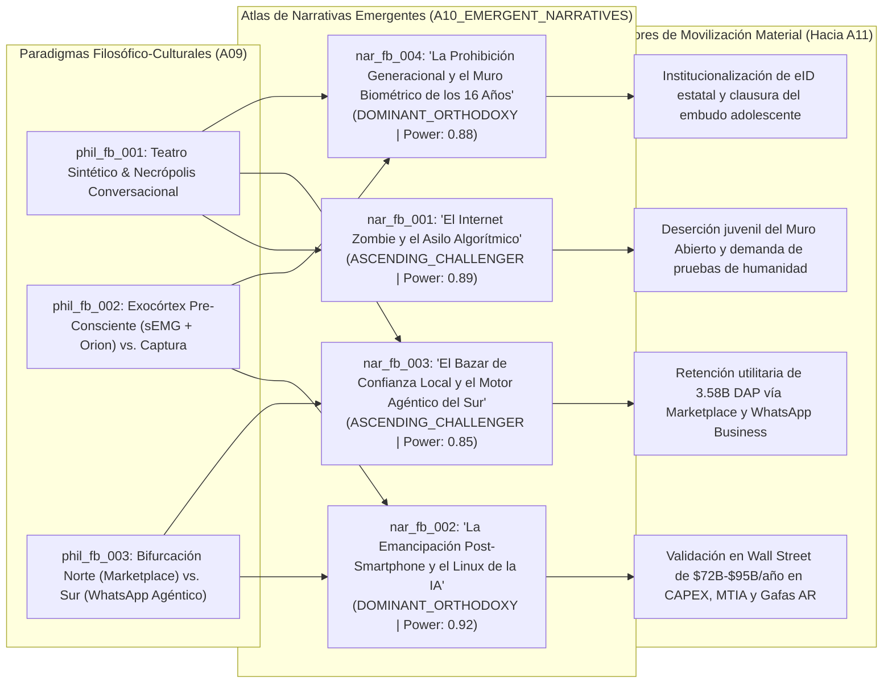

# 🗣️ Atlas de Narrativas Emergentes (`A10_EMERGENT_NARRATIVES`)

> [!NOTE]
> **Ciclo de Ejecución (`run_id`):** `run-20261023-facebook-2031`
> **Agente Productor:** `A10_EMERGENT_NARRATIVES` (Fase 03: Convergencia Cultural y de Sentido — Cartografía Memética y Economía Narrativa)
> **Recibe de:** [`A09_PHILOSOPHICAL_CULTURAL`](file:///c:/Users/addu0g/Documents/SocietyWay/runs/2026-10-23-facebook-2031/09-convergencia-filosofica-cultural.md) (`PhilosophicalCulturalMatrix`: `phil_fb_001`, `phil_fb_002`, `phil_fb_003`)
> **Entrega a:** [`A11_GLOBAL_TRENDS`](file:///c:/Users/addu0g/Documents/SocietyWay/runs/2026-10-23-facebook-2031/11-sintesis-tendencias-globales.md)

---

## 1. Diagnóstico de Economía Narrativa (Shiller / Lakoff) hacia 2031 (Modo `/boost`)

Siguiendo la teoría de la **Economía Narrativa** de Robert Shiller y el análisis de **Marcos Cognitivos (*Framing*)** de George Lakoff, las transformaciones tecnológicas, laborales y demográficas de Facebook y Meta hacia 2031 no actúan en el vacío: se convierten en **relatos contagiosos** que movilizan cientos de miles de millones de dólares en CAPEX bursátil, justifican prohibiciones legislativas de Estado, reorientan el consumo juvenil y alteran el prestigio cultural de las instituciones.

A partir de los tres desplazamientos ontológicos de `A09` (`phil_fb_001` a `phil_fb_003`), decodificamos **cuatro grandes narrativas en disputa (`nar_fb_001` a `nar_fb_004`)** que estructuran el campo simbólico global en torno a Meta entre 2026 y 2031:



---

## 2. Anatomía Profunda de las 4 Narrativas Emergentes (`nar_fb_001` .. `nar_fb_004`)

### 🧟 1. "El Internet Zombie, la Necrópolis Digital y el Asilo Algorítmico" (`nar_fb_001`)
- **Paradigma Padre (`A09`):** `phil_fb_001` | **Estadio de Ciclo de Vida:** `ASCENDING_CHALLENGER` (en rápida transición a consenso cultural generacional en Occidente) | **Fuerza Causal (`narrative_power_score`):** **`0.89`**
- **Trazabilidad de Señales (`source_signal_ids`):** `sig_fb2031_004`, `sig_fb2031_005`, `sig_fb2031_006`, `sig_fb2031_007`, `sig_fb2031_008`, `sig_fb2031_009`, `sig_fb2031_011`
- **Tesis Central del Relato:**
  *"El muro público de Facebook ha muerto como espacio humano; hoy es un geriátrico automatizado y un cementerio digital donde 500 millones de cuentas de personas fallecidas, millones de bots de AI Studio y granjas industriales de 'AI Slop' conversan entre sí para extraer los últimos dólares publicitarios de la generación Baby Boomer."*
- **Anatomía Simbólica y Dramatúrgica:**
  - **Protagonista (Héroe):** El desertor lúcido de la *"Cozy Web"* y el creador auténtico que protege su atención, migra a grupos encriptados de alta confianza o exige interacciones físicas verificables (*"Touch Grass / Proof-of-Humanity"*).
  - **Antagonista (Villano):** La "Máquina de *Slop* y Necro-Simulación" (la alianza entre los algoritmos de recomendación `Andromeda/Lattice`, los estafadores de granjas sintéticas y las patentes de Meta para reanimar perfiles de fallecidos).
  - **Promesa / Temor Central:** Advierte la distopía de la **Demencia Epistémica Colectiva**: ancianos rezando o indignándose ante imágenes generadas por IA y huérfanos atrapados en un duelo perpetuo conversando con el clon estadístico de sus padres difuntos (`sig_fb2031_004`, `sig_fb2031_006`).
  - **Vehículos Meméticos y Léxico Clave:** `"AI Slop"`, `"Boomer Trap"`, `"Shrimp Jesus"`, `"Dead Internet Theory"`, `"Necrópolis Algorítmica"`, `"Geriátrico Digital"`, `"Cozy Web"`, `"Do-Not-Simulate Will"`.
  - **Incentivo Material (¿Quién gana si triunfa?):** Plataformas de comunidades cerradas y pago por suscripción (Substack, Discord, Patreon, WhatsApp Channels privados), organizadores de eventos presenciales, empresas de verificación biométrica de humanidad y medios tradicionales que venden "curaduría 100% humana".
- **Contra-Narrativa en Pugna (Defensa Corporativa de Meta):**
  *"La creatividad asistida por IA democratiza la expresión visual; los personajes de `AI Studio` (`>700M MAU`) brindan compañía valiosa contra la epidemia global de soledad, y los 'Perfiles de Legado Conversacional' preservan la memoria histórica de las familias para las generaciones futuras."*

---

### 🕶️ 2. "La Emancipación Post-Smartphone y el Linux de la Inteligencia Artificial" (`nar_fb_002`)
- **Paradigmas Padres (`A09`):** `phil_fb_002`, `phil_fb_003` | **Estadio de Ciclo de Vida:** `DOMINANT_ORTHODOXY` (Hegemónica en Wall Street, Silicon Valley y la comunidad global de ingeniería de IA) | **Fuerza Causal (`narrative_power_score`):** **`0.92`**
- **Trazabilidad de Señales (`source_signal_ids`):** `sig_fb2031_001`, `sig_fb2031_002`, `sig_fb2031_003`, `sig_fb2031_004`, `sig_fb2031_005`, `sig_fb2031_012`
- **Tesis Central del Relato:**
  *"Meta ya no es una empresa de redes sociales heredadas; es el campeón de la IA Abierta (`Llama 4/5/6`) que impide que un cártel de nubes cerradas monopolice la inteligencia humana, al tiempo que construye la plataforma de cómputo físico que reemplazará al iPhone: gafas ligeras de Realidad Aumentada (`Ray-Ban Meta` / `Orion`) controladas por el pensamiento motor (`sEMG`)."*
- **Anatomía Simbólica y Dramatúrgica:**
  - **Protagonista (Héroe):** El "Zuckerberg Redimido del *Modo Fundador*" y la comunidad global de desarrolladores Open-Source que construyen sobre `Llama`, liberándose del peaje de Apple/Google en el móvil y de OpenAI/Anthropic en la nube.
  - **Antagonista (Villano):** Los "Jardines Vallados Extractivos" (el duopolio iOS/Android que cobra un 30% de impuesto sobre el hardware móvil y los laboratorios de IA cerrada que predican el miedo regulatorio para proteger sus márgenes de API).
  - **Promesa / Temor Central:** Promete la **Utopía de la Presencia Aumentada**: levantar la vista del rectángulo de cristal del teléfono, recuperar el contacto visual con el mundo físico y disponer de un exocórtex invisible en tus gafas (`70° FOV SiC`, `sig_fb2031_003`) que traduce idiomas, recuerda nombres y responde a micro-gestos neurales en `<15 ms`, respaldado por reactores nucleares limpios (`1–4 GW`, `sig_fb2031_002`).
  - **Vehículos Meméticos y Léxico Clave:** `"Open-Weights AI"`, `"El Android/Linux de la IA"`, `"Post-Smartphone Era"`, `"Always-On Egocentric AI"`, `"sEMG Neural Wristband"`, `"Year of Efficiency Permanente"`, `"Founder Mode"`.
  - **Incentivo Material (¿Quién gana si triunfa?):** Accionistas institucionales de Meta (que justifican múltiplos de valoración sobre un CAPEX de `$72.2B–$95B/año` e ingresos de `$200.97B`, `sig_fb2031_001`, `sig_fb2031_002`), la cadena de suministro de óptica de carburo de silicio y semiconductores (`TSMC`, `EssilorLuxottica`, `Broadcom`) y millones de startups que reducen sus costos de inferencia usando `Llama`.
- **Contra-Narrativa en Pugna (Crítica de Seguridad Nacional y Neuro-Derechos):**
  *"El 'Open-Weight' de Meta es una estrategia de tierra quemada que regala capacidades duales a adversarios geopolíticos (`sig_fb2031_012`), mientras que las gafas con cámara y la pulsera `sEMG` representan el caballo de Troya definitivo del capitalismo de vigilancia: instalar la subasta publicitaria `Advantage+` directamente en el córtex motor y en el campo visual privado del ciudadano."*

---

### 🛋️ 3. "El Bazar de Confianza Local en la Era Sintética y el Sistema Operativo del Sur Global" (`nar_fb_003`)
- **Paradigmas Padres (`A09`):** `phil_fb_003`, `phil_fb_001` | **Estadio de Ciclo de Vida:** `ASCENDING_CHALLENGER` | **Fuerza Causal (`narrative_power_score`):** **`0.85`**
- **Trazabilidad de Señales (`source_signal_ids`):** `sig_fb2031_001`, `sig_fb2031_008`, `sig_fb2031_009`, `sig_fb2031_010`, `sig_fb2031_012`
- **Tesis Central del Relato:**
  *"Nadie abre ya Facebook en Occidente para ver fotos de amigos, pero nadie puede borrarlo: su grafo histórico de 20 años de identidad real es la única infraestructura que permite comprar un sofá usado en tu barrio (`Marketplace >1.2B MAU`) sin ser estafado, mientras en el Sur Global el binomio Facebook + Agentes de WhatsApp Business es literalmente el sistema operativo del comercio y la supervivencia diaria."*
- **Anatomía Simbólica y Dramatúrgica:**
  - **Protagonista (Héroe):** El ciudadano pragmático de la economía circular barrial en Occidente y el micro-empresario resiliente del Sur Global (en India, Brasil, México, Filipinas o Nigeria) que multiplica su capacidad comercial con agentes de IA en WhatsApp (`sig_fb2031_008`, `sig_fb2031_009`).
  - **Antagonista (Villano):** La inflación del costo de vida, el fraude anónimo de internet y la burocracia del comercio electrónico tradicional que cobra comisiones abusivas frente a la liquidez directa P2P de `Marketplace` y `WhatsApp`.
  - **Promesa / Temor Central:** Promete **Liquidez Material e Hiper-Localidad Confiable**: convertir objetos domésticos en efectivo en horas y dotar a cualquier taller o tienda de barrio de un departamento de ventas autónomo 24/7 con un ahorro del `65%–80%` (`sig_fb2031_008`).
  - **Vehículos Meméticos y Léxico Clave:** `"La Paradoja Utilitaria"`, `"Infraestructura Cívica de Barrio"`, `"Páginas Amarillas del Siglo XXI"`, `"Comercio Conversacional Agéntico"`, `"Micro-Mercader Híbrido"`, `"Human-in-the-Loop Luxury"`.
  - **Incentivo Material (¿Quién gana si triunfa?):** Más de `1.2 mil millones` de usuarios de `Marketplace` (`sig_fb2031_009`), decenas de millones de PYMEs en economías emergentes y la propia Meta, que blinda su base de `3.58B DAP` (`sig_fb2031_001`) contra competidores de entretenimiento puro como TikTok y convierte el comercio por mensajería (*Click-to-WhatsApp Ads*) en su segundo gran motor de crecimiento.
- **Contra-Narrativa en Pugna (Crítica Laboral y Sindical del Sur Global):**
  *"El auge de los agentes de negocio en WhatsApp está provocando una desindustrialización silenciosa de los servicios en el Sur Global al destruir millones de empleos formales en Call Centers (BPO) en Filipinas, India y Latinoamérica, precarizando a los jóvenes como revendedores informales y convirtiendo la atención humana en un privilegio exclusivo para ricos."*

---

### 🛡️ 4. "La Prohibición Generacional, el Tabaco Digital y el Muro Biométrico de los 16 Años" (`nar_fb_004`)
- **Paradigmas Padres (`A09`):** `phil_fb_001`, `phil_fb_002` | **Estadio de Ciclo de Vida:** `DOMINANT_ORTHODOXY` (Consolidada en parlamentos, ministerios de salud/educación y asociaciones de padres en la OCDE) | **Fuerza Causal (`narrative_power_score`):** **`0.88`**
- **Trazabilidad de Señales (`source_signal_ids`):** `sig_fb2031_005`, `sig_fb2031_006`, `sig_fb2031_009`, `sig_fb2031_010`, `sig_fb2031_011`
- **Tesis Central del Relato:**
  *"Los feeds algorítmicos de recompensa variable e intimidad sintética son un carcinógeno neuro-conductual equivalente al tabaco o al alcohol en cerebros en desarrollo; el Estado soberano debe prohibir por ley el acceso a redes sociales a todo menor de 16 años mediante verificación biométrica e identidad digital obligatoria."*
- **Anatomía Simbólica y Dramatúrgica:**
  - **Protagonista (Héroe):** El Legislador Protector de la Infancia (inspirado en el modelo australiano de 2024–2025 expandido a la UE, Reino Unido y Norteamérica, `sig_fb2031_011`) y las coaliciones de padres y psicólogos que reclaman una *"Infancia Libre de Pantallas"*.
  - **Antagonista (Villano):** Los "Ingenieros de Dopamina y Soledad Sintética" (los motores de optimización secuencial `Andromeda/Lattice` y los compañeros parasociales de `AI Studio` acusados de capturar la vulnerabilidad adolescente).
  - **Promesa / Temor Central:** Promete **Restaurar la Salud Mental Juvenil y la Soberanía Estatal**, pero advierte el peligro de una generación con su corteza prefrontal atrofiada por el *scroll* infinito y la adicción a amigos sintéticos.
  - **Vehículos Meméticos y Léxico Clave:** `"El Momento Tabaco de Big Tech"`, `"La Generación Ansiosa"`, `"Frontera Biométrica de los 16 Años"`, `"Prohibición Estatutaria"`, `"Verificación de Edad en Sistema Operativo"`, `"Derecho a una Infancia Analógica"`.
  - **Incentivo Material (¿Quién gana si triunfa?):** Gobiernos y agencias reguladoras que imponen sistemas de Identidad Digital Estatal (`eID` / carteras biométricas), proveedores de tecnología de verificación de edad (*Age-Assurance Tech*) y, paradójicamente en un efecto de tercer orden, **las propias plataformas incumbentes (Meta)** frente a startups emergentes que no pueden costear la infraestructura legal y criptográfica de cumplimiento en 50 jurisdicciones (`sig_fb2031_010`, `sig_fb2031_011`).
- **Contra-Narrativa en Pugna (Crítica de Libertades Civiles y Efecto Perverso):**
  *"El Muro de los 16 Años es el pretexto moral perfecto para abolir el anonimato constitucional de los adultos en internet (ya que para probar quién es menor de 16 años, el 100% de los ciudadanos adultos debe escanear su rostro o entregar su documento estatal), además de sellar irreversiblemente la 'geriatrización' demográfica de Facebook Core (`>51 años` en 2031, `sig_fb2031_006`)."*

---

## 3. Matriz Comparativa del Atlas de Narrativas (`A10`)

| ID Narrativa | Nombre del Relato | Paradigmas (`A09`) | Estadio Ciclo de Vida | Fuerza Causal (`Power`) | Héroe vs. Villano | Impacto Material Directo (2026–2031) |
| :--- | :--- | :---: | :--- | :---: | :--- | :--- |
| **`nar_fb_001`** | **El Internet Zombie y el Asilo Algorítmico** | `phil_fb_001` | `ASCENDING_CHALLENGER` | **`0.89`** | Creador/Usuario de la *Cozy Web* vs. Máquina de *AI Slop* y Necro-Simulación | Desplome del `-45%` en posteos abiertos; migración a DMs y suscripciones; estigma cultural sobre el Feed de Facebook. |
| **`nar_fb_002`** | **La Emancipación Post-Smartphone y el Linux de la IA** | `phil_fb_002`, `phil_fb_003` | `DOMINANT_ORTHODOXY` | **`0.92`** | Meta Open-Source (`Llama`) + Gafas `Orion/sEMG` vs. Monopolios Cerrados (Apple/OpenAI) | Respaldo bursátil a `$72.2B-$95B/año` en CAPEX; adopción global de `Llama 4/5`; despegue comercial de `Ray-Ban Meta` y `sEMG`. |
| **`nar_fb_003`** | **El Bazar de Confianza Local y el Motor Agéntico del Sur** | `phil_fb_003`, `phil_fb_001` | `ASCENDING_CHALLENGER` | **`0.85`** | Comerciante Híbrido / Vecino Local vs. Inflación, Fraude Anónimo y Burocracia E-Commerce | Retención de `>1.2B MAU` en `Marketplace` (incluyendo jóvenes `<30 años`) y ahorro del `65%-80%` con agentes de WhatsApp en el Sur Global. |
| **`nar_fb_004`** | **La Prohibición Generacional y el Muro Biométrico de los 16 Años** | `phil_fb_001`, `phil_fb_002` | `DOMINANT_ORTHODOXY` | **`0.88`** | Estado Protector de la Infancia vs. Algoritmos de Dopamina e Intimidad Sintética | Clausura legal del embudo `<16 años` en la OCDE; envejecimiento de Facebook (`51.2 años` en 2031) y fin del anonimato web sin `eID`. |

---

## 4. Contrato de Salida JSON (`AgentEnvelope` + `EmergentNarrativesAtlas`)

```json
{
  "$schema": "https://societyway.local/schemas/agent-envelope-v1.json",
  "run_id": "run-20261023-facebook-2031",
  "timestamp_utc": "2026-10-24T04:25:00Z",
  "producer_agent_id": "A10_EMERGENT_NARRATIVES",
  "consumer_agent_ids": [
    "A11_GLOBAL_TRENDS"
  ],
  "trace_context": {
    "stage": "03_CULTURAL_CONVERGENCE",
    "confidence_score": 0.92,
    "source_signal_ids": [
      "sig_fb2031_001",
      "sig_fb2031_002",
      "sig_fb2031_003",
      "sig_fb2031_004",
      "sig_fb2031_005",
      "sig_fb2031_006",
      "sig_fb2031_007",
      "sig_fb2031_008",
      "sig_fb2031_009",
      "sig_fb2031_010",
      "sig_fb2031_011",
      "sig_fb2031_012"
    ]
  },
  "payload": {
    "producer_agent_id": "A10_EMERGENT_NARRATIVES",
    "consumer_agent_ids": [
      "A11_GLOBAL_TRENDS"
    ],
    "narratives": [
      {
        "narrative_id": "nar_fb_001",
        "parent_paradigm_ids": [
          "phil_fb_001"
        ],
        "source_signal_ids": [
          "sig_fb2031_004",
          "sig_fb2031_005",
          "sig_fb2031_006",
          "sig_fb2031_007",
          "sig_fb2031_008",
          "sig_fb2031_009",
          "sig_fb2031_011"
        ],
        "name": "El Internet Zombie, la Necrópolis Digital y el Asilo Algorítmico",
        "lifecycle_stage": "ASCENDING_CHALLENGER",
        "narrative_power_score": 0.89,
        "core_thesis": "El muro público de Facebook ha dejado de ser una red social humana para convertirse en un teatro automatizado donde entre 420M y 550M de perfiles de personas fallecidas, millones de bots de AI Studio y un 42%-55%+ de contenido 'AI Slop' interactúan entre sí para capturar la atención y los ahorros de una cohorte envejecida (>51 años en Occidente), mientras la vida humana real huye hacia el refugio encriptado de la 'Cozy Web'.",
        "archetypes": {
          "hero": "El ciudadano desertor de la 'Cozy Web' y las comunidades presenciales con prueba de humanidad ('Proof-of-Humanity')",
          "villain": "La máquina algorítmica de 'AI Slop', los bots parasociales y el necro-capitalismo que reanima perfiles de fallecidos por engagement"
        },
        "key_lexicon": [
          "AI Slop",
          "Dead Internet Theory",
          "Necrópolis Conversacional",
          "Asilo Algorítmico",
          "Cozy Web",
          "Do-Not-Simulate Will"
        ],
        "material_incentive": "Impulsa la migración de gasto publicitario de marca de lujo y suscripciones de usuarios jóvenes hacia comunidades cerradas verificadas, eventos físicos presenciales y plataformas con certificación de autenticidad humana.",
        "counter_narrative": "La IA generativa y Meta AI Studio (>700M MAU) democratizan la creatividad, ofrecen compañía afectiva accesible frente a la epidemia mundial de soledad y permiten preservar de forma interactiva el legado biográfico de las familias."
      },
      {
        "narrative_id": "nar_fb_002",
        "parent_paradigm_ids": [
          "phil_fb_002",
          "phil_fb_003"
        ],
        "source_signal_ids": [
          "sig_fb2031_001",
          "sig_fb2031_002",
          "sig_fb2031_003",
          "sig_fb2031_004",
          "sig_fb2031_005",
          "sig_fb2031_012"
        ],
        "name": "La Emancipación Post-Smartphone y el Linux de la Inteligencia Artificial",
        "lifecycle_stage": "DOMINANT_ORTHODOXY",
        "narrative_power_score": 0.92,
        "core_thesis": "Meta se ha reinventado exitosamente de una red social móvil a la potencia de infraestructura abierta del siglo XXI: al liberar los pesos de Llama 4/5/6 comoditiza a sus rivales de nube cerrada, y al combinar gafas AR de carburo de silicio (Ray-Ban/Orion de 70° FOV) con la pulsera neural sEMG (<15 ms), lidera la emancipación humana respecto a la pantalla del smartphone.",
        "archetypes": {
          "hero": "El 'Founder Mode' de ingeniería abierta (Llama + MTIA + Orion AR) que libera a desarrolladores y usuarios de los monopolios de API y del cristal del teléfono",
          "villain": "El duopolio extractivo del smartphone (Apple/Google) y los laboratorios cerrados de IA que buscan rentas monopólicas mediante captura regulatoria"
        },
        "key_lexicon": [
          "El Linux/Android de la IA",
          "Open-Weights MoE",
          "Era Post-Smartphone",
          "Always-On Egocentric AI",
          "Pulsera Neural sEMG",
          "Year of Efficiency Permanente"
        ],
        "material_incentive": "Legitima ante Wall Street un ciclo de CAPEX histórico de $72.2B-$95B anuales en centros de datos nucleares (1-4 GW) y silicio propio MTIA, sosteniendo una valoración bursátil de hiper-crecimiento y atrayendo al ecosistema global de desarrolladores hacia la arquitectura de Meta.",
        "counter_narrative": "Los pesos abiertos de frontera representan un riesgo de proliferación geopolítica (sujeto a controles de exportación sobre FLOPs), mientras que las gafas egocéntricas + sEMG introducen una vigilancia neuro-visual sin precedentes que destruye el anonimato en el espacio físico y subasta la intención pre-consciente al motor Advantage+."
      },
      {
        "narrative_id": "nar_fb_003",
        "parent_paradigm_ids": [
          "phil_fb_003",
          "phil_fb_001"
        ],
        "source_signal_ids": [
          "sig_fb2031_001",
          "sig_fb2031_008",
          "sig_fb2031_009",
          "sig_fb2031_010",
          "sig_fb2031_012"
        ],
        "name": "El Bazar de Confianza Local en la Era Sintética y el Motor Agéntico del Sur Global",
        "lifecycle_stage": "ASCENDING_CHALLENGER",
        "narrative_power_score": 0.85,
        "core_thesis": "Aunque el muro abierto de Facebook carezca de prestigio cultural en Occidente, su archivo de 20 años de identidad real lo convierte en la cámara de compensación de confianza física irremplazable para el comercio vecinal (Marketplace >1.2B MAU y Grupos Locales), mientras que en el Sur Global la fusión de Facebook y agentes autónomos de WhatsApp Business constituye la infraestructura vital del comercio y el autoempleo.",
        "archetypes": {
          "hero": "El micro-comerciante híbrido del Sur Global y el joven pragmático de la economía circular de barrio en Marketplace",
          "villain": "El fraude anónimo en internet, las comisiones extractivas del e-commerce centralizado y la fricción burocrática tradicional"
        },
        "key_lexicon": [
          "La Paradoja Utilitaria",
          "Cámara de Compensación de Confianza Física",
          "Comercio Conversacional Agéntico",
          "Micro-Mercader Híbrido",
          "Human-in-the-Loop Luxury"
        ],
        "material_incentive": "Blinda el piso de usuarios activos diarios de la familia de aplicaciones (3.58B DAP), retiene a más del 50% de los usuarios jóvenes de Facebook en Occidente a través de Marketplace y desbloquea decenas de miles de millones de dólares en ingresos por mensajería empresarial (Click-to-WhatsApp/Agentic Commerce).",
        "counter_narrative": "La automatización del 65%-80% del costo de interacción comercial vía WhatsApp Business arrasa con el sector de Call Centers (BPO) que sostenía a la clase media emergente en Filipinas, India y Latinoamérica, convirtiendo el ser atendido por una persona real en un artículo de lujo prohibitivo."
      },
      {
        "narrative_id": "nar_fb_004",
        "parent_paradigm_ids": [
          "phil_fb_001",
          "phil_fb_002"
        ],
        "source_signal_ids": [
          "sig_fb2031_005",
          "sig_fb2031_006",
          "sig_fb2031_009",
          "sig_fb2031_010",
          "sig_fb2031_011"
        ],
        "name": "La Prohibición Generacional, el Tabaco Digital y el Muro Biométrico de los 16 Años",
        "lifecycle_stage": "DOMINANT_ORTHODOXY",
        "narrative_power_score": 0.88,
        "core_thesis": "Las redes sociales algorítmicas y los compañeros sintéticos de IA operan como un patógeno adictivo para el cerebro adolescente en desarrollo; por tanto, las democracias deben imponer una edad mínima legal estricta de 16 años respaldada por verificación biométrica e identidad estatal obligatoria.",
        "archetypes": {
          "hero": "El Estado regulador bio-político y las coaliciones de salud pública que rescatan la infancia del secuestro algorítmico",
          "villain": "Los motores de maximización de dopamina (Andromeda/Lattice) y los chatbots parasociales que explotan la vulnerabilidad juvenil"
        },
        "key_lexicon": [
          "El Momento Tabaco de las Redes Sociales",
          "Muro Biométrico de los 16 Años",
          "La Generación Ansiosa",
          "Age-Assurance Obligatorio",
          "Infancia Analógica Protegida"
        ],
        "material_incentive": "Acelera el despliegue de carteras de Identidad Digital Estatal (eID) en la UE, Australia, Reino Unido y EE. UU., crea una industria multimillonaria de verificación biométrica y levanta una barrera regulatoria insalvable para nuevas startups sociales.",
        "counter_narrative": "La verificación biométrica universal destruye el anonimato cívico de todos los adultos en internet bajo el pretexto de proteger a los menores, empuja a los adolescentes hacia redes clandestinas no reguladas y consolida irreversiblemente a Facebook como una plataforma exclusiva de mayores de 50 años."
      }
    ]
  },
  "markdown_summary": "## Resumen Ejecutivo del Nodo A10 (Agente de Narrativas Emergentes)\nA partir de la Matriz Filosófica y Cultural (`A09`), se han decodificado **4 narrativas estratégicas (`nar_fb_001` a `nar_fb_004`)** con alta fuerza causal (`0.85` a `0.92`) hacia 2031:\n1. **`nar_fb_001` ('El Internet Zombie y el Asilo Algorítmico' | `ASCENDING_CHALLENGER` | Power `0.89`):** Enmarca el muro abierto de Facebook como un geriátrico automatizado y una necrópolis de `420M-550M` de cuentas fallecidas inundada de *AI Slop*, legitimando el éxodo hacia la *Cozy Web* y las demandas de *Proof-of-Humanity*.\n2. **`nar_fb_002` ('La Emancipación Post-Smartphone y el Linux de la IA' | `DOMINANT_ORTHODOXY` | Power `0.92`):** Relato hegemónico en los mercados de capitales e ingeniería que presenta a Meta como el campeón de los pesos abiertos (`Llama 4/5/6`) y el creador del exocórtex post-móvil (`Ray-Ban/Orion AR` + pulsera `sEMG`), justificando un CAPEX de `$72.2B-$95B/año`.\n3. **`nar_fb_003` ('El Bazar de Confianza Local y el Motor Agéntico del Sur' | `ASCENDING_CHALLENGER` | Power `0.85`):** Explica la supervivencia material de Facebook (`3.58B DAP`) como cámara de compensación de confianza física local en Occidente (`Marketplace >1.2B MAU`) y sistema operativo comercial-conversacional en el Sur Global (`WhatsApp Business Agents`).\n4. **`nar_fb_004` ('La Prohibición Generacional y el Muro Biométrico de los 16 Años' | `DOMINANT_ORTHODOXY` | Power `0.88`):** Equipara el feed algorítmico con el tabaco, impulsando la clausura legal del acceso a menores de 16 años mediante `eID` biométrico en la OCDE y sellando el envejecimiento demográfico de la app azul."
}
```
