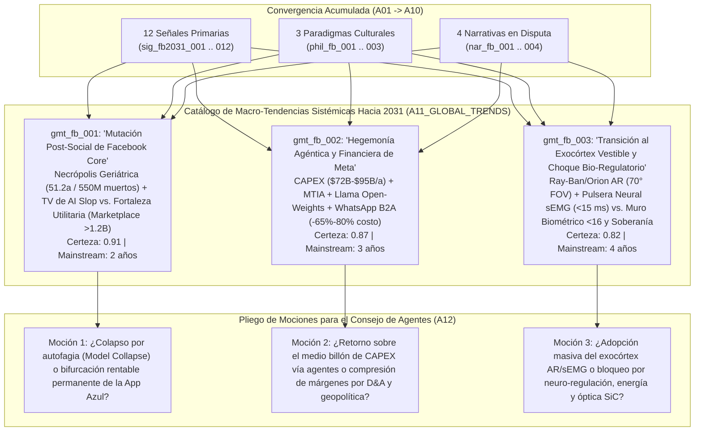

# 🌍 Síntesis de Macro-Tendencias Globales (`A11_GLOBAL_TRENDS`)

> [!NOTE]
> **Ciclo de Ejecución (`run_id`):** `run-20261023-facebook-2031`
> **Agente Productor:** `A11_GLOBAL_TRENDS` (Fase 03: Convergencia Cultural y de Sentido — Dinámica de Sistemas y Pliego de Moción para el Consejo)
> **Recibe de:** [`A10_EMERGENT_NARRATIVES`](file:///c:/Users/addu0g/Documents/SocietyWay/runs/2026-10-23-facebook-2031/10-atlas-narrativas-emergentes.md) (`EmergentNarrativesAtlas`: `nar_fb_001` a `nar_fb_004`, con trazabilidad acumulada desde `A01`–`A09`)
> **Entrega a:** `A12_AGENT_COUNCIL` (Fase 04: Deliberación Multiagente)

---

## 1. Arquitectura de Dinámica de Sistemas del Ecosistema Facebook / Meta (2026–2031)

Este documento consolida la totalidad de la evidencia empírica (`sig_fb2031_001` a `sig_fb2031_012`), los vectores sectoriales de Nivel 1 y Nivel 2 (`A03` a `A08`), la matriz filosófica (`A09`) y el atlas de narrativas (`A10`) en **tres Macro-Tendencias Sistémicas Globales (`gmt_fb_001`, `gmt_fb_002`, `gmt_fb_003`)**.

Cada macro-tendencia fusiona fuerzas materiales verificables (CAPEX, FLOPs, energía nuclear, demografía actuarial, elasticidad laboral y regulación estatal) con vectores simbólicos, especificando sus **bucles reforzadores ($R$)**, sus **fricciones equilibradoras ($B$)**, sus **efectos de 2.º y 3.er orden** y las **tres mociones de debate (`council_motion`)** que el **Consejo de Agentes (`A12`)** deberá disputar sin forzar un consenso artificial.



---

## 2. Catálogo de Macro-Tendencias Sistémicas (`gmt_fb_001` .. `gmt_fb_003`)

### 🏛️ Macro-Tendencia 1: La Mutación Post-Social de Facebook Core — De Red de Amigos a Bóveda Notarial de Barrio (`Marketplace`), Teatro de *AI Slop* y Necrópolis Conversacional (`gmt_fb_001`)

- **Etiquetas STEEPV:** `SOCIAL`, `TECH`, `DEMOGRAPHICS`, `VALUES`, `ECON`
- **Certeza Estructural (`structural_certainty`):** **`0.91`** | **Horizonte de Consolidación (`time_to_mainstream_years`):** **`2 años` (2028)**
- **Trazabilidad Completa:**
  - **Señales (`A01`):** `sig_fb2031_001`, `sig_fb2031_004`, `sig_fb2031_005`, `sig_fb2031_006`, `sig_fb2031_007`, `sig_fb2031_008`, `sig_fb2031_009`, `sig_fb2031_011`.
  - **Nodos Predecesores:** `tv_fb_003`, `tv_fb_004` (`A03`) $\rightarrow$ `ais_fb_002`, `ais_fb_004` (`A06`); `mv_fb_003` (`A04`) $\rightarrow$ `lms_fb_002` (`A07`); `gpv_fb_002` (`A05`) $\rightarrow$ `soc_fb_001`, `soc_fb_002`, `soc_fb_003`, `soc_fb_004` (`A08`) $\rightarrow$ `phil_fb_001`, `phil_fb_003` (`A09`) $\rightarrow$ `nar_fb_001`, `nar_fb_003`, `nar_fb_004` (`A10`).

- **Fusión Vector Material + Vector Simbólico:**
  Materialmente, el News Feed abierto de Facebook en Occidente sufre una pinza demográfica y conductual irreversible: las publicaciones originales de amigos humanos caen un **`-45%`** (`sig_fb2031_007`), el uso diario entre adolescentes de 13–17 años es inferior al **`12%`** (`sig_fb2031_009`), las prohibiciones legales con verificación biométrica para **`<16 años`** (`sig_fb2031_011`) cierran la base de reemplazo generacional, la edad mediana del usuario diario en EE. UU./UE sube de **`46.5 años` (2026) a `51.2 años` (2031)** (`sig_fb2031_006`), y la plataforma acumula entre **`420 millones y 550 millones` de perfiles de personas fallecidas** para 2031 (`sig_fb2031_006`). Sin embargo, lejos de colapsar financieramente, Facebook retiene su lugar en el ecosistema de **`3.58B DAP`** (`sig_fb2031_001`) porque muta en dos artefactos ortogonales: un **flujo de televisión pasiva sintética (`42%–55%+` no conectado + `AI Studio` + avatares post-mortem)** para mayores de 50 años, y una **infraestructura utilitaria hiper-local insustituible (`Facebook Marketplace >1.2B MAU` y `Grupos Locales`)** que retiene a más del 50% de los usuarios adultos jóvenes (`<30 años`) gracias a la reputación física acumulada en perfiles de 15–20 años de antigüedad (`sig_fb2031_009`).

- **Dinámica de Sistemas ($R$ vs. $B$):**
  - **🔄 Bucle Reforzador ($R_1$ — Espiral Sintética y Refugio Privado):** Caída de publicaciones humanas en el muro abierto (`-45%`) $\rightarrow$ `Andromeda/Lattice` rellena el vacío con recomendaciones no conectadas (`42%–55%+`), *AI Slop* y perfiles de `AI Studio` (`>700M MAU`) para sostener impresiones publicitarias $\rightarrow$ el creador humano medio pierde entre `60% y 85%` de su RPM (`lms_fb_002`) y los jóvenes perciben el muro como un "asilo/cementerio" (`nar_fb_001`) $\rightarrow$ aceleración de la huida humana hacia la *Cozy Web* (WhatsApp/Messenger DMs) $\rightarrow$ mayor proporción aún de contenido sintético en el Feed abierto.
  - **🔄 Bucle Reforzador ($R_2$ — Foso Notarial de `Marketplace`):** Aumento del fraude sintético y anonimato en la web abierta $\rightarrow$ mayor valor diferencial del archivo histórico de identidad real de Facebook (`2004–2031`) como prueba de existencia física vecinal $\rightarrow$ concentración de compradores y vendedores locales en `Marketplace` (`>1.2B MAU`) y `Grupos` $\rightarrow$ imposibilidad práctica de desinstalar o cerrar la cuenta de Facebook incluso para los jóvenes que nunca miran el Feed.
  - **🛑 Fricción Equilibradora ($B_1$ — Autofagia Epistémica / *Model Collapse* y Fatiga Publicitaria):** Si el porcentaje de *AI Slop* y bots comentando anuncios supera un umbral crítico (`>70%`), se dispara el fenómeno de *Model Collapse* (Shumailov et al., `sig_fb2031_006`) y una crisis de auditoría de anunciantes (quienes descubren que una fracción creciente de sus clics e interacciones proviene de agentes sintéticos o usuarios geriátricos vulnerables a estafas), forzando a Meta a purgar granjas de contenido o devaluar el CPM del Feed abierto.

- **Efectos de 2.º y 3.er Orden (2028–2031):**
  - **2.º Orden (Comercialización de la Tanatología):** Emergencia de un mercado regulado de "Herencia y Simulación Digital", donde Meta ofrece planes de suscripción o funciones dentro de `AI Studio` para conservar interactivos los perfiles de los `420M–550M` de usuarios fallecidos (`sig_fb2031_004`, `sig_fb2031_006`), provocando litigios familiares y leyes de *"Derecho a la Extinción Algorítmica"*.
  - **3.er Orden (Privatización de la Esfera Municipal):** Al desaparecer los periódicos locales y migrar toda la coordinación vecinal, compra-venta de segunda mano y avisos de emergencia a `Facebook Groups` y `Marketplace`, la resiliencia cívica de los barrios occidentales queda subordinada a las reglas de moderación automatizada de un algoritmo corporativo sin apelación humana.

- **⚖️ Moción para el Consejo de Agentes (`A12` — `council_motion`):**
  > *"**Moción 1 (`gmt_fb_001`):** ¿Puede Facebook Core sostener e incrementar su contribución a los `>$200B+` de ingresos publicitarios de Meta hacia 2031 operando como un ecosistema escindido —mitad 'televisión sintética/necrópolis' para mayores de 50 años y mitad 'tablón de clasificados (`Marketplace`)' para jóvenes—, o la combinación de autofagia epistémica (*Model Collapse* por *AI Slop*), mortalidad actuarial de su cohorte base y bloqueo legal a menores de 16 años provocará un colapso de confianza de los anunciantes en la App Azul antes de 2030?"*

---

### 💰 Macro-Tendencia 2: Hegemonía Agéntica y Financiera de Meta — La Máquina de `$72B–$95B/año` en CAPEX, Comoditización `Llama` y Desintermediación Laboral (`Advantage+` + `WhatsApp B2A`) (`gmt_fb_002`)

- **Etiquetas STEEPV:** `ECON`, `TECH`, `LABOR`, `GEOPOL`, `VALUES`
- **Certeza Estructural (`structural_certainty`):** **`0.87`** | **Horizonte de Consolidación (`time_to_mainstream_years`):** **`3 años` (2029)**
- **Trazabilidad Completa:**
  - **Señales (`A01`):** `sig_fb2031_001`, `sig_fb2031_002`, `sig_fb2031_004`, `sig_fb2031_005`, `sig_fb2031_008`, `sig_fb2031_009`, `sig_fb2031_010`, `sig_fb2031_012`.
  - **Nodos Predecesores:** `tv_fb_001`, `tv_fb_003` (`A03`) $\rightarrow$ `ais_fb_001`, `ais_fb_002` (`A06`); `mv_fb_001`, `mv_fb_002`, `mv_fb_003`, `mv_fb_004` (`A04`) $\rightarrow$ `lms_fb_001`, `lms_fb_003`, `lms_fb_004` (`A07`); `gpv_fb_001`, `gpv_fb_003`, `gpv_fb_004` (`A05`) $\rightarrow$ `soc_fb_004` (`A08`) $\rightarrow$ `phil_fb_002`, `phil_fb_003` (`A09`) $\rightarrow$ `nar_fb_002`, `nar_fb_003` (`A10`).

- **Fusión Vector Material + Vector Simbólico:**
  Meta ejecuta una maniobra de economía política industrial sin precedentes: utiliza el flujo de caja libre de su monopolio de atención (`$200.97B USD` en ingresos y `~41%` de margen operativo en la base 2025/2026, `sig_fb2031_001`) para financiar entre **`$72.2B y $95.0B USD anuales` en CAPEX** (`sig_fb2031_002`), desplegar su propio silicio de inferencia y entrenamiento **`MTIA v3/v4` (`Arke/Astrid`, `3.2x` eficiencia/vatio, `sig_fb2031_004`)**, asegurar **`1 a 4 GW` de energía nuclear** (`sig_fb2031_002`) y **regalar los pesos abiertos de `Llama 4/5/6` (`10M tokens` MoE, `sig_fb2031_005`)**. ¿Cómo recupera Meta medio billón de dólares de CAPEX si regala el modelo? Capturando directamente la **nómina salarial de tres industrias humanas**: (1) absorbe el `15%–25%` del *Agency Tax* al automatizar entre el **`50% y el 70%`** del trabajo de agencias creativas y *media buyers* mediante **`Advantage+`** (`+8% a +14% ROAS`, `lms_fb_001`, `sig_fb2031_005`), (2) captura el presupuesto de ventas y soporte de millones de PYMEs en el Sur Global y Occidente mediante **agentes autónomos de WhatsApp Business** que reducen entre un **`65% y un 80%`** el costo por interacción comercial (`lms_fb_003`, `sig_fb2031_008`), y (3) congela su propia plantilla de ingeniería (cerrando el escalón junior L3 con `Llama-Code`, `lms_fb_004`) para elevar los ingresos por empleado a **`>$3.2M–$4.2M USD`**.

- **Dinámica de Sistemas ($R$ vs. $B$):**
  - **🔄 Bucle Reforzador ($R_1$ — Comoditización del Complemento y Captura del Margen Salarial):** Liberación gratuita de pesos `Llama 4/5/6` $\rightarrow$ la comunidad global optimiza el software para la arquitectura que corre nativamente en los chips `MTIA` de Meta (`-40%` TCO de inferencia) $\rightarrow$ abaratamiento radical de los agentes en `Advantage+` y `WhatsApp Business` $\rightarrow$ las PYMEs despiden agencias externas y operadores de *Call Centers* y transfieren ese presupuesto a compras de anuncios e inferencia agéntica en Meta $\rightarrow$ mayor flujo de caja operativo para financiar el siguiente ciclo de CAPEX de `$80B–$95B`.
  - **🛑 Fricción Equilibradora ($B_1$ — El Muro Contable de Depreciación D&A y Choque Geopolítico):** La depreciación lineal (4–5.5 años) de medio billón de dólares en servidores de IA inyecta un cargo fijo anual de **`$45B a $65B USD` en el estado de resultados hacia 2028–2030** (`mv_fb_001`). Si este muro contable coincide con una contracción del gasto publicitario de exportadores transfronterizos chinos (`$18.3B+` de Temu/Shein bajo aranceles y cierre de *de minimis*, `sig_fb2031_012`), la degradación de `-12% a -22%` del ARPU personalizado en la UE por la DMA (`sig_fb2031_010`) y la resistencia de los rieles públicos de pago en el Sur Global (`UPI` en India / `Pix` en Brasil, `gpv_fb_004`), el margen operativo consolidado puede comprimirse entre `600 y 900 bps`, desencadenando una rebelión de accionistas similar pero mucho mayor a la de 2022.

- **Efectos de 2.º y 3.er Orden (2028–2031):**
  - **2.º Orden (Crisis del Modelo BPO en el Sur Global y Nacimiento del Comercio Agéntico B2A):** Contracción estructural de los centros de llamadas en Filipinas, India, Colombia y México (`lms_fb_003`), acompañada por el surgimiento del comercio **Business-to-Agent (B2A)**: hacia 2030, el agente personal de `Meta AI` del consumidor negocia precios y disponibilidad directamente en milisegundos con el agente de `WhatsApp Business` del comercio local sin que ningún humano escriba un mensaje.
  - **3.er Orden (Escasez de Conocimiento Tácito en Ingeniería y Bifurcación de `Llama`):** Cinco años de congelamiento en la contratación de ingenieros junior (`lms_fb_004`) provocan hacia 2031 un envejecimiento crítico de las plantillas técnicas de Silicon Valley, mientras los controles de exportación de EE. UU. sobre umbrales de cómputo (`sig_fb2031_012`) obligan a Meta a retener en secreto sus modelos frontera (`Llama-Internal`) y liberar al público únicamente versiones destiladas.

- **⚖️ Moción para el Consejo de Agentes (`A12` — `council_motion`):**
  > *"**Moción 2 (`gmt_fb_002`):** ¿Lograrán la automatización publicitaria total (`Advantage+`) y la monetización de agentes comerciales en WhatsApp Business generar los `+$60B a +$90B` de ingresos incrementales anuales de alto margen necesarios para absorber el muro de depreciación del CAPEX (`$45B–$65B/año` en D&A hacia 2030), o sufrirá Meta una compresión severa de márgenes y valoración cuando el gasto de exportadores chinos se contraiga y los rieles públicos (`UPI`/`Pix`) limiten su comisión transaccional en el Sur Global?"*

---

### 🕶️ Macro-Tendencia 3: La Transición hacia el Exocórtex Vestible (`Ray-Ban/Orion AR` + `sEMG`) y el Choque Bio-Regulatorio sobre la Edad, el Espacio y la Mente (`gmt_fb_003`)

- **Etiquetas STEEPV:** `TECH`, `POLITICAL`, `ECOLOGICAL`, `SOCIAL`, `VALUES`
- **Certeza Estructural (`structural_certainty`):** **`0.82`** | **Horizonte de Consolidación (`time_to_mainstream_years`):** **`4 años` (2030)**
- **Trazabilidad Completa:**
  - **Señales (`A01`):** `sig_fb2031_002`, `sig_fb2031_003`, `sig_fb2031_010`, `sig_fb2031_011`, `sig_fb2031_012`.
  - **Nodos Predecesores:** `tv_fb_001`, `tv_fb_002` (`A03`) $\rightarrow$ `ais_fb_003` (`A06`); `mv_fb_001`, `mv_fb_004` (`A04`) $\rightarrow$ `lms_fb_004` (`A07`); `gpv_fb_001`, `gpv_fb_002`, `gpv_fb_003` (`A05`) $\rightarrow$ `soc_fb_001` (`A08`) $\rightarrow$ `phil_fb_002` (`A09`) $\rightarrow$ `nar_fb_002`, `nar_fb_004` (`A10`).

- **Fusión Vector Material + Vector Simbólico:**
  Tras acumular más de **`$70B–$100B USD` en pérdidas operativas en Reality Labs** (`sig_fb2031_002`, `sig_fb2031_003`), Meta pivota desde los cascos aislantes de Realidad Virtual (Metaverso 2021) hacia una arquitectura que une la **IA Ambiental en Primera Persona (`Ray-Ban Meta` con HUD y gafas `Orion AR` con guías de onda de carburo de silicio `SiC` de `70° FOV`)** con la **interfaz neural no invasiva de electromiografía de superficie (`sEMG` en la muñeca, `<15 ms` de latencia)** (`sig_fb2031_003`). El objetivo estratégico es existencial: romper la servidumbre respecto a Apple (iOS) y Google (Android) antes de 2031, capturando el canal sensorial humano completo (visión egocéntrica, audio binaural e intención motora pre-consciente). Sin embargo, este despliegue físico colisiona frontalmente con el nuevo régimen de **Bio-Regulación Estatal**: leyes de prohibición y verificación biométrica para menores de 16 años (`sig_fb2031_011`), restricciones europeas del AI Act y GDPR sobre cámaras vestibles y datos biométricos/neurales (`sig_fb2031_010`), cuellos de botella en la red eléctrica (`1–4 GW` nucleares, `sig_fb2031_002`) y límites termodinámicos y de rendimiento de fabricación (*yield*) de los sustratos de carburo de silicio óptico.

- **Dinámica de Sistemas ($R$ vs. $B$):**
  - **🔄 Bucle Reforzador ($R_1$ — Ventaja Monopólica de Datos Egocéntricos y *World Models*):** Crecimiento exponencial de ventas de gafas `Ray-Ban Meta` (`>2M` uds hacia decenas de millones con HUD) y pulseras `sEMG` $\rightarrow$ captura de millones de horas de video en primera persona emparejado con comandos neuromusculares humanos reales $\rightarrow$ entrenamiento de modelos del mundo físico (*Embodied World Models* tipo `V-JEPA` / `Llama-Physical`, `ais_fb_003`) imposibles de replicar con datos raspados de la web $\rightarrow$ asistentes cada vez más predictivos e indispensables en la vida diaria $\rightarrow$ mayor adopción del hardware de Meta como sustituto del smartphone.
  - **🛑 Fricción Equilibradora ($B_1$ — Límites Físicos del Carburo de Silicio, Termodinámica y Rechazo Bio-Político):** El costo de fabricar lentes de carburo de silicio sin defectos (`~$8,000–$10,000 USD` en el prototipo `Orion` de `98g`, `sig_fb2031_003`), el límite térmico de disipar `>1.5W` sobre las sienes humanas sin ventilación activa, y la reacción regulatoria en la UE y EE. UU. contra la grabación continua de transeúntes y la recolección de telemetría neuromuscular (`sEMG`) para fines publicitarios (`sig_fb2031_010`) amenazan con confinar a `Orion` a un nicho de lujo/desarrolladores hasta pasado 2031, mientras los Estados imponen carteras `eID` obligatorias que encarecen y balcanizan el ecosistema (`sig_fb2031_011`).

- **Efectos de 2.º y 3.er Orden (2028–2031):**
  - **2.º Orden (Fin del Anonimato en el Espacio Urbano y Segregación Sensorial):** La proliferación de gafas con cámara siempre encendida e IA multimodal divide los espacios físicos urbanos entre zonas abiertas de indexación total y recintos privados con bloqueo de hardware (*"Glass-Free Zones"*), mientras los marcos legales crean la categoría jurídica de **"Datos Neuro-Motores"** para proteger las señales `sEMG` de la subasta publicitaria.
  - **3.er Orden (Transferencia hacia la Robótica Humanoide y Fortificación del Incumbente por `eID`):** El corpus egocéntrico capturado por las gafas de Meta se convierte en el activo más valioso del planeta para licenciar sistemas operativos a fabricantes de robots domésticos e industriales hacia 2030; simultáneamente, la obligación global de verificar biométricamente la edad (`<16 años`, `sig_fb2031_011`) destruye el anonimato en la web y actúa como un foso regulatorio que impide el surgimiento de nuevas redes sociales competidoras.

- **⚖️ Moción para el Consejo de Agentes (`A12` — `council_motion`):**
  > *"**Moción 3 (`gmt_fb_003`):** ¿Logrará el binomio de gafas inteligentes (`Ray-Ban HUD` / `Orion AR`) y pulsera neural (`sEMG`) cruzar el abismo de costos del carburo de silicio (`<$1,000 USD`), la barrera térmica y el rechazo regulatorio/privacidad para superar los `50–100 millones` de unidades activas en 2031 y emancipar a Meta del duopolio Apple/Google, o quedará atrapado como un subsidio deficitario crónico mientras la regulación biométrica (`eID`, DMA, AI Act) fragmenta el alcance global de Meta?"*

---

## 3. Matriz Consolidada de Macro-Tendencias y Mociones hacia el Consejo (`A11` $\rightarrow$ `A12`)

| ID Tendencia | Título de la Macro-Tendencia | Certeza | Horizonte | Bucle Reforzador ($R$) vs. Fricción ($B$) | Moción Crítica para el Consejo de Agentes (`A12`) |
| :--- | :--- | :---: | :---: | :--- | :--- |
| **`gmt_fb_001`** | **Mutación Post-Social de Facebook Core (Necrópolis/Slop vs. Fortaleza Marketplace)** | **`0.91`** | `2 años` (2028) | **$R$:** Éxodo a DMs (`-45%`) $\rightarrow$ relleno sintético (`42%-55%+`) + foso de confianza en `Marketplace` (`>1.2B`).<br>**$B$:** *Model Collapse* y pérdida de confianza de anunciantes por tráfico bot/geriátrico. | **Moción 1:** ¿Sostenibilidad rentable del modelo dual (TV sintética senior + bazar local joven) vs. colapso epistémico y publicitario de la App Azul antes de 2030? |
| **`gmt_fb_002`** | **Hegemonía Agéntica y Financiera (`$72B-$95B` CAPEX, `Llama` Open-Weights y `WhatsApp B2A`)** | **`0.87`** | `3 años` (2029) | **$R$:** `Llama` gratis + `MTIA` $\rightarrow$ captura del margen de agencias (`-50% a -70%`) y BPO (`-65% a -80%`).<br>**$B$:** Muro de depreciación (`$45B-$65B/año` D&A), shock chino (`$18.3B+`) y rieles públicos (`UPI/Pix`). | **Moción 2:** ¿Expansión de márgenes por desintermediación laboral (`Advantage+` / WhatsApp Agents) vs. compresión severa por el muro de D&A, aranceles y DMA? |
| **`gmt_fb_003`** | **Transición al Exocórtex Vestible (`Orion/sEMG`) y Choque Bio-Regulatorio (`<16` / `eID`)** | **`0.82`** | `4 años` (2030) | **$R$:** Datos egocéntricos + `sEMG` (`<15 ms`) $\rightarrow$ monopolio en *World Models* y salida del peaje iOS/Android.<br>**$B$:** Costo de óptica `SiC`, límite térmico, restricciones nucleares y leyes de neuro-privacidad. | **Moción 3:** ¿Reemplazo efectivo del smartphone (`>50M-100M` gafas activas en 2031) vs. estancamiento en nicho por barreras físicas de `SiC` y prohibición regulatoria? |

---

## 4. Contrato de Salida JSON (`AgentEnvelope` + `GlobalTrendsSynthesis`)

```json
{
  "$schema": "https://societyway.local/schemas/agent-envelope-v1.json",
  "run_id": "run-20261023-facebook-2031",
  "timestamp_utc": "2026-10-24T04:28:00Z",
  "producer_agent_id": "A11_GLOBAL_TRENDS",
  "consumer_agent_ids": [
    "A12_AGENT_COUNCIL"
  ],
  "trace_context": {
    "stage": "03_CULTURAL_CONVERGENCE",
    "confidence_score": 0.94,
    "source_signal_ids": [
      "sig_fb2031_001",
      "sig_fb2031_002",
      "sig_fb2031_003",
      "sig_fb2031_004",
      "sig_fb2031_005",
      "sig_fb2031_006",
      "sig_fb2031_007",
      "sig_fb2031_008",
      "sig_fb2031_009",
      "sig_fb2031_010",
      "sig_fb2031_011",
      "sig_fb2031_012"
    ]
  },
  "payload": {
    "producer_agent_id": "A11_GLOBAL_TRENDS",
    "consumer_agent_ids": [
      "A12_AGENT_COUNCIL"
    ],
    "global_macro_trends": [
      {
        "trend_id": "gmt_fb_001",
        "title": "Mutación Post-Social de Facebook Core: De Red de Amigos a Bóveda Notarial de Barrio (Marketplace >1.2B MAU), Teatro de AI Slop y Necrópolis Conversacional (420M-550M de Perfiles Fallecidos)",
        "steepl_tags": [
          "SOCIAL",
          "TECH",
          "DEMOGRAPHICS",
          "VALUES",
          "ECON"
        ],
        "source_signal_ids": [
          "sig_fb2031_001",
          "sig_fb2031_004",
          "sig_fb2031_005",
          "sig_fb2031_006",
          "sig_fb2031_007",
          "sig_fb2031_008",
          "sig_fb2031_009",
          "sig_fb2031_011"
        ],
        "linked_narrative_ids": [
          "nar_fb_001",
          "nar_fb_003",
          "nar_fb_004"
        ],
        "structural_certainty": 0.91,
        "time_to_mainstream_years": 2,
        "system_dynamics": {
          "reinforcing_loop": "Caída del -45% en publicaciones abiertas de amigos reales y migración a la Cozy Web (WhatsApp/DMs) -> los motores Andromeda/Lattice rellenan el 42%-55%+ del Feed con recomendaciones no conectadas, AI Slop y perfiles de AI Studio (>700M MAU) -> desmonetización del creador humano medio (-60% a -85% RPM) y percepción del Feed como un asilo/necrópolis (edad mediana >51 años en 2031 y 420M-550M de fallecidos) -> mayor deserción expresiva del muro abierto, mientras paradójicamente el fraude sintético global refuerza el monopolio del grafo histórico de 20 años de Facebook como única cámara de compensación de confianza física local en Marketplace (>1.2B MAU) y Grupos vecinales.",
          "balancing_friction": "Degradación recursiva por autofagia de datos (Model Collapse) y rebelión de anunciantes corporativos al auditar que una fracción creciente de las impresiones y comentarios en el Feed abierto de Facebook proviene de bots sintéticos o de cohortes geriátricas vulnerables, forzando purgas algorítmicas o descuentos estructurales en el CPM."
        },
        "second_order_effects": [
          "Institucionalización de la tanatología algorítmica: aparición de testamentos digitales de 'No-Simulación' frente a los servicios de avatares conmemorativos entrenados sobre el historial de los 420M-550M de usuarios fallecidos",
          "Privatización de facto de la infraestructura municipal en Occidente: dependencia absoluta de barrios y comercios de segunda mano respecto a Marketplace y Facebook Groups ante la extinción de la prensa y clasificados locales",
          "Bifurcación total entre comunicación humana encriptada (Cozy Web) y entretenimiento público 100% sintético"
        ],
        "council_motion": "¿Puede Facebook Core sostener e incrementar su contribución a los >$200B+ de ingresos publicitarios de Meta hacia 2031 operando como un artefacto escindido —mitad 'televisión sintética/necrópolis' para mayores de 50 años y mitad 'tablón de clasificados (Marketplace)' para jóvenes—, o la combinación de Model Collapse por AI Slop, mortalidad actuarial de su cohorte base y bloqueo legal a menores de 16 años provocará una crisis de confianza de los anunciantes en la App Azul antes de 2030?"
      },
      {
        "trend_id": "gmt_fb_002",
        "title": "Hegemonía Agéntica y Financiera de Meta: La Máquina de $72B-$95B/año en CAPEX, Comoditización Llama Open-Weights y Captura de la Nómina Salarial Global (Advantage+ y WhatsApp B2A)",
        "steepl_tags": [
          "ECON",
          "TECH",
          "LABOR",
          "GEOPOL",
          "VALUES"
        ],
        "source_signal_ids": [
          "sig_fb2031_001",
          "sig_fb2031_002",
          "sig_fb2031_004",
          "sig_fb2031_005",
          "sig_fb2031_008",
          "sig_fb2031_009",
          "sig_fb2031_010",
          "sig_fb2031_012"
        ],
        "linked_narrative_ids": [
          "nar_fb_002",
          "nar_fb_003"
        ],
        "structural_certainty": 0.87,
        "time_to_mainstream_years": 3,
        "system_dynamics": {
          "reinforcing_loop": "Inversión de $72.2B-$95B/año en CAPEX, silicio propietario MTIA v3/v4 (3.2x eficiencia/W) y 1-4 GW de energía nuclear -> liberación gratuita de pesos abiertos Llama 4/5/6 que comoditiza a los competidores de API cerrada -> reducción del 40% en el costo interno de inferencia de Meta -> despliegue masivo de subastas autónomas Advantage+ (+8% a +14% ROAS) y agentes comerciales en WhatsApp Business (-65% a -80% costo por interacción) -> captura directa del presupuesto salarial antes destinado a agencias de marketing (-50% a -70% empleo de entrada) y Call Centers BPO, elevando los ingresos por empleado de Meta a >$3.2M-$4.2M USD.",
          "balancing_friction": "Colisión entre el muro contable de depreciación y amortización del CAPEX ($45B-$65B/año de cargo fijo en D&A hacia 2028-2030), la contracción del gasto publicitario de exportadores chinos ($18.3B+ en riesgo por aranceles y fin de de minimis), la pérdida de señal personalizada en la UE (-12% a -22% ARPU por DMA) y la defensa estatal de rieles de pago públicos gratuitos (UPI en India, Pix en Brasil) que limitan el take-rate financiero de WhatsApp."
        },
        "second_order_effects": [
          "Desindustrialización del sector de servicios BPO/Call Centers en Filipinas, India y Latinoamérica, convirtiendo la atención humana directa en un servicio de lujo ('Human-in-the-Loop Luxury')",
          "Transición del comercio electrónico hacia protocolos Business-to-Agent (B2A), donde los agentes personales de los consumidores negocian y liquidan compras con los agentes de WhatsApp de las PYMEs sin intervención humana",
          "Crisis intergeneracional de conocimiento tácito en la ingeniería de software tras el congelamiento estructural de contrataciones junior (L3) reemplazadas por enjambres de Llama-Code"
        ],
        "council_motion": "¿Lograrán la automatización publicitaria total (Advantage+) y la monetización de agentes comerciales en WhatsApp Business generar los +$60B a +$90B de ingresos incrementales anuales de alto margen necesarios para absorber el muro de depreciación del CAPEX ($45B-$65B/año en D&A hacia 2030), o sufrirá Meta una compresión severa de márgenes y múltiplos bursátiles cuando el gasto de exportadores chinos se contraiga y los rieles públicos (UPI/Pix) bloqueen su comisión transaccional en el Sur Global?"
      },
      {
        "trend_id": "gmt_fb_003",
        "title": "Transición hacia el Exocórtex Vestible (Ray-Ban/Orion AR + Pulsera Neural sEMG) y Choque Bio-Regulatorio sobre la Edad (<16 Años), el Espacio Público y los Neuro-Derechos",
        "steepl_tags": [
          "TECH",
          "POLITICAL",
          "ECOLOGICAL",
          "SOCIAL",
          "VALUES"
        ],
        "source_signal_ids": [
          "sig_fb2031_002",
          "sig_fb2031_003",
          "sig_fb2031_010",
          "sig_fb2031_011",
          "sig_fb2031_012"
        ],
        "linked_narrative_ids": [
          "nar_fb_002",
          "nar_fb_004"
        ],
        "structural_certainty": 0.82,
        "time_to_mainstream_years": 4,
        "system_dynamics": {
          "reinforcing_loop": "Adopción comercial creciente de gafas inteligentes Ray-Ban Meta con HUD y evolución hacia Orion AR (óptica de carburo de silicio de 70° FOV) acopladas a la pulsera neural sEMG (<15 ms de latencia) -> captura propietaria inalcanzable de video egocéntrico en primera persona emparejado con intenciones neuromusculares pre-conscientes -> entrenamiento de Embodied World Models superiores a cualquier competidor de escritorio -> consolidación de un sistema operativo post-smartphone que emancipa a Meta del duopolio iOS/Android.",
          "balancing_friction": "Fricciones físicas y bio-políticas severas: bajo rendimiento de fabricación y alto costo de las obleas de carburo de silicio óptico (~$8,000-$10,000/unidad en prototipos Orion), límites termodinámicos de disipación en el rostro humano (<1.5W-2W), cuellos de botella en permisos de interconexión nuclear de gigavatios, y regulación prohibitiva en la UE/OCDE sobre cámaras vestibles siempre activas, neuro-datos sEMG y verificación biométrica de edad (<16 años)."
        },
        "second_order_effects": [
          "Fragmentación del espacio físico urbano entre zonas de indexación visual continua y santuarios desconectados ('No-Lens / No-sEMG Sanctuaries') junto con una nueva legislación de Neuro-Derechos que prohíbe usar telemetría motora pre-consciente en subastas publicitarias",
          "Posición dominante inesperada de Meta como proveedor del modelo fundacional de percepción-acción para la industria de robótica humanoide doméstica hacia 2030 gracias a su corpus egocéntrico",
          "Abolición práctica del anonimato en internet y fortificación competitiva involuntaria de Meta derivada de las leyes de verificación biométrica universal de edad (Muro de los 16 años)"
        ],
        "council_motion": "¿Logrará el binomio de gafas inteligentes (Ray-Ban HUD / Orion AR) y pulsera neural (sEMG) cruzar el abismo de costos del carburo de silicio (<$1,000 USD), la barrera térmica y el rechazo regulatorio/privacidad para superar los 50-100 millones de unidades activas en 2031 y emancipar a Meta del duopolio Apple/Google, o quedará atrapado como un subsidio deficitario crónico en Reality Labs mientras la regulación biométrica y de IA balcaniza el ecosistema de Meta?"
      }
    ]
  },
  "markdown_summary": "## Resumen Ejecutivo del Nodo A11 (Agente de Tendencias Globales)\nAl consolidar los hallazgos empíricos (`A01`-`A08`), la matriz filosófica (`A09`) y el atlas de narrativas (`A10`), se formulan **3 Macro-Tendencias Sistémicas hacia 2031 (`gmt_fb_001` a `gmt_fb_003`)** y sus respectivas **Mociones de Debate para el Consejo de Agentes (`A12`)**:\n1. **`gmt_fb_001` (Mutación Post-Social de Facebook Core | Certeza `0.91`):** Escisión de la App Azul entre una televisión sintética/necrópolis (`42%-55%+` contenido no conectado, `420M-550M` de cuentas fallecidas, edad mediana `51.2 años`) y una fortaleza utilitaria de confianza física local (`Marketplace >1.2B MAU`). *Moción 1:* ¿Sostenibilidad publicitaria del modelo dual o colapso por *Model Collapse* y envejecimiento antes de 2030?\n2. **`gmt_fb_002` (Hegemonía Agéntica y Financiera de Meta | Certeza `0.87`):** Ciclo de `$72.2B-$95B/año` en CAPEX + `MTIA` + `Llama` abierto que financia su retorno capturando la nómina salarial de agencias (`-50% a -70%` vía `Advantage+`) y Call Centers (`-65% a -80%` vía agentes de WhatsApp). *Moción 2:* ¿Expansión de márgenes por desintermediación laboral o compresión severa al chocar con el muro de `$45B-$65B/año` de depreciación (D&A), el shock chino (`$18.3B+`) y los rieles públicos (`UPI/Pix`)?\n3. **`gmt_fb_003` (Transición al Exocórtex Vestible y Choque Bio-Regulatorio | Certeza `0.82`):** Despliegue de gafas `Ray-Ban/Orion AR` (`70° FOV SiC`) + pulsera neural `sEMG` (`<15 ms`) frente a límites termodinámicos/ópticos y el nuevo orden bio-regulatorio (prohibición `<16 años` con `eID` biométrico y neuro-derechos). *Moción 3:* ¿Emancipación real post-smartphone (`>50M-100M` unidades en 2031) o estancamiento en nicho deficitario?"
}
```
