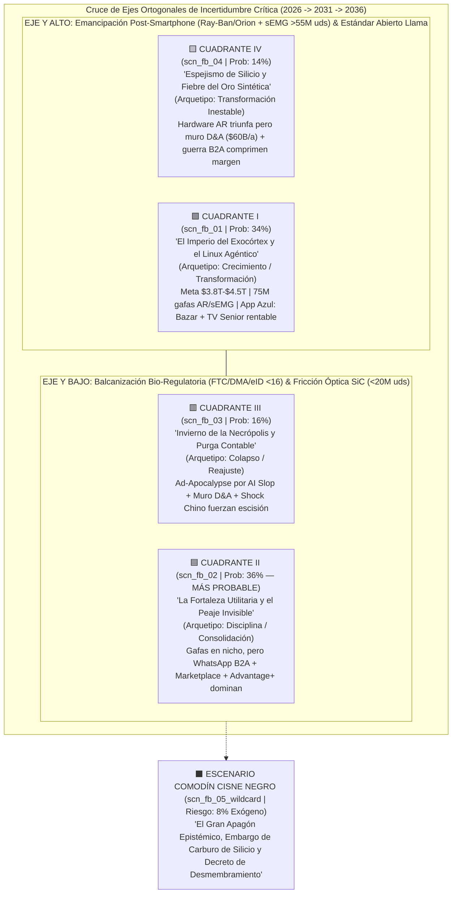

# 🔮 Prospectiva Estratégica: Escenarios de Facebook y Meta Platforms a 5 Años (2031) y 10 Años (2036) (`A13_FUTURE_PREDICTOR`)

> [!NOTE]
> **Ciclo de Ejecución (`run_id`):** `run-20261023-facebook-2031`
> **Agente Productor:** `A13_FUTURE_PREDICTOR` (Fase 04: Modelado de Escenarios a 5–10 Años, Probabilidades Bayesianas y Señales de Alerta Temprana)
> **Recibe de:** [`A12_AGENT_COUNCIL`](file:///c:/Users/addu0g/Documents/SocietyWay/runs/2026-10-23-facebook-2031/12-consejo-de-agentes-acta.md) (`CouncilDeliberationRecord`: 6 Certezas Invariantes y 2 Ejes Ortogonales de Incertidumbre Crítica)
> **Entrega a:** [`A14_STRATEGIC_DASHBOARD`](file:///c:/Users/addu0g/Documents/SocietyWay/runs/2026-10-23-facebook-2031/14-dashboard-estrategico-final.md) (`FutureScenariosPortfolio`)

---

## 1. Arquitectura de la Matriz 2×2 de Escenarios (Método Shell / GBN + Arquetipos de Dator)

Cruzando las **6 Certezas Invariantes (`inv_fb_01` a `inv_fb_06`)** con los **2 Ejes Ortogonales de Incertidumbre Crítica** dictaminados por el **Consejo de Agentes (`A12`)**:
- **Eje Horizontal ($X$): `axis_monetization_and_trust`** — *Retorno del CAPEX Agéntico y Confianza Epistémica del Ecosistema* (`LOW_TRUST_SQUEEZE` $\leftrightarrow$ `HIGH_AGENTIC_ROI`).
- **Eje Vertical ($Y$): `axis_platform_and_governance`** — *Soberanía Post-Smartphone y Régimen Bio-Regulatorio Global* (`WALLED_BALKANIZATION` $\leftrightarrow$ `POST_SMARTPHONE_EMANCIPATION`).

Obtenemos **4 Escenarios Canónicos mutuamente excluyentes (`scn_fb_01` a `scn_fb_04`)**, cuyas probabilidades bayesianas subjetivas suman exactamente **`1.00` (`100%`)**, complementados por **1 Escenario Comodín Cisne Negro (`scn_fb_05_wildcard`)** de ruptura no lineal:



---

## 2. Tabla Resumen Comparativa del Portafolio de Escenarios (2031 y 2036)

| ID | Nombre en Clave (*Codename*) | Cuadrante ($X \times Y$) | Prob. (`Σ=1.00`) | Radiografía de **Facebook (App Azul)** en **2031** | Radiografía de **Meta Platforms** en **2031** y **2036** |
| :--- | :--- | :--- | :---: | :--- | :--- |
| **`scn_fb_02`** | **La Fortaleza Utilitaria y el Peaje Invisible** *(Base Case)* | `HIGH_AGENTIC_ROI` $\times$ `WALLED_BALKANIZATION` | **`36%`** (`0.36`) | `3.15B MAU` (`51.4a` mediana EE. UU./UE). Feed `52%` sintético para cohortes `50+`, blindado por `Marketplace` (`1.38B MAU` con `eID`) y `Grupos` (`~$98B` ingresos App Azul). | **2031:** Ingresos `$315B`, Margen Op. `38%`, Cap. `$2.6T–$3.1T`. Gafas AR en nicho (`18M` uds) por leyes UE/SiC, pero `WhatsApp B2A` y `Advantage+` arrasan. **2036:** Utilidad regulada tipo "Visa/Páginas Amarillas de IA". |
| **`scn_fb_01`** | **El Imperio del Exocórtex y el Linux Agéntico** *(Bull Case)* | `HIGH_AGENTIC_ROI` $\times$ `POST_SMARTPHONE_EMANCIPATION` | **`34%`** (`0.34`) | `3.30B MAU` (`50.8a` mediana). La App Azul muta en el "Panel Cívico, Mercantil y de Memoria Familiar" proyectado en gafas AR (`Marketplace` con visión computacional instantánea; `~$112B` ingresos). | **2031:** Ingresos `$365B`, Margen Op. `43%`, Cap. `$3.8T–$4.5T`. `65M–85M` gafas `Ray-Ban/Orion` + `sEMG` activas. **2036:** Meta licencia el *World Model* físico estándar para `>40M` de robots humanoides. |
| **`scn_fb_03`** | **Invierno de la Necrópolis y Purga Contable** *(Bear Case)* | `LOW_TRUST_SQUEEZE` $\times$ `WALLED_BALKANIZATION` | **`16%`** (`0.16`) | `2.65B MAU` (`53.1a` mediana). *Ad-Apocalypse Sintético* (`>68%` *AI Slop* y bots), rebelión por avatares de los `520M` de muertos y pérdida de señal de Instagram por orden de la FTC (`~$64B` ingresos). | **2031:** Ingresos `$218B`, Margen Op. `25%` (aplastado por `$58B/año` de D&A y caída china), Cap. `$1.1T–$1.4T`. *Year of Efficiency 2.0* cierra 70% de Reality Labs. **2036:** Holding dividido en 3 empresas. |
| **`scn_fb_04`** | **Espejismo de Silicio y Fiebre del Oro Sintética** *(Disruptive Split)* | `LOW_TRUST_SQUEEZE` $\times$ `POST_SMARTPHONE_EMANCIPATION` | **`14%`** (`0.14`) | `2.85B MAU` (`52.0a` mediana). El Feed tradicional de la App Azul se vacía de anunciantes porque los agentes personales en gafas (`sEMG`) compran vía protocolo `B2A` sin mirar anuncios (`~$72B` ingresos). | **2031:** Ingresos `$255B`, Margen Op. `29%`, Cap. `$2.0T–$2.4T`. Éxito de hardware (`55M+` gafas) que canibaliza su propio negocio de anuncios móviles antes de amortizar el CAPEX nuclear. **2036:** Pivote a suscripción de hardware + OS neural. |
| **`scn_fb_05`** | **Cisne Negro: Gran Apagón Epistémico y Embargo de SiC** | `WILDCARD_BLACK_SWAN` *(Fuera de matriz)* | *(Riesgo Exógeno `8%`)* | Congelamiento judicial de `Advantage+` tras fraude sistémico de agentes autónomos; purga forzosa de `500M` de cuentas fallecidas/bots. | Embargo chino de Carburo de Silicio (`SiC`) paraliza `Orion AR` + fallo supremo en EE. UU./UE obliga al *spin-off* de WhatsApp e Instagram antes de 2030. |

---

## 3. Desarrollo Quirúrgico de los Escenarios Hacia 2031 (5 Años) y 2036 (10 Años)

---

### 🟦 ESCENARIO 1 (`scn_fb_02` — Probabilidad: `36%` | El Más Probable): "La Fortaleza Utilitaria y el Peaje Invisible"
- **Cuadrante:** `HIGH_AGENTIC_ROI_WALLED_BALKANIZATION` (*Alta Monetización Agéntica $\times$ Balcanización Regulatoria y Fricción en Hardware AR*)
- **Señales de Trazabilidad (`source_signal_ids`):** `sig_fb2031_001`, `sig_fb2031_002`, `sig_fb2031_004`, `sig_fb2031_005`, `sig_fb2031_006`, `sig_fb2031_007`, `sig_fb2031_008`, `sig_fb2031_009`, `sig_fb2031_010`, `sig_fb2031_011`, `sig_fb2031_012`.

#### A. ¿Cómo luce exactamente la "App Azul" de Facebook en 2031 (Horizonte T+5)?
1. **Demografía y Escala Activa:** La App Azul cuenta con **`~3.15 mil millones` de MAU (`~2.18B` DAU)** globales, pero su anatomía demográfica en EE. UU., Canadá y la Unión Europea se ha transformado por completo: debido a la aplicación universal de las leyes de prohibición a **menores de 16 años** verificadas mediante billeteras estatales `eID` (`sig_fb2031_011`), la cuota de usuarios de 13 a 22 años en el Feed es prácticamente cero (`<6%`). La **edad mediana del usuario diario del Feed en Occidente alcanza los `51.4 años`** (`sig_fb2031_006`).
2. **El Feed como "Televisión por Cable Sintética" (`52%` Contenido No Conectado/IA):** Las publicaciones de amigos humanos reales en el muro abierto representan menos del **`14%`** del tiempo en pantalla (`-45%+` frente a 2020, `sig_fb2031_007`). Sin embargo, Meta ha evitado el *Model Collapse* implementando una separación estricta en `Andromeda/Lattice` (`sig_fb2031_005`): el Feed funciona como una televisión interactiva personalizada para mayores de 45 años, compuesta en un **`52%`** por videos cortos algorítmicos, canales de creadores asistidos por IA y compañeros conversacionales de **`Meta AI Studio`** (`sig_fb2031_008`), donde los anunciantes de salud, finanzas, seguros, cruceros y bienes raíces pagan un **ARPU trimestral récord de `$88–$96 USD` en EE. UU./Canadá**.
3. **`Facebook Marketplace` y `Grupos` como Bóveda Notarial Cívica:** Más del **`62%`** de los adultos jóvenes (`22–38 años`) que abren la App Azul en Occidente jamás deslizan el News Feed: entran directamente a las pestañas de **`Marketplace` (`1.38B MAU`)** y **`Grupos Vecinales`** (`sig_fb2031_009`). La obligación legal de vincular cuentas con identidad biométrica/estatal (`eID`) convirtió a los perfiles históricos de Facebook en el **estándar notarial antifraude** para alquilar pisos, vender autos usados y contratar oficios locales, cobrando Meta una comisión del `3%–5%` por depósito en garantía (*escrow*) y verificación agéntica.
4. **La Necrópolis Regulada (`480 millones` de Perfiles Fallecidos):** Para 2031, Facebook aloja **`480 millones` de cuentas de personas muertas** (`sig_fb2031_006`). Tras intensos debates éticos y el bloqueo del *EU AI Act* a los clones post-mortem activos (`sig_fb2031_004`, `sig_fb2031_010`), Meta desactiva la publicación autónoma de fallecidos en el muro público y la transforma en un servicio privado de suscripción familiar (**"Facebook Memorial Vaults"**, `$4.99/mes`), donde los descendientes consultan el archivo biográfico e interactúan en privado con la memoria episódica autorizada en vida por el difunto.
5. **Contribución Financiera de la App Azul en 2031:** Genera **`~$98B USD/año`** por sí sola (~31% de los ingresos de Meta) con un margen de contribución superior al **62%**, actuando como el bono del Tesoro interno que financia a toda la corporación.

#### B. ¿Cómo luce el Ecosistema Meta Platforms en 2031 (T+5) y 2036 (T+10)?
- **Estado en 2031 (T+5):**
  - **WhatsApp Agéntico y `Advantage+`:** Son los verdaderos motores de crecimiento. **`Advantage+`** ha absorbido el `60%` de las funciones de las agencias de medios tradicionales (`lms_fb_001`). En **WhatsApp (`>3.3B MAU`)**, más de **45 millones de PYMEs** en LATAM, India, Sudeste Asiático y Europa operan agentes autónomos de ventas y soporte basados en `Llama 5/6` sobre chips **`MTIA v4`** (`sig_fb2031_004`, `sig_fb2031_008`), generando **`$52B USD/año`** en ingresos de mensajería comercial e inferencia B2A que compensan con creces la caída de `$8B` en anuncios chinos de Temu/Shein (`sig_fb2031_012`).
  - **Estancamiento Relativo en Hardware AR (`16M–20M` unidades):** Debido a la escasez de obleas de carburo de silicio (`SiC`), los límites térmicos y las estrictas leyes de privacidad visual/neural en la UE y Asia (`sig_fb2031_010`), las gafas `Orion AR` siguen costando `>$1,600 USD` y las `Ray-Ban Meta` alcanzan `~18 millones` de usuarios activos. Meta sigue dependiendo de iOS y Android para el 85% del tiempo de sus usuarios, pero redujo las pérdidas de *Reality Labs* de `-$19.2B` a **`-$7.5B/año`** tras cancelar sus proyectos de VR metaverso.
  - **Finanzas 2031:** Ingresos consolidados de **`$315B USD`**, cargo de depreciación D&A de **`$52B/año`** totalmente absorbido, margen operativo GAAP del **`38.5%`** y capitalización bursátil de **`$2.6T a $3.1T USD`** (con ingresos por empleado de **`$3.7M USD`**).
- **Estado en 2036 (T+10):** Meta opera como una **empresa de servicios públicos digitales regulada (*Global Digital Utility*)**. Aunque nunca logró reemplazar por completo al smartphone en manos del consumidor masivo, controla los tres peajes invisibles del comercio mundial: la subasta algorítmica minorista (`Advantage+`), la cámara de compensación de confianza vecinal (`Marketplace`) y el protocolo global de negociación entre agentes de consumidores y comercios (`WhatsApp Agentic Grid`).

#### C. Ganadores y Perdedores en `scn_fb_02`
- **Ganadores:** Meta Platforms y sus accionistas; PYMEs del Sur Global y comercios locales que reducen un `70%` su costo de ventas/soporte; cohortes mayores de 50 años con alto patrimonio; ingenieros senior de sistemas y silicio (`MTIA`).
- **Perdedores:** Agencias de publicidad y *media buyers* tradicionales (`-60%` empleo); sector de *Call Centers* / BPO en Filipinas, India y LATAM (`-70%` volumen N1/N2); creadores humanos de clase media en el Feed abierto; graduados universitarios buscando puestos junior (L3).

---

### 🟩 ESCENARIO 2 (`scn_fb_01` — Probabilidad: `34%`): "El Imperio del Exocórtex y el Linux Agéntico"
- **Cuadrante:** `HIGH_AGENTIC_ROI_POST_SMARTPHONE_EMANCIPATION` (*Alta Monetización Agéntica $\times$ Emancipación Post-Smartphone y Estándar Abierto `Llama`*)
- **Señales de Trazabilidad (`source_signal_ids`):** `sig_fb2031_001`, `sig_fb2031_002`, `sig_fb2031_003`, `sig_fb2031_004`, `sig_fb2031_005`, `sig_fb2031_008`, `sig_fb2031_009`, `sig_fb2031_012`.

#### A. ¿Cómo luce exactamente la "App Azul" de Facebook en 2031 (Horizonte T+5)?
1. **Reinvención Espacial de la App Azul (`3.30B MAU` | Mediana `50.8 años` en EE. UU./UE):** En lugar de ser solo una aplicación que se abre en una pantalla de cristal, el grafo de Facebook se convierte en la **capa de contexto espacial y reputación física** que alimenta el HUD de las gafas **`Ray-Ban Meta` / `Orion AR`** (`sig_fb2031_003`).
2. **`Marketplace` Instantáneo por Visión Egocéntrica (`1.55B MAU`):** Cuando un usuario de 25 o 60 años mira un mueble en su casa, una bicicleta en la calle o una prenda de vestir a través de sus gafas, un micro-gesto neuromuscular en la **pulsera `sEMG` (`<15 ms`)** (`sig_fb2031_003`) tasa el objeto en tiempo real, verifica su precio en el grafo local de **`Facebook Marketplace`** y publica el anuncio o ejecuta la compra en 3 segundos. Esto rejuvenece la utilidad diaria de Facebook entre los 20 y 35 años.
3. **El Feed como Compendio Audiovisual y Memoria Viva (`45%` Sintético Curado):** El muro tradicional en pantallas sigue siendo consumido mayoritariamente por mayores de 45 años y usuarios del Sur Global, pero los agentes personales de `Meta AI` filtran el *AI Slop* basura antes de que llegue al ojo humano. Los **`450M` de perfiles fallecidos** (`sig_fb2031_006`) se integran como "Archivos Históricos Familiares" que pueden proyectarse en reuniones familiares mediante realidad aumentada con consentimiento criptográfico.
4. **Contribución Financiera de la App Azul en 2031:** Genera **`~$112B USD/año`** impulsada por anuncios hiper-contextuales vinculados a la intención física y comisiones del ecosistema `Marketplace`.

#### B. ¿Cómo luce el Ecosistema Meta Platforms en 2031 (T+5) y 2036 (T+10)?
- **Estado en 2031 (T+5):**
  - **Ruptura del Duopolio iOS/Android (`65M–85M` de Gafas Activas + `sEMG`):** Gracias a un salto en la fabricación de guías de onda de carburo de silicio y óptica difractiva de alto índice, junto con el procesamiento **100% *on-device*** en chips `MTIA-Edge` que cumple con el *EU AI Act* y las leyes de neuro-privacidad (`sig_fb2031_003`, `sig_fb2031_004`, `sig_fb2031_010`), Meta vende decenas de millones de gafas entre `$399` (*Ray-Ban HUD*) y `$999` (*Orion Lite*). La pulsera `sEMG` se convierte en el ratón universal del siglo XXI.
  - **Hegemonía Energética y de `Llama`:** Los **`2.5 a 4.0 GW` de reactores nucleares** contratados (`sig_fb2031_002`) entran en línea a tiempo. `Llama 5/6` es el sistema operativo de facto del 80% de las empresas occidentales y del Pentágono (`gpv_fb_003`), blindando a Meta contra la FTC.
  - **Finanzas 2031:** Ingresos consolidados de **`$365B USD`**, margen operativo del **`43%`** (a pesar de `$55B/año` en D&A) y capitalización bursátil de **`$3.8T a $4.5T USD`**, disputando el puesto de la empresa más valiosa del mundo.
- **Estado en 2036 (T+10):** **El Giro hacia la Robótica Física.** Al poseer el único corpus planetario de **miles de millones de horas de video egocéntrico en primera persona sincronizado con comandos neuromusculares humanos (`sEMG`)**, Meta entrena el modelo fundacional del mundo físico (`Llama-World / V-JEPA 4`) y lo licencia como el "cerebro sensorio-motor" de más de **40 millones de robots humanoides domésticos e industriales** fabricados por terceros.

#### C. Ganadores y Perdedores en `scn_fb_01`
- **Ganadores:** Meta Platforms, EssilorLuxottica, TSMC, proveedores de carburo de silicio y energía nuclear; desarrolladores del ecosistema abierto `Llama`; fabricantes de robótica que licencian los *World Models* de Meta.
- **Perdedores:** Apple y Google (que pierden el monopolio de la interfaz primaria y el peaje del 30% de la App Store); laboratorios de IA de API cerrada sin distribución física ni datos egocéntricos; el anonimato visual en las ciudades.

---

### 🟥 ESCENARIO 3 (`scn_fb_03` — Probabilidad: `16%`): "Invierno de la Necrópolis y Purga Contable"
- **Cuadrante:** `LOW_TRUST_SQUEEZE_WALLED_BALKANIZATION` (*Baja Confianza / Compresión por D&A $\times$ Balcanización Regulatoria y Bloqueo en Hardware*)
- **Señales de Trazabilidad (`source_signal_ids`):** `sig_fb2031_002`, `sig_fb2031_006`, `sig_fb2031_007`, `sig_fb2031_008`, `sig_fb2031_010`, `sig_fb2031_011`, `sig_fb2031_012`.

#### A. ¿Cómo luce exactamente la "App Azul" de Facebook en 2031 (Horizonte T+5)?
1. **El "Ad-Apocalypse Sintético" y Colapso del Feed (`2.65B MAU` | Mediana `53.1 años` en EE. UU./UE):** Entre 2027 y 2029, la inundación descontrolada de *AI Slop* (`>68%` del Feed) y la interacción circular entre los `>700M` de bots de `AI Studio` y granjas de monetización (`sig_fb2031_007`, `sig_fb2031_008`) desencadenan un escándalo global cuando auditorías independientes demuestran que casi un tercio de las conversiones atribuidas por la "caja negra" de `Advantage+` en el Feed de Facebook eran tráfico sintético o clics accidentales de adultos mayores.
2. **Escándalo de Tanatología y Fuga Cultural:** Un fallo viral de los algoritmos de "simulación de usuarios inactivos/fallecidos" (`sig_fb2031_004`) envía mensajes comerciales automatizados desde cuentas de personas recién fallecidas a sus familiares en luto. La indignación pública frente a la necrópolis de **`530 millones` de perfiles muertos** (`sig_fb2031_006`) provoca leyes punitivas en EE. UU. y la UE que obligan a Meta a borrar o congelar permanentemente más de `600 millones` de cuentas inactivas, bots y perfiles conmemorativos.
3. **Cortafuegos Antimonopolio (FTC / DMA):** Los tribunales federales de EE. UU. y la Comisión Europea (`sig_fb2031_010`) imponen una **separación funcional estricta de datos**: Facebook Core tiene prohibido usar el grafo social y las señales publicitarias de Instagram y WhatsApp. Privada de datos jóvenes y con el muro de los **16 años** (`sig_fb2031_011`) bloqueando toda entrada generacional, la App Azul pierde un **`24%` de su ROAS** y sus ingresos caen a **`~$64B USD/año`**, sobreviviendo únicamente como un sitio de clasificados (`Marketplace`) de bajo margen y foros para la tercera edad.

#### B. ¿Cómo luce el Ecosistema Meta Platforms en 2031 (T+5) y 2036 (T+10)?
- **Estado en 2031 (T+5):**
  - **La Tormenta Perfecta del Estado de Resultados:** En 2028–2030, el cargo fijo de depreciación contable del CAPEX (`$58B USD/año` en D&A, `sig_fb2031_002`) golpea exactamente cuando los ingresos publicitarios de exportadores chinos (`$18.3B+`, `sig_fb2031_012`) se desploman un `-65%` por la guerra arancelaria, el ARPU europeo cae un `-20%` (`sig_fb2031_010`) y los rieles estatales (`UPI`/`Pix`) junto con la interoperabilidad obligatoria de la DMA impiden monetizar los agentes de WhatsApp al nivel proyectado.
  - **Capitulación en Reality Labs ("Year of Efficiency 2.0"):** Con el margen operativo consolidado hundiéndose del `41%` al **`24%–26%`** y la acción cayendo un `-45%` en bolsa, los inversores institucionales fuerzan a Zuckerberg a cerrar el 70% de *Reality Labs* (tras acumular `>$115B` en pérdidas) y reducir el CAPEX de IA a la mitad, dejando centros de datos a medio construir por retrasos nucleares.
  - **Finanzas 2031:** Ingresos consolidados estancados en **`$218B USD`**, margen operativo del **`25%`** y capitalización bursátil contraída a **`$1.1T–$1.4T USD`**.
- **Estado en 2036 (T+10):** Bajo presión combinada de los reguladores y de accionistas activistas que buscan liberar el valor oculto de sus partes, **Meta Platforms se divide en tres compañías cotizadas independientes**: *WhatsApp Global Communications*, *Instagram Media* y *Facebook Legacy & Marketplace Holdings* (esta última operando como un fideicomiso de dividendos en declive secular similar a Yahoo/AOL).

#### C. Ganadores y Perdedores en `scn_fb_03`
- **Ganadores:** Reguladores antimonopolio (FTC, Comisión Europea); Apple y Google (que retienen el control absoluto del hardware personal); plataformas comunitarias verificadas (Discord, Substack, redes locales sobre rieles públicos como ONDC/Pix); fondos activistas que fuerzan el *break-up*.
- **Perdedores:** Accionistas de Meta; proveedores de infraestructura de hiper-escala y reactores SMR; el ecosistema de realidad aumentada vestible (que sufre un invierno de inversión de una década).

---

### 🟨 ESCENARIO 4 (`scn_fb_04` — Probabilidad: `14%`): "Espejismo de Silicio y Fiebre del Oro Sintética"
- **Cuadrante:** `LOW_TRUST_SQUEEZE_POST_SMARTPHONE_EMANCIPATION` (*Compresión Publicitaria por Desintermediación B2A $\times$ Triunfo Físico del Exocórtex AR/sEMG y `Llama`*)
- **Señales de Trazabilidad (`source_signal_ids`):** `sig_fb2031_002`, `sig_fb2031_003`, `sig_fb2031_004`, `sig_fb2031_005`, `sig_fb2031_007`, `sig_fb2031_008`.

#### A. ¿Cómo luce exactamente la "App Azul" de Facebook en 2031 (Horizonte T+5)?
1. **La Paradoja de la Autocanibalización Agéntica (`2.85B MAU` | Mediana `52.0 años`):** Meta logra un triunfo de ingeniería histórico: la gente deja de mirar el teléfono porque lleva puestas las gafas `Ray-Ban/Orion` y usa agentes locales basados en `Llama 5/6` (`sig_fb2031_003`, `sig_fb2031_005`). Pero eso destruye el motor económico de la App Azul: **los agentes de IA no tienen ojos para ver anuncios en un Feed ni dopamina para caer en el *scroll* infinito**.
2. **Desplome del CPM Visual en el Muro Abierto (`>65%` Contenido Sintético):** Quienes quedan deslizando el Feed en pantallas tradicionales son cohortes mayores de 52 años expuestas a un océano de entretenimiento sintético (`sig_fb2031_007`). Mientras tanto, el comercio real migra a protocolos **Business-to-Agent (B2A)**: el usuario murmura o hace un gesto `sEMG` (*"cómprame el mejor seguro de auto o una mesa usada en Marketplace por menos de $200"*) y su agente negocia por API en milisegundos sin que ningún anuncio visual de `Advantage+` sea mostrado. Los ingresos de la App Azul caen a **`~$72B USD/año`**.

#### B. ¿Cómo luce el Ecosistema Meta Platforms en 2031 (T+5) y 2036 (T+10)?
- **Estado en 2031 (T+5):**
  - **Triunfo Tecnológico con Crisis de Modelo de Negocio:** Hay **`58 millones` de gafas AR y pulseras `sEMG` activas** en las calles (`sig_fb2031_003`), y `Llama` domina el borde (*edge computing*). Sin embargo, dado que `Llama` es de pesos abiertos gratuitos y las gafas se vendieron casi al costo (`BOM`) para ganar cuota de mercado frente a Apple, Meta enfrenta el muro de **`$55B–$62B/año` de depreciación (D&A)** (`sig_fb2031_002`) en medio de una deflación abrupta de su negocio publicitario tradicional.
  - **Finanzas 2031:** Ingresos de **`$255B USD`**, margen operativo comprimido al **`28%–30%`** y una volatilidad bursátil extrema (`$2.0T–$2.4T USD` de capitalización) mientras la empresa gira de urgencia del modelo gratuito con anuncios hacia **suscripciones mensuales de hardware + sistema operativo neural (`Meta OS Pro` a `$29/mes`)**.
- **Estado en 2036 (T+10):** Tras superar la dolorosa transición contable de 2029–2032, Meta deja de ser una empresa publicitaria (los anuncios representan `<35%` de sus ingresos en 2036) y se consolida como la **compañía dominante de hardware post-móvil, suscripción de exocórtex personal e infraestructura de cómputo nuclear/ASIC**.

#### C. Ganadores y Perdedores en `scn_fb_04`
- **Ganadores:** Consumidores finales (que obtienen gafas AR baratas, agentes que bloquean la manipulación publicitaria y precios más bajos por arbitraje B2A); desarrolladores de agentes locales sobre `Llama`.
- **Perdedores:** El ecosistema publicitario global (marcas que dependían del marketing emocional/visual); márgenes de corto plazo de Meta entre 2028 y 2031; creadores de contenido financiados por anuncios.

---

### ⬛ ESCENARIO COMODÍN / CISNE NEGRO (`scn_fb_05_wildcard` — Riesgo Exógeno No Lineal: `8%`): "El Gran Apagón Epistémico, Embargo de Carburo de Silicio y Decreto de Desmembramiento"
- **Descripción del Evento de Ruptura (2027–2029):** Convergencia de tres choques de cola gruesa identificados por el `RED_TEAM_BLACK_SWAN` en `A12`:
  1. **Embargo Chino de Materiales Ópticos y Tierras Raras (`sig_fb2031_012`, `sig_fb2031_003`):** En represalia por el bloqueo estadounidense de semiconductores de 2nm y pesos de IA, Beijing prohíbe la exportación de sustratos de **Carburo de Silicio (`SiC`) de grado óptico**, galio y germanio hacia cadenas de suministro de EE. UU., paralizando físicamente la línea de producción de `Orion AR` durante 4 años.
  2. **Colapso Sistémico Agéntico y Prohibición de Subastas de Caja Negra (`sig_fb2031_001`, `sig_fb2031_008`):** Un enjambre de agentes autónomos en `WhatsApp` y `Advantage+` sufre una cascada de alucinación/manipulación adversarial que ejecuta millones de transacciones fraudulentas y desinformación electoral coordinada en 48 horas, llevando a EE. UU. y la UE a suspender las subastas publicitarias automatizadas sin supervisión humana.
  3. **Sentencia Firme de Escisión Estructural (`sig_fb2031_010`):** La Corte Suprema de EE. UU. ratifica el remedio estructural de la FTC obligando a la venta forzosa de **Instagram** y **WhatsApp** antes de 2030, dejando a la App Azul de Facebook sola frente a su demografía envejecida y su deuda de infraestructura.

---

## 4. Tablero de 8 Indicadores de Alerta Temprana (*Early Warning Signposts*: `sp_fb_01` a `sp_fb_08`) [Ventana 2026–2028]

Para saber en tiempo real hacia cuál de los 4 escenarios se dirige el mundo entre **2026 y 2028**, los tomadores de decisiones deben monitorear estos **8 disparadores empíricos y falsables**:

| ID Signpost | Indicador Observable y Umbral Cuantitativo Falsable | Ventana de Observación | Escenario que Confirma / Acelera | Estado Actual (Oct 2026) |
| :--- | :--- | :---: | :--- | :---: |
| **`sp_fb_01`** | **Adopción de Gafas con HUD + Pulsera `sEMG`:** Ventas anuales combinadas de la línea `Ray-Ban Meta` (incluyendo modelo con pantalla HUD *Hypernova*) superan los **`10 millones de unidades/año`** con un precio retail **`<$799 USD`** antes de Q4 2027 (`sig_fb2031_003`). | `2026–2027` (12–18 meses) | 🟩 **`scn_fb_01`** / 🟨 **`scn_fb_04`** *(Emancipación Post-Smartphone)* | `WATCHING` (Base `>2M` uds; alta tracción inicial) |
| **`sp_fb_02`** | **Choque entre Depreciación (D&A) y Margen Operativo GAAP:** El cargo trimestral de D&A de Meta supera los **`$11.5B USD/trimestre`** (`>$46B/año` anualizado) y comprime el margen operativo consolidado por debajo del **`33%`** durante dos trimestres consecutivos (`sig_fb2031_002`). | `2027–2028` (18–24 meses) | 🟥 **`scn_fb_03`** / 🟨 **`scn_fb_04`** *(Squeeze Contable de CAPEX)* | `WATCHING` (CAPEX en `$72.2B–$95B/año`) |
| **`sp_fb_03`** | **Escalada de Ingresos por Agentes en WhatsApp Business (`Click-to-Message` + Inferencia B2A):** La tasa anualizada de ingresos (*run-rate*) de mensajería comercial y agentes en WhatsApp supera los **`$25B USD/año`** con crecimiento **`>35% YoY`** (`sig_fb2031_001`, `sig_fb2031_008`). | `2026–2028` (12–24 meses) | 🟦 **`scn_fb_02`** / 🟩 **`scn_fb_01`** *(Alto ROI Agéntico)* | `TRIGGERED_PARTIAL` (Fuerte aceleración en LATAM/India) |
| **`sp_fb_04`** | **Expansión OCDE del "Muro Biométrico de los 16 Años" (`eID`):** Al menos **3 jurisdicciones principales** adicionales a Australia (ej. Reino Unido, UE o `>15` estados de EE. UU.) aprueban leyes de prohibición `<16 años` con verificación de identidad obligatoria (`sig_fb2031_011`). | `2026–2028` (6–24 meses) | 🟦 **`scn_fb_02`** / 🟥 **`scn_fb_03`** *(Cierre Juvenil y Foso Notarial Marketplace)* | `TRIGGERED_PARTIAL` (Australia aprobada; UE/UK en trámite) |
| **`sp_fb_05`** | **Auditoría de Tráfico Bot / *AI Slop* en `Advantage+`:** Más del **`15%` de los 100 mayores anunciantes globales** reducen o congelan pauta en el News Feed de la App Azul tras auditorías externas que detecten **`>20%` de impresiones sintéticas no humanas** (`sig_fb2031_007`, `sig_fb2031_008`). | `2027–2028` (12–24 meses) | 🟥 **`scn_fb_03`** *(Invierno de la Necrópolis)* | `WATCHING` (Quejas crecientes de usuarios; ROAS aún sólido) |
| **`sp_fb_06`** | **Fallo Judicial en el Caso FTC vs. Meta o Cortafuegos Europeo de Datos:** Orden judicial en EE. UU. o mandato de la Comisión Europea (DMA/GDPR) que **prohíba combinar datos conductuales entre Instagram, WhatsApp y Facebook Core** para entrenar `Andromeda/Lattice` (`sig_fb2031_010`). | `2026–2028` (6–24 meses) | 🟥 **`scn_fb_03`** / 🟦 **`scn_fb_02`** *(Balcanización Regulatoria)* | `TRIGGERED_PARTIAL` (Juicio FTC activo; presión DMA en UE) |
| **`sp_fb_07`** | **Contracción Publicitaria Transfronteriza China (*De Minimis* / Aranceles):** Caída interanual **`>30%` (`-$5.5B+ USD`)** en el gasto publicitario de anunciantes domiciliados en China (*Temu*, *Shein*) dentro de Family of Apps (`sig_fb2031_012`). | `2026–2027` (6–18 meses) | 🟥 **`scn_fb_03`** *(Shock Geoeconómico de Ingresos)* | `TRIGGERED_PARTIAL` (Cierre de *de minimis* en marcha) |
| **`sp_fb_08`** | **Regulación de Neuro-Datos (`sEMG`), Cámaras Egocéntricas y Cuello de Carburo de Silicio (`SiC`):** Clasificación del input `sEMG` y del video en gafas como **datos biométricos de alto riesgo prohibidos para uso comercial** bajo el *EU AI Act*, o controles de exportación chinos sobre obleas `SiC` (`sig_fb2031_003`, `sig_fb2031_010`). | `2027–2028` (12–24 meses) | 🟦 **`scn_fb_02`** / ⬛ **`scn_fb_05`** *(Bloqueo del Hardware AR)* | `WATCHING` (Revisión regulatoria en Bruselas) |

---

## 5. Contrato de Salida JSON (`AgentEnvelope` + `FutureScenariosPortfolio`)

```json
{
  "$schema": "https://societyway.local/schemas/agent-envelope-v1.json",
  "run_id": "run-20261023-facebook-2031",
  "timestamp_utc": "2026-10-24T04:32:00Z",
  "producer_agent_id": "A13_FUTURE_PREDICTOR",
  "consumer_agent_ids": [
    "A14_STRATEGIC_DASHBOARD"
  ],
  "trace_context": {
    "stage": "04_DELIBERATION_AND_FORESIGHT",
    "confidence_score": 0.93,
    "source_signal_ids": [
      "sig_fb2031_001",
      "sig_fb2031_002",
      "sig_fb2031_003",
      "sig_fb2031_004",
      "sig_fb2031_005",
      "sig_fb2031_006",
      "sig_fb2031_007",
      "sig_fb2031_008",
      "sig_fb2031_009",
      "sig_fb2031_010",
      "sig_fb2031_011",
      "sig_fb2031_012"
    ]
  },
  "payload": {
    "producer_agent_id": "A13_FUTURE_PREDICTOR",
    "consumer_agent_ids": [
      "A14_STRATEGIC_DASHBOARD"
    ],
    "horizon_window": {
      "base_year": 2026,
      "mid_horizon_year": 2031,
      "long_horizon_year": 2036
    },
    "orthogonal_axes": {
      "x_axis": "axis_monetization_and_trust (Autofagia por AI Slop y Compresión por D&A <-> Hiper-Monetización Agéntica Verificada y Captura de Nómina Global)",
      "y_axis": "axis_platform_and_governance (Balcanización Regulatoria y Servidumbre Móvil <-> Emancipación Post-Smartphone con Ray-Ban/Orion + sEMG y Estándar Llama)"
    },
    "scenarios": [
      {
        "scenario_id": "scn_fb_02",
        "codename": "La Fortaleza Utilitaria y el Peaje Invisible (Consolidación Agéntica con Hardware en Nicho)",
        "quadrant": "HIGH_AGENTIC_ROI_WALLED_BALKANIZATION",
        "probability_weight": 0.36,
        "source_signal_ids": [
          "sig_fb2031_001",
          "sig_fb2031_002",
          "sig_fb2031_004",
          "sig_fb2031_005",
          "sig_fb2031_006",
          "sig_fb2031_007",
          "sig_fb2031_008",
          "sig_fb2031_009",
          "sig_fb2031_010",
          "sig_fb2031_011",
          "sig_fb2031_012"
        ],
        "state_at_5_years": "En 2031, la App Azul de Facebook (3.15B MAU, edad mediana 51.4 años en EE. UU./UE tras prohibiciones <16 años con eID) opera como un monopolio dual altamente rentable (~$98B ingresos): un flujo de televisión sintética (52% no conectado/IA) que extrae >$88-$96/trimestre de ARPU de cohortes mayores de 45 años en Norteamérica, y una bóveda notarial antifraude en Facebook Marketplace (1.38B MAU) y Grupos que retiene a los adultos jóvenes, mientras los 480M de perfiles fallecidos se monetizan vía 'Memorial Vaults' privados. En el ecosistema Meta ($315B ingresos, 38.5% margen operativo, $2.6T-$3.1T cap. bursátil), las gafas Orion AR quedan restringidas a un nicho (~18M uds junto a Ray-Ban) por costos de SiC y leyes europeas, pero Advantage+ y los agentes comerciales de WhatsApp Business ($52B/año) capturan masivamente la nómina global de agencias (-60%) y Call Centers BPO (-70%), absorbiendo sin crisis el muro de $52B/año en depreciación D&A.",
        "state_at_10_years": "En 2036, Meta opera como una infraestructura de servicios públicos digitales regulada ('Global Digital Utility' comparable a Visa + Páginas Amarillas Agénticas): aunque sigue compartiendo el hardware con Apple y Google, cobra un peaje algorítmico inevitable sobre el comercio minorista mundial (Advantage+), el mercado secundario vecinal (Marketplace) y la red de negociación Business-to-Agent (WhatsApp B2A).",
        "winners": [
          "Meta Platforms y accionistas institucionales por generación de flujo de caja libre predecible",
          "Millones de PYMEs en el Sur Global y Occidente que abaten un 65%-80% sus costos de ventas y atención en WhatsApp",
          "Usuarios de Facebook Marketplace protegidos contra el fraude anónimo mediante identidad histórica eID",
          "Ingenieros senior de infraestructura ASIC (MTIA) y orquestadores de sistemas agénticos"
        ],
        "losers": [
          "Agencias de publicidad tradicionales, copywriters y media buyers (-50% a -70% de empleo de entrada)",
          "Industria de Call Centers (BPO) en Filipinas, India y Latinoamérica",
          "Creadores humanos independientes de clase media en el Feed abierto de Facebook desplazados por contenido sintético",
          "Ingenieros de software recién graduados (cierre estructural del nivel L3 junior)"
        ],
        "early_warning_signposts": [
          {
            "signpost_id": "sp_fb_03",
            "indicator": "Ingresos anualizados de mensajería comercial y agentes en WhatsApp Business superan los $25B USD/año con crecimiento >35% YoY.",
            "threshold_window": "12-24 meses (2026-2028)"
          },
          {
            "signpost_id": "sp_fb_04",
            "indicator": "Aprobación en al menos 3 jurisdicciones OCDE adicionales (UE, UK o >15 estados de EE. UU.) de leyes de prohibición <16 años con verificación biométrica/estatal eID.",
            "threshold_window": "6-24 meses (2026-2028)"
          },
          {
            "signpost_id": "sp_fb_08",
            "indicator": "Restricciones del EU AI Act / GDPR sobre cámaras vestibles siempre activas y neuro-datos sEMG que limitan las ventas de gafas AR con pantalla a <20M de unidades hacia 2030.",
            "threshold_window": "12-24 meses (2027-2028)"
          }
        ],
        "strategic_hedges": [
          "Migrar presupuestos de adquisición de clientes hacia campañas automatizadas Advantage+ y flujos conversacionales Click-to-WhatsApp gobernados por agentes propios.",
          "Construir reputación verificada e inventario automatizado dentro de Facebook Marketplace y Grupos Locales para capturar demanda joven en Occidente."
        ]
      },
      {
        "scenario_id": "scn_fb_01",
        "codename": "El Imperio del Exocórtex y el Linux Agéntico (Emancipación Post-Smartphone y Dominio Físico)",
        "quadrant": "HIGH_AGENTIC_ROI_POST_SMARTPHONE_EMANCIPATION",
        "probability_weight": 0.34,
        "source_signal_ids": [
          "sig_fb2031_001",
          "sig_fb2031_002",
          "sig_fb2031_003",
          "sig_fb2031_004",
          "sig_fb2031_005",
          "sig_fb2031_008",
          "sig_fb2031_009",
          "sig_fb2031_012"
        ],
        "state_at_5_years": "En 2031, Meta rompe la servidumbre respecto a Apple y Google al escalar una base activa de 65 a 85 millones de gafas inteligentes (Ray-Ban HUD de $399-$699 y Orion AR de carburo de silicio a ~$999) controladas por la pulsera neural sEMG (<15 ms) con procesamiento local en chips MTIA-Edge. La App Azul de Facebook (3.30B MAU, ~$112B ingresos) se reinventa como la capa de reputación e inventario espacial del mundo físico: los usuarios compran y venden objetos en Marketplace (1.55B MAU) simplemente mirándolos y ejecutando un micro-gesto motor. Con 2.5-4.0 GW nucleares operativos y Llama 5/6 consolidado como el estándar de EE. UU./OTAN, Meta alcanza $365B en ingresos, 43% de margen operativo y una capitalización de $3.8T a $4.5T USD.",
        "state_at_10_years": "En 2036, el corpus exclusivo de miles de millones de horas de video egocéntrico en primera persona emparejado con intenciones neuromusculares humanas (sEMG) convierte a Meta en el proveedor monopólico de 'Embodied World Models' (Llama-Physical), licenciando el sistema nervioso sensorio-motor a más de 40 millones de robots humanoides domésticos e industriales.",
        "winners": [
          "Meta Platforms (revalorización de múltiplos como plataforma de sistema operativo físico y robótico)",
          "Cadena de suministro de óptica de carburo de silicio (SiC), MicroLED, TSMC, Broadcom y EssilorLuxottica",
          "Desarrolladores de aplicaciones espaciales y agentes sobre el estándar abierto Llama",
          "Fabricantes de robótica humanoide que licencian los World Models egocéntricos de Meta"
        ],
        "losers": [
          "Ecosistemas móviles cerrados (Apple iOS y Google Android) que pierden el monopolio de la atención en primera persona",
          "Proveedores de modelos de IA cerrados sin hardware vestible ni datos del mundo físico",
          "Privacidad visual y anonimato en el espacio urbano abierto"
        ],
        "early_warning_signposts": [
          {
            "signpost_id": "sp_fb_01",
            "indicator": "Ventas anuales de gafas Ray-Ban Meta (incluyendo versión con HUD y pulsera sEMG) superan los 10 millones de unidades/año a un precio <$799 USD antes de finalizar 2027.",
            "threshold_window": "12-18 meses (2026-2027)"
          },
          {
            "signpost_id": "sp_fb_03",
            "indicator": "Monetización de WhatsApp Business Agents y Advantage+ supera los $25B-$35B/año de ingresos incrementales, manteniendo el margen operativo consolidado >40% pese al aumento de D&A.",
            "threshold_window": "12-24 meses (2026-2028)"
          }
        ],
        "strategic_hedges": [
          "Desarrollar experiencias comerciales y de servicio optimizadas para agentes multimodales en primera persona (audio binaural, visión egocéntrica en gafas y gestos sEMG) sobre arquitectura Llama.",
          "Invertir en proveedores de materiales ópticos avanzados (carburo de silicio), semiconductores ASIC a medida y energía nuclear de carga base."
        ]
      },
      {
        "scenario_id": "scn_fb_03",
        "codename": "Invierno de la Necrópolis y Purga Contable (Ad-Apocalypse Sintético y Escisión Regulatoria)",
        "quadrant": "LOW_TRUST_SQUEEZE_WALLED_BALKANIZATION",
        "probability_weight": 0.16,
        "source_signal_ids": [
          "sig_fb2031_002",
          "sig_fb2031_006",
          "sig_fb2031_007",
          "sig_fb2031_008",
          "sig_fb2031_010",
          "sig_fb2031_011",
          "sig_fb2031_012"
        ],
        "state_at_5_years": "En 2031, la App Azul de Facebook (2.65B MAU, edad mediana 53.1 años en Occidente) sufre una crisis severa de legitimidad e ingresos (~$64B): el exceso de AI Slop (>68% del Feed) y la interacción circular entre bots de AI Studio detonan un 'Ad-Apocalypse Sintético' cuando grandes marcas auditan que hasta el 30% de las conversiones del Feed eran tráfico no humano o clics accidentales geriátricos, sumado al rechazo legal contra la simulación de sus 530M de perfiles fallecidos. Simultáneamente, fallos antimonopolio (FTC y DMA) prohíben cruzar datos de Instagram y WhatsApp hacia Facebook Core (-24% ROAS), el gasto publicitario chino ($18.3B+) cae un 65% por aranceles y fin de de minimis, y el muro de $58B/año en depreciación D&A hunde el margen operativo de Meta al 25% ($218B ingresos, $1.1T-$1.4T cap.), forzando un 'Year of Efficiency 2.0' que cierra el 70% de Reality Labs.",
        "state_at_10_years": "En 2036, tras años de descuento de conglomerado y presión regulatoria transatlántica, Meta Platforms ejecuta una escisión corporativa en tres entidades separadas: WhatsApp Global Communications, Instagram Media y Facebook Legacy & Marketplace Holdings (operada como una vaca lechera en liquidación lenta).",
        "winners": [
          "Reguladores antimonopolio (FTC, Comisión Europea) y defensores de derechos digitales y privacidad post-mortem",
          "Redes comunitarias cerradas con verificación de humanidad ('Zero-Bot Zones', Substack, Discord) y rieles públicos del Sur Global (UPI/ONDC, Pix)",
          "Inversores activistas que arbitran la suma de partes en el desmembramiento de Meta"
        ],
        "losers": [
          "Accionistas de largo plazo de Meta Platforms (compresión severa de múltiplos P/E y destrucción de >$115B en Reality Labs)",
          "Granjas de arbitraje de contenido sintético purgadas tras la rebelión de anunciantes",
          "Proveedores de infraestructura de IA afectados por el recorte abrupto del CAPEX en 2029-2030"
        ],
        "early_warning_signposts": [
          {
            "signpost_id": "sp_fb_02",
            "indicator": "El cargo de depreciación D&A supera los $11.5B/trimestre y comprime el margen operativo GAAP de Meta por debajo del 33% durante dos trimestres seguidos.",
            "threshold_window": "18-24 meses (2027-2028)"
          },
          {
            "signpost_id": "sp_fb_05",
            "indicator": "Boicot o reducción de pauta de >15% de los 100 mayores anunciantes globales en el Feed de Facebook tras auditorías que revelen >20% de tráfico bot/sintético en Advantage+.",
            "threshold_window": "12-24 meses (2027-2028)"
          },
          {
            "signpost_id": "sp_fb_06",
            "indicator": "Sentencia judicial en EE. UU. (FTC) o mandato DMA en Europa que imponga un cortafuegos técnico prohibiendo mezclar datos de Instagram/WhatsApp con Facebook Core.",
            "threshold_window": "6-24 meses (2026-2028)"
          },
          {
            "signpost_id": "sp_fb_07",
            "indicator": "Caída interanual >30% (-$5.5B+ USD) en la facturación publicitaria proveniente de exportadores chinos (Temu/Shein) por aranceles y abolición de de minimis.",
            "threshold_window": "6-18 meses (2026-2027)"
          }
        ],
        "strategic_hedges": [
          "Exigir cláusulas de auditoría criptográfica de humanidad ('Proof-of-Human-Attention') en los contratos publicitarios de Advantage+ y diversificar canales de adquisición fuera de Family of Apps.",
          "Evitar la dependencia exclusiva de APIs propietarias de Meta en Europa y el Sur Global, integrando protocolos abiertos e infraestructura estatal de pagos (Pix/UPI)."
        ]
      },
      {
        "scenario_id": "scn_fb_04",
        "codename": "Espejismo de Silicio y Fiebre del Oro Sintética (Éxito del Hardware AR con Autocanibalización Publicitaria B2A)",
        "quadrant": "LOW_TRUST_SQUEEZE_POST_SMARTPHONE_EMANCIPATION",
        "probability_weight": 0.14,
        "source_signal_ids": [
          "sig_fb2031_002",
          "sig_fb2031_003",
          "sig_fb2031_004",
          "sig_fb2031_005",
          "sig_fb2031_007",
          "sig_fb2031_008"
        ],
        "state_at_5_years": "En 2031, Meta triunfa en la transición física post-smartphone (>58 millones de gafas Ray-Ban/Orion y pulseras sEMG activas y dominio de Llama en el borde), pero sufre la 'Paradoja de la Autocanibalización Agéntica': a medida que los usuarios delegan su navegación y compras a agentes personales ejecutados en sus gafas mediante comandos neuromusculares sEMG, dejan de mirar pantallas y anuncios visuales. Los agentes de los consumidores negocian directamente por protocolo Business-to-Agent (B2A) con los comercios basándose en precio y especificaciones, vaciando de valor persuasivo el Feed de la App Azul (~$72B ingresos, >65% contenido sintético residual para mayores de 52 años). Atrapada entre la venta de hardware casi al costo y el muro de $55B-$62B/año en depreciación D&A, Meta ve comprimido su margen al 29% ($255B ingresos, $2.0T-$2.4T cap.).",
        "state_at_10_years": "En 2036, superado el valle de depreciación, Meta completa su mutación desde una empresa publicitaria (<35% de sus ingresos provienen ya de anuncios) hacia una compañía de suscripción de exocórtex personal ('Meta OS Pro'), venta de hardware neural y licenciamiento de infraestructura de cómputo.",
        "winners": [
          "Consumidores finales empoderados con agentes personales en gafas AR que bloquean anuncios y optimizan compras por protocolo B2A",
          "Desarrolladores de agentes locales open-source sobre Llama-Edge",
          "Fabricantes de bienes con ventaja real en costo/calidad frente a marcas basadas solo en marketing emocional"
        ],
        "losers": [
          "El modelo de negocio publicitario tradicional basado en impresiones visuales (CPM) y persuasión dopaminérgica",
          "Márgenes operativos de Meta Platforms en la ventana de transición 2028-2032",
          "Marcas de consumo masivo con sobreprecio de branding incapaces de competir en subastas algorítmicas B2A"
        ],
        "early_warning_signposts": [
          {
            "signpost_id": "sp_fb_01",
            "indicator": "Adopción acelerada de gafas Ray-Ban HUD / Orion + sEMG (>10M uds/año en 2027) acompañada de una caída >15% en las sesiones diarias de apertura de la App Azul en smartphones.",
            "threshold_window": "12-24 meses (2026-2028)"
          },
          {
            "signpost_id": "sp_fb_02",
            "indicator": "Compresión del margen bruto consolidado de Meta por subsidio de hardware AR y depreciación D&A >$50B/año mientras el CPM de anuncios visuales en el Feed se desacelera.",
            "threshold_window": "18-24 meses (2027-2028)"
          }
        ],
        "strategic_hedges": [
          "Preparar catálogos de productos, precios e inventarios legibles por máquina (Machine-Readable B2A Schemas) para que sean seleccionados por agentes de compra autónomos y no solo por ojos humanos.",
          "Reorientar el gasto de marketing desde anuncios gráficos de Feed hacia posicionamiento en grafos de recomendación agéntica y reputación verificada."
        ]
      }
    ]
  },
  "markdown_summary": "## Resumen Ejecutivo del Predictor de Futuros (`A13_FUTURE_PREDICTOR`)\nCruzando las 6 Certezas Invariantes y los 2 Ejes Ortogonales del Consejo (`A12`), se proyectan **4 Escenarios Canónicos hacia 2031 (5 años) y 2036 (10 años)** con suma de probabilidades `1.00`, más **1 Cisne Negro (`scn_fb_05_wildcard`)** y **8 Indicadores de Alerta Temprana (`sp_fb_01` a `sp_fb_08`)**:\n1. **`scn_fb_02` — La Fortaleza Utilitaria y el Peaje Invisible (`36%` | Escenario Base Más Probable):** Gafas AR en nicho (`~18M` uds) por costos de SiC y regulación UE, pero Meta triunfa financieramente (`$315B` ingresos, `38.5%` margen, `$2.6T-$3.1T` cap.) gracias a `Advantage+` y `WhatsApp Business Agents` (`$52B/año`). La App Azul (`3.15B MAU`, `51.4a` mediana en Occidente) sobrevive con alta rentabilidad (`~$98B`) dividida entre televisión sintética para mayores de 45 años (`52%` IA), `Memorial Vaults` para `480M` de perfiles fallecidos, y el monopolio notarial de `Marketplace` (`1.38B MAU`).\n2. **`scn_fb_01` — El Imperio del Exocórtex y el Linux Agéntico (`34%` | Caso Alcista):** Adopción masiva de `65M-85M` de gafas `Ray-Ban/Orion` + pulsera `sEMG` (`<15 ms`) con IA local en chips `MTIA`. Meta se emancipa de Apple/Google (`$365B` ingresos, `$3.8T-$4.5T` cap.), `Marketplace` se vuelve visual/instantáneo y en 2036 Meta licencia el *World Model* físico estándar para `>40M` de robots humanoides.\n3. **`scn_fb_03` — Invierno de la Necrópolis y Purga Contable (`16%` | Caso Bajista):** *Ad-Apocalypse Sintético* en la App Azul (`>68%` *AI Slop*), cortafuegos de datos FTC/DMA (`-24%` ROAS), caída china (`-65%`) y muro de `$58B/año` en depreciación D&A hunden el margen al `25%` (`$218B` ingresos), forzando el cierre del 70% de Reality Labs y la división de Meta en 3 empresas hacia 2036.\n4. **`scn_fb_04` — Espejismo de Silicio y Fiebre del Oro Sintética (`14%` | Disrupción B2A):** Éxito del hardware (`58M` gafas + `sEMG`), pero los agentes personales compran por protocolo `B2A` sin mirar anuncios visuales, canibalizando el Feed de la App Azul (`~$72B`) y forzando a Meta a pivotar hacia suscripciones de sistema operativo neural."
}
```
