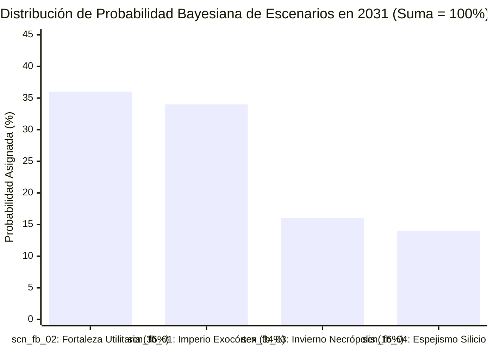

# 🧭 SocietyWay — Dashboard Estratégico Ejecutivo Final (`A14_STRATEGIC_DASHBOARD`)

> [!IMPORTANT]
> **Ciclo de Inteligencia (`run_id`):** `run-20261023-facebook-2031` | **Modo:** `/boost` (Trazabilidad Total `A01` $\rightarrow$ `A14`)
> **Pregunta Rectora:** *¿Qué sucederá en 5 años (2026–2031) con Facebook (tanto la plataforma/app azul de Facebook como el ecosistema Meta Platforms) y cuál es su trayectoria hacia 2036?*
> **Veredicto Ejecutivo en Una Frase:** Hacia **2031**, **Facebook (la App Azul)** deja de existir como una "red social de amigos humanos" (`-45%` en posteos originales, `<12%` de uso adolescente por prohibiciones legales a `<16 años`, edad mediana de **`51.4 años`** en Occidente y **`420M–550M` de perfiles fallecidos**), pero **sobrevive como una colosal vaca lechera escindida (`~$98B–$112B/año`)**: mitad **"televisión por cable sintética (`42%–55%+` de IA)"** para mayores de 45 años y mitad **"bóveda notarial antifraude de comercio vecinal (`Facebook Marketplace >1.38B MAU` y `Grupos`)"** para jóvenes; ese flujo de caja financia la metamorfosis de **Meta Platforms (`$315B–$365B` en ingresos proyectados en 2031)** en el **sistema operativo agéntico del comercio global (`Advantage+` + `WhatsApp B2A`)** y el **exocórtex post-smartphone (`Ray-Ban/Orion AR` + pulsera neural `sEMG`)**.

---

## I. Radiografía Cuantitativa: Línea Base Auditada (2026) vs. Proyección 5 Años (2031)

| Indicador Estratégico Verificable | Línea Base Auditada (`2025/2026`) | Proyección Escenario Base (`2031` — `scn_fb_02`, `36%`) | Proyección Caso Exocórtex (`2031` — `scn_fb_01`, `34%`) | Proyección Caso Bajista (`2031` — `scn_fb_03`, `16%`) | Señales de Origen (`A01`) |
| :--- | :--- | :--- | :--- | :--- | :---: |
| **1. Ingresos Anuales Consolidados (Meta)** | **`$200.97B USD`** (+22% YoY) | **`$315.0B USD`** (CAGR ~9.4%) | **`$365.0B USD`** (CAGR ~12.7%) | **`$218.0B USD`** (Estancamiento) | [`sig_fb2031_001`](file:///c:/Users/addu0g/Documents/SocietyWay/runs/2026-10-23-facebook-2031/01-ingesta-recolector.md#L89-L105) |
| **2. Ingresos de "La App Azul" (Facebook Core)** | **`~$96.0B USD`** (~48% del total) | **`~$98.0B USD`** (~31% del total) | **`~$112.0B USD`** (~31% del total) | **`~$64.0B USD`** (*Ad-Apocalypse*) | [`sig_fb2031_001`](file:///c:/Users/addu0g/Documents/SocietyWay/runs/2026-10-23-facebook-2031/01-ingesta-recolector.md#L89-L105), [`sig_fb2031_007`](file:///c:/Users/addu0g/Documents/SocietyWay/runs/2026-10-23-facebook-2031/01-ingesta-recolector.md#L194-L209) |
| **3. Ingresos de WhatsApp Agéntico / Business** | **`~$8.5B–$11B USD`** | **`$52.0B USD`** (Motor B2A PYME) | **`$64.0B USD`** (Agentes + Pagos) | **`$24.0B USD`** (Fricción DMA/UPI) | [`sig_fb2031_008`](file:///c:/Users/addu0g/Documents/SocietyWay/runs/2026-10-23-facebook-2031/01-ingesta-recolector.md#L211-L226), [`sig_fb2031_010`](file:///c:/Users/addu0g/Documents/SocietyWay/runs/2026-10-23-facebook-2031/01-ingesta-recolector.md#L245-L260) |
| **4. Personas Activas Diarias Familia (DAP)** | **`3.58 mil millones`** | **`3.95 mil millones`** | **`4.15 mil millones`** | **`3.40 mil millones`** (Purga bots) | [`sig_fb2031_001`](file:///c:/Users/addu0g/Documents/SocietyWay/runs/2026-10-23-facebook-2031/01-ingesta-recolector.md#L89-L105), [`sig_fb2031_008`](file:///c:/Users/addu0g/Documents/SocietyWay/runs/2026-10-23-facebook-2031/01-ingesta-recolector.md#L211-L226) |
| **5. Edad Mediana Usuario App Azul (EE. UU./UE)** | **`46.5 años`** (`<12%` uso diario teen) | **`51.4 años`** (Muro legal `<16`) | **`50.8 años`** (Rebote por AR/Marketplace) | **`53.1 años`** (Geriatrización pura) | [`sig_fb2031_006`](file:///c:/Users/addu0g/Documents/SocietyWay/runs/2026-10-23-facebook-2031/01-ingesta-recolector.md#L177-L192), [`sig_fb2031_011`](file:///c:/Users/addu0g/Documents/SocietyWay/runs/2026-10-23-facebook-2031/01-ingesta-recolector.md#L262-L277) |
| **6. Perfiles de Personas Fallecidas en Facebook** | **`~210–240 millones`** | **`480 millones`** (*Memorial Vaults*) | **`450 millones`** (Legado AR curado) | **`530 millones`** (Crisis regulatoria) | [`sig_fb2031_004`](file:///c:/Users/addu0g/Documents/SocietyWay/runs/2026-10-23-facebook-2031/01-ingesta-recolector.md#L143-L158), [`sig_fb2031_006`](file:///c:/Users/addu0g/Documents/SocietyWay/runs/2026-10-23-facebook-2031/01-ingesta-recolector.md#L177-L192) |
| **7. % Contenido No Conectado / Sintético en Feed** | **`42%–50%`** (`-45%` posts amigos) | **`52%`** (TV Sintética segmentada) | **`45%`** (Filtrado por agente personal) | **`>68%`** (*Model Collapse* / *Slop*) | [`sig_fb2031_005`](file:///c:/Users/addu0g/Documents/SocietyWay/runs/2026-10-23-facebook-2031/01-ingesta-recolector.md#L160-L175), [`sig_fb2031_007`](file:///c:/Users/addu0g/Documents/SocietyWay/runs/2026-10-23-facebook-2031/01-ingesta-recolector.md#L194-L209) |
| **8. Usuarios Mensuales `Facebook Marketplace`** | **`>1.20 mil millones MAU`** | **`1.38 mil millones MAU`** (Foso `eID`) | **`1.55 mil millones MAU`** (Visión AR) | **`1.15 mil millones MAU`** | [`sig_fb2031_009`](file:///c:/Users/addu0g/Documents/SocietyWay/runs/2026-10-23-facebook-2031/01-ingesta-recolector.md#L228-L243) |
| **9. CAPEX Anual vs. Muro de Depreciación (D&A)** | **`$72.2B–$95B`** CAPEX / `~$18B` D&A | **`$82B`** CAPEX / **`$52B/año` D&A** | **`$95B`** CAPEX / **`$55B/año` D&A** | **`$45B`** (Recorte) / **`$58B/año` D&A** | [`sig_fb2031_002`](file:///c:/Users/addu0g/Documents/SocietyWay/runs/2026-10-23-facebook-2031/01-ingesta-recolector.md#L107-L123) |
| **10. Gafas `Ray-Ban/Orion AR` + Pulsera `sEMG`** | **`~2.5M–4M` unidades** (`-$19.2B` RL) | **`~18M` unidades** (Nicho por UE/SiC) | **`65M–85M` unidades** (Reemplazo móvil) | **`<10M` unidades** (Cierre 70% RL) | [`sig_fb2031_002`](file:///c:/Users/addu0g/Documents/SocietyWay/runs/2026-10-23-facebook-2031/01-ingesta-recolector.md#L107-L123), [`sig_fb2031_003`](file:///c:/Users/addu0g/Documents/SocietyWay/runs/2026-10-23-facebook-2031/01-ingesta-recolector.md#L125-L141) |
| **11. Ingresos por Empleado (Productividad IA)** | **`~$2.7M USD`** (~74k empleados) | **`$3.7M USD`** (Plantilla congelada) | **`$4.2M USD`** (Enjambres `Llama-Code`) | **`$2.9M USD`** (Reestructuración) | [`sig_fb2031_001`](file:///c:/Users/addu0g/Documents/SocietyWay/runs/2026-10-23-facebook-2031/01-ingesta-recolector.md#L89-L105), [`sig_fb2031_005`](file:///c:/Users/addu0g/Documents/SocietyWay/runs/2026-10-23-facebook-2031/01-ingesta-recolector.md#L160-L175) |
| **12. Capitalización Bursátil y Margen Operativo** | **`~$1.5T–$1.8T`** \| Margen **`~41%`** | **`$2.6T–$3.1T`** \| Margen **`38.5%`** | **`$3.8T–$4.5T`** \| Margen **`43.0%`** | **`$1.1T–$1.4T`** \| Margen **`25.0%`** | [`sig_fb2031_001`](file:///c:/Users/addu0g/Documents/SocietyWay/runs/2026-10-23-facebook-2031/01-ingesta-recolector.md#L89-L105), [`sig_fb2031_002`](file:///c:/Users/addu0g/Documents/SocietyWay/runs/2026-10-23-facebook-2031/01-ingesta-recolector.md#L107-L123) |

---

## II. Termómetro Sistémico y Radar Sectorial de las 6 Ramas (`A03` a `A08`)

### 1. Termómetro Sistémico del Ciclo (`run-20261023-facebook-2031`)

| Dimensión Sistémica | Índice `[0.00 - 1.00]` | Tendencia | Diagnóstico Sintético Verificado |
| :--- | :---: | :---: | :--- |
| **Aceleración Tecnológica e IA (`A03`/`A06`)** | **`0.93`** | ⬆️ Crítica | Transición a supertokenizadores (`Andromeda/Lattice`), `Llama 4/5` MoE, ASICs `MTIA` (3.2x/W) y exocórtex `Orion AR` + `sEMG` (`<15 ms`). |
| **Intensidad de Capital y Presión Laboral (`A04`/`A07`)** | **`0.86`** | ⬆️ Muy Alta | CAPEX de `$72.2B–$95B/año` que genera un muro de `$45B–$65B/año` en D&A y comprime el `50%–70%` de agencias y el `65%–80%` del BPO. |
| **Fricción Geopolítica y Bio-Regulatoria (`A05`)** | **`0.84`** | ⬆️ Alta | Juicio FTC, cerco europeo (`DMA`/`AI Act`, `-12% a -22%` ARPU), prohibición global `<16 años` con `eID` y shock arancelario chino (`$18.3B+`). |
| **Cohesión del Grafo Social Humano (`A08`)** | **`0.31`** | ⬇️ Muy Baja | Deserción del `-45%` en el muro abierto hacia la *Cozy Web*, geriatrización (`51.2 años`) y acumulación de `420M–550M` de cuentas fallecidas. |

### 2. Síntesis de las 6 Ramas Sectoriales (`A03` $\rightarrow$ `A08`) y Convergencia Cultural (`A09` $\rightarrow$ `A11`)

- **[`A03_TECH_TRENDS`](file:///c:/Users/addu0g/Documents/SocietyWay/runs/2026-10-23-facebook-2031/03-rama-tecnologia-trends.md) $\rightarrow$ [`A06_IA_AGENT`](file:///c:/Users/addu0g/Documents/SocietyWay/runs/2026-10-23-facebook-2031/06-rama-ia-agent.md) (Rama Tecnológica e IA):**
  Meta ejecuta una integración vertical física y algorítmica para escapar del impuesto de Nvidia (desplegando 4 generaciones de silicio **`MTIA 300/400/450/500`** en 3nm/2nm que reducen un `40%` el costo de inferencia) y del duopolio Apple/Google (combinando gafas **`Ray-Ban HUD` / `Orion AR`** de carburo de silicio con `70° FOV` y la **pulsera neural `sEMG`** que intercepta potenciales motores en `<15 ms`). Al regalar los pesos de **`Llama 4/5`** (`10M tokens`), comoditiza la capa de modelos cerrados y captura datos egocéntricos en primera persona para entrenar *Embodied World Models* (`ais_fb_001` a `ais_fb_004`).
- **[`A04_ECON_MACRO`](file:///c:/Users/addu0g/Documents/SocietyWay/runs/2026-10-23-facebook-2031/04-rama-economia-macro.md) $\rightarrow$ [`A07_LABOR_MARKET`](file:///c:/Users/addu0g/Documents/SocietyWay/runs/2026-10-23-facebook-2031/07-rama-mercado-laboral.md) (Rama Macroeconómica y Laboral):**
  La "vaca lechera" de *Family of Apps* (`$200.97B` ingresos, `>$68–$75` ARPU trimestral en EE. UU./CA) financia el mayor ciclo de CAPEX industrial del siglo (`$72.2B–$95B/año` + `1–4 GW` nucleares). Para absorber el muro contable de **`$45B–$65B/año` en Depreciación (D&A)** hacia 2028–2030, Meta captura directamente tres masas salariales: absorbe el `15%–25%` del *Agency Tax* vía **`Advantage+`** (`-50% a -70%` empleo de entrada en agencias), automatiza las ventas y soporte en **`WhatsApp Business`** (`-65% a -80%` costo por interacción BPO en el Sur Global) y cierra el escalón de ingeniería junior (L3) para llevar su ingreso por empleado a **`>$3.2M–$4.2M USD`** (`lms_fb_001` a `lms_fb_004`).
- **[`A05_POLITICS_GEO`](file:///c:/Users/addu0g/Documents/SocietyWay/runs/2026-10-23-facebook-2031/05-rama-politica-geo.md) $\rightarrow$ [`A08_SOCIETY_AGENT`](file:///c:/Users/addu0g/Documents/SocietyWay/runs/2026-10-23-facebook-2031/08-rama-sociedad-agent.md) (Rama Geopolítica y Sociodemográfica):**
  Mientras el litigio de la **FTC** y la **DMA europea** amenazan el subsidio cruzado de datos entre Instagram/WhatsApp y la App Azul, la propagación global de las **prohibiciones legales a menores de 16 años** (modelo Australia) con verificación biométrica (`eID`) clausura el reemplazo juvenil. Sociológicamente, Facebook se escinde: su muro abierto se convierte en un teatro de *AI Slop* (`42%–55%+`) y una necrópolis de **`420M–550M` de muertos**, mientras **`Facebook Marketplace` (`>1.2B MAU`)** en Occidente y **WhatsApp** en el Sur Global operan como infraestructuras de supervivencia insustituibles (`soc_fb_001` a `soc_fb_004`).
- **[`A09_PHILOSOPHICAL_CULTURAL`](file:///c:/Users/addu0g/Documents/SocietyWay/runs/2026-10-23-facebook-2031/09-convergencia-filosofica-cultural.md) $\rightarrow$ [`A10_EMERGENT_NARRATIVES`](file:///c:/Users/addu0g/Documents/SocietyWay/runs/2026-10-23-facebook-2031/10-atlas-narrativas-emergentes.md) $\rightarrow$ [`A11_GLOBAL_TRENDS`](file:///c:/Users/addu0g/Documents/SocietyWay/runs/2026-10-23-facebook-2031/11-sintesis-tendencias-globales.md) (Convergencia Cultural y de Sentido):**
  Facebook transita del *Espejo Representacional* (2004–2022) al **Simulacro Operativo Post-Social** (`phil_fb_001` a `phil_fb_003`). En el campo simbólico colisionan cuatro relatos de alto poder causal: **"El Internet Zombie y el Asilo Algorítmico"** (`nar_fb_001`, poder `0.89`), **"La Emancipación Post-Smartphone y el Linux de la IA"** (`nar_fb_002`, poder `0.92`), **"El Bazar de Confianza Local y el Motor del Sur Global"** (`nar_fb_003`, poder `0.85`) y **"El Muro Biométrico de los 16 Años"** (`nar_fb_004`, poder `0.88`), dando origen a las tres Macro-Tendencias Sistémicas (`gmt_fb_001` a `gmt_fb_003`).

---

## III. Veredicto del Consejo de Agentes (`A12_AGENT_COUNCIL`)

> [!WARNING]
> **Síntesis del Arbitraje Adversarial ([`12-consejo-de-agentes-acta.md`](file:///c:/Users/addu0g/Documents/SocietyWay/runs/2026-10-23-facebook-2031/12-consejo-de-agentes-acta.md)):**
> - **Lo que ya está determinado hacia 2031 (6 Certezas Invariantes):** (1) El muro abierto de amigos humanos en Facebook Core está clínicamente muerto en Occidente y su edad mediana subirá a `50.5–52.0 años`; (2) Facebook acumulará `420M–550M` de perfiles fallecidos; (3) `Marketplace` (`>1.2B–1.4B MAU`) y `Grupos` sobrevivirán como bóveda notarial de identidad física; (4) `Advantage+` y los agentes de WhatsApp comprimirán entre el `50% y el 80%` del empleo de entrada en agencias y BPO; (5) El cargo contable de depreciación (D&A) escalará a `$45B–$65B/año` hacia 2028–2031; (6) El Metaverso VR cerrado ha muerto, sustituido por el binomio Gafas IA + `sEMG` y la verificación biométrica de edad (`<16 años`).
> - **Lo que definirá qué futuro triunfa (2 Ejes Ortogonales de Incertidumbre Crítica):**
>   1. **Eje $X$ (`axis_monetization_and_trust`):** *¿Colapso de confianza publicitaria por `AI Slop` y asfixia del margen por el muro de D&A (`$45B–$65B/año`), o hiper-monetización agéntica verificada (`Advantage+` + `WhatsApp B2A`) que captura la nómina global?*
>   2. **Eje $Y$ (`axis_platform_and_governance`):** *¿Balcanización bio-regulatoria (`FTC/DMA/eID/Neuro-Derechos`) con gafas AR estancadas en nicho (`<20M` uds), o emancipación post-smartphone (`65M–85M` gafas `Ray-Ban/Orion` + `sEMG`) y hegemonía del estándar abierto `Llama`?*

---

## IV. Portafolio de Escenarios 2031 (5 Años) y 2036 (10 Años) (`A13_FUTURE_PREDICTOR`)



> [!NOTE]
> **Lectura Estratégica de Probabilidades Conjuntas:** Existe un **`70%` de probabilidad acumulada (`scn_fb_02` [36%] + `scn_fb_01` [34%])** de que Meta Platforms consolide una **hegemonía financiera superior a los `$315B–$365B USD` de ingresos anuales en 2031**, aun cuando la App Azul de Facebook sea demográficamente geriátrica en su Feed abierto. Sin embargo, existe un **`30%` de probabilidad acumulada (`scn_fb_03` [16%] + `scn_fb_04` [14%])** de que el **muro contable de depreciación (`$45B–$65B/año` en D&A)** o la **autocanibalización del comercio B2A / *AI Slop*** compriman severamente los márgenes de la compañía entre 2028 y 2031.

| ID / Escenario | Prob. | ¿Qué es **Facebook (App Azul)** en **2031**? | ¿Qué es **Meta Platforms** en **2031** y **2036**? | Disparadores Clave (*Signposts* 2026–2028) |
| :--- | :---: | :--- | :--- | :--- |
| 🟦 **`scn_fb_02`**<br>**La Fortaleza Utilitaria y el Peaje Invisible**<br>*(Escenario Central)* | **`36%`** | **`3.15B MAU` \| `~$98B` ingresos.** Escindida entre **TV sintética (`52%` IA)** para mayores de 45 años (`>$88` ARPU/qtr en US), **`Memorial Vaults`** para `480M` de fallecidos y **bóveda notarial antifraude en `Marketplace` (`1.38B MAU`)** con identidad `eID`. | **2031 (`$315B` rev \| `38.5%` margen \| `$2.6T-$3.1T`):** Gafas AR en nicho (`18M` uds) por costos de `SiC` y leyes UE, pero **`Advantage+`** y **`WhatsApp B2A` (`$52B/año`)** absorben el muro de `$52B` en D&A.<br>**2036:** *Utility* global regulada de comercio e identidad. | `sp_fb_03`: WhatsApp B2A `>$25B/año`.<br>`sp_fb_04`: Leyes `<16 años` con `eID` en OCDE.<br>`sp_fb_08`: Fricción UE a cámaras/neuro-datos. |
| 🟩 **`scn_fb_01`**<br>**El Imperio del Exocórtex y el Linux Agéntico**<br>*(Caso Alcista)* | **`34%`** | **`3.30B MAU` \| `~$112B` ingresos.** La App Azul se proyecta espacialmente en las gafas AR: **`Marketplace` (`1.55B MAU`)** opera por visión computacional y gestos `sEMG` en 3 segundos; agentes personales filtran el *Slop* y curan la memoria familiar. | **2031 (`$365B` rev \| `43%` margen \| `$3.8T-$4.5T`):** **`65M–85M` gafas `Ray-Ban/Orion` + `sEMG`** emancipan a Meta de Apple/Google; `Llama` es estándar OTAN con `4 GW` nucleares.<br>**2036:** Meta licencia el *World Model* físico a `>40M` de robots humanoides. | `sp_fb_01`: Ventas de gafas Ray-Ban HUD + `sEMG` `>10M uds/año` a `<$799` en 2027.<br>`sp_fb_03`: Margen `>40%` sostenido. |
| 🟥 **`scn_fb_03`**<br>**Invierno de la Necrópolis y Purga Contable**<br>*(Caso Bajista)* | **`16%`** | **`2.65B MAU` \| `~$64B` ingresos.** *Ad-Apocalypse Sintético* (`>68%` *AI Slop* y fraude de bots), escándalo por avatares de los `530M` de muertos y orden de la FTC/DMA que prohíbe usar datos de Instagram/WhatsApp (`-24%` ROAS). | **2031 (`$218B` rev \| `25%` margen \| `$1.1T-$1.4T`):** Choque del muro de `$58B` D&A con caída del `-65%` en anuncios chinos (`$18.3B+`). *Year of Efficiency 2.0* cierra 70% de Reality Labs.<br>**2036:** Desmembramiento de Meta en 3 compañías. | `sp_fb_02`: D&A `>$11.5B/qtr` y margen `<33%`.<br>`sp_fb_05`: Boicot de anunciantes por bots.<br>`sp_fb_06` y `sp_fb_07`: Fallo FTC y caída china. |
| 🟨 **`scn_fb_04`**<br>**Espejismo de Silicio y Fiebre Sintética**<br>*(Disrupción B2A)* | **`14%`** | **`2.85B MAU` \| `~$72B` ingresos.** **Autocanibalización:** los usuarios usan gafas AR y agentes locales (`sEMG`), dejando de mirar pantallas. Los agentes compran por API (`B2A`) sin ver anuncios visuales, vaciando el Feed de la App Azul. | **2031 (`$255B` rev \| `29%` margen \| `$2.0T-$2.4T`):** Triunfo en hardware (`58M` gafas) pero compresión financiera al chocar la venta de gafas al costo y el muro D&A con la deflación del CPM visual.<br>**2036:** Pivote a suscripción `Meta OS Pro` (`$29/mes`). | `sp_fb_01` + `sp_fb_02`: Éxito de gafas AR acompañado de caída `>15%` en sesiones móviles y compresión de margen bruto. |
| ⬛ **`scn_fb_05`**<br>**Cisne Negro: Embargo SiC y Escisión Suprema** | *(Riesgo `8%`)* | Suspensión judicial de subastas autónomas `Advantage+` tras fraude agéntico masivo y purga forzosa de `500M` de cuentas. | Embargo chino de Carburo de Silicio (`SiC`) congela `Orion AR` por 4 años mientras la Corte Suprema ordena vender Instagram y WhatsApp antes de 2030. | `sp_fb_06` + `sp_fb_08`: Embargo material de Beijing y sentencia final de desinversión. |

---

## V. Hoja de Ruta Estratégica (*Decision Playbook* hacia 2031)

### 1. Movimientos Sin Arrepentimiento (*No-Regret Moves* — Rentables en los 4 Escenarios)

> [!TIP]
> **Para Empresas, Marcas y Anunciantes:**
> 1. **Desacoplar el Presupuesto entre "Feed Senior" y "Utilidad/Agentes":** Dejar de tratar a la App Azul de Facebook como un canal de construcción de marca para menores de 35 años. Utilizar **`Advantage+` en el Feed de Facebook** exclusivamente para productos de alto ticket dirigidos a cohortes de **45 a 75 años** (salud, finanzas, patrimonio, turismo, hogar), mientras se traslada toda la adquisición y retención general hacia **agentes transaccionales en `WhatsApp Business`** y listados automatizados en **`Facebook Marketplace`**.
> 2. **Preparación para el Comercio *Business-to-Agent* (B2A):** Estructurar desde 2026 catálogos de precios, inventario en tiempo real, garantías y políticas de devolución en esquemas legibles por máquina (*Machine-Readable APIs / MCP*) para que los agentes personales de `Meta AI` (en WhatsApp o en gafas `Ray-Ban/Orion`) seleccionen sus productos sin depender de anuncios gráficos.
> 3. **Auditoría Criptográfica de Atribución:** Incluir mediciones de incrementalidad fuera de plataforma (*Geo-Lift / Holdout Tests*) para blindarse contra la inflación de impresiones sintéticas generadas por bots y *AI Slop* en el Feed abierto.

> [!TIP]
> **Para Creadores de Contenido, Agencias y Profesionales:**
> 1. **Huida del Muro Abierto de *AI Slop* hacia la *Cozy Web* y la Presencia Física:** El creador humano que compita por volumen en el Feed abierto de Facebook perderá entre el `60% y el 85%` de su RPM frente a granjas sintéticas (`lms_fb_002`). La captura de valor migra hacia **comunidades cerradas verificadas (*Zero-Bot Zones*, grupos privados por suscripción, eventos presenciales y comercio directo en WhatsApp)**.
> 2. **Reconversión de Agencias de Publicidad y BPOs:** Las agencias que cobren un `15%–25%` por subir anuncios manualmente a Ads Manager o los *Call Centers* basados en operadores humanos N1 desaparecerán antes de 2029 (`lms_fb_001`, `lms_fb_003`). El único camino de supervivencia es transformarse en **Integradores de Arquitectura Agéntica B2A, Auditores de Seguridad Epistémica y Proveedores de Atención Humana de Lujo (*Human-in-the-Loop Luxury*)**.

> [!TIP]
> **Para Desarrolladores, Tecnólogos e Inversores:**
> 1. **Construir sobre el Estándar Abierto `Llama` con Inferencia Híbrida (*Cloud + Edge*):** Aprovechar el subsidio multimillonario de I+D de Meta utilizando `Llama 4/5/6` para agentes empresariales, pero manteniendo arquitecturas agnósticas capaces de ejecutarse localmente para cumplir con la soberanía de datos europea (`DMA`/`AI Act`) y del Sur Global.
> 2. **Vigilancia Trimestral del Ratio `ROIC Agéntico vs. D&A` (`sp_fb_02` vs. `sp_fb_03`):** Para inversores en renta variable, el múltiplo de valoración de Meta entre **2027 y 2029** no dependerá de los usuarios activos del Feed de Facebook, sino de si el crecimiento anualizado de **`WhatsApp Business` + `Advantage+` (`>$25B–$40B` incrementales)** supera la rampa de depreciación contable de **`$45B–$65B/año`**.

### 2. Matriz de Disparadores Contingentes (*If-Then Trigger Playbook*)

| Si se activa el Signpost... | Evidencia Empírica Observada (2026–2028) | Acción Estratégica Inmediata (*Then Execute*) |
| :--- | :--- | :--- |
| **`IF sp_fb_01`** *(Despegue de Gafas HUD + `sEMG` `>10M/año`)* | El mundo gira hacia **`scn_fb_01` (Imperio del Exocórtex)**. | Desplegar interfaces de compra visual en primera persona, catálogos espaciales en `Marketplace` y agentes de voz/intención binaural para el ecosistema `Ray-Ban/Orion`. |
| **`IF sp_fb_02 + sp_fb_07`** *(D&A `>$11.5B/qtr`, margen `<33%` y caída china `>30%`)* | El mundo gira hacia **`scn_fb_03` (Purga Contable / Year of Efficiency 2.0)**. | Reducir exposición bursátil a múltiplos de crecimiento de Meta y proveedores de CAPEX de segundo nivel; esperar recortes drásticos en Reality Labs y subidas de precios en APIs empresariales de WhatsApp. |
| **`IF sp_fb_04`** *(Leyes `<16 años` con `eID` obligatorio en UE/UK/EE. UU.)* | Confirmación de **`inv_fb_01` y `scn_fb_02` (Foso Notarial)**. | Integrar la verificación de identidad histórica de Facebook/Meta como capa antifraude para marketplaces P2P, alquileres, seguros y servicios locales de confianza. |
| **`IF sp_fb_05 + sp_fb_06`** *(Boicot de marcas por tráfico bot + Cortafuegos FTC/DMA)* | Crisis de atribución en la App Azul (**`scn_fb_03`**). | Retirar presupuesto de *awareness* del News Feed abierto de la App Azul y reasignarlo 100% a conversión cerrada verificable (*Click-to-WhatsApp*, búsqueda con intención y canales propios). |

---

## VI. Contrato de Salida JSON (`AgentEnvelope` + `StrategicDashboardArtifact`)

```json
{
  "$schema": "https://societyway.local/schemas/agent-envelope-v1.json",
  "run_id": "run-20261023-facebook-2031",
  "timestamp_utc": "2026-10-24T04:35:00Z",
  "producer_agent_id": "A14_STRATEGIC_DASHBOARD",
  "consumer_agent_ids": [
    "USER_DECISION_MAKER"
  ],
  "trace_context": {
    "stage": "04_DELIBERATION_AND_FORESIGHT",
    "confidence_score": 0.95,
    "source_signal_ids": [
      "sig_fb2031_001",
      "sig_fb2031_002",
      "sig_fb2031_003",
      "sig_fb2031_004",
      "sig_fb2031_005",
      "sig_fb2031_006",
      "sig_fb2031_007",
      "sig_fb2031_008",
      "sig_fb2031_009",
      "sig_fb2031_010",
      "sig_fb2031_011",
      "sig_fb2031_012"
    ]
  },
  "payload": {
    "producer_agent_id": "A14_STRATEGIC_DASHBOARD",
    "run_id": "run-20261023-facebook-2031",
    "generated_at_utc": "2026-10-24T04:35:00Z",
    "system_thermometer": {
      "technological_acceleration_index": 0.93,
      "macroeconomic_fragility_index": 0.86,
      "geopolitical_fragmentation_index": 0.84,
      "social_cohesion_index": 0.31,
      "dominant_cultural_mood": "SIMULACRO_POST_SOCIAL_UTILITARISMO_BARRIAL_Y_TRANSICION_AL_EXOCORTEX"
    },
    "scenario_probabilities": [
      {
        "scenario_id": "scn_fb_02",
        "codename": "La Fortaleza Utilitaria y el Peaje Invisible (Consolidación Agéntica con Hardware en Nicho)",
        "probability": 0.36
      },
      {
        "scenario_id": "scn_fb_01",
        "codename": "El Imperio del Exocórtex y el Linux Agéntico (Emancipación Post-Smartphone y Dominio Físico)",
        "probability": 0.34
      },
      {
        "scenario_id": "scn_fb_03",
        "codename": "Invierno de la Necrópolis y Purga Contable (Ad-Apocalypse Sintético y Escisión Regulatoria)",
        "probability": 0.16
      },
      {
        "scenario_id": "scn_fb_04",
        "codename": "Espejismo de Silicio y Fiebre del Oro Sintética (Éxito del Hardware AR con Autocanibalización B2A)",
        "probability": 0.14
      }
    ],
    "active_signposts_watchlist": [
      {
        "signpost_id": "sp_fb_01",
        "indicator": "Ventas anuales de gafas Ray-Ban Meta (con HUD) + pulsera sEMG >10M unidades/año a <$799 USD antes de Q4 2027",
        "status": "WATCHING",
        "shifts_probability_toward": "scn_fb_01"
      },
      {
        "signpost_id": "sp_fb_02",
        "indicator": "Cargo de depreciación D&A >$11.5B/trimestre que comprime el margen operativo GAAP consolidado <33% durante dos trimestres",
        "status": "WATCHING",
        "shifts_probability_toward": "scn_fb_03"
      },
      {
        "signpost_id": "sp_fb_03",
        "indicator": "Ingresos anualizados de mensajería comercial y agentes en WhatsApp Business superan los $25B USD/año (>35% YoY)",
        "status": "TRIGGERED_PARTIAL",
        "shifts_probability_toward": "scn_fb_02"
      },
      {
        "signpost_id": "sp_fb_04",
        "indicator": "Aprobación en >=3 jurisdicciones OCDE adicionales de prohibiciones legales <16 años con verificación biométrica/estatal eID",
        "status": "TRIGGERED_PARTIAL",
        "shifts_probability_toward": "scn_fb_02"
      },
      {
        "signpost_id": "sp_fb_05",
        "indicator": "Reducción de pauta de >15% de los top 100 anunciantes en el Feed de la App Azul tras auditar >20% de tráfico sintético/bot",
        "status": "WATCHING",
        "shifts_probability_toward": "scn_fb_03"
      },
      {
        "signpost_id": "sp_fb_06",
        "indicator": "Fallo judicial FTC o mandato DMA que imponga un cortafuegos técnico prohibiendo mezclar datos de Instagram/WhatsApp con Facebook Core",
        "status": "TRIGGERED_PARTIAL",
        "shifts_probability_toward": "scn_fb_03"
      },
      {
        "signpost_id": "sp_fb_07",
        "indicator": "Caída interanual >30% (-$5.5B+ USD) en el gasto publicitario de exportadores chinos (Temu/Shein) por aranceles y fin de de minimis",
        "status": "TRIGGERED_PARTIAL",
        "shifts_probability_toward": "scn_fb_03"
      },
      {
        "signpost_id": "sp_fb_08",
        "indicator": "Prohibición comercial del input sEMG y video egocéntrico bajo EU AI Act o controles de exportación chinos sobre carburo de silicio (SiC)",
        "status": "WATCHING",
        "shifts_probability_toward": "scn_fb_02"
      }
    ],
    "decision_playbook": {
      "no_regret_moves": [
        "Bifurcar la estrategia en Facebook/Meta: usar el Feed de la App Azul vía Advantage+ exclusivamente para ofertas de alto valor dirigidas a mayores de 45-70 años, y concentrar el comercio general y juvenil en agentes autónomos de WhatsApp Business y Facebook Marketplace.",
        "Estandarizar catálogos de productos y servicios en protocolos legibles por máquina (B2A) para ser indexados por los agentes personales de compra en WhatsApp y gafas Ray-Ban/Orion.",
        "Reconvertir agencias de marketing y operaciones de atención al cliente (BPO) hacia la orquestación de enjambres agénticos sobre Llama, auditoría criptográfica de atribución y servicios premium de trato humano verificado.",
        "Monitorear trimestralmente en los estados financieros de Meta el diferencial entre el crecimiento de ingresos agénticos (Advantage+ / WhatsApp) y la rampa de depreciación contable del CAPEX ($45B-$65B/año en D&A hacia 2028-2030)."
      ],
      "contingent_triggers": [
        {
          "if_signpost": "sp_fb_01",
          "then_action": "Desplegar experiencias de comercio visual en primera persona y búsqueda espacial en Facebook Marketplace optimizadas para gafas Ray-Ban HUD / Orion AR y gestos sEMG."
        },
        {
          "if_signpost": "sp_fb_02",
          "then_action": "Cobertura financiera ante compresión de múltiplos bursátiles de Meta y preparación para recortes abruptos de subsidios en Reality Labs ('Year of Efficiency 2.0')."
        },
        {
          "if_signpost": "sp_fb_05",
          "then_action": "Transferir el 100% del presupuesto de marca del Feed abierto de la App Azul hacia canales de conversión cerrada verificada (Click-to-WhatsApp y comunidades con prueba de humanidad)."
        }
      ]
    }
  },
  "markdown_summary": "## Resumen Ejecutivo Final — Dashboard Estratégico (`A14_STRATEGIC_DASHBOARD`)\nEl pipeline completo de 14 agentes de **SocietyWay** (`run-20261023-facebook-2031`) concluye con una confianza estructural de `0.95` que entre **2026 y 2031** Facebook y Meta protagonizarán una bifurcación histórica:\n- **La Plataforma/App Azul de Facebook en 2031:** Muere definitivamente como plaza de publicación abierta entre amigos humanos en Occidente (`-45%` posteos, edad mediana `51.4 años` tras prohibiciones legales a `<16 años` con `eID`, y `420M-550M` de perfiles fallecidos), pero se consolida como un activo financiero de `~$98B-$112B/año` dividido en dos mitades: una **televisión sintética (`42%-55%+` IA)** que monetiza el alto patrimonio de las cohortes mayores de 45 años (`>$88` ARPU/qtr en Norteamérica) y una **bóveda notarial antifraude de comercio local (`Facebook Marketplace >1.38B MAU` y `Grupos`)** indispensable para los adultos jóvenes.\n- **El Ecosistema Meta Platforms en 2031 y 2036:** Con un **70% de probabilidad combinada** entre el escenario central **`scn_fb_02` (Fortaleza Utilitaria, `36%`)** y el escenario alcista **`scn_fb_01` (Imperio del Exocórtex, `34%`)**, Meta absorbe el muro contable de **`$45B-$65B/año` en depreciación (D&A)** de su CAPEX industrial (`$72.2B-$95B/año`) capturando directamente la nómina salarial de las agencias de publicidad (`-50% a -70%` vía `Advantage+`) y de los Call Centers globales (`-65% a -80%` vía agentes de `WhatsApp Business`), alcanzando entre **`$315B y $365B USD` de ingresos en 2031** y disputando con sus gafas **`Ray-Ban/Orion AR` + pulsera `sEMG`** el sistema operativo del mundo físico y de la robótica hacia **2036**."
}
```
