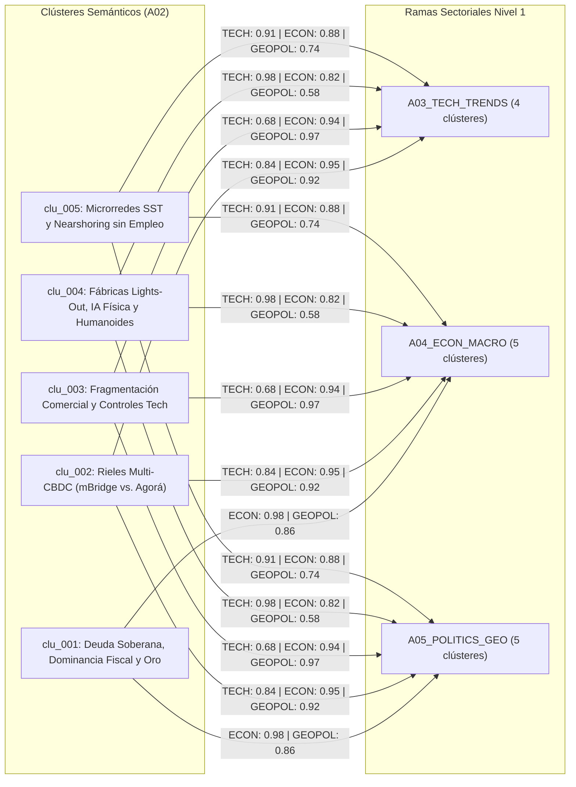

# 🧠 Mapa de Clasificación Semántica y Enrutamiento (`A02`)

> [!NOTE]
> **ID del Agente:** `A02_NLP_CLASSIFIER`  
> **Ciclo de Ejecución (`run_id`):** `run-20261023-sovereignty`  
> **Recibe de:** `A01_DATA_HARVESTER` (`12` señales normalizadas: `sig_20261023_001` a `sig_20261023_012`)  
> **Entrega a (Fan-Out Paralelo):** `A03_TECH_TRENDS`, `A04_ECON_MACRO`, `A05_POLITICS_GEO`  
> **Regla de Enrutamiento:** Clasificación multi-etiqueta ponderada; todo clúster con afinidad `>= 0.35` en un dominio se enruta a la cola de ese agente sectorial.

---

## 1. Resumen Ejecutivo del Clustering Vectorial

Utilizando embeddings densos (`text-embedding-3-large` / `multilingual-e5-large`), reconocimiento de entidades nombradas (NER) y extracción de tripletas causales, las **12 señales estratégicas** emitidas por `A01_DATA_HARVESTER` fueron agrupadas en **5 clústeres semánticos multi-dominio (`clu_001` a `clu_005`)**:

1. **`clu_001` — Dominancia Fiscal, Deuda Soberana y Acumulación Estratégica de Oro** (`sig_20261023_001`, `sig_20261023_002`, `sig_20261023_011`): Conecta el umbral de $100 billones USD de deuda pública y el encarecimiento del servicio de la deuda con la compra récord de oro por bancos centrales (>1,000 t/año) y la narrativa de degradación fiduciaria en mercados.
2. **`clu_002` — Bifurcación de Rieles Monetarios Transfronterizos: Multi-CBDCs y Liquidación Tokenizada** (`sig_20261023_004`, `sig_20261023_008`): Vincula la fractura tecnológica entre **Project mBridge** y **Project Agorá** con los modelos econométricos que proyectan una erosión del 12%–18% en el monopolio de liquidación de las divisas de reserva tradicionales.
3. **`clu_003` — Fragmentación Geoeconómica, Aranceles Estratégicos y Controles de Exportación Críticos** (`sig_20261023_003`, `sig_20261023_005`): Agrupa la triplicación de restricciones comerciales globales, los aranceles del 25%–100% y la guerra de controles de exportación en semiconductores/litografía frente a minerales críticos.
4. **`clu_004` — Manufactura Autónoma Lights-Out, IA Física (VLA/PINNs) y Robótica Humanoide de Bajo Costo** (`sig_20261023_006`, `sig_20261023_007`, `sig_20261023_009`): Integra el hito de 5 millones de robots industriales con los avances en arXiv sobre modelos *Vision-Language-Action (VLA)* acoplados a gemelos digitales físicos y la caída del BOM humanoide bajo $18,000 USD gracias a patentes en actuadores QDD.
5. **`clu_005` — Soberanía Energética Industrial (SST/Microrredes) y la Paradoja del Nearshoring sin Empleo** (`sig_20261023_010`, `sig_20261023_012`): Conecta la autonomía energética de las megafábricas mediante Transformadores de Estado Sólido (SiC SST) con el impacto socio-laboral de plantas relocalizadas que operan con 70% menos plantilla humana y costos robóticos amortizados de $3.50–$5.50/hora.

---

## 2. Clústeres Detectados y Enrutamiento Multi-Rama

| Cluster ID | Etiqueta Semántica | Señales (`N`) | IDs de Señal | Novedad | Momentum | Polarización | Afinidad `TECH` | Afinidad `ECON` | Afinidad `GEOPOL` | Destinos (`>= 0.35`) |
| :--- | :--- | :---: | :--- | :---: | :---: | :---: | :---: | :---: | :---: | :--- |
| **`clu_001`** | Dominancia Fiscal, Deuda Soberana y Acumulación Estratégica de Oro | 3 | `sig_20261023_001`, `sig_20261023_002`, `sig_20261023_011` | `0.78` | `0.94` | `0.81` | `0.24` | **`0.98`** | **`0.86`** | `A04`, `A05` |
| **`clu_002`** | Bifurcación de Rieles Monetarios Transfronterizos: Multi-CBDCs y Liquidación Tokenizada | 2 | `sig_20261023_004`, `sig_20261023_008` | `0.91` | `0.89` | `0.76` | **`0.84`** | **`0.95`** | **`0.92`** | `A03`, `A04`, `A05` |
| **`clu_003`** | Fragmentación Geoeconómica, Aranceles Estratégicos y Controles de Exportación Críticos | 2 | `sig_20261023_003`, `sig_20261023_005` | `0.74` | `0.92` | `0.88` | **`0.68`** | **`0.94`** | **`0.97`** | `A03`, `A04`, `A05` |
| **`clu_004`** | Manufactura Autónoma Lights-Out, IA Física (VLA/PINNs) y Robótica Humanoide de Bajo Costo | 3 | `sig_20261023_006`, `sig_20261023_007`, `sig_20261023_009` | `0.95` | `0.96` | `0.62` | **`0.98`** | **`0.82`** | **`0.58`** | `A03`, `A04`, `A05` |
| **`clu_005`** | Soberanía Energética Industrial (SST/Microrredes) y Paradoja del Nearshoring sin Empleo | 2 | `sig_20261023_010`, `sig_20261023_012` | `0.89` | `0.87` | `0.85` | **`0.91`** | **`0.88`** | **`0.74`** | `A03`, `A04`, `A05` |

---

## 3. Grafo de Enrutamiento Fan-Out (`A02` -> Nivel 1 Sectorial)



---

## 4. Contrato de Salida JSON (`AgentEnvelope` + `ClassifiedRoutingPayload`)

```json
{
  "$schema": "https://societyway.local/schemas/agent-envelope-v1.json",
  "run_id": "run-20261023-sovereignty",
  "timestamp_utc": "2026-10-23T22:50:00Z",
  "producer_agent_id": "A02_NLP_CLASSIFIER",
  "consumer_agent_ids": [
    "A03_TECH_TRENDS",
    "A04_ECON_MACRO",
    "A05_POLITICS_GEO"
  ],
  "trace_context": {
    "stage": "01_INGESTION_AND_ROUTING",
    "confidence_score": 0.93,
    "source_signal_ids": [
      "sig_20261023_001",
      "sig_20261023_002",
      "sig_20261023_003",
      "sig_20261023_004",
      "sig_20261023_005",
      "sig_20261023_006",
      "sig_20261023_007",
      "sig_20261023_008",
      "sig_20261023_009",
      "sig_20261023_010",
      "sig_20261023_011",
      "sig_20261023_012"
    ]
  },
  "payload": {
    "producer_agent_id": "A02_NLP_CLASSIFIER",
    "consumer_agent_ids": [
      "A03_TECH_TRENDS",
      "A04_ECON_MACRO",
      "A05_POLITICS_GEO"
    ],
    "embedding_model": "text-embedding-3-large / multilingual-e5-large",
    "semantic_clusters": [
      {
        "cluster_id": "clu_001",
        "cluster_label": "Dominancia Fiscal, Deuda Soberana y Acumulación Estratégica de Oro",
        "centroid_keywords": [
          "deuda soberana",
          "dominancia fiscal",
          "reservas de oro",
          "servicio de deuda",
          "represión financiera",
          "prima por plazo"
        ],
        "signal_ids": [
          "sig_20261023_001",
          "sig_20261023_002",
          "sig_20261023_011"
        ],
        "metrics": {
          "novelty_score": 0.78,
          "momentum_score": 0.94,
          "polarization_index": 0.81
        },
        "domain_affinity": {
          "TECH": 0.24,
          "ECON": 0.98,
          "GEOPOL": 0.86
        },
        "extracted_causal_triples": [
          {
            "subject": "Deuda pública global superior a $100 billones USD y servicio de deuda >15% de ingresos fiscales",
            "predicate": "RESTRINGE_CAPACIDAD_DE",
            "object": "Política monetaria antiinflacionaria ortodoxa en bancos centrales (Dominancia Fiscal)"
          },
          {
            "subject": "Riesgo de sanciones extraterritoriales y degradación fiduciaria",
            "predicate": "ACELERA_ACUMULACION_DE",
            "object": "Reservas soberanas de oro físico (>1,000 toneladas anuales) y activos reales"
          }
        ]
      },
      {
        "cluster_id": "clu_002",
        "cluster_label": "Bifurcación de Rieles Monetarios Transfronterizos: Multi-CBDCs y Liquidación Tokenizada",
        "centroid_keywords": [
          "mBridge",
          "Project Agorá",
          "CBDC mayorista",
          "depósitos tokenizados",
          "desdolarización comercial",
          "liquidación atómica T+0"
        ],
        "signal_ids": [
          "sig_20261023_004",
          "sig_20261023_008"
        ],
        "metrics": {
          "novelty_score": 0.91,
          "momentum_score": 0.89,
          "polarization_index": 0.76
        },
        "domain_affinity": {
          "TECH": 0.84,
          "ECON": 0.95,
          "GEOPOL": 0.92
        },
        "extracted_causal_triples": [
          {
            "subject": "Despliegue operativo de plataformas multi-CBDC como Project mBridge",
            "predicate": "DESINTERMEDIA_A",
            "object": "Redes de banca corresponsal tradicionales en la liquidación comercial euroasiática y del Golfo"
          },
          {
            "subject": "Coexistencia de rieles monetarios en competencia (mBridge vs. Project Agorá) bajo dominancia fiscal",
            "predicate": "EROSIONA_EN_12_A_18_POR_CIENTO",
            "object": "Demanda estructural de reservas fiduciarias G7 hacia 2035"
          }
        ]
      },
      {
        "cluster_id": "clu_003",
        "cluster_label": "Fragmentación Geoeconómica, Aranceles Estratégicos y Controles de Exportación Críticos",
        "centroid_keywords": [
          "aranceles estratégicos",
          "friend-shoring",
          "near-shoring",
          "controles de exportación",
          "litografía EUV/DUV",
          "minerales críticos"
        ],
        "signal_ids": [
          "sig_20261023_003",
          "sig_20261023_005"
        ],
        "metrics": {
          "novelty_score": 0.74,
          "momentum_score": 0.92,
          "polarization_index": 0.88
        },
        "domain_affinity": {
          "TECH": 0.68,
          "ECON": 0.94,
          "GEOPOL": 0.97
        },
        "extracted_causal_triples": [
          {
            "subject": "Triplicación de barreras comerciales y aranceles del 25%-100% en sectores estratégicos",
            "predicate": "FRAGMENTA_FLUJOS_EN",
            "object": "Bloques geoeconómicos regionales con sobrecostos de CAPEX del 12%-22%"
          },
          {
            "subject": "Controles de exportación simétricos (semiconductores/litografía vs. galio/germanio/tierras raras)",
            "predicate": "FUERZA_DUPLICACION_DE",
            "object": "Ecosistemas de manufactura tecnológica y cadenas de suministro redundantes (Just-in-Case)"
          }
        ]
      },
      {
        "cluster_id": "clu_004",
        "cluster_label": "Manufactura Autónoma Lights-Out, IA Física (VLA/PINNs) y Robótica Humanoide de Bajo Costo",
        "centroid_keywords": [
          "lights-out manufacturing",
          "Vision-Language-Action (VLA)",
          "gemelos digitales PINNs",
          "OpenUSD",
          "actuadores QDD",
          "robótica humanoide"
        ],
        "signal_ids": [
          "sig_20261023_006",
          "sig_20261023_007",
          "sig_20261023_009"
        ],
        "metrics": {
          "novelty_score": 0.95,
          "momentum_score": 0.96,
          "polarization_index": 0.62
        },
        "domain_affinity": {
          "TECH": 0.98,
          "ECON": 0.82,
          "GEOPOL": 0.58
        },
        "extracted_causal_triples": [
          {
            "subject": "Acoplamiento de modelos fundacionales VLA con Gemelos Digitales basados en física (PINNs/OpenUSD)",
            "predicate": "REDUCE_EN_64_POR_CIENTO",
            "object": "Tasa de fallo Sim-to-Real en celdas de manufactura autónoma sin presencia humana"
          },
          {
            "subject": "Estandarización de patentes en actuadores cuasi-directos (QDD) y tornillos planetarios",
            "predicate": "COMPRIME_COSTO_BOM_DE",
            "object": "Robots humanoides industriales por debajo del umbral comercial de $18,000 USD"
          }
        ]
      },
      {
        "cluster_id": "clu_005",
        "cluster_label": "Soberanía Energética Industrial (SST/Microrredes) y Paradoja del Nearshoring sin Empleo",
        "centroid_keywords": [
          "transformadores de estado sólido (SST)",
          "carburo de silicio (SiC)",
          "microrredes DC",
          "jobless reshoring",
          "arbitraje salarial robótico",
          "desplazamiento laboral"
        ],
        "signal_ids": [
          "sig_20261023_010",
          "sig_20261023_012"
        ],
        "metrics": {
          "novelty_score": 0.89,
          "momentum_score": 0.87,
          "polarization_index": 0.85
        },
        "domain_affinity": {
          "TECH": 0.91,
          "ECON": 0.88,
          "GEOPOL": 0.74
        },
        "extracted_causal_triples": [
          {
            "subject": "Adopción de Transformadores de Estado Sólido (SiC SST) y microrredes industriales en corriente continua",
            "predicate": "INDEPENDIZA_OPERACION_DE",
            "object": "Fábricas lights-out y centros de datos frente a redes eléctricas públicas congestionadas"
          },
          {
            "subject": "Costo operativo amortizado de robótica avanzada ($3.50-$5.50 USD/hora) en plantas Greenfield",
            "predicate": "PROVOCA_FENOMENO_DE",
            "object": "Nearshoring sin empleo (reducción del 65%-75% en plantilla directa) y erosión del arbitraje laboral emergente"
          }
        ]
      }
    ],
    "routed_queues": {
      "to_A03_TECH_TRENDS": [
        "clu_002",
        "clu_003",
        "clu_004",
        "clu_005"
      ],
      "to_A04_ECON_MACRO": [
        "clu_001",
        "clu_002",
        "clu_003",
        "clu_004",
        "clu_005"
      ],
      "to_A05_POLITICS_GEO": [
        "clu_001",
        "clu_002",
        "clu_003",
        "clu_004",
        "clu_005"
      ]
    }
  },
  "markdown_summary": "## Resumen Ejecutivo del Nodo A02 (NLP Classifier)\nLas 12 señales normalizadas (`sig_20261023_001` a `sig_20261023_012`) se agruparon en 5 clústeres semánticos multi-dominio (`clu_001` a `clu_005`). Aplicando el umbral de afinidad `>= 0.35`, se enrutaron 4 clústeres hacia `A03_TECH_TRENDS` (`clu_002`, `clu_003`, `clu_004`, `clu_005`), y los 5 clústeres completos (`clu_001` a `clu_005`) hacia `A04_ECON_MACRO` y `A05_POLITICS_GEO`, garantizando trazabilidad total de IDs para la Fase 02."
}
```
