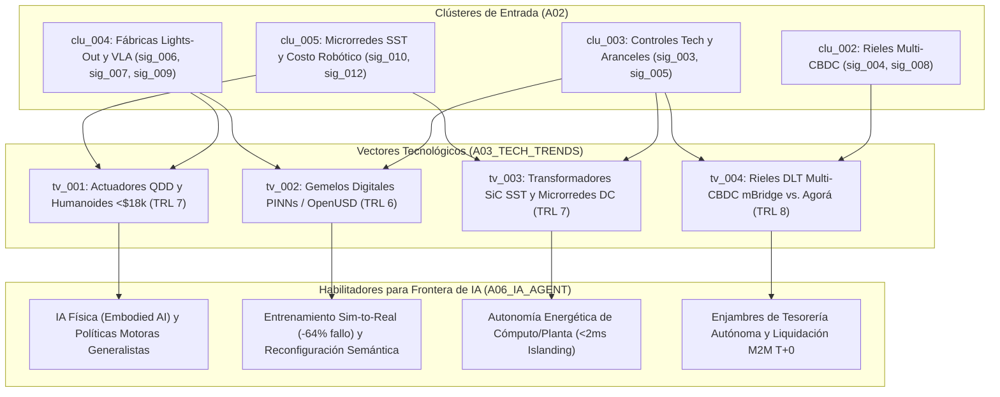

# 🔬 Reporte de Tendencias Tecnológicas (`A03`)

> [!NOTE]
> **ID del Agente:** `A03_TECH_TRENDS`  
> **Ciclo de Ejecución (`run_id`):** `run-20261023-sovereignty`  
> **Etapa:** `02_SECTORAL_ANALYSIS_L1` (Rama A — Nivel 1: Frontera Científica, I+D e Infraestructura Tecnológica)  
> **Recibe de:** `A02_NLP_CLASSIFIER` (`to_A03_TECH_TRENDS`: clústeres `clu_002`, `clu_003`, `clu_004`, `clu_005`)  
> **Entrega a:** `A06_IA_AGENT`  

---

## 1. Resumen Ejecutivo de Frontera Tecnológica e Infraestructura

El análisis de los cuatro clústeres tecnológicos enrutados por `A02_NLP_CLASSIFIER` (`clu_002`, `clu_003`, `clu_004`, `clu_005`, que integran las 9 señales `sig_20261023_003` a `sig_20261023_010` y `sig_20261023_012`) revela una **convergencia ciber-física y cripto-financiera de carácter soberano**. La tecnología deja de evolucionar sobre una cadena global unificada y sin fricciones para reconfigurarse en **pilas tecnológicas autárquicas y resilientes** (*Sovereign Industrial & Financial Stacks*).

Identificamos **4 Vectores Tecnológicos Estructurales (`tv_001` a `tv_004`)**:
1. **`tv_001` — Robótica Humanoide de Bajo Costo y Celdas de Manufactura Autónoma *Lights-Out*** (`ROBOTICS` | **TRL 7/9**): La estandarización de actuadores cuasi-directos (QDD) comprime el BOM humanoide bajo **$18,000 USD** y el costo operativo amortizado a **$3.50–$5.50 USD/hora**, mientras el parque industrial supera los **5 millones de robots**.
2. **`tv_002` — Gemelos Digitales Informados por la Física (PINNs / OpenUSD) para Simulación Industrial en Tiempo Real** (`COMPUTE_INFRASTRUCTURE` | **TRL 6/9**): El acoplamiento de motores multifísicos diferenciables con escenas estandarizadas en OpenUSD reduce en un **64% la brecha *Sim-to-Real*** y recorta el tiempo de reconfiguración de línea en un **78%**.
3. **`tv_003` — Electrónica de Potencia de Banda Ancha (SiC SST) y Microrredes Industriales Autónomas en Corriente Continua** (`ENERGY` | **TRL 7/9**): Los Transformadores de Estado Sólido (SST) basados en carburo de silicio (SiC) reducen un **60% la huella volumétrica**, alcanzan un **98.5% de eficiencia** y permiten conmutación a modo isla en **<2 ms**, blindando fábricas *lights-out* y centros de datos de IA ante cuellos de botella en redes eléctricas públicas y restricciones de minerales críticos.
4. **`tv_004` — Infraestructura Criptográfica Multi-CBDC y Rieles de Liquidación Atómica Programable** (`COMPUTE_INFRASTRUCTURE` | **TRL 8/9**): La graduación operativa de **Project mBridge** (liquidación P2P en segundos `T+0` con 50% menos costo) frente a **Project Agorá** consolida libros mayores distribuidos (DLT) permisionados con soporte nativo para contratos inteligentes de comercio exterior y tesorería algorítmica.

---

## 2. Matriz de Evaluación TRL, Cuellos de Botella y Convergencia

| Vector ID | Dominio | Nombre del Vector | Clústeres (`A02`) | Señales Base (`A01`) | Nivel TRL | Velocidad de Adopción | Cuello de Botella Crítico |
| :--- | :--- | :--- | :---: | :--- | :---: | :---: | :--- |
| **`tv_001`** | `ROBOTICS` | Actuación QDD y Plataformas Humanoides para Manufactura *Lights-Out* | `clu_004`, `clu_005` | `sig_20261023_006`, `sig_20261023_009`, `sig_20261023_012` | **`7 / 9`** | `ACCELERATING` | Densidad energética de baterías en torso, disipación térmica en articulaciones e imanes de tierras raras. |
| **`tv_002`** | `COMPUTE_INFRASTRUCTURE` | Gemelos Digitales Físicos (PINNs / OpenUSD) e Inferencia Industrial en el Borde | `clu_003`, `clu_004` | `sig_20261023_005`, `sig_20261023_007` | **`6 / 9`** | `ACCELERATING` | Controles de exportación en litografía EUV/DUV y memorias HBM; latencia determinista sub-milisegundo en el borde. |
| **`tv_003`** | `ENERGY` | Transformadores de Estado Sólido (SiC SST) y Microrredes DC Autónomas | `clu_003`, `clu_005` | `sig_20261023_003`, `sig_20261023_005`, `sig_20261023_010` | **`7 / 9`** | `STEADY_SCALING` | Suministro de obleas de SiC/GaN libre de defectos y restricciones de exportación sobre galio, germanio y grafito. |
| **`tv_004`** | `COMPUTE_INFRASTRUCTURE` | Rieles Criptográficos Multi-CBDC (`mBridge` / `Agorá`) y Liquidación Atómica DLT | `clu_002`, `clu_003` | `sig_20261023_003`, `sig_20261023_004`, `sig_20261023_008` | **`8 / 9`** | `ACCELERATING` | Incompatibilidad de protocolos entre bloques geopolíticos, latencia de pruebas Zero-Knowledge (ZKP) y oráculos físicos. |

---

## 3. Vectores Tecnológicos Detectados (Análisis Detallado)

### 1. Actuación Cuasi-Directa (QDD) y Robótica Humanoide en Fábricas *Lights-Out* (`tv_001`) — TRL: `7/9`
- **Clústeres de origen:** `clu_004`, `clu_005`
- **Señales base:** `sig_20261023_006`, `sig_20261023_009`, `sig_20261023_012`
- **Avance clave:** El parque global de robots industriales ha rebasado los **5 millones de unidades operativas** (>600,000 instalaciones anuales, 59% en China). El salto cualitativo reside en la maduración de patentes (IPC `B25J 9/10`, `H02K`) sobre **actuadores rotativos cuasi-directos (QDD)**, tornillos planetarios de rodillos y articulaciones refrigeradas por líquido con control de impedancia propioceptivo. Dado que los actuadores representan entre el **52% y el 58% de la lista de materiales (BOM)** de un humanoide, su industrialización a escala ha comprimido el costo unitario del hardware por debajo de **$18,000 USD** (con trayectoria a <$12,000 USD en volúmenes >50,000 unidades). En operación continua 24/7 en plantas *Greenfield*, el costo horario amortizado se sitúa entre **$3.50 y $5.50 USD/hora**, permitiendo reducir entre un **65% y un 75%** la plantilla operativa directa.
- **Cuellos de botella físicos/técnicos:**
  - **Termodinámica y autonomía energética a bordo:** Las baterías actuales de iones de litio limitan los ciclos continuos de locomoción bípeda con carga útil pesada a 2–4 horas sin recarga o intercambio en caliente (*hot-swapping*).
  - **Dependencia de tierras raras y metalurgia de precisión:** Los motores de flujo axial y radial de alta densidad de torque requieren imanes permanentes de neodimio-hierro-boro (NdFeB) dopados con disprosio/terbio, sujetos a controles de exportación (`sig_20261023_005`), además de rectificado sub-micrónico para tornillos planetarios.
- **Convergencia inter-tecnológica:** Cruce directo entre mecatrónica QDD (`sig_20261023_009`), arquitecturas eléctricas de corriente continua en planta (`tv_003` / `sig_20261023_010`) y políticas de relocalización industrial (*nearshoring* automatizado, `sig_20261023_012`).
- **Implicación directa para el IA Agent (`A06`):** El desplome del costo mecánico convierte al cuerpo robótico en un *commodity* periférico. El cuello de botella se desplaza íntegramente desde la mecatrónica hacia el **cerebro motor y perceptivo**: habilita el despliegue masivo de **IA Física (*Embodied AI*)** donde un mismo modelo fundacional controla flotas heterogéneas de manipuladores y humanoides en entornos no estructurados.

---

### 2. Gemelos Digitales Informados por la Física (PINNs / OpenUSD) e Inferencia Industrial (`tv_002`) — TRL: `6/9`
- **Clústeres de origen:** `clu_003`, `clu_004`
- **Señales base:** `sig_20261023_005`, `sig_20261023_007`
- **Avance clave:** Superación del histórico problema de transferencia *Sim-to-Real* en robótica industrial. La integración de **Redes Neuronales Informadas por la Física (PINNs)** dentro de grafos de escena universales (**OpenUSD / Omniverse**) permite simular en tiempo real fricción no lineal, fatiga de materiales, dinámica de cables deformables y tolerancias mecánicas. Como resultado, el fallo de transferencia desde simulación a planta real cae un **64%** y el tiempo de parada por reconfiguración de línea (*changeover time*) disminuye un **78%** frente a la reprogramación tradicional de PLCs.
- **Cuellos de botella físicos/técnicos:**
  - **Asimetría de silicio por controles de exportación:** Las restricciones extraterritoriales sobre litografía avanzada (**EUV/DUV**), aceleradores de IA y memorias de alto ancho de banda (**HBM**, `sig_20261023_005`) encarecen entre un 12% y un 22% el CAPEX de centros de cómputo industriales locales y fuerzan la optimización extrema de modelos para correr sobre silicio restringido o nodos maduros.
  - **Latencia de lazo cerrado (*Closed-Loop Latency*):** El control de impedancia y contacto físico requiere inferencia determinista por debajo de `2–5 ms` en el borde (*edge compute*), lo que exige cuantización agresiva y compilación específica en hardware embebido.
- **Convergencia inter-tecnológica:** Fusión de física computacional diferenciable (`PINNs`), estándares gráficos 3D industriales (`OpenUSD`) y robótica mecatrónica de bajo costo (`tv_001`).
- **Implicación directa para el IA Agent (`A06`):** Proporciona el **sustrato de entrenamiento sintético infinito** para los modelos **Vision-Language-Action (VLA)**. En lugar de recolectar millones de horas de teleoperación humana física, los agentes aprenden políticas motoras robustas dentro de leyes físicas simuladas y reconfiguran fábricas enteras mediante comandos en lenguaje natural.

---

### 3. Transformadores de Estado Sólido (SiC SST) y Microrredes Industriales Autónomas (`tv_003`) — TRL: `7/9`
- **Clústeres de origen:** `clu_003`, `clu_005`
- **Señales base:** `sig_20261023_003`, `sig_20261023_005`, `sig_20261023_010`
- **Avance clave:** Aceleración de patentes (IPC `H02M 3/335`, `H02J 3/38`) en **Transformadores de Estado Sólido (SST)** construidos con semiconductores de potencia de banda ancha (**Carburo de Silicio - SiC** y **Nitruro de Galio - GaN**). Estos sistemas operan a alta frecuencia, logrando una reducción del **55%–65% en volumen y peso** respecto a los transformadores electromagnéticos de 50/60 Hz, una eficiencia de conversión del **98.5%** y tiempos de desconexión a modo isla (*islanding*) inferiores a **2 milisegundos** (`sig_20261023_010`). Esto habilita microrredes industriales nativas en corriente continua (DC) que acoplan directamente almacenamiento en baterías (BESS), generación local y cargas de cómputo/robótica.
- **Cuellos de botella físicos/técnicos:**
  - **Guerra de minerales críticos e insumos de banda ancha:** Los controles de exportación impuestos por China sobre **galio, germanio, grafito y antimonio** (`sig_20261023_005`), junto con los aranceles del 25%–100% (`sig_20261023_003`, `sig_20261023_005`), tensionan la cadena de suministro de sustratos SiC/GaN de 200 mm y sistemas BESS.
  - **Gestión térmica de alta densidad de potencia:** El empaquetado compacto de módulos SiC de media tensión exige aislamiento dieléctrico avanzado y refrigeración por cambio de fase para evitar degradación prematura.
- **Convergencia inter-tecnológica:** Electrónica de potencia de estado sólido + almacenamiento electroquímico BESS + plantas de manufactura *lights-out* (`tv_001`) + clústeres de inferencia de IA local (`tv_002`).
- **Implicación directa para el IA Agent (`A06`):** Garantiza la **supervivencia física e independencia energética del cómputo autónomo**. Permite que complejos industriales gobernados por IA y centros de datos de inferencia operen desconectados de redes eléctricas públicas saturadas, abriendo además el campo a **agentes de IA de despacho energético sub-milisegundo** que arbitran energía entre cómputo, producción física y red.

---

### 4. Infraestructura Criptográfica Multi-CBDC (`mBridge` / `Agorá`) y Liquidación Atómica Programable (`tv_004`) — TRL: `8/9`
- **Clústeres de origen:** `clu_002`, `clu_003`
- **Señales base:** `sig_20261023_003`, `sig_20261023_004`, `sig_20261023_008`
- **Avance clave:** Bifurcación operativa de la infraestructura de pagos mayoristas globales en dos arquitecturas de registro distribuido (DLT) competidoras (`sig_20261023_004`). Por un lado, **Project mBridge** (bancos centrales de China, Hong Kong, EAU, Tailandia y Arabia Saudita) alcanza estado de Producto Mínimo Viable (MVP) autónomo con liquidación *peer-to-peer* en segundos (**T+0**) y reducción de costos de hasta el **50%** frente a la red corresponsal tradicional (3–5 días hábiles). Por otro lado, **Project Agorá** (7 bancos centrales occidentales y >40 instituciones financieras privadas) integra reservas de banca central con depósitos comerciales tokenizados bajo estándares G7. Los modelos econométricos sobre estas redes multi-CBDC (`sig_20261023_008`) proyectan que la liquidez algorítmica y la liquidación atómica erosionarán entre un **12% y un 18%** la demanda de reservas fiduciarias tradicionales hacia 2035.
- **Cuellos de botella físicos/técnicos:**
  - **Balcanización de protocolos e interoperabilidad criptográfica:** La divergencia regulatoria y geopolítica (`sig_20261023_003`) impide un estándar único de mensajería y consenso entre `mBridge` y `Agorá`, requiriendo puentes criptográficos (*cross-chain atomic swaps*) con pruebas de conocimiento cero (**ZKPs**) de alto costo computacional para preservar privacidad soberana.
  - **Oráculos de verificación física en comercio exterior:** La liquidación automática *Delivery-versus-Payment (DvP)* depende de integrar telemetría IoT/aduanera inmutable para evitar fraudes de colateral en cadenas de suministro fragmentadas.
- **Convergencia inter-tecnológica:** Criptografía aplicada y consenso distribuido DLT + telemetría de cadenas de suministro automatizadas (`tv_001`, `tv_002`) + ingeniería financiera soberana (`clu_002`).
- **Implicación directa para el IA Agent (`A06`):** El dinero y los activos mayoristas se vuelven **nativamente programables y direccionables por API/contratos inteligentes**. Esto habilita el surgimiento de **enjambres de agentes financieros y de tesorería autónoma** capaces de ejecutar arbitraje de liquidez multi-divisa, cobertura contra degradación fiduciaria y pagos máquina-a-máquina (M2M) instantáneos entre fábricas autónomas sin intervención de operadores bancarios humanos.

---

## 4. Diagrama de Transferencia de Infraestructura (`A03` -> `A06`)



---

## 5. Contrato de Salida JSON (`AgentEnvelope` + `TechTrendsReport`)

```json
{
  "$schema": "https://societyway.local/schemas/agent-envelope-v1.json",
  "run_id": "run-20261023-sovereignty",
  "timestamp_utc": "2026-10-23T22:54:00Z",
  "producer_agent_id": "A03_TECH_TRENDS",
  "consumer_agent_ids": [
    "A06_IA_AGENT"
  ],
  "trace_context": {
    "stage": "02_SECTORAL_ANALYSIS_L1",
    "confidence_score": 0.93,
    "source_signal_ids": [
      "sig_20261023_003",
      "sig_20261023_004",
      "sig_20261023_005",
      "sig_20261023_006",
      "sig_20261023_007",
      "sig_20261023_008",
      "sig_20261023_009",
      "sig_20261023_010",
      "sig_20261023_012"
    ]
  },
  "payload": {
    "producer_agent_id": "A03_TECH_TRENDS",
    "consumer_agent_ids": [
      "A06_IA_AGENT"
    ],
    "tech_vectors": [
      {
        "tech_vector_id": "tv_001",
        "domain": "ROBOTICS",
        "name": "Actuación Cuasi-Directa (QDD) y Robótica Humanoide de Bajo Costo en Manufactura Lights-Out",
        "source_cluster_ids": [
          "clu_004",
          "clu_005"
        ],
        "source_signal_ids": [
          "sig_20261023_006",
          "sig_20261023_009",
          "sig_20261023_012"
        ],
        "trl_level": 7,
        "adoption_velocity": "ACCELERATING",
        "key_breakthrough": "Estandarización industrial de actuadores rotativos QDD y tornillos planetarios de rodillos (52%-58% del BOM), comprimiendo el costo de fabricación de humanoides bajo $18,000 USD y situando el costo horario operativo amortizado en $3.50-$5.50 USD/hora en celdas lights-out.",
        "physical_bottlenecks": [
          "Densidad energética gravimétrica de baterías en torso para operación bípeda continua >4 horas",
          "Disipación térmica en articulaciones compactas de alta densidad de torque",
          "Dependencia de imanes permanentes de tierras raras (NdFeB/Disprosio) sujetos a controles de exportación"
        ],
        "ai_enabler_implications": "Convierte el hardware robótico antropomórfico y móvil en una plataforma escalable de bajo costo, trasladando el diferencial competitivo hacia los modelos fundacionales de IA Física (Embodied AI) que orquestan plantas enteras con un 65%-75% menos personal humano."
      },
      {
        "tech_vector_id": "tv_002",
        "domain": "COMPUTE_INFRASTRUCTURE",
        "name": "Gemelos Digitales Informados por la Física (PINNs / OpenUSD) e Inferencia Industrial en el Borde",
        "source_cluster_ids": [
          "clu_003",
          "clu_004"
        ],
        "source_signal_ids": [
          "sig_20261023_005",
          "sig_20261023_007"
        ],
        "trl_level": 6,
        "adoption_velocity": "ACCELERATING",
        "key_breakthrough": "Acoplamiento de Redes Neuronales Informadas por la Física (PINNs) con entornos de simulación OpenUSD que reduce un 64% la tasa de fallo Sim-to-Real en ensamblaje de precisión y recorta un 78% el tiempo de parada por reconfiguración de línea.",
        "physical_bottlenecks": [
          "Controles de exportación extraterritoriales sobre litografía EUV/DUV y memorias HBM que encarecen 12%-22% el CAPEX de cómputo",
          "Exigencia de latencia determinista sub-milisegundo en inferencia de borde para control de contacto y fuerza",
          "Calibración continua de parámetros de fricción y fatiga de materiales no homogéneos"
        ],
        "ai_enabler_implications": "Habilita el entrenamiento sintético masivo de modelos Vision-Language-Action (VLA) sin depender exclusivamente de teleoperación física humana, permitiendo que agentes cognitivos reprogramen líneas de manufactura mediante instrucciones semánticas."
      },
      {
        "tech_vector_id": "tv_003",
        "domain": "ENERGY",
        "name": "Transformadores de Estado Sólido (SiC SST) y Microrredes Industriales Autónomas en Corriente Continua",
        "source_cluster_ids": [
          "clu_003",
          "clu_005"
        ],
        "source_signal_ids": [
          "sig_20261023_003",
          "sig_20261023_005",
          "sig_20261023_010"
        ],
        "trl_level": 7,
        "adoption_velocity": "STEADY_SCALING",
        "key_breakthrough": "Transformadores de Estado Sólido basados en carburo de silicio (SiC) que reducen en 55%-65% la huella volumétrica con 98.5% de eficiencia y conmutan a modo isla en <2 milisegundos, independizando plantas lights-out y centros de datos de IA de redes públicas saturadas.",
        "physical_bottlenecks": [
          "Restricciones geopolíticas y controles de exportación sobre galio, germanio, grafito y sustratos SiC/GaN",
          "Aranceles estratégicos (25%-100%) que encarecen sistemas de almacenamiento BESS y electrónica de potencia",
          "Estrés térmico y aislamiento dieléctrico en conmutación de media tensión a alta frecuencia"
        ],
        "ai_enabler_implications": "Asegura soberanía energética ininterrumpida para clústeres de inferencia de IA y fábricas robotizadas, al tiempo que requiere agentes autónomos de control energético capaces de gestionar transitorios eléctricos en escalas de microsegundos."
      },
      {
        "tech_vector_id": "tv_004",
        "domain": "COMPUTE_INFRASTRUCTURE",
        "name": "Infraestructura Criptográfica Multi-CBDC (mBridge / Project Agorá) y Liquidación Atómica Programable",
        "source_cluster_ids": [
          "clu_002",
          "clu_003"
        ],
        "source_signal_ids": [
          "sig_20261023_003",
          "sig_20261023_004",
          "sig_20261023_008"
        ],
        "trl_level": 8,
        "adoption_velocity": "ACCELERATING",
        "key_breakthrough": "Despliegue en producción de plataformas DLT mayoristas (Project mBridge en fase MVP y consorcio Project Agorá) que ejecutan liquidación transfronteriza atómica (T+0) en segundos con reducción del 50% en costos y soporte nativo para depósitos y activos tokenizados.",
        "physical_bottlenecks": [
          "Incompatibilidad de estándares criptográficos y de gobernanza entre los rieles mBridge y Project Agorá",
          "Sobrecarga computacional en generación de pruebas Zero-Knowledge (ZKP) para privacidad de transacciones soberanas",
          "Integración de oráculos de hardware confiables para verificar entrega física (Delivery-versus-Payment) en aduanas fragmentadas"
        ],
        "ai_enabler_implications": "Proporciona rieles monetarios programables donde enjambres de agentes de IA financiera pueden arbitrar liquidez multi-divisa, gestionar colateral en tiempo real y liquidar contratos máquina-a-máquina (M2M) entre cadenas de suministro autónomas."
      }
    ]
  },
  "markdown_summary": "## Resumen Ejecutivo del Nodo A03 (Tecnología Trends Agent)\nSe procesaron los 4 clústeres tecnológicos (`clu_002`, `clu_003`, `clu_004`, `clu_005`) y sus 9 señales asociadas, identificando 4 vectores tecnológicos de alta madurez (TRL 6 a 8): `tv_001` (Robótica humanoide <$18k USD con actuadores QDD y costo horario de $3.50-$5.50/h, TRL 7), `tv_002` (Gemelos Digitales Físicos PINNs/OpenUSD que reducen 64% el fallo Sim-to-Real, TRL 6), `tv_003` (Transformadores de Estado Sólido SiC SST con desconexión a isla en <2 ms para fábricas lights-out, TRL 7) y `tv_004` (Infraestructura criptográfica multi-CBDC mBridge y Project Agorá para liquidación atómica T+0, TRL 8). Estos vectores transfieren a `A06_IA_AGENT` el sustrato físico, energético y financiero para la IA Física y los enjambres de tesorería autónoma."
}
```
