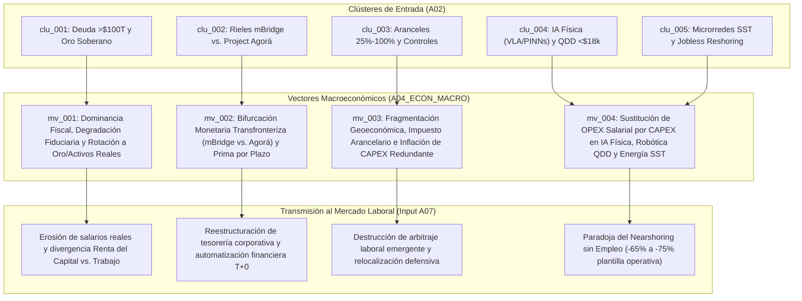

# 📈 Reporte Macroeconómico Global (`A04`)

> [!NOTE]
> **ID del Agente:** `A04_ECON_MACRO`  
> **Etapa:** `02_SECTORAL_ANALYSIS_L1` (Rama B — Nivel 1)  
> **Ciclo de Ejecución (`run_id`):** `run-20261023-sovereignty`  
> **Recibe de:** `A02_NLP_CLASSIFIER` (`to_A04_ECON_MACRO`: clústeres `clu_001` a `clu_005`)  
> **Entrega a:** `A07_LABOR_MARKET`  

---

## 1. Diagnóstico del Régimen Macroeconómico Actual

El sistema económico global opera bajo un cambio de régimen estructural definido por la transición desde la **Gran Moderación Desinflacionaria Globalizada (1990-2019)** hacia una **Era de Dominancia Fiscal, Fragmentación de Bloques e Hiper-Capitalización Autónoma (2026-2036)**. La función de producción macroeconómica global ($Y = A \cdot F(K, L)$) experimenta una distorsión simultánea en sus tres componentes: el costo financiero del capital soberano ($r$) sufre presiones alcistas por saturación de deuda, el comercio exterior se encarece por barreras arancelarias, y las corporaciones responden sustituyendo agresivamente gasto operativo laboral ($L$) por inversión de capital ($K$) en robótica física y autonomía energética para neutralizar la inflación de costos.

- **Postura de Crecimiento Global (`global_growth_stance`):** `BIFURCATED_CAPEX_DRIVEN_EXPANSION` — Crecimiento moderado y fragmentado, sostenido artificialmente por déficits fiscales crónicos, subsidios industriales y un superciclo de CAPEX en reindustrialización automatizada, mientras el comercio inter-bloque se contrae (`-1.8%`) frente al dinamismo intra-bloque (`+4.2%`) (`sig_20261023_003`).
- **Presión Inflacionaria (`inflation_pressure`):** `STRUCTURAL_FISCAL_AND_TARIFF_STICKINESS_VS_ROBOTIC_DEFLATION` — Piso inflacionario estructural del `3.2% - 4.0%` anual impulsado por monetización implícita de deuda pública, duplicación de cadenas de suministro (`+12% a +22%` en CAPEX) y aranceles del `25% al 100%` (`sig_20261023_005`, `sig_20261023_011`), contrarrestado únicamente por una intensa deflación tecnológica en el costo unitario del trabajo manufacturero robotizado (`$3.50 - $5.50 USD/hora`) (`sig_20261023_009`, `sig_20261023_012`).
- **Tendencia de Asignación de Capital (`capital_allocation_trend`):** `HARD_ASSETS_SOVEREIGN_GOLD_AND_AUTONOMOUS_INDUSTRIAL_CAPEX` — Rotación institucional desde deuda soberana G7 de larga duración hacia oro físico (`>1,030 t/año`), activos reales tokenizados (RWA), microrredes eléctricas industriales (SST SiC) y plantas *lights-out* (`sig_20261023_001`, `sig_20261023_002`, `sig_20261023_006`, `sig_20261023_010`).

---

## 2. Mapa de Transmisión Macroeconómica (`A04` -> `A07`)



---

## 3. Vectores Macroeconómicos y Mecanismos de Transmisión al Empleo

### 3.1. [`mv_001`] Dominancia Fiscal, Saturación de Deuda Soberana y Rotación hacia Oro y Activos Duros
- **Clústeres y Señales de Origen:** `clu_001` (`sig_20261023_001`, `sig_20261023_002`, `sig_20261023_011`)
- **Regiones Afectadas:** `GLOBAL`, `US`, `EU`, `CN`, `JP`, `IN`, `PL`, `TR`, `SG`
- **Diagnóstico Estructural:** El stock de deuda pública global ha rebasado los **$100 billones USD (93% del PIB mundial)**, encaminándose al **100% del PIB hacia 2030** (y **115%** en escenarios adversos del FMI). En el G7 y EE. UU., el pago neto de intereses absorbe entre el **14.5% y el 17.8% de los ingresos fiscales federales** (frente al 8.2% en 2010-2019). Esta rigidez presupuestaria —agravada por pensiones, defensa y subsidios industriales— coloca a los bancos centrales en **Dominancia Fiscal**: la imposibilidad de sostener tasas de interés reales restrictivas sin detonar crisis de refinanciación soberana. Ante la represión financiera e inflación subyacente de equilibrio en **3.2%–4.0%**, los bancos centrales acumulan **>1,030 toneladas anuales de oro físico** (reduciendo la cuota del USD en COFER al **57.8%**) y el capital privado rota masivamente hacia el *Debasement Trade* (`+340%` en tracción institucional/FinTwit) y activos reales tokenizados (RWA).
- **Indicadores Clave:**
  - Stock de deuda pública global: `>100.0 billones USD (93% del PIB)` (`sig_20261023_001`).
  - Servicio neto de intereses sobre recaudación fiscal (EE. UU./G7): `14.5% - 17.8%` (`sig_20261023_001`).
  - Compras oficiales de oro físico por bancos centrales: `>1,030 toneladas métricas/año` (`sig_20261023_002`).
  - Inflación subyacente de equilibrio esperada (5-10 años): `3.2% - 4.0% anual` (`sig_20261023_011`).
- **Ganadores Sectoriales:** Minería y custodia de metales preciosos, infraestructura de tokenización de activos reales (RWA), gestores de activos duros (energía, tierras, infraestructura crítica), defensa.
- **Perdedores Sectoriales:** Tenedores institucionales de renta fija soberana de larga duración sin cobertura inflacionaria, banca comercial regional expuesta a riesgo de duración, sectores de consumo discrecional dependientes de crédito barato a hogares.
- **Mecanismo de Transmisión hacia `A07 (Mercado Laboral)` (`labor_transmission_mechanism`):** La represión financiera y la inflación estructural (`3.2%–4.0%`) actúan como un impuesto regresivo silencioso que **erosiona el poder adquisitivo de los salarios nominales** y de los fondos de pensiones de contribución definida. Mientras los propietarios de activos duros y CAPEX capturan la revalorización nominal por degradación fiduciaria, los trabajadores asalariados sufren una caída persistente en su participación sobre el ingreso nacional (*Labor Share of GDP*) y el sector público enfrenta congelamientos de contratación civil para cubrir el servicio de la deuda.

---

### 3.2. [`mv_002`] Bifurcación de Rieles Monetarios Transfronterizos (`mBridge` vs. `Project Agorá`) y Desintermediación Cambiaria
- **Clústeres y Señales de Origen:** `clu_002` (`sig_20261023_004`, `sig_20261023_008`)
- **Regiones Afectadas:** `CN`, `HK`, `AE`, `TH`, `SA`, `US`, `EU`, `GB`, `GLOBAL`
- **Diagnóstico Estructural:** La fontanería financiera internacional se fractura en dos arquitecturas mayoristas incompatibles. **Project mBridge** (China, Hong Kong, EAU, Tailandia, Arabia Saudita) opera ya en fase MVP autónoma liquidando comercio de materias primas y manufacturas en divisas locales de forma atómica (**T+0 en segundos**) y reduciendo costos hasta un **50%** frente a los 3–5 días de la red corresponsal tradicional. En respuesta defensiva, **Project Agorá** (7 bancos centrales occidentales como NY Fed, BCE, BoE y >40 bancos privados con el IIF) tokeniza depósitos comerciales y reservas mayoristas G7. El modelado econométrico (NBER/BIS) demuestra que la combinación de servicio de deuda `>15%` de los ingresos fiscales con rieles multi-CBDC alternativos erosionará entre un **12% y un 18% la demanda de reservas fiduciarias G7 hacia 2035**, inyectando una prima por plazo (*term premium*) estructural de **+85 a +140 puntos básicos** en los bonos soberanos de 10 y 30 años.
- **Indicadores Clave:**
  - Eficiencia de liquidación en `Project mBridge`: `-50% en costos transaccionales y liquidación T+0` (`sig_20261023_004`).
  - Erosión proyectada en demanda de reservas fiduciarias G7 (2035): `12% - 18%` (`sig_20261023_008`).
  - Prima por plazo (*term premium*) adicional en deuda soberana a 10-30 años: `+85 a +140 bps` (`sig_20261023_008`).
- **Ganadores Sectoriales:** Arquitecturas de liquidación DLT mayorista y contratos inteligentes institucionales, cámaras de compensación de materias primas en Asia/Golfo, mesas de liquidez algorítmica multi-divisa.
- **Perdedores Sectoriales:** Banca corresponsal tradicional dependiente de comisiones SWIFT y float cambiario, intermediarios de *trade finance* documental basado en papel, tesorerías corporativas sin capacidad de enrutamiento multi-riel.
- **Mecanismo de Transmisión hacia `A07 (Mercado Laboral)` (`labor_transmission_mechanism`):** Contracción estructural de plantillas de *back-office* y *middle-office* en banca corresponsal, conciliación interbancaria, cumplimiento manual AML/KYC y operaciones de *trade finance* tradicional, debido a la liquidación atómica programable (`T+0`). Simultáneamente, emerge una demanda hiper-especializada (y con alta prima salarial) de **arquitectos de tesorería algorítmica multi-CBDC**, ingenieros de liquidez en depósitos tokenizados y especialistas en cumplimiento geoeconómico de doble riel.

---

### 3.3. [`mv_003`] Fragmentación Geoeconómica, Impuesto Arancelario Estructural y Duplicación de Cadenas (`Just-in-Case`)
- **Clústeres y Señales de Origen:** `clu_003` (`sig_20261023_003`, `sig_20261023_005`)
- **Regiones Afectadas:** `US`, `EU`, `CN`, `MX`, `VN`, `JP`, `KR`, `NL`
- **Diagnóstico Estructural:** Las restricciones comerciales globales se han **triplicado (3.1x)** respecto al promedio 2015-2019, afectando a más del **11% de las importaciones mundiales** y generando una pérdida de eficiencia estática estimada entre el **1.5% y el 2.5% del PIB global**. La consolidación de **aranceles estratégicos permanentes del 25% al 100%** en EE. UU. y la UE (100% en EVs, 50% en semiconductores y solar, 25% en acero/baterías) junto con controles de exportación sobre litografía EUV/DUV, memorias HBM y robótica, choca con las contramedidas chinas sobre **galio, germanio, grafito, antimonio y tierras raras**. Esto destruye el paradigma *Just-in-Time* y fuerza a las multinacionales a financiar una duplicación de ecosistemas industriales (*China+1*, *nearshoring* en Norteamérica/México y Europa Central), asumiendo un **sobrecosto de CAPEX inicial del 12% al 22%**.
- **Indicadores Clave:**
  - Multiplicador de restricciones comerciales vigentes vs. 2015-2019: `3.1x (afectando >11% de importaciones)` (`sig_20261023_003`).
  - Divergencia de crecimiento comercial en sectores estratégicos: `+4.2% intra-bloque vs. -1.8% inter-bloque` (`sig_20261023_003`).
  - Rango de aranceles estratégicos consolidados (EE. UU./UE): `25% a 100%` (`sig_20261023_005`).
  - Sobrecosto de CAPEX por duplicación de cadenas de suministro: `+12% a +22%` (`sig_20261023_005`).
- **Ganadores Sectoriales:** Desarrolladores de parques industriales e infraestructura logística en nodos de *nearshoring* (Norteamérica, Europa Central, Sudeste Asiático), procesadores no alineados de minerales críticos, firmas de ingeniería EPC industrial.
- **Perdedores Sectoriales:** Multinacionales de consumo y electrónica con cadenas de suministro transpacíficas no diversificadas, importadores minoristas sujetos a compresión de márgenes arancelarios, ensambladoras intensivas en mano de obra de bajo valor añadido.
- **Mecanismo de Transmisión hacia `A07 (Mercado Laboral)` (`labor_transmission_mechanism`):** Para absorber el **sobrecosto de CAPEX del 12%–22%** y los aranceles sobre insumos sin destruir la rentabilidad sobre el capital invertido (ROIC), los directores financieros (CFOs) imponen una directriz estricta en las nuevas plantas relocalizadas: **comprimir al mínimo la elasticidad empleo/CAPEX**. La relocalización manufacturera deja de buscar arbitraje salarial en mano de obra barata y pasa a exigir automatización integral desde el diseño (*Greenfield*), anulando el efecto multiplicador de empleo operativo que históricamente acompañaba a la Inversión Extranjera Directa (IED).

---

### 3.4. [`mv_004`] Sustitución Intensiva de OPEX Salarial por CAPEX en IA Física, Robótica Humanoide y Autonomía Energética (`SST`)
- **Clústeres y Señales de Origen:** `clu_004`, `clu_005` (`sig_20261023_006`, `sig_20261023_007`, `sig_20261023_009`, `sig_20261023_010`, `sig_20261023_012`)
- **Regiones Afectadas:** `CN`, `US`, `DE`, `JP`, `KR`, `EU`, `MX`, `TW`
- **Diagnóstico Estructural:** La viabilidad microeconómica del *reshoring* y *nearshoring* en economías de altos salarios o con cuellos de botella eléctricos descansa sobre tres rupturas tecnológicas que transforman costos laborales variables (OPEX) en activos depreciables (CAPEX):
  1. **Deflación del Hardware Robótico:** El parque mundial supera los **5 millones de robots industriales** (`>600,000/año`, 59% en China) mientras las patentes en actuadores cuasi-directos (**QDD**, que representan el `52%–58%` del BOM) comprimen el costo de fabricación de un humanoide industrial por debajo de **$18,000 USD** (proyectado a `<$12,000 USD` en escala), situando el **costo operativo horario amortizado en $3.50–$5.50 USD/hora** (`sig_20261023_006`, `sig_20261023_009`, `sig_20261023_012`).
  2. **Flexibilidad Cognitiva en Planta (*Physical AI*):** El acoplamiento de modelos *Vision-Language-Action (VLA)* con gemelos digitales basados en física (*PINNs/OpenUSD*) reduce un **64% el fallo Sim-to-Real** y un **78% el tiempo de parada por reconfiguración de línea**, eliminando la rigidez de la automatización tradicional (`sig_20261023_007`).
  3. **Soberanía Energética Industrial:** Los Transformadores de Estado Sólido (**SST**) de carburo de silicio (**SiC**) reducen un **55%–65% el volumen físico**, alcanzan **98.5% de eficiencia** y permiten conmutar a modo isla en **<2 ms**, independizando a las fábricas *lights-out* de redes públicas saturadas (`sig_20261023_010`).
- **Indicadores Clave:**
  - Costo horario operativo amortizado de robótica humanoide/colaborativa (24/7): `$3.50 - $5.50 USD/hora` (vs. `$25–$38/h` en EE. UU./UE y `$6–$9/h` en hubs emergentes) (`sig_20261023_012`).
  - Costo BOM unitario de robot humanoide industrial por patentes QDD: `<$18,000 USD` (`sig_20261023_009`).
  - Reducción de plantilla operativa directa en plantas *Greenfield* relocalizadas: `-65% a -75%` (`sig_20261023_012`).
  - Eficiencia de conversión y tiempo de *islanding* en microrredes SST SiC: `98.5% eficiencia / <2 ms` (`sig_20261023_010`).
- **Ganadores Sectoriales:** Fabricantes de robótica humanoide y actuadores QDD, plataformas de simulación física industrial (*OpenUSD/Omniverse/PINNs*), fabricantes de electrónica de potencia SiC/GaN y microrredes DC (SST), propietarios de capital intensivo en cómputo y energía.
- **Perdedores Sectoriales:** Maquiladoras y ensambladoras intensivas en mano de obra no calificada, sindicatos industriales tradicionales, economías emergentes cuyo modelo de desarrollo dependía exclusivamente del arbitraje salarial manufacturero (`$6–$9/hora`).
- **Mecanismo de Transmisión hacia `A07 (Mercado Laboral)` (`labor_transmission_mechanism`):** Desencadena directamente la **"Paradoja del Nearshoring sin Empleo" (*Jobless Reshoring*)**. Cuando el costo horario amortizado de un robot (`$3.50–$5.50/h`) cae por debajo no solo del salario sindicalizado occidental (`$25–$38/h`) sino también del salario manufacturero en hubs emergentes como México o Vietnam (`$6–$9/h`), se rompe el vínculo histórico entre relocalización industrial y creación masiva de empleo azul. Las nuevas plantas operan con **65% a 75% menos personal directo**, desplazando masivamente a operarios de ensamblaje, logística interna y control de calidad, mientras concentran la masa salarial restante en una élite reducida de ingenieros de gemelos digitales (*PINNs/VLA*) y técnicos mecatrónicos/energéticos de alta tensión (*SST*).

---

## 4. Contrato de Salida JSON (`AgentEnvelope` + `MacroEconReport`)

```json
{
  "$schema": "https://societyway.local/schemas/agent-envelope-v1.json",
  "run_id": "run-20261023-sovereignty",
  "timestamp_utc": "2026-10-23T22:55:00Z",
  "producer_agent_id": "A04_ECON_MACRO",
  "consumer_agent_ids": [
    "A07_LABOR_MARKET"
  ],
  "trace_context": {
    "stage": "02_SECTORAL_ANALYSIS_L1",
    "confidence_score": 0.95,
    "source_signal_ids": [
      "sig_20261023_001",
      "sig_20261023_002",
      "sig_20261023_003",
      "sig_20261023_004",
      "sig_20261023_005",
      "sig_20261023_006",
      "sig_20261023_007",
      "sig_20261023_008",
      "sig_20261023_009",
      "sig_20261023_010",
      "sig_20261023_011",
      "sig_20261023_012"
    ]
  },
  "payload": {
    "producer_agent_id": "A04_ECON_MACRO",
    "consumer_agent_ids": [
      "A07_LABOR_MARKET"
    ],
    "macro_regime_summary": {
      "global_growth_stance": "BIFURCATED_CAPEX_DRIVEN_EXPANSION",
      "inflation_pressure": "STRUCTURAL_FISCAL_AND_TARIFF_STICKINESS_VS_ROBOTIC_DEFLATION",
      "capital_allocation_trend": "HARD_ASSETS_SOVEREIGN_GOLD_AND_AUTONOMOUS_INDUSTRIAL_CAPEX"
    },
    "macro_vectors": [
      {
        "macro_vector_id": "mv_001",
        "theme": "Dominancia Fiscal, Saturación de Deuda Soberana (>$100T) y Rotación Estructural hacia Oro y Activos Reales",
        "source_cluster_ids": [
          "clu_001"
        ],
        "source_signal_ids": [
          "sig_20261023_001",
          "sig_20261023_002",
          "sig_20261023_011"
        ],
        "affected_regions": [
          "GLOBAL",
          "US",
          "EU",
          "CN",
          "JP",
          "IN",
          "PL",
          "TR",
          "SG"
        ],
        "key_indicators": [
          {
            "indicator": "Stock de deuda pública global sobre PIB mundial",
            "value": ">100.0 billones USD (93% del PIB; proyectado a 100%-115%)"
          },
          {
            "indicator": "Ratio de pago neto de intereses sobre ingresos fiscales (EE. UU. / G7)",
            "value": "14.5% - 17.8%"
          },
          {
            "indicator": "Compras netas anuales de oro físico por bancos centrales",
            "value": ">1,030 toneladas métricas/año (cuota USD COFER en 57.8%)"
          },
          {
            "indicator": "Inflación subyacente de equilibrio esperada a 5-10 años (consenso de mercado)",
            "value": "3.2% - 4.0% anual"
          }
        ],
        "sectoral_winners": [
          "Minería, refino y custodia soberana de metales preciosos",
          "Infraestructura financiera de Activos del Mundo Real Tokenizados (RWA)",
          "Propietarios de activos duros productivos (energía, infraestructura crítica, tierras)",
          "Contratistas de defensa e infraestructura estratégica subvencionada"
        ],
        "sectoral_losers": [
          "Fondos de pensiones y aseguradoras con alta exposición a deuda soberana G7 de larga duración",
          "Banca comercial mediana expuesta a riesgo de duración y represión financiera",
          "Consumo discrecional intensivo en crédito minorista para clases medias",
          "Servicios públicos no protegidos sujetos a recorte presupuestario por servicio de deuda"
        ],
        "labor_transmission_mechanism": "La represión financiera y un piso inflacionario estructural del 3.2%-4.0% erosionan de forma continua los salarios reales y el poder adquisitivo de los ahorros previsionales, mientras la revalorización nominal de activos se concentra en los tenedores de CAPEX y activos duros, reduciendo la participación salarial en el PIB (Labor Share) y restringiendo el empleo público."
      },
      {
        "macro_vector_id": "mv_002",
        "theme": "Bifurcación de Rieles de Liquidación Mayorista Transfronteriza (mBridge vs. Project Agorá) y Prima por Plazo Soberana",
        "source_cluster_ids": [
          "clu_002"
        ],
        "source_signal_ids": [
          "sig_20261023_004",
          "sig_20261023_008"
        ],
        "affected_regions": [
          "CN",
          "HK",
          "AE",
          "TH",
          "SA",
          "US",
          "EU",
          "GB",
          "GLOBAL"
        ],
        "key_indicators": [
          {
            "indicator": "Ahorro en costos y velocidad de liquidación en Project mBridge",
            "value": "-50% en costos transaccionales y liquidación atómica T+0 (segundos)"
          },
          {
            "indicator": "Erosión proyectada en demanda de reservas fiduciarias G7 hacia 2035",
            "value": "12% - 18%"
          },
          {
            "indicator": "Prima por plazo (term premium) adicional inducida en bonos soberanos a 10 y 30 años",
            "value": "+85 a +140 puntos básicos"
          }
        ],
        "sectoral_winners": [
          "Plataformas de liquidación mayorista multi-CBDC y depósitos bancarios tokenizados",
          "Cámaras de compensación energética y de materias primas en Eurasia y el Golfo",
          "Firmas de software de tesorería algorítmica y enrutamiento de liquidez multi-riel"
        ],
        "sectoral_losers": [
          "Banca corresponsal tradicional dependiente de comisiones SWIFT y spreads FX lentos",
          "Operadores de trade finance documental tradicional",
          "Tesoros soberanos G7 enfrentados a un mayor costo marginal de colocación de deuda"
        ],
        "labor_transmission_mechanism": "Sustitución acelerada de personal administrativo y analítico en back-office bancario, conciliación corresponsal, pagos internacionales y trade finance documental debido a la liquidación atómica T+0, creando en contrapartida un nicho de altísima remuneración para arquitectos de tesorería algorítmica, ingenieros de contratos inteligentes institucionales y oficiales de cumplimiento geoeconómico."
      },
      {
        "macro_vector_id": "mv_003",
        "theme": "Fragmentación Geoeconómica de Bloques, Aranceles Estratégicos (25%-100%) e Inflación de CAPEX Redundante",
        "source_cluster_ids": [
          "clu_003"
        ],
        "source_signal_ids": [
          "sig_20261023_003",
          "sig_20261023_005"
        ],
        "affected_regions": [
          "US",
          "EU",
          "CN",
          "MX",
          "VN",
          "JP",
          "KR",
          "NL"
        ],
        "key_indicators": [
          {
            "indicator": "Multiplicador de restricciones comerciales globales vs. promedio 2015-2019",
            "value": "3.1x (>11% de importaciones mundiales afectadas)"
          },
          {
            "indicator": "Diferencial de crecimiento comercial estratégico (Intra-bloque vs. Inter-bloque)",
            "value": "+4.2% intra-bloque vs. -1.8% inter-bloque"
          },
          {
            "indicator": "Rango de aranceles estratégicos en EVs, semiconductores, solar y acero",
            "value": "25% a 100%"
          },
          {
            "indicator": "Sobrecosto de CAPEX inicial por duplicación de cadenas (Just-in-Case)",
            "value": "+12% a +22%"
          }
        ],
        "sectoral_winners": [
          "Ingeniería civil e industrial (EPC) para plantas Greenfield en Norteamérica y Europa Central",
          "Refinación y procesamiento intra-bloque de minerales críticos y tierras raras",
          "Proveedores locales de equipamiento industrial protegidos por barreras arancelarias"
        ],
        "sectoral_losers": [
          "Corporaciones multinacionales con cadenas de suministro transpacíficas Just-in-Time",
          "Importadores y distribuidores comerciales incapaces de trasladar aranceles del 25%-100%",
          "Zonas francas de exportación intensivas en trabajo manual de bajo margen"
        ],
        "labor_transmission_mechanism": "El sobrecosto de CAPEX del 12%-22% y el encarecimiento arancelario de insumos obligan a las empresas que relocalizan producción a compensar la pérdida de margen mediante una drástica reducción del costo laboral unitario, condicionando todo proyecto de nearshoring a diseños de planta con mínima plantilla humana."
      },
      {
        "macro_vector_id": "mv_004",
        "theme": "Sustitución Intensiva de OPEX Salarial por CAPEX en IA Física (VLA/PINNs), Robótica Humanoide (<$18k) y Energía Autónoma (SST SiC)",
        "source_cluster_ids": [
          "clu_004",
          "clu_005"
        ],
        "source_signal_ids": [
          "sig_20261023_006",
          "sig_20261023_007",
          "sig_20261023_009",
          "sig_20261023_010",
          "sig_20261023_012"
        ],
        "affected_regions": [
          "CN",
          "US",
          "DE",
          "JP",
          "KR",
          "EU",
          "MX",
          "TW"
        ],
        "key_indicators": [
          {
            "indicator": "Costo horario operativo amortizado de robótica humanoide/colaborativa (24/7)",
            "value": "3.50 - 5.50 USD/hora (vs. 25-38 USD/h en EE. UU./UE y 6-9 USD/h en emergentes)"
          },
          {
            "indicator": "Costo BOM unitario de robot humanoide industrial gracias a actuadores QDD",
            "value": "<18,000 USD (proyectado a <12,000 USD en escala)"
          },
          {
            "indicator": "Reducción de plantilla operativa directa en nuevas plantas relocalizadas (Greenfield)",
            "value": "65% - 75% menos operarios por unidad de producto"
          },
          {
            "indicator": "Mejora operativa por IA Física (VLA + PINNs/OpenUSD) y microrredes SST SiC",
            "value": "-64% fallo Sim-to-Real, -78% tiempo de reconfiguración y 98.5% eficiencia eléctrica (<2ms islanding)"
          }
        ],
        "sectoral_winners": [
          "Fabricantes de robótica humanoide e industrial (>5M unidades activas) y actuadores QDD",
          "Desarrolladores de gemelos digitales físicos (PINNs/OpenUSD) y modelos fundacionales VLA",
          "Fabricantes de Transformadores de Estado Sólido (SST) en SiC/GaN y microrredes industriales DC",
          "Megafábricas autónomas lights-out con soberanía energética y alta densidad de capital"
        ],
        "sectoral_losers": [
          "Manufactura intensiva en mano de obra y ensamblaje tradicional (maquila/offshoring)",
          "Economías emergentes dependientes del arbitraje salarial manufacturero de $6-$9 USD/hora",
          "Proveedores de automatización industrial rígida (PLCs legados sin integración VLA/Sim-to-Real)",
          "Sindicatos industriales tradicionales con capacidad de negociación erosionada por sustitución robótica"
        ],
        "labor_transmission_mechanism": "Consolida la 'Paradoja del Nearshoring sin Empleo' (Jobless Reshoring): el retorno físico de la capacidad industrial aporta PIB y soberanía productiva, pero opera con un 65%-75% menos de trabajadores operativos directos al igualar o mejorar los costos salariales de países emergentes ($3.50-$5.50/h amortizado), polarizando la demanda laboral hacia una pequeña élite de ingenieros de sistemas ciber-físicos y técnicos de microrredes."
      }
    ]
  },
  "markdown_summary": "## Resumen Ejecutivo del Nodo A04 (Economía Macro Agent)\nEl régimen macroeconómico global ha transitado hacia una **Dominancia Fiscal Bifurcada e Hiper-Capitalizada**. Se identifican 4 vectores macroeconómicos (`mv_001` a `mv_004`) con trazabilidad completa a las 12 señales (`sig_20261023_001` a `sig_20261023_012`): (1) Deuda pública >$100B USD (93% PIB) con servicio de deuda del 14.5%-17.8% de ingresos fiscales que fuerza represión financiera, inflación de 3.2%-4.0% y compras de oro >1,030 t/año; (2) Bifurcación monetaria entre `mBridge` (liquidación T+0, -50% costo) y `Project Agorá`, erosionando 12%-18% la demanda de reservas G7 y añadiendo +85 a +140 bps de prima por plazo; (3) Fragmentación comercial (3.1x restricciones, aranceles 25%-100%) que añade +12% a +22% de sobrecosto en CAPEX; y (4) Sustitución radical de OPEX salarial por CAPEX en robótica humanoide (<$18k BOM, $3.50-$5.50/h amortizado), IA Física (VLA/PINNs) y microrredes SST SiC, detonando el fenómeno de *Jobless Reshoring* (-65% a -75% plantilla operativa)."
}
```
