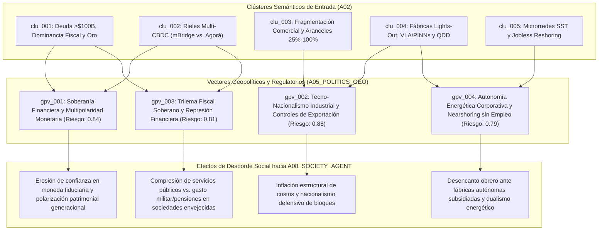

# 🌐 Reporte de Geopolítica y Gobernanza (`A05`)

> [!NOTE]
> **ID del Agente:** `A05_POLITICS_GEO`  
> **Ciclo de Ejecución (`run_id`):** `run-20261023-sovereignty`  
> **Etapa:** `02_SECTORAL_ANALYSIS_L1` (Rama C — Nivel 1: Geopolítica y Gobernanza)  
> **Recibe de:** `A02_NLP_CLASSIFIER` (Cola `to_A05_POLITICS_GEO`: clústeres `clu_001` a `clu_005` / `12` señales estratégicas)  
> **Entrega a:** `A08_SOCIETY_AGENT`  
> **Estado del Orden Geopolítico:** `MULTIPOLAR_TECHNO_NATIONALISM`

---

## 1. Resumen Ejecutivo Geopolítico

El análisis de los **5 clústeres semánticos (`clu_001` a `clu_005`)** enrutados hacia `A05_POLITICS_GEO` confirma una transición estructural desde el orden multilateral de posguerra Fría hacia un régimen de **Tecno-Nacionalismo Multipolar y Fragmentación Monetaria (`MULTIPOLAR_TECHNO_NATIONALISM`)**. En este nuevo equilibrio inestable, la interdependencia económica global ha dejado de operar como garante de paz para convertirse en un vector de vulnerabilidad estratégica (*weaponized interdependence*), forzando a las grandes potencias y potencias medias a blindar tres pilares de soberanía: **rieles de liquidación financiera, capacidad manufacturera automatizada e infraestructura energética crítica**.

Se han sintetizado **4 vectores geopolíticos y regulatorios (`gpv_001` a `gpv_004`)** que articulan las fuerzas de poder estatal y su efecto de desborde directo (*societal spillover*) sobre la ciudadanía:

1. **`gpv_001` — Soberanía Financiera y Multipolaridad Monetaria: Sanciones vs. Rieles Alternativos (`mBridge`, Oro Físico y Acuerdos en Divisas Locales):** La utilización geopolítica de sanciones financieras y congelamiento de reservas ha catalizado una respuesta defensiva sistémica en Eurasia y el Sur Global: acumulación soberana de oro físico a ritmos superiores a **1,030 toneladas/año** (`sig_20261023_002`) y puesta en marcha operativa de la plataforma multi-CBDC **Project mBridge** (`sig_20261023_004`), que compite directamente con el consorcio occidental **Project Agorá** y proyecta erosionar entre un **12% y 18%** la demanda de reservas fiduciarias G7 hacia 2035 (`sig_20261023_008`).
2. **`gpv_002` — Tecno-Nacionalismo Industrial: Aranceles Estratégicos (25%–100%) y Controles de Exportación en Manufactura Crítica:** Las restricciones al comercio mundial se han **triplicado (3.1x)** respecto a 2019 (`sig_20261023_003`). EE. UU. y la UE han institucionalizado muros arancelarios del **25% al 100%** junto con controles extraterritoriales sobre litografía EUV/DUV, semiconductores y robótica avanzada, mientras China responde restringiendo minerales críticos (galio, germanio, grafito, antimonio y tierras raras) (`sig_20261023_005`) y escalando al **59% de las instalaciones globales de robots industriales** (`sig_20261023_006`, `sig_20261023_009`).
3. **`gpv_003` — Trilema Fiscal Soberano: Deuda Pública >$100 Billones USD, Envejecimiento Demográfico y Dominancia Fiscal:** Los Estados enfrentan una tenaza fiscal sin precedentes: la deuda pública global supera los **$100 billones USD (93% del PIB mundial)** y el pago neto de intereses absorbe ya entre el **14.5% y el 17.8%** de los ingresos fiscales en economías líderes (`sig_20261023_001`). La imposibilidad política de recortar pensiones, defensa o subsidios industriales empuja a los bancos centrales hacia la **dominancia fiscal y represión financiera**, alimentando una prima por plazo adicional de **+85 a +140 pb** (`sig_20261023_008`) y desconfianza fiduciaria generalizada (`sig_20261023_011`).
4. **`gpv_004` — Soberanía de Infraestructura Física (Microrredes SST) y la Paradoja Política del "Nearshoring sin Empleo":** Mientras las corporaciones tecnológicas e industriales aseguran su continuidad operativa mediante **Transformadores de Estado Sólido (SiC SST)** y microrredes autónomas capaces de aislarse de redes públicas saturadas en `<2 ms` (`sig_20261023_010`), las fábricas relocalizadas bajo subsidios estatales operan con **IA Física (VLA/PINNs)** y robótica de **$3.50–$5.50 USD/hora**, requiriendo entre **65% y 75% menos trabajadores** (`sig_20261023_007`, `sig_20261023_012`), quebrando el pacto político de la reindustrialización.

---

## 2. Mapa de Flujo Geopolítico hacia Dinámicas Sociales (`A05` -> `A08`)



---

## 3. Vectores Geopolíticos y Regulatorios Detallados

### 1. Soberanía Financiera y Multipolaridad Monetaria: Sanciones vs. Rieles Alternativos (`gpv_001`) — Riesgo de Escalada: `0.84`
- **Eje Estratégico:** `TECNO_SOBERANIA`
- **Clústeres y Señales Fuente:** `clu_001`, `clu_002` (`sig_20261023_002`, `sig_20261023_004`, `sig_20261023_008`)
- **Actores e Instrumentos de Poder:**
  - **Bloque Euroasiático / Sur Global (China/PBOC, HKMA, EAU, Arabia Saudita, Tailandia, India, Polonia, Turquía):** Despliegue en fase MVP autónomo de la plataforma multi-CBDC **Project mBridge** para liquidación mayorista *peer-to-peer* en segundos (`T+0`) con reducción de hasta 50% en costos transaccionales (`sig_20261023_004`); compras netas de oro físico por bancos centrales superiores a **1,030 toneladas métricas anuales** con repatriación a bóvedas nacionales y reducción de la cuota del USD en reservas COFER al **57.8%** (`sig_20261023_002`).
  - **Bloque Occidental / G7 (Fed de Nueva York, BCE, Banco de Inglaterra, BIS, IIF + >40 bancos privados):** Lanzamiento de **Project Agorá** para tokenizar depósitos comerciales y reservas de bancos centrales bajo estándares regulatorios occidentales (`sig_20261023_004`), buscando preservar la centralidad del sistema de banca corresponsal frente a la erosión proyectada del **12% al 18%** en la demanda de reservas fiduciarias G7 hacia 2035 (`sig_20261023_008`).
- **Efecto de Desborde hacia `A08 (Sociedad Agent)` (`societal_spillover`):** La fragmentación del sistema monetario internacional en dos arquitecturas incompatibles traslada costos de fricción financiera e incertidumbre cambiaria a los hogares. La percepción de que las monedas fiduciarias son instrumentos de confrontación geopolítica vulnerables a sanciones o devaluación acelera la pérdida de fe ciudadana en el ahorro tradicional, impulsando comportamientos defensivos (fuga hacia oro físico, activos reales tokenizados y criptoactivos) y profundizando la brecha entre élites con acceso a cobertura multi-jurisdiccional y asalariados cautivos de su divisa local.

---

### 2. Tecno-Nacionalismo Industrial: Aranceles Estratégicos (25%–100%) y Guerra de Controles de Exportación (`gpv_002`) — Riesgo de Escalada: `0.88`
- **Eje Estratégico:** `BLOQUES_COMERCIALES`
- **Clústeres y Señales Fuente:** `clu_003`, `clu_004` (`sig_20261023_003`, `sig_20261023_005`, `sig_20261023_006`, `sig_20261023_009`)
- **Actores e Instrumentos de Poder:**
  - **Estados Unidos y Unión Europea (US Department of Commerce / BIS, Comisión Europea):** Institucionalización de aranceles estratégicos permanentes del **25% al 100%** sobre vehículos eléctricos, baterías, celdas solares, acero, aluminio y semiconductores (`sig_20261023_005`); controles de exportación extraterritoriales sobre litografía avanzada (EUV/DUV), memorias HBM y componentes de robótica de doble uso; programas de subsidios condicionados a *friend-shoring* y *near-shoring* (Norteamérica/México y Europa Central).
  - **China (MOFCOM, MIIT y ecosistema industrial doméstico):** Activación de controles de exportación simétricos sobre insumos químicos y minerales críticos (**galio, germanio, grafito, antimonio y tierras raras procesadas**) (`sig_20261023_005`); escalamiento masivo de automatización interna absorbiendo el **59% de las instalaciones mundiales de robots industriales** dentro de un parque global superior a **5 millones de unidades** (`sig_20261023_006`) y liderazgo en patentes de actuadores cuasi-directos (**QDD**) que comprimen el BOM humanoide bajo **$18,000 USD** (`sig_20261023_009`).
  - **Organización Mundial del Comercio (OMC) / Hubs Intermedios (México, Vietnam, Corea del Sur, Japón):** Parálisis de los mecanismos multilaterales de resolución de disputas mientras las medidas restrictivas se triplican (**3.1x** respecto a 2019), el comercio intra-bloque crece `+4.2%` frente a una caída de `-1.8%` inter-bloque (`sig_20261023_003`), y la duplicación de cadenas de suministro exige un sobrecosto de **12% a 22% en CAPEX** (`sig_20261023_005`).
- **Efecto de Desborde hacia `A08 (Sociedad Agent)` (`societal_spillover`):** El fin de la deflación manufacturera global (*"China price"*) y el sobrecosto del *Just-in-Case* se traducen en un piso inflacionario persistente en bienes duraderos, transición energética y tecnología de consumo para las clases medias y bajas. Políticamente, el discurso de "seguridad nacional económica" alimenta la xenofobia comercial, el atrincheramiento identitario de bloques y la subordinación de la política social a la carrera armamentística-industrial.

---

### 3. Trilema Fiscal Soberano: Deuda Pública >$100 Billones USD, Envejecimiento Demográfico y Dominancia Fiscal (`gpv_003`) — Riesgo de Escalada: `0.81`
- **Eje Estratégico:** `REGULACION`
- **Clústeres y Señales Fuente:** `clu_001`, `clu_002` (`sig_20261023_001`, `sig_20261023_008`, `sig_20261023_011`)
- **Actores e Instrumentos de Poder:**
  - **Tesoros Nacionales y Bancos Centrales del G7 y Economías Avanzadas (US Treasury, Fed, BCE, BoJ):** Gestión de un stock de deuda pública global superior a **$100 billones USD (93% del PIB mundial)** en ruta hacia el **100%–115% del PIB** a medio plazo (`sig_20261023_001`). Con un costo de servicio de la deuda que consume entre el **14.5% y el 17.8% de los ingresos fiscales federales** (frente al 8.2% en 2010-2019), los bancos centrales enfrentan restricciones políticas estructurales para sostener tasas reales positivas altas sin detonar crisis de refinanciación soberana (**Dominancia Fiscal**) (`sig_20261023_008`, `sig_20261023_011`).
  - **Mercados de Bonos e Inversores Institucionales/Minoristas:** Exigencia de una prima por plazo (*term premium*) adicional de **+85 a +140 puntos básicos** en deuda soberana de largo plazo (`sig_20261023_008`) y rotación acelerada hacia el llamado *"Debasement Trade"* (crecimiento del **+340% interanual** en tracción analítica sobre degradación fiduciaria, descontando una inflación subyacente de equilibrio del **3.2%–4.0% anual** frente al objetivo oficial del 2.0%) (`sig_20261023_011`).
- **Efecto de Desborde hacia `A08 (Sociedad Agent)` (`societal_spillover`):** El Estado de bienestar entra en una fase de suma cero intergeneracional. La combinación de envejecimiento demográfico (gasto inelástico en pensiones y salud), rearme militar y subsidios corporativos de reindustrialización deja sin margen fiscal la inversión en vivienda asequible, educación y movilidad social juvenil. La licuación silenciosa de la deuda mediante represión financiera e inflación superior al 3% funciona como un impuesto regresivo no legislado que transfiere riqueza desde los jóvenes asalariados hacia los tenedores senior de activos duros e inmobiliarios.

---

### 4. Soberanía de Infraestructura Crítica: Microrredes Industriales (SST) y la Paradoja Política del "Nearshoring sin Empleo" (`gpv_004`) — Riesgo de Escalada: `0.79`
- **Eje Estratégico:** `RECURSOS_CRITICOS`
- **Clústeres y Señales Fuente:** `clu_004`, `clu_005` (`sig_20261023_006`, `sig_20261023_007`, `sig_20261023_010`, `sig_20261023_012`)
- **Actores e Instrumentos de Poder:**
  - **Conglomerados de Electrónica de Potencia y Automatización (Huawei Digital Power, Siemens, ABB, Delta Electronics, State Grid, NVIDIA):** Estandarización de **Transformadores de Estado Sólido (SST)** de carburo de silicio (SiC) y microrredes DC que reducen un **55%–65% el volumen físico** y permiten conmutar a modo isla (*islanding*) en **`<2 milisegundos`** (`sig_20261023_010`), otorgando soberanía energética privada a centros de datos de IA y plantas *lights-out* frente a redes eléctricas públicas envejecidas.
  - **Gobiernos Nacionales/Estatales vs. Sindicatos Industriales:** Los gobiernos justifican miles de millones en subsidios fiscales, exenciones tributarias y aranceles bajo la promesa electoral de "recuperar los empleos manufactureros de clase media". Sin embargo, las plantas *Greenfield* relocalizadas integran **modelos VLA + Gemelos Digitales PINNs/OpenUSD** (que reducen un **64% el fallo Sim-to-Real** y **78% el tiempo de reconfiguración**) (`sig_20261023_007`) y celdas robóticas/humanoides con costo operativo amortizado de **$3.50 a $5.50 USD/hora** (`sig_20261023_012`), operando con **65% a 75% menos plantilla directa** que hace una década.
- **Efecto de Desborde hacia `A08 (Sociedad Agent)` (`societal_spillover`):** Se fractura la legitimidad democrática de la política industrial. Las comunidades de cinturones industriales (en EE. UU., la UE y hubs de *nearshoring* como México) observan cómo megafábricas subsidiadas con impuestos públicos se instalan en su territorio consumiendo suelo, agua y energía prioritaria (aisladas en microrredes SST de alta confiabilidad), pero sin generar la contratación masiva ni la derrama salarial prometida. Este divorcio entre **PIB industrial territorial** y **empleo humano local** cataliza un profundo resentimiento ciudadano y desconfianza hacia las élites políticas y tecnocráticas.

---

## 4. Tabla Sintética de Trazabilidad Geopolítica (`A05`)

| Vector ID | Eje | Título | Clústeres (`A02`) | Señales (`A01`) | Riesgo de Escalada | Impacto Principal en `A08_SOCIETY_AGENT` |
| :--- | :--- | :--- | :--- | :--- | :---: | :--- |
| **`gpv_001`** | `TECNO_SOBERANIA` | Soberanía Financiera y Multipolaridad Monetaria (`mBridge` vs. `Agorá` y Oro) | `clu_001`, `clu_002` | `sig_20261023_002`, `sig_20261023_004`, `sig_20261023_008` | `0.84` | Desconfianza en el ahorro fiduciario y brecha de cobertura patrimonial |
| **`gpv_002`** | `BLOQUES_COMERCIALES` | Tecno-Nacionalismo Industrial, Aranceles (25%–100%) y Controles de Exportación | `clu_003`, `clu_004` | `sig_20261023_003`, `sig_20261023_005`, `sig_20261023_006`, `sig_20261023_009` | `0.88` | Inflación estructural de bienes y atrincheramiento nacionalista |
| **`gpv_003`** | `REGULACION` | Trilema Fiscal Soberano (>$100B USD Deuda), Demografía y Dominancia Fiscal | `clu_001`, `clu_002` | `sig_20261023_001`, `sig_20261023_008`, `sig_20261023_011` | `0.81` | Conflicto distributivo intergeneracional y represión financiera |
| **`gpv_004`** | `RECURSOS_CRITICOS` | Autonomía Energética Industrial (SST) y Paradoja del "Nearshoring sin Empleo" | `clu_004`, `clu_005` | `sig_20261023_006`, `sig_20261023_007`, `sig_20261023_010`, `sig_20261023_012` | `0.79` | Desencanto ante la promesa incumplida de la reindustrialización |

---

## 5. Contrato de Salida JSON (`AgentEnvelope` + `GeoPoliticsReport`)

```json
{
  "$schema": "https://societyway.local/schemas/agent-envelope-v1.json",
  "run_id": "run-20261023-sovereignty",
  "timestamp_utc": "2026-10-23T22:53:30Z",
  "producer_agent_id": "A05_POLITICS_GEO",
  "consumer_agent_ids": [
    "A08_SOCIETY_AGENT"
  ],
  "trace_context": {
    "stage": "02_SECTORAL_ANALYSIS_L1",
    "confidence_score": 0.92,
    "source_signal_ids": [
      "sig_20261023_001",
      "sig_20261023_002",
      "sig_20261023_003",
      "sig_20261023_004",
      "sig_20261023_005",
      "sig_20261023_006",
      "sig_20261023_007",
      "sig_20261023_008",
      "sig_20261023_009",
      "sig_20261023_010",
      "sig_20261023_011",
      "sig_20261023_012"
    ]
  },
  "payload": {
    "producer_agent_id": "A05_POLITICS_GEO",
    "consumer_agent_ids": [
      "A08_SOCIETY_AGENT"
    ],
    "geopolitical_order_state": "MULTIPOLAR_TECHNO_NATIONALISM",
    "geopolitical_vectors": [
      {
        "geopol_vector_id": "gpv_001",
        "axis": "TECNO_SOBERANIA",
        "title": "Soberanía Financiera y Multipolaridad Monetaria: Sanciones Financieras vs. Rieles Alternativos (mBridge, Reservas en Oro y Liquidación en Moneda Local)",
        "source_cluster_ids": [
          "clu_001",
          "clu_002"
        ],
        "source_signal_ids": [
          "sig_20261023_002",
          "sig_20261023_004",
          "sig_20261023_008"
        ],
        "actors_involved": [
          "Bancos Centrales de Eurasia y el Golfo (PBOC, HKMA, EAU, Tailandia, Arabia Saudita)",
          "Consorcio Occidental G7 (Fed, BCE, Banco de Inglaterra, IIF)",
          "Bank for International Settlements (BIS)",
          "Gestores de Reservas Soberanas del Sur Global y Europa del Este (India, Polonia, Turquía)"
        ],
        "policy_instruments": [
          "Plataforma multi-CBDC mayorista Project mBridge con liquidación atómica T+0 fuera de la red de banca corresponsal tradicional",
          "Consorcio occidental Project Agorá para unificar reservas de bancos centrales y depósitos bancarios tokenizados",
          "Acumulación estratégica y repatriación física de oro (>1,030 toneladas/año) como activo inmune a sanciones extraterritoriales",
          "Acuerdos bilaterales de liquidación comercial de materias primas en divisas locales"
        ],
        "escalation_risk": 0.84,
        "societal_spillover": "Erosión acelerada de la confianza ciudadana en el dinero fiduciario como depósito de valor neutral; bifurcación entre actores con acceso a activos duros/tokenizados transfronterizos y poblaciones locales expuestas a controles de capital, fricción cambiaria y pérdida de poder adquisitivo."
      },
      {
        "geopol_vector_id": "gpv_002",
        "axis": "BLOQUES_COMERCIALES",
        "title": "Tecno-Nacionalismo Industrial: Barreras Arancelarias (25%-100%), Controles de Exportación Críticos y Reconfiguración de Bloques Comerciales",
        "source_cluster_ids": [
          "clu_003",
          "clu_004"
        ],
        "source_signal_ids": [
          "sig_20261023_003",
          "sig_20261023_005",
          "sig_20261023_006",
          "sig_20261023_009"
        ],
        "actors_involved": [
          "Estados Unidos (US Department of Commerce / BIS)",
          "Unión Europea (Comisión Europea)",
          "China (MOFCOM / MIIT / Ecosistema de Robótica Industrial)",
          "Hubs de Nearshoring y Aliados Industriales (México, Vietnam, Japón, Corea del Sur, Países Bajos)"
        ],
        "policy_instruments": [
          "Aranceles estratégicos permanentes del 25% al 100% sobre vehículos eléctricos, semiconductores, baterías, celdas solares, acero y aluminio",
          "Controles de exportación extraterritoriales sobre litografía EUV/DUV, chips HBM y robótica avanzada de doble uso",
          "Restricciones chinas de exportación sobre galio, germanio, grafito, antimonio y tierras raras procesadas",
          "Políticas de Estado para el dominio de patentes de actuadores QDD y despliegue masivo de robótica industrial (59% de cuota global en China)"
        ],
        "escalation_risk": 0.88,
        "societal_spillover": "Encarecimiento estructural del costo de vida por sobrecostos de CAPEX (12%-22%) en la duplicación de cadenas de suministro; consolidación de una retórica política de seguridad nacional permanente que polariza el debate público y penaliza el consumo de los hogares."
      },
      {
        "geopol_vector_id": "gpv_003",
        "axis": "REGULACION",
        "title": "Trilema Fiscal del Estado Soberano: Deuda Pública >$100 Billones USD, Envejecimiento Demográfico y Régimen de Dominancia Fiscal",
        "source_cluster_ids": [
          "clu_001",
          "clu_002"
        ],
        "source_signal_ids": [
          "sig_20261023_001",
          "sig_20261023_008",
          "sig_20261023_011"
        ],
        "actors_involved": [
          "Tesoros Nacionales del G7 y Economías Emergentes",
          "Fondo Monetario Internacional (FMI)",
          "Bancos Centrales bajo presión de Dominancia Fiscal",
          "Inversores institucionales, gestores de bonos y comunidades financieras minoristas (FinTwit / Substack)"
        ],
        "policy_instruments": [
          "Emisión masiva de deuda soberana (>93% del PIB global, con servicio de intereses absorbiendo 14.5%-17.8% de la recaudación fiscal)",
          "Represión financiera e inflación estructural tolerada por encima del objetivo oficial (3.2%-4.0% esperado) para licuar pasivos reales",
          "Reasignación presupuestaria forzosa hacia gasto en defensa, subsidios industriales y pensiones por envejecimiento demográfico"
        ],
        "escalation_risk": 0.81,
        "societal_spillover": "Ruptura del contrato intergeneracional: los jóvenes y trabajadores sin activos enfrentan inflación persistente, encarecimiento hipotecario (+85 a +140 pb de prima por plazo) y deterioro de servicios públicos, mientras los tenedores de activos reales se benefician de la licuación monetaria."
      },
      {
        "geopol_vector_id": "gpv_004",
        "axis": "RECURSOS_CRITICOS",
        "title": "Soberanía de Infraestructura Crítica: Autonomía Energética Corporativa (SST/Microrredes) y la Paradoja Política del Nearshoring sin Empleo",
        "source_cluster_ids": [
          "clu_004",
          "clu_005"
        ],
        "source_signal_ids": [
          "sig_20261023_006",
          "sig_20261023_007",
          "sig_20261023_010",
          "sig_20261023_012"
        ],
        "actors_involved": [
          "Consorcios de Electrónica de Potencia y Redes (Huawei Digital Power, Siemens, ABB, Delta Electronics, State Grid)",
          "Corporaciones de Manufactura Autónoma Lights-Out (Tesla, Figure AI, NVIDIA, integradores automotrices)",
          "Gobiernos locales/federales otorgantes de subsidios de relocalización",
          "Sindicatos industriales y comunidades trabajadoras en Norteamérica, Europa y México"
        ],
        "policy_instruments": [
          "Subsidios fiscales y exenciones para plantas Greenfield relocalizadas bajo narrativas de creación de empleo nacional",
          "Despliegue de Transformadores de Estado Sólido (SiC SST) y microrredes DC con capacidad de aislamiento (islanding <2ms) respecto a redes públicas",
          "Sustitución de mano de obra local e internacional mediante celdas VLA/PINNs y humanoides con costo amortizado de $3.50-$5.50 USD/hora (reducción de 65%-75% en plantilla)"
        ],
        "escalation_risk": 0.79,
        "societal_spillover": "Crisis de legitimidad política y desencanto ciudadano ante la 'promesa incumplida de la reindustrialización': las fábricas regresan al territorio nacional subsidiadas con fondos públicos y blindadas con microrredes energéticas propias, pero operan a oscuras (lights-out) sin reconstruir la clase media industrial del siglo XX."
      }
    ]
  },
  "markdown_summary": "## Resumen Ejecutivo del Nodo A05 (Política Geo Agent)\nEl análisis de los 5 clústeres (`clu_001` a `clu_005`) y las 12 señales base (`sig_20261023_001` a `sig_20261023_012`) define un estado de orden geopolítico `MULTIPOLAR_TECHNO_NATIONALISM` estructurado en 4 vectores (`gpv_001` a `gpv_004`): (1) Bifurcación de rieles monetarios (`mBridge` vs. `Project Agorá`) y acumulación soberana de oro (>1,030 t/año) frente al riesgo de sanciones; (2) Tecno-nacionalismo comercial con aranceles del 25%-100% y controles cruzados de exportación en semiconductores/robótica vs. tierras raras; (3) Trilema fiscal soberano con deuda >$100B USD (servicio del 14.5%-17.8% de ingresos) que fuerza dominancia fiscal e inflación estructural; y (4) Soberanía energética corporativa mediante microrredes SST acoplada a la paradoja política del 'Nearshoring sin Empleo' (plantas lights-out con 65%-75% menos personal)."
}
```
