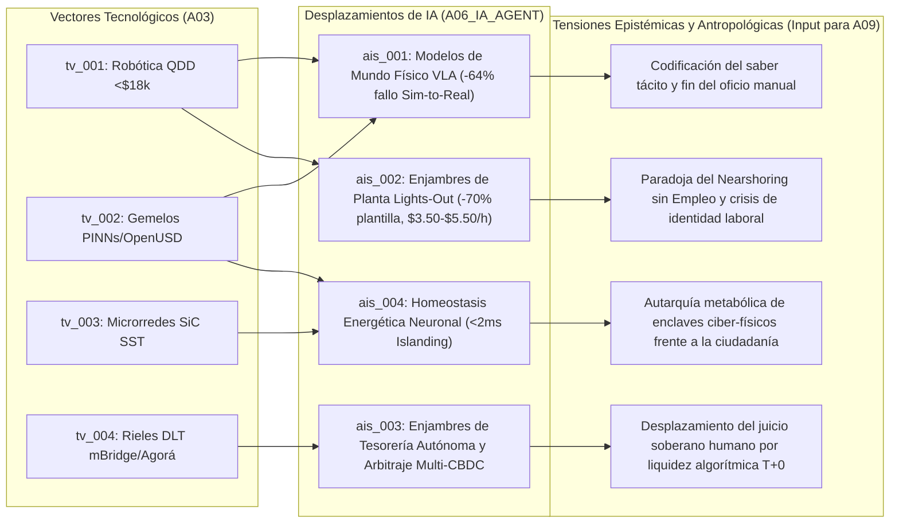

# 🤖 Síntesis de Frontera de IA (`A06`)

> [!NOTE]
> **ID del Agente:** `A06_IA_AGENT`  
> **Ciclo de Ejecución (`run_id`):** `run-20261023-sovereignty`  
> **Etapa:** `02_SECTORAL_ANALYSIS_L2` (Rama A — Nivel 2: Arquitecturas Cognitivas, Sistemas Autónomos e IA Física)  
> **Recibe de:** `A03_TECH_TRENDS` (`TechTrendsReport`: vectores `tv_001`, `tv_002`, `tv_003`, `tv_004`)  
> **Entrega a (Fan-In):** `A09_PHILOSOPHICAL_CULTURAL`  

---

## 1. Resumen Ejecutivo de la Frontera Cognitiva y Autónoma

A partir de los cuatro vectores de infraestructura diagnosticados por `A03_TECH_TRENDS` (`tv_001` a `tv_004`), el análisis de segundo nivel confirma que la Inteligencia Artificial ha superado la fase de generación puramente simbólica (texto/código en la nube) para adentrarse en un régimen de **Agencia Ciber-Física y Financiera Soberana**. 

La combinación de **Modelos de Mundo Informados por la Física (VLA + PINNs/OpenUSD)** con cuerpos robóticos de bajo costo (**BOM <$18,000 USD**) y **rieles monetarios mayoristas programables (`mBridge` / `Project Agorá`)** produce una ruptura histórica: **los sistemas autónomos ya pueden percibir y manipular la materia física en fábricas sin presencia humana (*lights-out*) y, simultáneamente, liquidar valor económico atómico (`T+0`) sin intermediación bancaria tradicional**.

Definimos **4 Desplazamientos Estructurales de Capacidad de IA (`ais_001` a `ais_004`)** que alimentan directamente la barra de sincronización del **Agente Filosófico y Cultural (`A09`)**:
1. **`ais_001` — IA Física (*Embodied AI*) y Modelos de Mundo Sim-to-Real (VLA + PINNs/OpenUSD)** (`WORLD_MODELS` | Fiabilidad: `0.86`): Reducción del **64% en fallos de transferencia a planta real** y del **78% en tiempos de reconfiguración**, desplazando el oficio manual y la ingeniería de planta tradicional.
2. **`ais_002` — Orquestación Multiagente de Manufactura *Lights-Out* y Desacoplamiento Trabajo-Producción** (`AGENTIC_SWARMS` | Fiabilidad: `0.84`): Enjambres jerárquicos que coordinan flotas de entre decenas y cientos de humanoides y celdas robotizadas a un costo amortizado de **$3.50–$5.50 USD/hora**, reduciendo un **65%–75% la plantilla humana directa**.
3. **`ais_003` — Enjambres de Tesorería Autónoma y Arbitraje Algorítmico sobre Rieles Multi-CBDC** (`AGENTIC_SWARMS` | Fiabilidad: `0.88`): Agentes financieros institucionales que ejecutan liquidación atómica transfronteriza, enrutamiento de colateral y cobertura contra dominancia fiscal entre `mBridge`, `Project Agorá` y activos reales tokenizados.
4. **`ais_004` — Gobernanza Ciber-Física Homeostática de Microrredes y Cómputo Soberano en el Borde** (`SCIENTIFIC_DISCOVERY` | Fiabilidad: `0.82`): Sistemas de control neuronal en tiempo real que administran Transformadores de Estado Sólido (SiC SST, conmutación a isla `<2 ms`) y balancean dinámicamente el presupuesto energético entre inferencia cognitiva y trabajo mecánico bajo restricciones de hardware.

---

## 2. Evaluación en las 5 Dimensiones de Capacidad y Filtro *Hype vs. Realidad*

| Dimensión de Capacidad (`A06`) | Estado de Frontera (Octubre 2026) | Métrica / Evidencia Verificable (`A01`/`A03`) | Desacoplamiento *Hype vs. Realidad Operativa* |
| :--- | :--- | :--- | :--- |
| **1. Razonamiento y Planificación de Horizonte Largo** | Horizonte autónomo verificable de **72 horas** en logística, tesorería y programación de producción. | Reducción del **78%** en tiempos de parada por cambio de línea (`sig_20261023_007`). | **Realidad:** Alta fiabilidad en dominios acotados por leyes físicas (`PINNs`) o reglas contables (`DLT`). **Hype:** La planificación abierta sin verificador formal aún sufre deriva acumulativa tras >100 pasos. |
| **2. Autonomía Multiagente** | Enjambres industriales y financieros en producción (`M2M`) sobre rieles atómicos. | Liquidación `T+0` con **50% menor costo** en `mBridge` (`sig_20261023_004`) y erosión proyectada del **12%–18%** en reservas G7 (`sig_20261023_008`). | **Realidad:** Los agentes de tesorería y compras superan la velocidad de mesas humanas. **Hype:** Riesgo latente de *flash crashes* inter-bloque por falta de cortafuegos semánticos entre `mBridge` y `Agorá`. |
| **3. IA Física / Robótica (*World Models*)** | Transición acelerada desde pilotos aislados hacia celdas comerciales *lights-out* multi-turno. | **>5M** robots industriales, BOM humanoide **<$18k USD** (`sig_20261023_006`, `sig_20261023_009`) y **-64%** fallo *Sim-to-Real* (`sig_20261023_007`). | **Realidad:** Viabilidad económica demostrada ($3.50–$5.50/h) en ensamblaje estructurado y semi-estructurado. **Hype:** Los humanoides domésticos generalistas aún enfrentan cuellos de botella en baterías y seguridad de contacto humano. |
| **4. Memoria Episódica y Personalización** | Gemelos digitales persistentes de planta y memoria institucional criptográficamente auditada. | Grafo continuo `OpenUSD` sincronizado con telemetría de actuadores QDD y estado de red `SST`. | **Realidad:** La fábrica entera posee una "memoria episódica física" compartida entre todos los robots; el aprendizaje de un fallo mecánico se propaga instantáneamente a toda la flota. |
| **5. Ciencia e Ingeniería Descubierta por IA** | Co-diseño automatizado de topologías mecatrónicas, control de potencia SiC y compilación en silicio restringido. | Explosión de patentes en actuadores `QDD` (`sig_20261023_009`) y electrónica `SiC SST` (`sig_20261023_010`) pese a controles `EUV/DUV` (`sig_20261023_005`). | **Realidad:** Los modelos física-informados optimizan campos magnéticos, disipación térmica y conmutación eléctrica en `<2 ms` mejor que el diseño heurístico tradicional. |

---

## 3. Desplazamientos en Capacidades Cognitivas y Autónomas (`ai_shifts`)

### 1. Modelos de Mundo Físico (VLA + PINNs/OpenUSD) y Cierre de la Brecha *Sim-to-Real* (`ais_001`)
- **Vector Tecnológico Base:** `tv_002` (`sig_20261023_005`, `sig_20261023_007`) y `tv_001` (`sig_20261023_006`, `sig_20261023_009`)
- **Dominio de Capacidad:** `WORLD_MODELS`
- **Impulsor Técnico y Fiabilidad (`0.86`):** La fusión de modelos fundacionales **Vision-Language-Action (VLA)** con **Redes Neuronales Informadas por la Física (PINNs)** sobre escenas **OpenUSD** permite que las redes neuronales internalicen las ecuaciones de conservación de momento, fricción de Coulomb, elasticidad y deformación de materiales. Esto reduce en un **64% la tasa de fallo en transferencia *Sim-to-Real*** en tareas de ensamblaje de precisión y disminuye un **78% el tiempo de reconfiguración de línea (`changeover time`)** (`sig_20261023_007`). Además, ante los controles de exportación sobre litografía EUV/DUV y memorias HBM (`sig_20261023_005`), la destilación de políticas motoras permite ejecutar estos modelos localmente en el borde con baja huella de memoria.
- **Impacto en la Agencia y Cognición Humana (Input para `A09`):**
  - **Expropiación epistémica del *saber hacer* tácito (Polanyi):** Durante siglos, la destreza sensoriomotora y el oficio industrial pertenecieron exclusivamente al cuerpo humano. Con `VLA + PINNs`, la intuición física se codifica matemáticamente y se vuelve replicable a costo marginal cero.
  - **Mutación de la autoría industrial:** El ingeniero u operario deja de ser un ejecutor manual o programador imperativo de PLCs para convertirse en un *especificador de intenciones semánticas*, cediendo el control micro-causal del proceso productivo a un modelo de mundo sintético cuya lógica interna de optimización es opaca a la inspección humana directa.

---

### 2. Enjambres de Coordinación en Fábricas *Lights-Out* y Comoditización del Trabajo Físico (`ais_002`)
- **Vector Tecnológico Base:** `tv_001` (`sig_20261023_006`, `sig_20261023_009`, `sig_20261023_012`)
- **Dominio de Capacidad:** `AGENTIC_SWARMS`
- **Impulsor Técnico y Fiabilidad (`0.84`):** Mientras el parque mundial supera los **5 millones de robots industriales** (`sig_20261023_006`) y el BOM de los humanoides cae bajo **$18,000 USD** gracias a los actuadores QDD (`sig_20261023_009`), emerge una arquitectura de **enjambres agénticos jerárquicos de planta**. Un agente planificador central descompone órdenes de manufactura y asigna subtareas en tiempo real a cientos de agentes encarnados (humanoides bípedos, manipuladores móviles y celdas fijas) que operan a oscuras (*lights-out*) a un costo amortizado de **$3.50 a $5.50 USD/hora**, logrando reducciones del **65% al 75% en la plantilla operativa directa** en plantas *Greenfield* relocalizadas (`sig_20261023_012`).
- **Impacto en la Agencia y Cognición Humana (Input para `A09`):**
  - **Ruptura del contrato social de la reindustrialización (*Jobless Reshoring*):** La soberanía productiva nacional se desacopla radicalmente de la creación de empleo obrero. Las fábricas regresan al territorio nacional pero como **catedrales silenciosas sin trabajadores**, vaciando de contenido la promesa política tradicional del trabajo industrial como ascensor social y fuente de identidad comunitaria.
  - **Inversión de la jerarquía humano-máquina en planta:** El escaso personal humano remanente (25%–35% dedicado a mantenimiento de excepciones y supervisión) experimenta una inversión de agencia: sus turnos, rutas y prioridades son despachados algorítmicamente por el gemelo digital de la fábrica.

---

### 3. Enjambres de Tesorería Autónoma y Arbitraje Algorítmico Soberano (`ais_003`)
- **Vector Tecnológico Base:** `tv_004` (`sig_20261023_003`, `sig_20261023_004`, `sig_20261023_008`)
- **Dominio de Capacidad:** `AGENTIC_SWARMS`
- **Impulsor Técnico y Fiabilidad (`0.88`):** Sobre la infraestructura bifurcada de liquidación mayorista (**Project mBridge** con liquidación `T+0` y -50% en costos vs. **Project Agorá** con depósitos tokenizados, `sig_20261023_004`), se despliegan **enjambres de agentes financieros y de tesorería autónoma**. Estos sistemas integran lectura macroeconómica en tiempo real, programación de contratos inteligentes (*Delivery-versus-Payment*) y modelos econométricos de riesgo soberano (`sig_20261023_008`). Cuando detectan deterioro fiscal, aranceles súbitos (`sig_20261023_003`) o fricciones sancionatorias, re-enrutan pagos transfronterizos en milisegundos entre divisas locales, depósitos tokenizados y colateral respaldado en oro/materias primas, acelerando la erosión proyectada del **12%–18% en la demanda de reservas fiduciarias tradicionales hacia 2035**.
- **Impacto en la Agencia y Cognición Humana (Input para `A09`):**
  - **Erosión de la soberanía monetaria deliberativa:** La velocidad de la liquidación atómica gobernada por agentes de IA (`T+0` en segundos) supera la escala temporal de deliberación de los comités de bancos centrales y ministerios de finanzas humanos. La confianza fiduciaria —históricamente un fenómeno psicológico y político intersubjetivo— pasa a ser arbitrada instantáneamente por funciones de utilidad algorítmicas.
  - **Comercio Máquina-a-Máquina (M2M) autónomo:** Una fábrica *lights-out* (`ais_002`) puede licitar insumos, contratar transporte, verificar entrega física por sensores y liquidar el pago transfronterizo en `mBridge` o `Agorá` (`ais_003`) cerrando el ciclo económico completo sin que ninguna mente humana haya intervenido en la transacción.

---

### 4. Control Neuronal Homeostático de Microrredes (SiC SST) y Metabolismo de Cómputo Soberano (`ais_004`)
- **Vector Tecnológico Base:** `tv_003` (`sig_20261023_003`, `sig_20261023_005`, `sig_20261023_010`) y `tv_002` (`sig_20261023_005`, `sig_20261023_007`)
- **Dominio de Capacidad:** `SCIENTIFIC_DISCOVERY`
- **Impulsor Técnico y Fiabilidad (`0.82`):** Los **Transformadores de Estado Sólido (SST) de carburo de silicio (SiC)** requieren algoritmos de control predictivo neuronal que operan en escalas de microsegundos a milisegundos para gestionar una eficiencia del **98.5%** y ejecutar la transición a modo isla en **<2 milisegundos** ante inestabilidades de la red pública (`sig_20261023_010`). Agentes especializados de optimización físico-energética unifican la gestión de la microrred en corriente continua (DC) con la carga computacional del centro de datos local y el consumo mecánico de los robots en planta, maximizando el rendimiento por vatio en un entorno de escasez de minerales críticos (galio, germanio, grafito) y aranceles del 25%–100% (`sig_20261023_003`, `sig_20261023_005`).
- **Impacto en la Agencia y Cognición Humana (Input para `A09`):**
  - **Autopoiesis material de la infraestructura sintética:** Al dotar a las fábricas autónomas y centros de datos de un "sistema nervioso autónomo energético" capaz de aislarse en `<2 ms` de la red pública, las infraestructuras de IA adquieren una forma de **homeostasis e instinto de autoconservación operativa**.
  - **Bifurcación metabólica del territorio:** Surge una tensión ética y política entre la red eléctrica ciudadana (expuesta a congestión e inflación energética) y los enclaves industriales/computacionales soberanos que garantizan su propia continuidad metabólica mediante microrredes SST gobernadas por IA.

---

## 4. Mapa de Convergencia hacia el Nodo Filosófico y Cultural (`A06` -> `A09`)



---

## 5. Contrato de Salida JSON (`AgentEnvelope` + `AIDomainSynthesis`)

```json
{
  "$schema": "https://societyway.local/schemas/agent-envelope-v1.json",
  "run_id": "run-20261023-sovereignty",
  "timestamp_utc": "2026-10-23T22:56:00Z",
  "producer_agent_id": "A06_IA_AGENT",
  "consumer_agent_ids": [
    "A09_PHILOSOPHICAL_CULTURAL"
  ],
  "trace_context": {
    "stage": "02_SECTORAL_ANALYSIS_L2",
    "confidence_score": 0.91,
    "source_signal_ids": [
      "sig_20261023_003",
      "sig_20261023_004",
      "sig_20261023_005",
      "sig_20261023_006",
      "sig_20261023_007",
      "sig_20261023_008",
      "sig_20261023_009",
      "sig_20261023_010",
      "sig_20261023_012"
    ]
  },
  "payload": {
    "producer_agent_id": "A06_IA_AGENT",
    "consumer_agent_ids": [
      "A09_PHILOSOPHICAL_CULTURAL"
    ],
    "ai_capability_frontier": {
      "autonomous_horizon_hours": 72,
      "dominant_paradigm": "PHYSICAL_AI_WORLD_MODELS_AND_SOVEREIGN_TREASURY_SWARMS",
      "embodied_ai_maturity": "COMMERCIAL_LIGHTS_OUT_MANUFACTURING_CELLS_AND_HUMANOID_FLEETS"
    },
    "ai_shifts": [
      {
        "ai_shift_id": "ais_001",
        "parent_tech_vector_id": "tv_002",
        "source_signal_ids": [
          "sig_20261023_005",
          "sig_20261023_006",
          "sig_20261023_007",
          "sig_20261023_009"
        ],
        "capability_domain": "WORLD_MODELS",
        "title": "Modelos Vision-Language-Action (VLA) Acoplados a Gemelos Digitales Físicos (PINNs / OpenUSD)",
        "technical_driver": "Integración de redes neuronales informadas por la física (PINNs) y simulación multifísica OpenUSD con políticas motoras VLA cuantizadas para inferencia en el borde, reduciendo un 64% el fallo Sim-to-Real y un 78% el tiempo de reconfiguración de línea.",
        "reliability_index": 0.86,
        "human_agency_impact": "Expropiación algorítmica del conocimiento sensoriomotor tácito: la destreza manual y el ajuste empírico de planta pasan de ser un patrimonio corporal humano a un activo de software transferible instantáneamente entre flotas robóticas, desplazando al humano hacia la mera especificación semántica de objetivos."
      },
      {
        "ai_shift_id": "ais_002",
        "parent_tech_vector_id": "tv_001",
        "source_signal_ids": [
          "sig_20261023_006",
          "sig_20261023_009",
          "sig_20261023_012"
        ],
        "capability_domain": "AGENTIC_SWARMS",
        "title": "Enjambres de Orquestación Industrial Lights-Out y Paradoja del Nearshoring sin Empleo",
        "technical_driver": "Coordinación multiagente de flotas heterogéneas (>5 millones de robots industriales y humanoides con BOM <$18,000 USD mediante actuadores QDD) que operan turnos 24/7 sin iluminación a un costo amortizado de $3.50-$5.50 USD/hora.",
        "reliability_index": 0.84,
        "human_agency_impact": "Disolución del vínculo histórico entre soberanía industrial y empleo masivo (reducción del 65%-75% en plantilla directa en plantas Greenfield). El trabajador humano remanente pierde centralidad productiva y pasa a operar como periférico de mantenimiento subordinado al despacho del planificador agéntico."
      },
      {
        "ai_shift_id": "ais_003",
        "parent_tech_vector_id": "tv_004",
        "source_signal_ids": [
          "sig_20261023_003",
          "sig_20261023_004",
          "sig_20261023_008"
        ],
        "capability_domain": "AGENTIC_SWARMS",
        "title": "Enjambres de Tesorería Autónoma y Arbitraje Algorítmico sobre Rieles Multi-CBDC",
        "technical_driver": "Agentes financieros autónomos conectados vía API a plataformas de liquidación atómica T+0 (Project mBridge y Project Agorá) que ejecutan pagos máquina-a-máquina (M2M), cobertura cambiaria y rotación dinámica de colateral ante riesgos de dominancia fiscal y aranceles.",
        "reliability_index": 0.88,
        "human_agency_impact": "Compresión hiper-temporal de la soberanía financiera: las decisiones de liquidez, asignación de reservas y liquidación comercial transfronteriza ocurren en segundos entre agentes sintéticos, erosionando entre 12% y 18% la demanda de reservas fiduciarias tradicionales y desplazando la deliberación humana en tesorerías y banca central."
      },
      {
        "ai_shift_id": "ais_004",
        "parent_tech_vector_id": "tv_003",
        "source_signal_ids": [
          "sig_20261023_003",
          "sig_20261023_005",
          "sig_20261023_010"
        ],
        "capability_domain": "SCIENTIFIC_DISCOVERY",
        "title": "Control Neuronal Homeostático de Microrredes (SiC SST) y Metabolismo de Cómputo Soberano",
        "technical_driver": "Modelos de control predictivo de ultra-baja latencia que gobiernan Transformadores de Estado Sólido (SiC SST, 98.5% eficiencia) para conmutar plantas lights-out y centros de datos de IA a modo isla en <2 milisegundos y optimizar el gasto energético bajo restricciones de silicio y minerales críticos.",
        "reliability_index": 0.82,
        "human_agency_impact": "Emergencia de enclaves ciber-físicos energéticamente autárquicos: la infraestructura de IA y robótica adquiere homeostasis material propia para proteger su continuidad operativa frente a fallos de la red pública ciudadana, inaugurando una jerarquía metabólica entre ciudadanos y complejos sintéticos."
      }
    ]
  },
  "markdown_summary": "## Resumen Ejecutivo del Nodo A06 (IA Agent)\nA partir de los 4 vectores tecnológicos de `A03_TECH_TRENDS` (`tv_001` a `tv_004`), se sintetizan 4 desplazamientos estructurales de IA (`ais_001` a `ais_004`) con un horizonte autónomo de 72 horas: `ais_001` (Modelos de Mundo Físico VLA + PINNs/OpenUSD que reducen 64% el fallo Sim-to-Real y codifican el oficio manual tácito), `ais_002` (Enjambres de manufactura lights-out a $3.50-$5.50/h que reducen 65%-75% la plantilla humana directa, consolidando el Jobless Reshoring), `ais_003` (Enjambres de tesorería autónoma que arbitran liquidez y liquidación atómica T+0 sobre mBridge y Project Agorá) y `ais_004` (Control neuronal homeostático de microrredes SiC SST con desconexión a isla en <2 ms). Este reporte entrega al Agente Filosófico y Cultural (`A09`) los vectores de impacto sobre la agencia humana, la autoría industrial y la soberanía epistémica."
}
```
