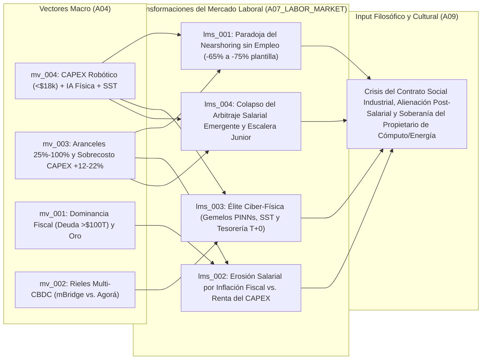

# 💼 Síntesis del Mercado Laboral (`A07`)

> [!NOTE]
> **ID del Agente:** `A07_LABOR_MARKET`  
> **Etapa:** `02_SECTORAL_ANALYSIS_L2` (Rama B — Nivel 2)  
> **Ciclo de Ejecución (`run_id`):** `run-20261023-sovereignty`  
> **Recibe de:** `A04_ECON_MACRO` (`MacroEconReport`: vectores `mv_001` a `mv_004`)  
> **Entrega a (Fan-In):** `A09_PHILOSOPHICAL_CULTURAL`  

---

## 1. Métricas Estructurales del Mercado Laboral Global

La transmisión de los cuatro vectores macroeconómicos (`mv_001` a `mv_004`) hacia la estructura ocupacional produce una **fractura histórica entre el crecimiento del PIB industrial/financiero y la generación de empleo e ingresos salariales**. Por primera vez desde la Primera Revolución Industrial, la relocalización geográfica de la manufactura (*reshoring/nearshoring*) y la modernización financiera ocurren bajo una elasticidad empleo-producto negativa en las tareas operativas de base:

- **Tendencia de Participación Salarial en el PIB (`labor_share_of_gdp_trend`):** `ACCELERATED_STRUCTURAL_DECLINE` — Caída sostenida de la participación del trabajo ($L$) frente al capital ($K$) debido a la triple pinza de: (a) sustitución directa de OPEX salarial por CAPEX robótico amortizado a `$3.50–$5.50 USD/hora` (`sig_20261023_009`, `sig_20261023_012`), (b) erosión de salarios reales por inflación fiscal/arancelaria del `3.2%–4.0%` (`sig_20261023_001`, `sig_20261023_005`, `sig_20261023_011`), y (c) captura de rentas por propietarios de activos duros, cómputo e infraestructura energética (`sig_20261023_002`, `sig_20261023_010`).
- **Vida Media de Habilidades Técnicas (`skill_half_life_years`):** `2.1 años` — La convergencia de modelos *Vision-Language-Action (VLA)*, gemelos digitales físicos (*PINNs/OpenUSD*) y liquidación financiera atómica (`T+0`) vuelve obsoletas las competencias de programación rígida de PLCs, operación electromecánica convencional y conciliación bancaria tradicional en menos de 26 meses (`sig_20261023_004`, `sig_20261023_007`).
- **Compresión del Escalón de Entrada (`entry_level_cognitive_compression`):** `SEVERE_DUAL_COLLAR_COMPRESSION` — La ruptura de la escalera formativa (*Career Ladder*) ya no se limita al trabajo administrativo de cuello blanco (finanzas/back-office), sino que se extiende al **cuello azul industrial y técnico junior**: las fábricas *lights-out* eliminan los puestos de operario aprendiz, dejando un vacío crítico en la transmisión intergeneracional de conocimiento tácito en planta (`sig_20261023_006`, `sig_20261023_012`).

---

## 2. Mapa de Reconfiguración Ocupacional y Tensión Identitaria (`A07` -> `A09`)



---

## 3. Desglose de Transformaciones Ocupacionales, Salariales e Identitarias (`labor_shifts`)

### 3.1. [`lms_001`] La "Paradoja del Nearshoring sin Empleo" (*Jobless Reshoring*) y el Desplazamiento del Cuello Azul en Fábricas *Lights-Out*
- **Vectores Macro Base:** `mv_004`, `mv_003` (`sig_20261023_003`, `sig_20261023_005`, `sig_20261023_006`, `sig_20261023_007`, `sig_20261023_009`, `sig_20261023_012`)
- **Análisis Basado en Tareas (*Task-Based Approach*):** Para compensar el sobrecosto de CAPEX del `12%–22%` derivado de la duplicación de cadenas de suministro y los aranceles del `25%–100%`, las nuevas plantas relocalizadas (*Greenfield*) en Norteamérica y Europa se diseñan desde cero bajo arquitectura *lights-out* (sin iluminación ni presencia humana continua). Con un parque global que supera los **5 millones de robots industriales** y el costo BOM de los humanoides comprimido bajo **$18,000 USD** gracias a actuadores cuasi-directos (**QDD**), el costo horario operativo amortizado cae a **$3.50–$5.50 USD/hora** en turnos 24/7. Acoplados a modelos *Vision-Language-Action (VLA)* que reducen un **64% el fallo Sim-to-Real** y un **78% el tiempo de cambio de línea**, los sistemas autónomos absorben las tareas físicas no estructuradas que antes requerían destreza manual humana, operando con **65% a 75% menos plantilla operativa directa**.
- **Clústeres de Tareas Desplazadas (`displaced_task_clusters`):**
  - Ensamblaje electromecánico manual y manipulación de arneses/componentes deformables en líneas automotrices y electrónicas.
  - Intralogística de planta, carga/descarga de pallets (*material handling*) y abastecimiento de celdas (*kitting*).
  - Inspección visual de control de calidad en línea y ajuste manual de utillajes durante cambios de lote (*changeover*).
  - Supervisión intermedia de turno en piso de producción (*shop-floor supervisors*).
- **Roles Emergentes (`emerging_roles`):**
  - **Ingeniero de Orquestación Sim-to-Real y Gemelos Digitales Físicos (`PINNs/OpenUSD`)**: Entrena y valida políticas *VLA* en simulación antes de desplegarlas en flotas robóticas heterogéneas.
  - **Especialista en Tele-Operación de Excepciones y Entrenamiento Propioceptivo Humanoide**: Interviene remotamente ante casos borde (*edge cases*) mecánicos y genera demostraciones cinemáticas para ajuste fino de modelos *Physical AI*.
  - **Técnico Mecatrónico de Actuadores Cuasi-Directos (`QDD`) y Cinemática Bípeda**: Mantenimiento preventivo de articulaciones de alta densidad de torque, tornillos planetarios de rodillos y sistemas de refrigeración líquida.
- **Efecto en la Distribución Salarial (`wage_distribution_effect`):** Desaparición masiva de empleos manufactureros sindicalizados de clase media (`$25.00–$38.00 USD/hora` en EE. UU./UE). El ahorro en masa salarial se transfiere íntegramente al retorno sobre el capital (ROIC) de la planta y a una prima salarial extrema concentrada en el `<15%` de personal técnico de alta calificación que permanece en la instalación.
- **Tensión de Identidad y Propósito (Input para `A09`):** **Ruptura de la promesa política del nacionalismo industrial.** Las comunidades de cinturones industriales (*Rust Belts*) observan cómo se levantan megafábricas subvencionadas con impuestos públicos en sus municipios sin que se abran vacantes para los trabajadores locales. El trabajo fabril —históricamente pilar de dignidad masculina, cohesión sindical y ascenso intergeneracional— se percibe como un espacio deshumanizado y hermético (*lights-out*), detonando resentimiento político contra la "reindustrialización fantasma".

---

### 3.2. [`lms_002`] Erosión Salarial por Dominancia Fiscal e Inflación Arancelaria frente a la Captura de Rentas del CAPEX
- **Vectores Macro Base:** `mv_001`, `mv_003` (`sig_20261023_001`, `sig_20261023_002`, `sig_20261023_005`, `sig_20261023_011`)
- **Análisis Basado en Tareas (*Task-Based Approach*):** Bajo un régimen donde la deuda pública global supera los **$100 billones USD (93% del PIB)** y el pago de intereses absorbe entre el **14.5% y el 17.8% de los ingresos fiscales**, el Estado recurre a la represión financiera y tolera una inflación subyacente de equilibrio del **3.2%–4.0% anual** agravada por aranceles estratégicos (`25%–100%`). Mientras las tareas laborales humanas (tanto de servicios como administrativas y operativas) se remuneran en moneda fiduciaria sujeta a degradación del poder adquisitivo y rigidez salarial a la alza, el rendimiento económico se desplaza hacia la tenencia de activos escasos o productivos: reservas de oro (`>1,030 t/año`), activos reales tokenizados (RWA), flotas de robots depreciables e infraestructura energética autónoma.
- **Clústeres de Tareas Desplazadas (`displaced_task_clusters`):**
  - Gestión patrimonial tradicional basada en carteras estáticas 60/40 con bonos soberanos G7 como activo libre de riesgo.
  - Administración pública rutinaria y servicios civiles municipales sujetos a congelamiento presupuestario por el peso del servicio de deuda.
  - Negociación colectiva salarial indexada a métricas de IPC oficial rezagadas frente a la inflación de activos reales y energía.
- **Roles Emergentes (`emerging_roles`):**
  - **Estratega de Cobertura contra Dominancia Fiscal y Activos Reales Tokenizados (`RWA`)**: Estructuración de balances corporativos y familiares en oro físico, materias primas, energía y deuda privada indexada.
  - **Arquitecto de Financiamiento de Flotas Robóticas (*Robot-as-a-Service / CAPEX Leasing*)**: Diseño de vehículos financieros donde el colateral son celdas humanoides y transformadores SST en lugar de nóminas.
- **Efecto en la Distribución Salarial (`wage_distribution_effect`):** Divergencia patrimonial acelerada (*K-Shaped Wealth Divide*). Los trabajadores que dependen exclusivamente de un salario nominal en divisa fiduciaria sufren una pérdida acumulada de poder adquisitivo real del `15%–22%` en un horizonte de 5 años frente a la cesta de activos duros (vivienda, energía, oro), mientras que los propietarios de CAPEX (cómputo, robótica, microrredes) capturan tanto la productividad deflacionaria de las máquinas como la revalorización nominal inflacionaria.
- **Tensión de Identidad y Propósito (Input para `A09`):** **Crisis de legitimidad del dinero fiduciario y muerte del ahorro salarial.** La viralización del *Debasement Trade* (`+340%` en tracción social) instala en la conciencia colectiva de las clases medias y jóvenes profesionales la convicción de que *"trabajar por un sueldo y ahorrar en el banco es una trampa matemática"*. Esto erosiona la ética protestante del esfuerzo diferido y fomenta una mentalidad de supervivencia patrimonial, especulación financiera defensiva o deserción del contrato fiscal tradicional.

---

### 3.3. [`lms_003`] Desintermediación del Trabajo Financiero Corresponsal y Surgimiento de la Élite de Ingeniería Ciber-Física y Energética
- **Vectores Macro Base:** `mv_002`, `mv_004` (`sig_20261023_004`, `sig_20261023_008`, `sig_20261023_010`)
- **Análisis Basado en Tareas (*Task-Based Approach*):** En el frente financiero, la graduación operativa de **Project mBridge** (liquidación atómica **T+0** en segundos y **-50% en costos**) y el despliegue de **Project Agorá** (depósitos tokenizados y reservas mayoristas programables) automatizan mediante contratos inteligentes las tareas de compensación interbancaria, verificación de liquidez FX y conciliación documental de comercio exterior que antes requerían de 3 a 5 días hábiles y miles de analistas. Paralelamente, en el frente industrial, la necesidad de desconectar las fábricas *lights-out* de redes eléctricas públicas vulnerables impulsa la adopción de **Transformadores de Estado Sólido (SST) de carburo de silicio (SiC)** con **98.5% de eficiencia** y conmutación a modo isla en **<2 milisegundos**, creando un cuello de botella crítico de talento en electrónica de potencia de alta frecuencia y microrredes en corriente continua (DC).
- **Clústeres de Tareas Desplazadas (`displaced_task_clusters`):**
  - Conciliación manual de cuentas nostro/vostro, gestión de mensajes SWIFT e investigación de excepciones en pagos transfronterizos.
  - Verificación documental de cartas de crédito (*Letters of Credit*) y cumplimiento AML/KYC secuencial en *trade finance*.
  - Mantenimiento eléctrico industrial convencional basado en transformadores electromagnéticos pasivos de 50/60 Hz sin telemetría de estado sólido.
- **Roles Emergentes (`emerging_roles`):**
  - **Arquitecto de Tesorería Algorítmica Multi-CBDC (`mBridge` / `Project Agorá`)**: Programa el enrutamiento dinámico de liquidez corporativa entre rieles soberanos orientales/del Golfo y consorcios tokenizados occidentales, optimizando primas por plazo (`+85 a +140 bps`) y exposición a sanciones.
  - **Ingeniero de Microrredes Industriales DC y Electrónica de Potencia `SiC/GaN` (`SST`)**: Diseña y opera sistemas de potencia autónomos con capacidad de *islanding* en `<2 ms` acoplados a baterías BESS y plantas *lights-out*.
  - **Auditor de Soberanía de Suministro y Cumplimiento Geoeconómico de Doble Riel**: Verifica la trazabilidad de insumos críticos (galio, germanio, litografía) y la legalidad de liquidaciones financieras a través de jurisdicciones fragmentadas.
- **Efecto en la Distribución Salarial (`wage_distribution_effect`):** Polarización extrema dentro de los sectores de cuello blanco y de ingeniería: compresión severa de salarios y vacantes en operaciones bancarias administrativas (`-35% a -50%` en demanda de *back-office* transfronterizo), frente a guerras de talento con compensaciones en el percentil 98 para arquitectos de sistemas ciber-físicos, especialistas en semiconductores de potencia SiC y tesoreros algorítmicos.
- **Tensión de Identidad y Propósito (Input para `A09`):** **Bifurcación cognitiva entre la "Casta de Soberanía Técnica" y el proletariado administrativo redundante.** Quienes dominan la intersección entre física, energía de estado sólido, código algorítmico y finanzas tokenizadas adquieren un estatus casi soberano dentro de las corporaciones, mientras que los profesionales administrativos de carrera media experimentan una obsolescencia abrupta al ver que su función de "intermediación y confianza burocrática" es reemplazada por protocolos criptográficos de liquidación instantánea.

---

### 3.4. [`lms_004`] Colapso del Arbitraje Salarial en Mercados Emergentes y Ruptura de la Escalera de Aprendizaje Técnico
- **Vectores Macro Base:** `mv_003`, `mv_004` (`sig_20261023_003`, `sig_20261023_005`, `sig_20261023_006`, `sig_20261023_007`, `sig_20261023_009`, `sig_20261023_012`)
- **Análisis Basado en Tareas (*Task-Based Approach*):** Durante cuatro décadas, el modelo de industrialización de las economías en desarrollo (América Latina, Sudeste Asiático, Europa del Este) se basó en ofrecer mano de obra manufacturera a **$6.00–$9.00 USD/hora** frente a los **$25.00–$38.00 USD/hora** de las economías avanzadas. Al caer el costo amortizado de la robótica humanoide y colaborativa a **$3.50–$5.50 USD/hora** (`sig_20261023_012`) y el BOM por debajo de **$18,000 USD** (`sig_20261023_009`), el arbitraje salarial geográfico queda matemáticamente anulado. Incluso cuando las plantas se instalan en hubs de *nearshoring* (como México o Vietnam) para saltar aranceles (`sig_20261023_003`, `sig_20261023_005`), llegan pre-equipadas con celdas autónomas *VLA/PINNs*. Al mismo tiempo, la desaparición del 65%–75% de los puestos operativos de entrada destruye el mecanismo de *aprender haciendo* (*learning-by-doing*) en el que se formaban los futuros técnicos senior.
- **Clústeres de Tareas Desplazadas (`displaced_task_clusters`):**
  - Trabajo de maquila de exportación intensiva en mano de obra (ensamblaje electrónico básico, confección técnica, empaque industrial).
  - Tareas de aprendiz técnico y ayudante general de planta que servían como primer escalón de formalización laboral para jóvenes sin título universitario.
  - Reprogramación manual repetitiva de controladores lógicos programables (PLCs) y calibración artesanal de líneas de producción.
- **Roles Emergentes (`emerging_roles`):**
  - **Curador de Datos Cinemáticos y Físicos de Planta (*Industrial Data Wrangler*)**: Captura y etiqueta anomalías de fricción, desgaste mecánico y telemetría de sensores para alimentar las redes neuronales informadas por la física (*PINNs*).
  - **Instructor de Simulación Industrial en Entornos Sintéticos (`OpenUSD`)**: Capacita a técnicos jóvenes directamente sobre gemelos digitales inmersivos para compensar la ausencia de puestos de aprendiz físico en plantas *lights-out*.
- **Efecto en la Distribución Salarial (`wage_distribution_effect`):** Estancamiento de los salarios manufactureros de base en economías emergentes y cierre de la vía tradicional de convergencia de ingresos Norte-Sur. Se produce un cuello de botella demográfico donde millones de jóvenes en edad productiva quedan atrapados en servicios informales de baja productividad al cerrarse la puerta de entrada a la manufactura formal.
- **Tensión de Identidad y Propósito (Input para `A09`):** **Orfandad de desarrollo en el Sur Global y crisis de transmisión del oficio.** Para las sociedades emergentes, la "industrialización sin obreros" representa una traición histórica a la escalera del desarrollo: reciben la huella ecológica y el consumo energético/hídrico de las fábricas relocalizadas, pero no la absorción masiva de su bono demográfico. A nivel antropológico, la eliminación del aprendiz en el taller rompe el linaje milenario maestro-aprendiz (*craftsmanship*), sustituyendo la destreza corporal acumulada por pesos sinápticos propietarios en modelos *VLA*.

---

## 4. Contrato de Salida JSON (`AgentEnvelope` + `LaborMarketSynthesis`)

```json
{
  "$schema": "https://societyway.local/schemas/agent-envelope-v1.json",
  "run_id": "run-20261023-sovereignty",
  "timestamp_utc": "2026-10-23T22:58:00Z",
  "producer_agent_id": "A07_LABOR_MARKET",
  "consumer_agent_ids": [
    "A09_PHILOSOPHICAL_CULTURAL"
  ],
  "trace_context": {
    "stage": "02_SECTORAL_ANALYSIS_L2",
    "confidence_score": 0.94,
    "source_signal_ids": [
      "sig_20261023_001",
      "sig_20261023_002",
      "sig_20261023_003",
      "sig_20261023_004",
      "sig_20261023_005",
      "sig_20261023_006",
      "sig_20261023_007",
      "sig_20261023_008",
      "sig_20261023_009",
      "sig_20261023_010",
      "sig_20261023_011",
      "sig_20261023_012"
    ]
  },
  "payload": {
    "producer_agent_id": "A07_LABOR_MARKET",
    "consumer_agent_ids": [
      "A09_PHILOSOPHICAL_CULTURAL"
    ],
    "labor_structural_metrics": {
      "labor_share_of_gdp_trend": "ACCELERATED_STRUCTURAL_DECLINE",
      "skill_half_life_years": 2.1,
      "entry_level_cognitive_compression": "SEVERE_DUAL_COLLAR_COMPRESSION"
    },
    "labor_shifts": [
      {
        "labor_shift_id": "lms_001",
        "parent_macro_vector_id": "mv_004",
        "source_signal_ids": [
          "sig_20261023_005",
          "sig_20261023_006",
          "sig_20261023_007",
          "sig_20261023_009",
          "sig_20261023_012"
        ],
        "shift_title": "La Paradoja del Nearshoring sin Empleo (Jobless Reshoring) y el Desplazamiento del Cuello Azul en Fábricas Lights-Out",
        "displaced_task_clusters": [
          "Ensamblaje electromecánico manual y manipulación de componentes en líneas automotrices y electrónicas",
          "Intralogística de planta, abastecimiento de línea (kitting) y manejo de materiales",
          "Inspección visual de calidad rutinaria y reconfiguración manual de utillajes en cambios de línea",
          "Supervisión intermedia de turno sobre cuadrillas operativas en piso de fábrica"
        ],
        "emerging_roles": [
          "Ingeniero de Gemelos Digitales Físicos y Simulación Sim-to-Real (PINNs / OpenUSD)",
          "Especialista en Tele-Operación de Excepciones y Entrenamiento de Modelos Vision-Language-Action (VLA)",
          "Técnico Mecatrónico de Actuadores Cuasi-Directos (QDD) y Flotas Humanoides Bípedas"
        ],
        "wage_distribution_effect": "Contracción del 65% al 75% en la plantilla operativa directa de plantas Greenfield relocalizadas; el costo robótico amortizado de $3.50-$5.50 USD/hora desplaza al empleo manufacturero sindicalizado ($25-$38 USD/hora), concentrando la masa salarial en un <15% de ingenieros ciber-físicos y transfiriendo el excedente al retorno sobre el CAPEX.",
        "identity_and_purpose_tension": "Desencanto comunitario y crisis del contrato social industrial: las regiones receptoras de nearshoring ven erigirse megafábricas subvencionadas que operan a oscuras (lights-out) sin generar empleos para la población local, vaciando de contenido la promesa política de que la reindustrialización restauraría la clase media trabajadora."
      },
      {
        "labor_shift_id": "lms_002",
        "parent_macro_vector_id": "mv_001",
        "source_signal_ids": [
          "sig_20261023_001",
          "sig_20261023_002",
          "sig_20261023_005",
          "sig_20261023_011"
        ],
        "shift_title": "Erosión del Poder Adquisitivo Salarial por Dominancia Fiscal e Inflación Arancelaria frente a la Renta del Propietario de CAPEX",
        "displaced_task_clusters": [
          "Planificación previsional y de retiro basada en ahorro salarial fiduciario y bonos soberanos G7 tradicionales",
          "Empleo administrativo en el sector público no estratégico restringido por un servicio de deuda del 14.5%-17.8% de la recaudación",
          "Negociación colectiva salarial convencional incapaz de igualar la inflación combinada de activos reales y aranceles (25%-100%)"
        ],
        "emerging_roles": [
          "Estratega de Cobertura Patrimonial contra Dominancia Fiscal y Activos del Mundo Real Tokenizados (RWA)",
          "Estructurador Financiero de Flotas Autónomas e Infraestructura Energética (CAPEX-Backed Lending)"
        ],
        "wage_distribution_effect": "Ampliación estructural de la brecha entre Renta del Capital y Renta del Trabajo: mientras la inflación subyacente de equilibrio (3.2%-4.0%) y la represión financiera licúan el poder de compra de los sueldos nominales, los tenedores de activos duros (oro >1,030 t/año, energía, cómputo y robots) capturan tanto la apreciación nominal por degradación fiduciaria como las rentas productivas.",
        "identity_and_purpose_tension": "Ruptura psicológica con la ética del ahorro salarial y auge de la narrativa de degradación fiduciaria (Debasement Trade +340%): los trabajadores jóvenes y profesionales perciben que el salario en moneda fiduciaria ya no permite acumular patrimonio ni vivienda, generando cinismo hacia el esfuerzo laboral formal y ansiedad existencial por adquirir participaciones de capital."
      },
      {
        "labor_shift_id": "lms_003",
        "parent_macro_vector_id": "mv_002",
        "source_signal_ids": [
          "sig_20261023_004",
          "sig_20261023_008",
          "sig_20261023_010"
        ],
        "shift_title": "Desintermediación del Back-Office Financiero Corresponsal y Ascenso de los Arquitectos de Tesorería Algorítmica y Energía SST",
        "displaced_task_clusters": [
          "Conciliación manual interbancaria, procesamiento de pagos corresponsales SWIFT (3-5 días) y gestión de float cambiario",
          "Revisión documental en papel de comercio exterior (Trade Finance) y auditoría secuencial de liquidación",
          "Operación y mantenimiento de subestaciones eléctricas industriales pasivas sin control de estado sólido"
        ],
        "emerging_roles": [
          "Arquitecto de Tesorería Algorítmica Multi-CBDC y Enrutamiento de Liquidez (mBridge / Project Agorá)",
          "Ingeniero de Microrredes Industriales DC y Transformadores de Estado Sólido (SiC SST)",
          "Oficial de Cumplimiento Geoeconómico y Liquidez Atómica T+0 en Jurisdicciones Bifurcadas"
        ],
        "wage_distribution_effect": "Compresión severa de vacantes administrativas de cuello blanco en banca corresponsal y operaciones internacionales (donde mBridge reduce costos en 50% y liquida en segundos), simultánea a una prima salarial extraordinaria para la reducida élite capaz de programar liquidez multi-riel y asegurar autonomía eléctrica en <2 ms para fábricas e IA.",
        "identity_and_purpose_tension": "Desplazamiento del prestigio profesional desde la burocracia financiera tradicional hacia la soberanía de infraestructura dura y algorítmica: el trabajador administrativo de cuello blanco pierde su rol histórico como garante de confianza institucional frente al código criptográfico T+0 y la ingeniería física de potencia."
      },
      {
        "labor_shift_id": "lms_004",
        "parent_macro_vector_id": "mv_003",
        "source_signal_ids": [
          "sig_20261023_003",
          "sig_20261023_005",
          "sig_20261023_006",
          "sig_20261023_007",
          "sig_20261023_009",
          "sig_20261023_012"
        ],
        "shift_title": "Anulación del Arbitraje Salarial en Mercados Emergentes y Ruptura de la Escalera de Aprendizaje Técnico (Career Ladder)",
        "displaced_task_clusters": [
          "Manufactura de exportación intensiva en mano de obra de bajo costo ($6-$9 USD/hora) en zonas francas y maquiladoras",
          "Puestos de operario aprendiz y ayudante técnico de entrada donde se adquiría experiencia empírica en planta",
          "Programación manual de PLCs tradicionales sustituida por reconfiguración semántica VLA (-78% tiempo de parada)"
        ],
        "emerging_roles": [
          "Curador de Telemetría Cinemática y Fricción Física para Entrenamiento de Modelos Industriales (PINNs)",
          "Instructor de Capacitación Técnica en Gemelos Digitales Sintéticos (OpenUSD Virtual Apprenticeship)"
        ],
        "wage_distribution_effect": "Clausura del canal histórico de movilidad social ascendente en economías en desarrollo (donde el robot a $3.50-$5.50/h es más barato que el obrero local a $6-$9/h) y estrangulamiento del escalón junior técnico en economías avanzadas, elevando la barrera de entrada al empleo industrial formal.",
        "identity_and_purpose_tension": "Orfandad de desarrollo en el Sur Global y extinción del linaje maestro-aprendiz: millones de jóvenes ven cerrarse la puerta de la industrialización inclusiva, mientras en el taller desaparece la transmisión humana del oficio artesanal, reemplazada por la captura algorítmica del movimiento en modelos fundacionales propietarios."
      }
    ]
  },
  "markdown_summary": "## Resumen Ejecutivo del Nodo A07 (Mercado Laboral Agent)\nA partir del `MacroEconReport` (`A04`), se diagnostica una caída estructural acelerada en la participación salarial sobre el PIB (`labor_share_of_gdp_trend: ACCELERATED_STRUCTURAL_DECLINE`) y una vida media de habilidades de `2.1 años`. Se estructuran 4 transformaciones laborales (`lms_001` a `lms_004`) con trazabilidad completa a `sig_20261023_001..012`: (1) `lms_001` documenta la **Paradoja del Nearshoring sin Empleo** (*Jobless Reshoring*), con plantas relocalizadas operando con 65%-75% menos personal gracias a humanoides (<$18k BOM, $3.50-$5.50/h) e IA Física (VLA/PINNs); (2) `lms_002` analiza la **erosión del poder adquisitivo salarial** bajo dominancia fiscal (deuda >$100T, inflación 3.2%-4.0%) frente a la captura de rentas por propietarios de CAPEX y oro; (3) `lms_003` aborda la **desintermediación del back-office bancario** por liquidación T+0 (`mBridge`/`Agorá`) y el auge de **arquitectos de tesorería algorítmica e ingenieros de microrredes SST SiC**; y (4) `lms_004` expone el **colapso del arbitraje salarial emergente** ($6-$9/h) y la ruptura de la escalera de aprendizaje junior, entregando las tensiones de identidad y propósito al **Agente Filosófico y Cultural (`A09`)**."
}
```
