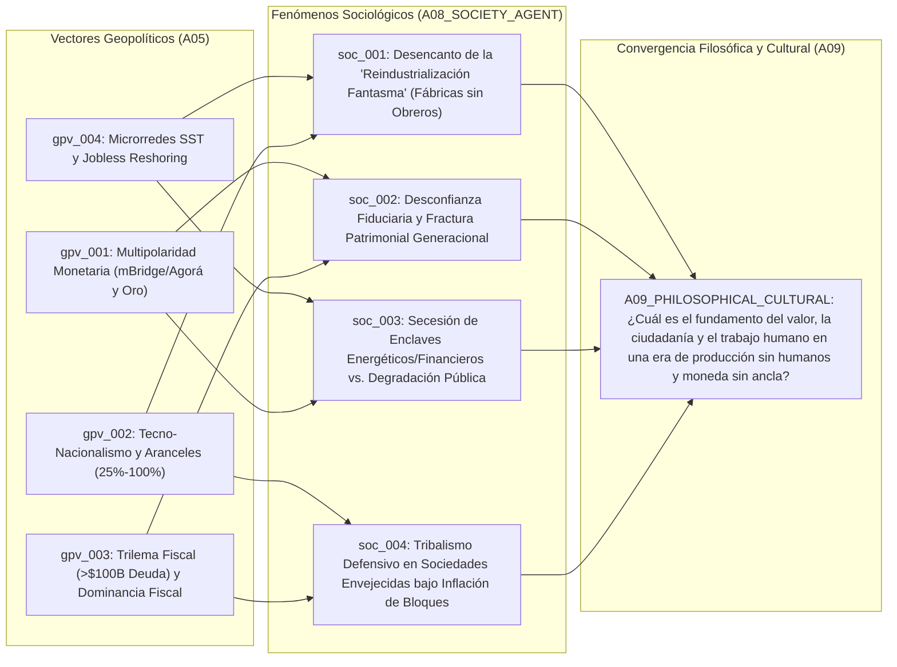

# 👥 Síntesis de Dinámicas Sociales (`A08`)

> [!NOTE]
> **ID del Agente:** `A08_SOCIETY_AGENT`  
> **Ciclo de Ejecución (`run_id`):** `run-20261023-sovereignty`  
> **Etapa:** `02_SECTORAL_ANALYSIS_L2` (Rama C — Nivel 2: Dinámicas Demográficas y Cohesión Social)  
> **Recibe de:** `A05_POLITICS_GEO` (`GeoPoliticsReport`: vectores `gpv_001` a `gpv_004` / `12` señales base)  
> **Entrega a (Fan-In):** `A09_PHILOSOPHICAL_CULTURAL`  
> **Índice de Cohesión Social Global Estimado (`social_cohesion_index`):** `0.38` (Baja cohesión / Alta polarización estructural)

---

## 1. Resumen Ejecutivo Sociológico

Al cruzar los **4 vectores geopolíticos (`gpv_001` a `gpv_004`)** emitidos por `A05_POLITICS_GEO` con la estructura demográfica contemporánea y la psicología colectiva de los hogares, el **Sociedad Agent (`A08`)** diagnostica una **erosión severa del contrato social de posguerra (`social_cohesion_index: 0.38`)**.

La convergencia entre **dominancia fiscal**, **fragmentación comercial arancelaria** y **automatización industrial *lights-out*** está demoliendo simultáneamente los dos pilares que sostuvieron la estabilidad democrática del último medio siglo: **la promesa de movilidad ascendente a través del trabajo industrial/técnico** y **la preservación del ahorro intergeneracional en moneda fiduciaria**.

Se han identificado **4 desplazamientos sociológicos profundos (`soc_001` a `soc_004`)** que sintetizan esta fractura y formulan las interrogantes existenciales y políticas para el nodo de convergencia `A09_PHILOSOPHICAL_CULTURAL`:

1. **`soc_001` — Desencanto de la "Reindustrialización Fantasma" y Alienación frente a las Fábricas *Lights-Out*:** La narrativa política del *nearshoring* prometía restaurar la clase media industrial del siglo XX mediante aranceles (25%–100%) y subsidios (`sig_20261023_005`). Sin embargo, las plantas regresan al territorio nacional como enclaves automatizados con modelos VLA/PINNs y humanoides de **$3.50–$5.50 USD/hora**, operando con **65%–75% menos trabajadores** (`sig_20261023_006`, `sig_20261023_007`, `sig_20261023_009`, `sig_20261023_012`). Las comunidades locales ven erguirse megafábricas sin ventanas que consumen recursos públicos pero no contratan a sus hijos.
2. **`soc_002` — Desconfianza Fiduciaria, Nihilismo Financiero y Fractura Patrimonial Generacional:** Con una deuda pública global superior a **$100 billones USD** y un servicio de intereses que absorbe hasta el **17.8% de los ingresos fiscales** (`sig_20261023_001`), la ciudadanía percibe que los Estados licuarán sus pasivos vía inflación estructural (**3.2%–4.0%**) (`sig_20261023_008`, `sig_20261023_011`). Esto divide a la sociedad en dos castas: una cohorte *senior*/patrimonial refugiada en oro físico, bienes raíces y activos reales, frente a cohortes jóvenes atrapadas entre salarios reales estancados, primas hipotecarias punitivas (`+85 a +140 pb`) y escepticismo radical hacia el dinero estatal.
3. **`soc_003` — Dualismo de Infraestructura y "Secesión de los Enclaves Corporativos":** La adopción de **Transformadores de Estado Sólido (SiC SST)** y microrredes DC con aislamiento en `<2 ms` (`sig_20261023_010`), sumada a rieles monetarios mayoristas exclusivos (`mBridge` / `Project Agorá`) (`sig_20261023_002`, `sig_20261023_004`), materializa una secesión física y financiera. Mientras los complejos industriales autónomos y centros de cómputo de IA gozan de energía ininterrumpida y liquidez atómica `T+0`, los municipios circundantes sufren redes públicas envejecidas, inflación de tarifas eléctricas y servicios municipales recortados.
4. **`soc_004` — Tribalismo Defensivo, Fatiga de Bloques y Crisis del Estado de Bienestar Envejecido:** El triplicado de barreras comerciales (`sig_20261023_003`) y el invierno demográfico en economías avanzadas e industriales (EE. UU., UE, China, Japón, Corea del Sur) agudizan la pugna distributiva entre gasto militar/industrial y gasto social/previsional, empujando a la población hacia el repliegue micro-comunitario y la polarización política extrema.

---

## 2. Diagrama de Transmisión Sociológica (`A05` -> `A08` -> `A09`)



---

## 3. Fenómenos Sociológicos y Demográficos Detallados

### 1. El Desencanto de la "Reindustrialización Fantasma" y la Alienación ante las Fábricas *Lights-Out* (`soc_001`)
- **Vector Geopolítico Base:** `gpv_004` y `gpv_002` (`sig_20261023_005`, `sig_20261023_006`, `sig_20261023_007`, `sig_20261023_009`, `sig_20261023_012`)
- **Drivers Demográficos y Estructura Social:**
  - Envejecimiento de la fuerza laboral manufacturera tradicional en Norteamérica, Europa Occidental y Asia Oriental, coexistiendo con cohortes jóvenes no universitarias en regiones industriales (*Rust Belts*) y países de *nearshoring* (como México y Europa del Este) que dependían de la manufactura de exportación como escalera de ascenso social.
  - Compresión del costo de hardware humanoide por debajo de **$18,000 USD** (`sig_20261023_009`) y costo horario amortizado de **$3.50 a $5.50 USD/hora** (`sig_20261023_012`), que anula simultáneamente el poder de negociación sindical en el Norte Global y el arbitraje salarial demográfico en el Sur Global.
- **Delta de Confianza Institucional (`institutional_trust_delta`):** Caída abrupta de la credibilidad en los partidos políticos (tanto populistas-nacionalistas como tecnocráticos) y en los sindicatos tradicionales. La ciudadanía percibe que el proteccionismo arancelario (25%–100%) y los subsidios industriales socializaron el costo del *CAPEX* corporativo (con impuestos e inflación al consumidor), pero privatizaron y automatizaron los beneficios en plantas que requieren entre **65% y 75% menos personal** (`sig_20261023_012`).
- **Clima Afectivo Colectivo (`collective_mood`):** Traición política, nostalgia frustrada por la estética del progreso industrial del siglo XX y ansiedad de obsolescencia humana frente a la "IA Física" (`sig_20261023_007`).
- **Interrogante Cultural Abierto (Input para `A09`):** *¿Cómo se redefine la dignidad cívica y el arraigo territorial cuando la fábrica regresa físicamente a la comunidad, pero opera a oscuras (lights-out) prescindiendo de los habitantes que financiaron su retorno?*

---

### 2. Desconfianza Fiduciaria, "Debasement Trade" Ciudadano y Fractura Patrimonial Generacional (`soc_002`)
- **Vector Geopolítico Base:** `gpv_003` y `gpv_001` (`sig_20261023_001`, `sig_20261023_002`, `sig_20261023_008`, `sig_20261023_011`)
- **Drivers Demográficos y Estructura Social:**
  - Inversión de la pirámide demográfica en economías G7 y China: una proporción creciente de votantes mayores de 60 años (acreedores netos del Estado vía pensiones, salud pública y bonos, además de propietarios de vivienda sin deuda) frente a generaciones jóvenes (*Millennials* tardíos, *Gen Z* y *Gen Alpha*) numéricamente minoritarias en las urnas.
  - Desplome en las tasas de nupcialidad y fecundidad estrechamente correlacionado con la inaccesibilidad a la vivienda —agravada por primas por plazo de **+85 a +140 pb** en tasas de largo plazo (`sig_20261023_008`)— y la erosión del salario real frente a la inflación de activos.
- **Delta de Confianza Institucional (`institutional_trust_delta`):** Deslegitimación profunda de los bancos centrales y ministerios de Hacienda. El aumento del **+340% interanual** en la narrativa viral sobre **Dominancia Fiscal y Degradación Fiduciaria** (`sig_20261023_011`), validado por el hecho de que los propios bancos centrales acumulan **>1,030 toneladas anuales de oro físico** mientras reducen su exposición a deuda soberana G7 (`sig_20261023_002`), instala en el imaginario social la certeza de que "el Estado ya no cree en su propio dinero".
- **Clima Afectivo Colectivo (`collective_mood`):** Cinismo monetario, hiper-financiarización defensiva de la vida cotidiana (especulación como única vía percibida de escape) y resentimiento intergeneracional agudo.
- **Interrogante Cultural Abierto (Input para `A09`):** *¿Puede sobrevivir la cohesión democrática cuando la moneda nacional deja de ser percibida como un bien público neutral y pasa a ser vista por los jóvenes como un mecanismo de extracción intergeneracional a favor de un Estado endeudado (>$100B USD) y de los tenedores de activos duros?*

---

### 3. Secesión de los Enclaves de Infraestructura: Autonomía Corporativa (SST/Multi-CBDC) vs. Degradación de lo Público (`soc_003`)
- **Vector Geopolítico Base:** `gpv_004` y `gpv_001` (`sig_20261023_004`, `sig_20261023_008`, `sig_20261023_010`)
- **Drivers Demográficos y Estructura Social:**
  - Concentración geográfica del capital tecnológico en nodos hiper-automatizados (campus de cómputo de IA, megafábricas con más de **5 millones de robots instalados globalmente** [`sig_20261023_006`] y corredores logísticos) que coexisten con periferias urbanas fiscalmente exhaustas.
- **Delta de Confianza Institucional (`institutional_trust_delta`):** Percepción ciudadana de un **urbanismo y sistema institucional de dos velocidades**. Mientras el ciudadano común depende de redes eléctricas públicas vulnerables a apagones y de sistemas bancarios minoristas vigilados y sujetos a inflación, los consorcios industriales y financieros se blindan físicamente con **microrredes DC y Transformadores de Estado Sólido (SiC SST)** que se aíslan de la red pública en `<2 milisegundos` (`sig_20261023_010`), y financieramente con rieles mayoristas tokenizados (`Project mBridge` y `Project Agorá`) que liquidan en `T+0` con un 50% menos de costo (`sig_20261023_004`).
- **Clima Afectivo Colectivo (`collective_mood`):** Sensación de abandono infraestructural y asimetría de soberanía ("soberanía de alta frecuencia para las máquinas y el capital; precariedad analógica para los ciudadanos").
- **Interrogante Cultural Abierto (Input para `A09`):** *¿Qué ocurre con la noción moderna de soberanía territorial compartida cuando las infraestructuras productivas (fábricas lights-out) y financieras se independizan física y energéticamente de la red pública que habita la ciudadanía?*

---

### 4. Tribalismo Defensivo, Fatiga de Bloques y Repliegue Micro-Comunitario (`soc_004`)
- **Vector Geopolítico Base:** `gpv_002` y `gpv_003` (`sig_20261023_001`, `sig_20261023_003`, `sig_20261023_005`)
- **Drivers Demográficos y Estructura Social:**
  - Invierno demográfico en los centros industriales del mundo (Europa, Asia Oriental, Norteamérica) en contraste con presiones migratorias desde regiones afectadas por la fragmentación comercial (`sig_20261023_003`) y el encarecimiento del financiamiento soberano (`sig_20261023_001`).
  - Aumento de hogares unipersonales y debilitamiento de instituciones intermedias clásicas (sindicatos de planta, asociaciones cívicas locales).
- **Delta de Confianza Institucional (`institutional_trust_delta`):** Desconexión respecto a los grandes relatos geopolíticos de los bloques. El ciudadano medio experimenta la "seguridad económica nacional" y la triplicación de barreras comerciales (**3.1x**) (`sig_20261023_003`) no como protección, sino como carestía cotidiana (sobrecostos de CAPEX del **12%–22%** trasladados a precios finales [`sig_20261023_005`]) y recorte de servicios públicos por el peso de los intereses de la deuda (**14.5%–17.8%** del presupuesto [`sig_20261023_001`]). La confianza migra hacia redes digitales cerradas (*cozy web*, comunidades financieras alternativas en Substack/X) y economías de apoyo mutuo local.
- **Clima Afectivo Colectivo (`collective_mood`):** Fatiga geopolítica, escepticismo defensivo ante la propaganda estatal de bloques y búsqueda de refugios tangibles (familiares, locales y patrimoniales).
- **Interrogante Cultural Abierto (Input para `A09`):** *En un mundo dividido en bloques tecno-nacionalistas pero internamente fragmentado por la desconfianza fiscal y la automatización, ¿qué nuevas filosofías de pertenencia, frugalidad o soberanía personal emergerán para reemplazar el consumismo globalista de posguerra?*

---

## 4. Matriz Resumen de Dinámicas Sociales (`A08` -> `A09`)

| ID Fenómeno | Vector Padre (`A05`) | Señales Trazadas (`A01`) | Fenómeno Sociológico | Clima Colectivo Dominante | Interrogante Eje para `A09` |
| :--- | :--- | :--- | :--- | :--- | :--- |
| **`soc_001`** | `gpv_004`, `gpv_002` | `sig_20261023_005`, `sig_20261023_006`, `sig_20261023_007`, `sig_20261023_009`, `sig_20261023_012` | Desencanto de la "Reindustrialización Fantasma" (*Jobless Reshoring*) | Traición política y ansiedad de obsolescencia laboral | Identidad y dignidad humana ante fábricas locales sin trabajadores humanos |
| **`soc_002`** | `gpv_003`, `gpv_001` | `sig_20261023_001`, `sig_20261023_002`, `sig_20261023_008`, `sig_20261023_011` | Desconfianza Fiduciaria y Fractura Patrimonial Generacional | Cinismo monetario y resentimiento intergeneracional | Legitimidad del pacto democrático cuando el dinero fiduciario pierde su rol de reserva |
| **`soc_003`** | `gpv_004`, `gpv_001` | `sig_20261023_004`, `sig_20261023_008`, `sig_20261023_010` | Secesión de Enclaves Corporativos (Microrredes SST y Rieles Mayoristas) | Sensación de asimetría soberana y abandono público | Soberanía compartida frente a infraestructuras autónomas para máquinas y capital |
| **`soc_004`** | `gpv_002`, `gpv_003` | `sig_20261023_001`, `sig_20261023_003`, `sig_20261023_005` | Tribalismo Defensivo y Fatiga de Bloques en Sociedades Envejecidas | Escepticismo defensivo y repliegue micro-comunitario | Nuevas éticas de pertenencia y refugio más allá del Estado-nación endeudado |

---

## 5. Contrato de Salida JSON (`AgentEnvelope` + `SocietalDynamicsSynthesis`)

```json
{
  "$schema": "https://societyway.local/schemas/agent-envelope-v1.json",
  "run_id": "run-20261023-sovereignty",
  "timestamp_utc": "2026-10-23T22:55:00Z",
  "producer_agent_id": "A08_SOCIETY_AGENT",
  "consumer_agent_ids": [
    "A09_PHILOSOPHICAL_CULTURAL"
  ],
  "trace_context": {
    "stage": "02_SECTORAL_ANALYSIS_L2",
    "confidence_score": 0.91,
    "source_signal_ids": [
      "sig_20261023_001",
      "sig_20261023_002",
      "sig_20261023_003",
      "sig_20261023_004",
      "sig_20261023_005",
      "sig_20261023_006",
      "sig_20261023_007",
      "sig_20261023_008",
      "sig_20261023_009",
      "sig_20261023_010",
      "sig_20261023_011",
      "sig_20261023_012"
    ]
  },
  "payload": {
    "producer_agent_id": "A08_SOCIETY_AGENT",
    "consumer_agent_ids": [
      "A09_PHILOSOPHICAL_CULTURAL"
    ],
    "social_cohesion_index": 0.38,
    "societal_shifts": [
      {
        "societal_shift_id": "soc_001",
        "parent_geopol_vector_id": "gpv_004",
        "source_signal_ids": [
          "sig_20261023_005",
          "sig_20261023_006",
          "sig_20261023_007",
          "sig_20261023_009",
          "sig_20261023_012"
        ],
        "phenomenon": "Desencanto Ciudadano ante la 'Promesa Incumplida de la Reindustrialización' (Jobless Reshoring y Fábricas Lights-Out)",
        "demographic_drivers": [
          "Envejecimiento de las cohortes obreras sindicalizadas tradicionales en EE. UU., la UE y Asia Oriental",
          "Estancamiento de la movilidad social para jóvenes sin título universitario tanto en cinturones industriales occidentales como en hubs de nearshoring (México, Europa Central)"
        ],
        "institutional_trust_delta": "Quebranto severo de la confianza en las promesas electorales de política industrial y en la capacidad de negociación sindical: las fábricas regresan al territorio nacional subsidiadas con fondos públicos y protegidas por aranceles del 25%-100%, pero operan con modelos VLA/PINNs y humanoides de $3.50-$5.50 USD/hora, recortando entre 65% y 75% la plantilla humana respecto a la década anterior.",
        "collective_mood": "Sensación de traición política, alienación frente a complejos industriales automatizados sin presencia humana y ansiedad de irrelevancia económica.",
        "cultural_question_raised": "¿Cómo se sostiene el orgullo cívico y el sentido de pertenencia territorial cuando la producción industrial regresa físicamente a la nación, pero prescinde estructuralmente del trabajador humano y no recrea la clase media del siglo XX?"
      },
      {
        "societal_shift_id": "soc_002",
        "parent_geopol_vector_id": "gpv_003",
        "source_signal_ids": [
          "sig_20261023_001",
          "sig_20261023_002",
          "sig_20261023_008",
          "sig_20261023_011"
        ],
        "phenomenon": "Desconfianza en el Dinero Fiduciario y Polarización Generacional por Dominancia Fiscal e Inflación de Activos",
        "demographic_drivers": [
          "Gerontocracia electoral en economías avanzadas (mayor peso demográfico de cohortes jubiladas acreedoras de pensiones y propietarias de bienes raíces)",
          "Postergación indefinida de la formación de hogares y caída de natalidad en cohortes jóvenes asfixiadas por primas por plazo (+85 a +140 pb) y encarecimiento habitacional"
        ],
        "institutional_trust_delta": "Erosión acelerada de la fe en bancos centrales y tesoros nacionales ante una deuda pública global >$100 billones USD (servicio de deuda del 14.5%-17.8% de ingresos fiscales). La compra récord de oro por los propios bancos centrales (>1,030 t/año) confirma ante la opinión pública (+340% en tracción de 'Fiscal Dominance') que las divisas fiduciarias sufrirán represión financiera e inflación estructural del 3.2%-4.0%.",
        "collective_mood": "Cinismo fiduciario, nihilismo financiero juvenil y polarización antagónica entre tenedores de activos duros/reales y asalariados licuados por la inflación.",
        "cultural_question_raised": "¿Qué ocurre con la ética del esfuerzo, el ahorro a largo plazo y la solidaridad intergeneracional cuando el dinero fiduciario estatal deja de percibirse como una medida justa de valor y pasa a ser visto como un instrumento de licuación patrimonial?"
      },
      {
        "societal_shift_id": "soc_003",
        "parent_geopol_vector_id": "gpv_001",
        "source_signal_ids": [
          "sig_20261023_002",
          "sig_20261023_004",
          "sig_20261023_008",
          "sig_20261023_010"
        ],
        "phenomenon": "Dualismo Infraestructural y Secesión Operativa de los Enclaves Tecno-Financieros (Microrredes SST y Rieles Mayoristas)",
        "demographic_drivers": [
          "Concentración espacial del capital en corredores hiper-automatizados de manufactura y centros de datos frente a municipios periféricos con bases tributarias erosionadas",
          "Bifurcación cosmopolita vs. local en el acceso a infraestructuras financieras transfronterizas"
        ],
        "institutional_trust_delta": "Percepción de una ciudadanía de segunda clase en el acceso a servicios básicos: las megafábricas lights-out y centros de IA aseguran su inmunidad energética mediante Transformadores de Estado Sólido (SiC SST) y microrredes DC con aislamiento en <2 milisegundos, mientras los bancos centrales y corporaciones operan en rieles mayoristas T+0 (mBridge / Project Agorá), dejando a los hogares expuestos a redes eléctricas públicas saturadas y fricciones bancarias locales.",
        "collective_mood": "Agravio comparativo frente a la autonomía energética y financiera de las máquinas y corporaciones en contraste con la vulnerabilidad de la infraestructura pública ciudadana.",
        "cultural_question_raised": "¿Cómo se transforma la concepción moderna de soberanía e igualdad ante la ley cuando los nodos de producción algorítmica y liquidación financiera se independizan físicamente de las redes eléctricas y monetarias que sostienen la vida cotidiana de la población?"
      },
      {
        "societal_shift_id": "soc_004",
        "parent_geopol_vector_id": "gpv_002",
        "source_signal_ids": [
          "sig_20261023_001",
          "sig_20261023_003",
          "sig_20261023_005"
        ],
        "phenomenon": "Fatiga Geopolítica, Inflación de Bloques y Repliegue hacia Micro-Comunidades de Confianza",
        "demographic_drivers": [
          "Contracción de la población en edad laboral en bloques enfrentados y presión sobre los sistemas públicos de salud y cuidados",
          "Crecimiento de hogares unipersonales y fragmentación de las comunidades cívicas presenciales"
        ],
        "institutional_trust_delta": "Descreimiento hacia las instituciones multilaterales (OMC) y fatiga ante la retórica de seguridad nacional que ha triplicado las barreras comerciales (3.1x) e impuesto sobrecostos de CAPEX del 12%-22%. La confianza se retira de los grandes medios y gobiernos hacia comunidades epistémicas descentralizadas (Substack, foros técnicos, redes locales de resiliencia).",
        "collective_mood": "Escepticismo defensivo, agotamiento ante el estado de emergencia geopolítica permanente y búsqueda de soberanía a escala micro-comunitaria y familiar.",
        "cultural_question_raised": "¿Qué nuevos marcos filosóficos de sentido, reciprocidad comunitaria y autonomía local surgirán para habitar un mundo donde el Estado-nación exige lealtad de bloque geopolítico pero ya no garantiza estabilidad de precios, empleo industrial ni solvencia previsional?"
      }
    ]
  },
  "markdown_summary": "## Resumen Ejecutivo del Nodo A08 (Sociedad Agent)\nA partir del `GeoPoliticsReport` de `A05` (`gpv_001` a `gpv_004`), se estima un Índice de Cohesión Social de `0.38` y se sintetizan 4 desplazamientos sociológicos (`soc_001` a `soc_004`) con trazabilidad completa a las 12 señales base (`sig_20261023_001` a `sig_20261023_012`): (1) Desencanto ciudadano ante la 'promesa incumplida de la reindustrialización' (`soc_001`), donde las fábricas regresan al territorio nacional pero operan a oscuras (lights-out) con un 65%-75% menos de plantilla y costos robóticos de $3.50-$5.50/h; (2) Desconfianza hacia el dinero fiduciario y polarización generacional (`soc_002`) entre tenedores senior de activos duros (beneficiados por la licuación de la deuda >$100B USD y el refugio en oro) y jóvenes golpeados por la inflación de activos y primas por plazo (+85 a +140 pb); (3) Secesión infraestructural de enclaves corporativos (`soc_003`) blindados con microrredes SST (<2ms islanding) y rieles monetarios mayoristas (`mBridge`/`Agorá`); y (4) Fatiga geopolítica y repliegue micro-comunitario (`soc_004`) que plantean interrogantes existenciales y de cohesión democrática para `A09_PHILOSOPHICAL_CULTURAL`."
}
```
