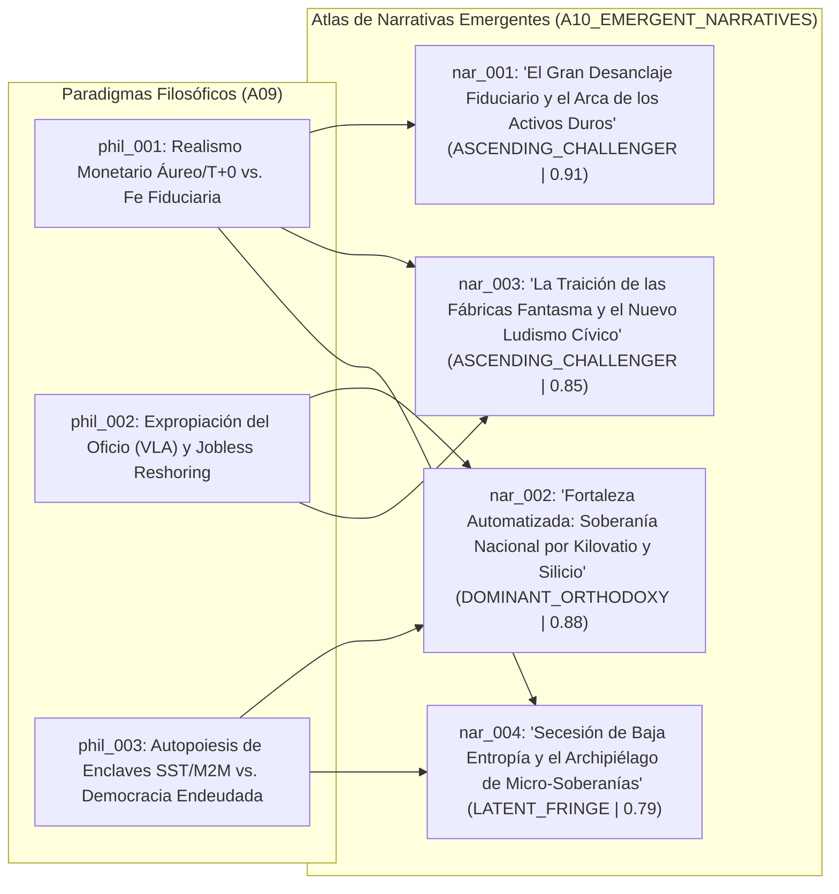

# 🗣️ Atlas de Narrativas Emergentes (`A10`)

> [!NOTE]
> **ID del Agente:** `A10_EMERGENT_NARRATIVES`  
> **Ciclo de Ejecución (`run_id`):** `run-20261023-sovereignty`  
> **Etapa:** `03_CULTURAL_CONVERGENCE`  
> **Recibe de:** [09-convergencia-filosofica-cultural.md](file:///c:/Users/addu0g/Documents/SocietyWay/runs/2026-10-23-sovereignty/09-convergencia-filosofica-cultural.md) (`PhilosophicalCulturalMatrix`: `phil_001`, `phil_002`, `phil_003`)  
> **Entrega a:** `A11_GLOBAL_TRENDS`  

---

## 1. Síntesis de Economía Narrativa y Disputa Simbólica

Siguiendo el marco de la **Economía Narrativa (Robert Shiller)** y la **Teoría de Marcos Cognitivos (George Lakoff)**, las tensiones ontológicas destiladas por `A09_PHILOSOPHICAL_CULTURAL` (`phil_001` a `phil_003`) no permanecen en el plano abstracto: se cristalizan en **relatos colectivos contagiosos** que reordenan las decisiones de inversión de CAPEX, la asignación de reservas soberanas, la negociación salarial y el comportamiento electoral.

En el ciclo `run-20261023-sovereignty`, observamos el agotamiento definitivo del metarrelato globalista de posguerra (*"comercio libre deflacionario + dinero fiduciario estable + ascenso social vía empleo manufacturero/administrativo"*). En su lugar, cuatro grandes narrativas (`nar_001` a `nar_004`) compiten por la hegemonía cultural y regulatoria hacia el horizonte 2026–2035.



---

## 2. Anatomía del Atlas de Narrativas (`narratives`)

### 1. El Gran Desanclaje Fiduciario y el Arca de los Activos Duros (`nar_001`)
- **Paradigmas Padre (`parent_paradigm_ids`):** `phil_001`, `phil_003`
- **Trazabilidad de Señales (`source_signal_ids`):** `sig_20261023_001`, `sig_20261023_002`, `sig_20261023_004`, `sig_20261023_008`, `sig_20261023_011`
- **Estadio de Ciclo de Vida (`lifecycle_stage`):** `ASCENDING_CHALLENGER` (Transicionando rápidamente de nicho macro-financiero a consenso intergeneracional y de banca central)
- **Puntaje de Poder Narrativo (`narrative_power_score`):** `0.91`
- **Tesis Central (`core_thesis`):** Los Estados-nación endeudados por encima de los **$100 billones USD** (`sig_20261023_001`) han cruzado el horizonte de sucesos de la **Dominancia Fiscal**: jamás pagarán su deuda en términos reales y están condenados matemáticamente a licuar a los tenedores de moneda fiduciaria y bonos soberanos mediante represión financiera e inflación estructural (**3.2%–4.0%**, `sig_20261023_008`). La prueba definitiva es que los propios bancos centrales están desertando del papel fiduciario para acumular **>1,030 toneladas anuales de oro** (`sig_20261023_002`) y construir rieles de liquidación atómica directa **T+0** (`mBridge` / `Project Agorá`, `sig_20261023_004`). Solo quien convierta flujos salariales en **colateral termodinámico o escaso** (oro, energía, tierra, cómputo, activos reales tokenizados) sobrevivirá a la gran licuación patrimonial.
- **Arquetipos en Disputa (`archetypes`):**
  - **Héroe (`hero`):** El **Realista Soberano** (el banco central multipolar que repatria oro, el tesorero algorítmico que liquida en `T+0` sin intermediarios y el ciudadano previsor que escapa de la trampa salarial fiduciaria hacia activos reales).
  - **Villano (`villain`):** El **Leviatán Deudor y la Tecnocracia Monetaria G7**, acusados de confiscar silenciosamente el tiempo de vida de los jóvenes y ahorradores mediante el impuesto inflacionario encubierto para financiar déficits fiscales perpetuos.
- **Léxico Memético (`key_lexicon`):** `Debasement Trade` (+340% viralidad, `sig_20261023_011`), `Dominancia Fiscal`, `Espiral de la Muerte de la Deuda`, `Colateral Duro`, `Liquidación Atómica T+0`, `Dinero Termodinámico`, `Fiat Melting Ice Cube`.
- **Incentivo Material Subyacente:** Beneficia masivamente a estados exportadores de materias primas/energía (BRICS+, Golfo), consorcios de infraestructura DLT mayorista, fondos de activos reales (RWA), mineras de metales preciosos/críticos y propietarios apalancados a tasa fija previa.
- **Contra-Narrativa en Pugna (`counter_narrative`):** *"La Soberanía Monetaria del Emisor e Inversión Pública Estratégica"*: El Estado emisor de su propia moneda nunca puede quebrar técnicamente; la deuda pública es el activo seguro del sector privado y los déficits actuales son inversiones indispensables en transición energética, defensa y reindustrialización que generarán crecimiento futuro.

---

### 2. Fortaleza Automatizada: Soberanía Nacional por Kilovatio, Silicio y Acero Autónomo (`nar_002`)
- **Paradigmas Padre (`parent_paradigm_ids`):** `phil_002`, `phil_003`
- **Trazabilidad de Señales (`source_signal_ids`):** `sig_20261023_003`, `sig_20261023_005`, `sig_20261023_006`, `sig_20261023_007`, `sig_20261023_009`, `sig_20261023_010`, `sig_20261023_012`
- **Estadio de Ciclo de Vida (`lifecycle_stage`):** `DOMINANT_ORTHODOXY` (Hegemónica en ministerios de defensa/industria, juntas directivas manufactureras y capital de riesgo *Deep Tech*)
- **Puntaje de Poder Narrativo (`narrative_power_score`):** `0.88`
- **Tesis Central (`core_thesis`):** En un sistema-mundo fragmentado por **3,100 restricciones comerciales** (`sig_20261023_003`), controles sobre litografía avanzada (`sig_20261023_005`) e invierno demográfico, la dependencia de cadenas de suministro lejanas o de mano de obra abundante es un suicidio geopolítico. La única vía para reindustrializar economías con altos costos laborales y compensar el sobrecosto arancelario (**+12% a +22% en CAPEX**, `sig_20261023_005`) es desplegar **fábricas *lights-out* hiper-automatizadas** gobernadas por **IA Física (VLA + PINNs/OpenUSD)** (`sig_20261023_007`), flotas de **humanoides de <$18,000 USD** operando a **$3.50–$5.50/hora** (`sig_20261023_009`, `sig_20261023_012`) y **microrredes SiC SST** inmunes a fallos eléctricos (`sig_20261023_010`). El poder de una potencia en el siglo XXI se mide en gigavatios autónomos y densidad robótica, no en nóminas obreras.
- **Arquetipos en Disputa (`archetypes`):**
  - **Héroe (`hero`):** El **Arquitecto Tecno-Industrial Patriótico** y el **Ingeniero Ciber-Físico**, que devuelven la capacidad productiva crítica a suelo nacional superando la escasez demográfica y las vulnerabilidades geopolíticas mediante silicio, modelos de mundo físico y electrónica de potencia.
  - **Villano (`villain`):** El **Globalismo Ingenuo Desindustrializador** (que entregó la base manufacturera a rivales sistémicos por mano de obra barata) y la **Fricción Burocrático-Sindical** que pretende frenar la automatización poniendo en riesgo la seguridad nacional.
- **Léxico Memético (`key_lexicon`):** `Physical AI`, `Lights-Out Sovereignty`, `Sim-to-Real Mastery`, `Fortress Manufacturing`, `Cómputo y Acero Soberano`, `Independencia de Suministro`, `Islanding <2ms`.
- **Incentivo Material Subyacente:** Justifica la captura de subsidios estatales multimillonarios, barreras arancelarias protectoras del **25%–100%** (`sig_20261023_005`), deducciones fiscales aceleradas para CAPEX robótico y exenciones regulatorias para microrredes industriales privadas.
- **Contra-Narrativa en Pugna (`counter_narrative`):** *"El Espejismo Autárquico y la Inflación de Bloques"*: La duplicación forzada de cadenas de suministro mediante aranceles destruye la eficiencia comparativa global, encarece estructuralmente los bienes de capital y condena a los consumidores a una estanflación innecesaria.

---

### 3. La Traición de las Fábricas Fantasma y el Nuevo Ludismo Cívico (`nar_003`)
- **Paradigmas Padre (`parent_paradigm_ids`):** `phil_002`, `phil_001`
- **Trazabilidad de Señales (`source_signal_ids`):** `sig_20261023_001`, `sig_20261023_005`, `sig_20261023_006`, `sig_20261023_007`, `sig_20261023_009`, `sig_20261023_011`, `sig_20261023_012`
- **Estadio de Ciclo de Vida (`lifecycle_stage`):** `ASCENDING_CHALLENGER` (En rápida propagación en cinturones industriales del Norte Global y corredores de *nearshoring* del Sur Global)
- **Puntaje de Poder Narrativo (`narrative_power_score`):** `0.85`
- **Tesis Central (`core_thesis`):** El *nearshoring* y el nacionalismo industrial han resultado ser un **caballo de Troya contra la clase trabajadora** (`soc_001`). Los ciudadanos financiaron con sus impuestos e inflación doméstica el regreso de las fábricas bajo la promesa de recuperar los empleos de clase media del siglo XX, pero las corporaciones erigieron **cajas negras sin ventanas (*lights-out*)** que recortan entre el **65% y el 75% de la plantilla humana** (`sig_20261023_012`), expropian digitalmente el oficio manual mediante cámaras y sensores **VLA/PINNs** (`sig_20261023_007`) y destruyen simultáneamente la vía de desarrollo de los países emergentes al hacer que el robot (**$3.50–$5.50/h**) sea más barato que el obrero del Sur Global (`lms_004`). Es una "reindustrialización sin pueblo" que privatiza las ganancias en CAPEX y socializa la irrelevancia laboral.
- **Arquetipos en Disputa (`archetypes`):**
  - **Héroe (`hero`):** La **Comunidad Local Traicionada**, el **Maestro de Oficio Humano** y los **Movimientos por el Dividendo Cívico de Automatización**, que defienden la dignidad irreemplazable del trabajo humano y el derecho del territorio a participar de la riqueza producida en su suelo.
  - **Villano (`villain`):** Los **Barones de las Catedrales Oscuras** (corporaciones que cobran subsidios públicos para instalar flotas humanoides libres de impuestos sobre la nómina) y los **Políticos del Empleo Fantasma** que vendieron proteccionismo arancelario como si fuera política laboral.
- **Léxico Memético (`key_lexicon`):** `Jobless Reshoring`, `Fábricas Fantasma`, `Subsidios para Robots`, `Robo del Oficio (Skill Expropriation)`, `Impuesto al Humanoide`, `Traición del Nearshoring`, `Catedrales a Oscuras`.
- **Incentivo Material Subyacente:** Moviliza coaliciones electorales populistas (tanto de izquierda laboralista como de derecha comunitarista), sindicatos industriales y gobiernos municipales/regionales para exigir **impuestos al reemplazo robótico (*Robot Taxes*)**, cuotas mínimas de empleo humano por megavatio/subsidio recibido y fondos soberanos ciudadanos financiados por el CAPEX automatizado.
- **Contra-Narrativa en Pugna (`counter_narrative`):** *"Automatizar o Desaparecer"*: En un mundo donde Asia y los bloques rivales superan los 5 millones de robots industriales (`sig_20261023_006`), gravar o restringir las fábricas *lights-out* no salvará empleos manuales; simplemente provocará el cierre total de la industria nacional y una dependencia exterior absoluta.

---

### 4. Secesión de Baja Entropía y el Archipiélago de Micro-Soberanías (`nar_004`)
- **Paradigmas Padre (`parent_paradigm_ids`):** `phil_003`, `phil_001`
- **Trazabilidad de Señales (`source_signal_ids`):** `sig_20261023_001`, `sig_20261023_002`, `sig_20261023_004`, `sig_20261023_008`, `sig_20261023_010`, `sig_20261023_012`
- **Estadio de Ciclo de Vida (`lifecycle_stage`):** `LATENT_FRINGE` (De vanguardia entre élites de ingeniería ciber-física, arquitectos de infraestructura crítica y subculturas de resiliencia localista; alto potencial disruptivo a 5–10 años)
- **Puntaje de Poder Narrativo (`narrative_power_score`):** `0.79`
- **Tesis Central (`core_thesis`):** Las grandes infraestructuras públicas centralizadas del siglo XX (la red eléctrica nacional de corriente alterna, el sistema bancario minorista fiduciario y la burocracia del Estado de bienestar endeudado) están entrando en una fase de **alta entropía irreversible** debido al colapso fiscal (**14.5%–17.8%** de ingresos en intereses, `sig_20261023_001`) y la parálisis política. La verdadera soberanía ya no consiste en reformar el centro, sino en **construir islas de baja entropía con capacidad de desconexión instantánea**: complejos productivos y comunidades que operan su propia microrred **DC con Transformadores de Estado Sólido (SiC SST)** que conmutan a modo isla en **<2 milisegundos** (`sig_20261023_010`), ejecutan su propio cómputo/manufactura autónoma local (`sig_20261023_012`) y liquidan comercio exterior sobre rieles atómicos **T+0** (`sig_20261023_004`) y reservas duras (`sig_20261023_002`).
- **Arquetipos en Disputa (`archetypes`):**
  - **Héroe (`hero`):** El **Ingeniero de Sistemas Homeostáticos** y la **Comunidad/Enclave Autárquico**, que aseguran la continuidad energética, productiva y cognitiva mediante física de estado sólido y protocolos descentralizados frente al deterioro sistémico.
  - **Villano (`villain`):** La **Red Pública Monolítica y Extractiva** (el sistema eléctrico y fiscal centralizado que arrastra a los nodos productivos hacia el apagón, la inflación y el racionamiento).
- **Léxico Memético (`key_lexicon`):** `Sub-2ms Islanding`, `Enclaves de Baja Entropía`, `Autopoiesis Industrial`, `Soberanía de Microrred`, `Desconexión Limpia`, `Ciudadelas Ciber-Físicas`, `Post-Grid Economy`.
- **Incentivo Material Subyacente:** Impulsa la inversión privada masiva en semiconductores de potencia `SiC/GaN`, almacenamiento estacionario, generación cautiva tras el medidor (*behind-the-meter*), zonas económicas especiales con regímenes regulatorios/monetarios autónomos y arquitectura residencial/comunitaria *off-grid*.
- **Contra-Narrativa en Pugna (`counter_narrative`):** *"Contra el Tecno-Feudalismo de Enclaves"*: Permitir que las corporaciones, centros de datos de IA y élites patrimoniales se desconecten física y financieramente de la red pública destruye la solidaridad territorial, vacía la base tributaria de las ciudades y convierte a la democracia en un cascarón vacío para ciudadanos de segunda clase (`soc_003`).

---

## 3. Matriz Comparativa de Fuerza Causal y Ciclo de Vida (`A10` -> `A11`)

| ID Narrativa | Nombre del Relato | Paradigmas (`A09`) | Estadio (`lifecycle_stage`) | Poder Causal (`score`) | Vector Material que Moviliza |
| :--- | :--- | :--- | :--- | :--- | :--- |
| **`nar_001`** | El Gran Desanclaje Fiduciario y el Arca de los Activos Duros | `phil_001`, `phil_003` | `ASCENDING_CHALLENGER` | **0.91** | Rotación masiva de reservas y ahorro privado desde bonos soberanos G7 hacia oro (`>1,030 t/año`), rieles `mBridge`/`Agorá` y activos reales/CAPEX. |
| **`nar_002`** | Fortaleza Automatizada: Soberanía por Kilovatio y Silicio | `phil_002`, `phil_003` | `DOMINANT_ORTHODOXY` | **0.88** | Subsidios de política industrial, aranceles del 25%–100% y despliegue acelerado de fábricas *lights-out* con modelos `VLA/PINNs` y humanoides `<$18k`. |
| **`nar_003`** | La Traición de las Fábricas Fantasma y el Nuevo Ludismo Cívico | `phil_002`, `phil_001` | `ASCENDING_CHALLENGER` | **0.85** | Presión política y legislativa por *Robot Taxes*, condicionalidad laboral en subsidios de *nearshoring* y conflictividad social en municipios industriales. |
| **`nar_004`** | Secesión de Baja Entropía y el Archipiélago de Micro-Soberanías | `phil_003`, `phil_001` | `LATENT_FRINGE` | **0.79** | Inversión en microrredes autónomas `SiC SST` (`<2 ms`), generación eléctrica cautiva para IA/robótica y zonas económicas con liquidación `M2M` propia. |

---

## 4. Contrato de Salida JSON (`AgentEnvelope` + `EmergentNarrativesAtlas`)

```json
{
  "$schema": "https://societyway.local/schemas/agent-envelope-v1.json",
  "run_id": "run-20261023-sovereignty",
  "timestamp_utc": "2026-10-23T23:12:00Z",
  "producer_agent_id": "A10_EMERGENT_NARRATIVES",
  "consumer_agent_ids": [
    "A11_GLOBAL_TRENDS"
  ],
  "trace_context": {
    "stage": "03_CULTURAL_CONVERGENCE",
    "confidence_score": 0.91,
    "source_signal_ids": [
      "sig_20261023_001",
      "sig_20261023_002",
      "sig_20261023_003",
      "sig_20261023_004",
      "sig_20261023_005",
      "sig_20261023_006",
      "sig_20261023_007",
      "sig_20261023_008",
      "sig_20261023_009",
      "sig_20261023_010",
      "sig_20261023_011",
      "sig_20261023_012"
    ]
  },
  "payload": {
    "producer_agent_id": "A10_EMERGENT_NARRATIVES",
    "consumer_agent_ids": [
      "A11_GLOBAL_TRENDS"
    ],
    "narratives": [
      {
        "narrative_id": "nar_001",
        "parent_paradigm_ids": [
          "phil_001",
          "phil_003"
        ],
        "source_signal_ids": [
          "sig_20261023_001",
          "sig_20261023_002",
          "sig_20261023_004",
          "sig_20261023_008",
          "sig_20261023_011"
        ],
        "name": "El Gran Desanclaje Fiduciario y el Arca de los Activos Duros (The Great Fiat Debasement & Hard-Collateral Ark)",
        "lifecycle_stage": "ASCENDING_CHALLENGER",
        "narrative_power_score": 0.91,
        "core_thesis": "Con una deuda pública global >$100 billones USD y costos de intereses que consumen hasta el 17.8% de los ingresos fiscales, los Estados han entrado en dominancia fiscal irreversible y licuarán el poder adquisitivo de sus monedas (inflación estructural del 3.2%-4.0%). La acumulación récord de oro por los propios bancos centrales (>1,030 t/año) y el lanzamiento de rieles atómicos T+0 (mBridge / Project Agorá) confirman que la única preservación de soberanía patrimonial consiste en abandonar el ahorro fiduciario nominal y refugiarse en colateral físico, energético y criptográficamente verificable.",
        "archetypes": {
          "hero": "El Realista de Colateral Duro (bancos centrales acumuladores de oro, tesoreros algorítmicos T+0 y ciudadanos que convierten salario fiduciario en activos reales productivos)",
          "villain": "El Leviatán Deudor y la Ilusión Fiduciaria G7 (bancos centrales y tesoros que degradan silenciosamente el ahorro intergeneracional mediante represión financiera)"
        },
        "key_lexicon": [
          "Debasement Trade",
          "Dominancia Fiscal",
          "Colateral Termodinámico",
          "Liquidación Atómica T+0",
          "Desanclaje Fiduciario",
          "Prima por Plazo Estructural"
        ],
        "counter_narrative": "El Estado emisor soberano nunca enfrenta insolvencia involuntaria en su propia moneda; los déficits públicos financian la transición industrial y de seguridad nacional que sostiene la productividad a largo plazo."
      },
      {
        "narrative_id": "nar_002",
        "parent_paradigm_ids": [
          "phil_002",
          "phil_003"
        ],
        "source_signal_ids": [
          "sig_20261023_003",
          "sig_20261023_005",
          "sig_20261023_006",
          "sig_20261023_007",
          "sig_20261023_009",
          "sig_20261023_010",
          "sig_20261023_012"
        ],
        "name": "Fortaleza Automatizada: Soberanía Nacional por Kilovatio, Silicio y Acero Autónomo",
        "lifecycle_stage": "DOMINANT_ORTHODOXY",
        "narrative_power_score": 0.88,
        "core_thesis": "Ante la triplicación de barreras comerciales (3,100 restricciones), aranceles del 25%-100% y el envejecimiento demográfico, la única forma de relocalizar la industria sin quebrar por sobrecostos de CAPEX (+12% a +22%) es sustituir masivamente el trabajo humano por fábricas 'lights-out' gobernadas por IA Física (VLA + PINNs/OpenUSD), humanoides de <$18,000 USD operando a $3.50-$5.50/hora y microrredes de estado sólido (SiC SST). La potencia geopolítica ya no reside en el tamaño de la fuerza laboral, sino en la autonomía ciber-física instalada.",
        "archetypes": {
          "hero": "El Arquitecto Tecno-Industrial y el Ingeniero Ciber-Físico (constructores de la base manufacturera autónoma y la inmunidad de suministro nacional)",
          "villain": "El Globalismo Desindustrializador y la Rigidez Luddita (quienes expondrían a la nación a la dependencia extranjera por rechazar la automatización total)"
        },
        "key_lexicon": [
          "Physical AI",
          "Manufactura Lights-Out",
          "Soberanía de Cómputo y Acero",
          "Cierre Sim-to-Real",
          "Paridad Robótica $3.50/h",
          "Fortress Reshoring"
        ],
        "counter_narrative": "El proteccionismo tecno-nacionalista destruye la eficiencia comercial global, infla artificialmente el costo del capital y utiliza la seguridad nacional como coartada para subsidiar monopolios corporativos sin beneficio laboral."
      },
      {
        "narrative_id": "nar_003",
        "parent_paradigm_ids": [
          "phil_002",
          "phil_001"
        ],
        "source_signal_ids": [
          "sig_20261023_001",
          "sig_20261023_005",
          "sig_20261023_006",
          "sig_20261023_007",
          "sig_20261023_009",
          "sig_20261023_011",
          "sig_20261023_012"
        ],
        "name": "La Traición de las Fábricas Fantasma y el Nuevo Ludismo Cívico (Phantom Factories & The Civic Automation Dividend)",
        "lifecycle_stage": "ASCENDING_CHALLENGER",
        "narrative_power_score": 0.85,
        "core_thesis": "La promesa política del nearshoring y la reindustrialización ha sido un engaño para las comunidades trabajadoras: el pueblo pagó los subsidios fiscales y la inflación arancelaria (25%-100%), pero las corporaciones construyeron catedrales oscuras (lights-out) que recortan entre 65% y 75% los empleos humanos, expropian el saber tácito de los operarios mediante modelos VLA/PINNs y anulan simultáneamente el desarrollo de los países emergentes. Si las máquinas reemplazan al ciudadano-obrero en suelo subsidiado, la riqueza robótica debe tributar y redistribuirse localmente.",
        "archetypes": {
          "hero": "La Comunidad Productiva Local y el Defensor del Oficio Humano (municipios, trabajadores y gremios técnicos que exigen copropiedad o dividendo cívico sobre la automatización)",
          "villain": "Los Barones de las Fábricas Fantasma y los Políticos del Empleo Ficticio (consorcios que privatizan subsidios públicos en flotas robóticas de $3.50/h sin contratar población local)"
        },
        "key_lexicon": [
          "Jobless Reshoring",
          "Fábricas Fantasma",
          "Expropiación del Oficio",
          "Impuesto al Humanoide",
          "Catedrales sin Obreros",
          "Dividendo Cívico de Automatización"
        ],
        "counter_narrative": "Frenar o gravar punitivamente las celdas robóticas lights-out provocará la fuga inmediata de la manufactura hacia jurisdicciones competidoras que ya superan los 5 millones de robots instalados."
      },
      {
        "narrative_id": "nar_004",
        "parent_paradigm_ids": [
          "phil_003",
          "phil_001"
        ],
        "source_signal_ids": [
          "sig_20261023_001",
          "sig_20261023_002",
          "sig_20261023_004",
          "sig_20261023_008",
          "sig_20261023_010",
          "sig_20261023_012"
        ],
        "name": "Secesión de Baja Entropía y el Archipiélago de Micro-Soberanías (Low-Entropy Enclaves & Sub-2ms Secession)",
        "lifecycle_stage": "LATENT_FRINGE",
        "narrative_power_score": 0.79,
        "core_thesis": "A medida que las redes eléctricas públicas, los presupuestos municipales y los sistemas bancarios minoristas se degradan bajo la presión de la deuda soberana y la polarización política, los actores con capacidad técnica y de capital buscan la 'inmunidad homeostática': complejos industriales y micro-comunidades equipadas con Transformadores de Estado Sólido (SiC SST) capaces de aislarse de la red pública en <2 milisegundos, cómputo local soberano y liquidación financiera M2M directa sobre rieles atómicos y activos duros.",
        "archetypes": {
          "hero": "El Arquitecto de Autarquía Resiliente (quien diseña nodos energéticos, productivos y financieros capaces de operar en modo isla ante el fallo sistémico)",
          "villain": "La Red Centralizada Entrópica (infraestructuras públicas obsoletas y burocracias fiscales que exportan fragilidad e inflación a los nodos productivos)"
        },
        "key_lexicon": [
          "Islanding <2ms",
          "Enclaves de Baja Entropía",
          "Autopoiesis Ciber-Física",
          "Soberanía Behind-the-Meter",
          "Tesorería M2M",
          "Archipiélago Post-Estatal"
        ],
        "counter_narrative": "La secesión energética y financiera de los enclaves corporativos y patrimoniales constituye un nuevo tecno-feudalismo que abandona a la ciudadanía a una infraestructura pública de segunda clase."
      }
    ]
  },
  "markdown_summary": "## Resumen Ejecutivo del Nodo A10 (Agente de Narrativas Emergentes)\nA partir de la Matriz Filosófica y Cultural (`A09`: `phil_001`, `phil_002`, `phil_003`), se decodifican 4 narrativas emergentes (`nar_001` a `nar_004`) con trazabilidad completa a las 12 señales base (`sig_20261023_001` a `sig_20261023_012`): (1) `nar_001` — *El Gran Desanclaje Fiduciario y el Arca de los Activos Duros* (`ASCENDING_CHALLENGER`, score `0.91`), que moviliza la huida desde deuda soberana G7 hacia oro (>1,030 t/año), rieles T+0 (`mBridge`/`Agorá`) y colateral físico ante la dominancia fiscal; (2) `nar_002` — *Fortaleza Automatizada: Soberanía Nacional por Kilovatio y Silicio* (`DOMINANT_ORTHODOXY`, score `0.88`), relato hegemónico de élites industriales y de defensa que legitima aranceles del 25%-100% y fábricas *lights-out* con IA Física (VLA/PINNs) y humanoides (<$18k BOM); (3) `nar_003` — *La Traición de las Fábricas Fantasma y el Nuevo Ludismo Cívico* (`ASCENDING_CHALLENGER`, score `0.85`), reacción social y municipal contra el *Jobless Reshoring* (-65% a -75% de empleo en plantas subsidiadas); y (4) `nar_004` — *Secesión de Baja Entropía y el Archipiélago de Micro-Soberanías* (`LATENT_FRINGE`, score `0.79`), que impulsa la desconexión energética en `<2 ms` mediante microrredes SiC SST y autonomía financiera M2M."
}
```
