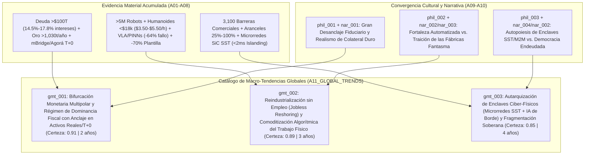

# 🌍 Síntesis de Macro-Tendencias Globales (`A11`)

> [!NOTE]
> **ID del Agente:** `A11_GLOBAL_TRENDS`  
> **Ciclo de Ejecución (`run_id`):** `run-20261023-sovereignty`  
> **Etapa:** `03_CULTURAL_CONVERGENCE` (Cierre de Fase 03 y Pliego de Tesis para Fase 04)  
> **Recibe de:** [10-atlas-narrativas-emergentes.md](file:///c:/Users/addu0g/Documents/SocietyWay/runs/2026-10-23-sovereignty/10-atlas-narrativas-emergentes.md) (`EmergentNarrativesAtlas`: `nar_001` a `nar_004` + trazabilidad acumulada `A01`–`A09`)  
> **Entrega a:** `A12_AGENT_COUNCIL` (Consejo de Agentes — Debate Multiagente)  

---

## 1. Arquitectura Sistémica de las Macro-Tendencias Globales

En cumplimiento de la regla de **Fusión Hecho + Narrativa** de **SocietyWay**, una Macro-Tendencia Global (`gmt_...`) solo se consolida cuando un **vector material duro** (capacidad instalada de cómputo/robótica, flujos de reservas de banca central, restricciones arancelarias o electrónica de potencia) converge con un **vector simbólico y narrativo** capaz de coordinar las expectativas de capital, gobiernos y sociedad.

Integrando las **12 señales primarias (`sig_20261023_001` a `sig_20261023_012`)**, los **12 vectores sectoriales de Nivel 1 y 2 (`A03`–`A08`)**, los **3 desplazamientos filosófico-culturales (`phil_001`–`phil_003`)** y las **4 narrativas en pugna (`nar_001`–`nar_004`)**, el **Agente de Tendencias Globales (`A11`)** estructura las **3 Macro-Tendencias Sistémicas (`gmt_001`, `gmt_002`, `gmt_003`)** que definen el sistema-mundo y formula las **3 Mociones Deliberativas (`council_motion`)** que serán sometidas a juicio adversarial en el **Consejo de Agentes (`A12`)**.



---

## 2. Catálogo de Macro-Tendencias Sistémicas (`global_macro_trends`)

### 1. Bifurcación Monetaria Multipolar y Régimen de Dominancia Fiscal con Anclaje en Activos Duros y Liquidación `T+0` (`gmt_001`)
- **Etiquetas STEEPV (`steepl_tags`):** `["ECON", "GEOPOL", "TECH", "SOCIAL", "VALUES"]`
- **Trazabilidad de Señales (`source_signal_ids`):** `sig_20261023_001`, `sig_20261023_002`, `sig_20261023_003`, `sig_20261023_004`, `sig_20261023_008`, `sig_20261023_011`
- **Narrativas y Paradigmas Vinculados:** `nar_001`, `nar_004` (`phil_001`, `phil_003`)
- **Certeza Estructural (`structural_certainty`):** `0.91` | **Tiempo a Mainstream (`time_to_mainstream_years`):** `2 años`
- **Síntesis de Fusión (Hecho + Narrativa):** El hecho material de una deuda soberana global que rebasa los **$100 billones USD (93% del PIB)** con costos de servicio de intereses del **14.5% al 17.8% de la recaudación tributaria** (`sig_20261023_001`) se fusiona con la narrativa viral del *Debasement Trade* (+340% YoY, `sig_20261023_011` / `nar_001`). El sistema monetario internacional abandona el monopolio unipolar de reservas fiduciarias G7/SWIFT para dividirse en dos arquitecturas programables en competencia: **Project mBridge** (liquidación atómica `T+0` en segundos y -50% en costos entre bancos centrales de Asia/Golfo) y **Project Agorá** (depósitos comerciales tokenizados occidentales) (`sig_20261023_004`), mientras el **oro físico (>1,030 toneladas/año compradas por bancos centrales)** y las materias primas reemergen como el activo de liquidación neutral de última instancia (`sig_20261023_002`), proyectando una erosión del **12% al 18% en la demanda de reservas fiduciarias tradicionales hacia 2035** con una inflación subyacente estructural del **3.2%–4.0%** y primas por plazo de **+85 a +140 pb** (`sig_20261023_008`).
- **Dinámica de Sistemas (`system_dynamics`):**
  - **Bucle Reforzador ($R$ — `reinforcing_loop`):** Aumento del déficit fiscal y servicio de deuda soberana (`sig_20261023_001`) $\rightarrow$ Mayor emisión e inflación estructural (`3.2%–4.0%`) para licuar pasivos (`sig_20261023_008`) $\rightarrow$ Aceleración de la narrativa de *Dominancia Fiscal* (`nar_001`) y rotación de bancos centrales y enjambres de tesorería autónoma (`ais_003`) hacia oro (`>1,030 t/año`) y rieles directos `mBridge`/`Agorá` (`sig_20261023_002`, `sig_20261023_004`) $\rightarrow$ Menor demanda cautiva de bonos soberanos G7 (-12% a -18%) y exigencia de mayores primas por plazo (`+85 a +140 pb`) $\rightarrow$ Encarecimiento adicional del servicio de la deuda pública que retroalimenta el déficit inicial.
  - **Fricción Equilibradora ($B$ — `balancing_friction`):** Profundidad y liquidez aún insustituibles de los mercados de capitales en dólares/euros para absorber superávits globales; imposición de controles de capitales, aranceles punitivos secundarios contra jurisdicciones que evadan el sistema occidental y regulación de tenencia obligatoria de deuda pública (*represión financiera estatutaria*) sobre fondos de pensiones, aseguradoras y emisores de *stablecoins*/depósitos tokenizados en `Project Agorá`.
- **Efectos de 2.º y 3.er Orden (`second_order_effects`):**
  1. **2.º Orden — Extinción de la cartera 60/40 y crisis hipotecaria juvenil:** Los bonos soberanos de largo plazo pierden su función histórica de cobertura anticíclica; la prima por plazo estructural (`+85 a +140 pb`) traslada tasas reales altas al crédito hipotecario y corporativo, consolidando una fractura social entre propietarios patrimoniales *senior* y jóvenes inquilinos perpetuos (`soc_002`).
  2. **2.º Orden — Desintermediación de la banca corresponsal y *flash-runs* algorítmicos:** La liquidación atómica `T+0` gobernada por agentes de tesorería de IA (`ais_003`, `lms_003`) elimina el colchón de flotación de 3 a 5 días de SWIFT, permitiendo fugas de liquidez soberana o corporativa en cuestión de segundos ante rumores geopolíticos.
  3. **3.er Orden — Remonetización de la energía y los minerales estratégicos:** Los contratos inteligentes en `mBridge` empiezan a utilizar cestas de kilovatios-hora, cobre, galio/germanio y oro depositado en bóvedas multipolares como unidad de cuenta sintética para el comercio Sur-Sur y Este-Este.
- **⚖️ Moción para el Consejo de Agentes (`council_motion`):** *¿Conducirá la convergencia entre Dominancia Fiscal (deuda >$100B USD) y rieles multi-CBDC (`mBridge`/`Agorá`) a una desdolarización multipolar fragmentada respaldada por oro y materias primas hacia 2030–2035, o lograrán los bloques centrales imponer un régimen de "represión financiera digital cautiva" (vía `Project Agorá` y controles de capital) que preserve la hegemonía fiduciaria mediante coerción regulatoria?*

---

### 2. Reindustrialización sin Empleo (*Jobless Reshoring*) y Comoditización Algorítmica del Trabajo Físico (`gmt_002`)
- **Etiquetas STEEPV (`steepl_tags`):** `["TECH", "ECON", "SOCIAL", "GEOPOL", "VALUES"]`
- **Trazabilidad de Señales (`source_signal_ids`):** `sig_20261023_003`, `sig_20261023_005`, `sig_20261023_006`, `sig_20261023_007`, `sig_20261023_009`, `sig_20261023_012`
- **Narrativas y Paradigmas Vinculados:** `nar_002`, `nar_003` (`phil_002`)
- **Certeza Estructural (`structural_certainty`):** `0.89` | **Tiempo a Mainstream (`time_to_mainstream_years`):** `3 años`
- **Síntesis de Fusión (Hecho + Narrativa):** La ortodoxia tecno-nacionalista de la *Fortaleza Automatizada* (`nar_002`) impulsa aranceles del **25% al 100%** y subsidios para relocalizar cadenas críticas (`sig_20261023_005`), pero choca frontalmente con la física económica de la robótica avanzada: un parque global de **>5 millones de robots industriales** (`sig_20261023_006`), humanoides con **BOM <$18,000 USD** gracias a actuadores **QDD** (`sig_20261023_009`) y modelos **VLA + PINNs/OpenUSD** que reducen un **64% el fallo Sim-to-Real** y un **78% el tiempo de cambio de línea** (`sig_20261023_007`). El resultado es la consolidación de plantas *lights-out* que operan a un costo amortizado de **$3.50 a $5.50 USD/hora** con **65% a 75% menos plantilla operativa directa** (`sig_20261023_012`), detonando la contra-narrativa cívica de las *Fábricas Fantasma* (`nar_003`) al romper simultáneamente el pacto obrero en el Norte Global y el modelo de industrialización por mano de obra barata ($6–$9/h) en el Sur Global.
- **Dinámica de Sistemas (`system_dynamics`):**
  - **Bucle Reforzador ($R$ — `reinforcing_loop`):** Imposición de aranceles (25%–100%) y fragmentación comercial (`sig_20261023_003`, `sig_20261023_005`) $\rightarrow$ Sobrecosto de CAPEX del 12%–22% en plantas relocalizadas $\rightarrow$ Imperativo corporativo de eliminar el costo salarial humano adoptando celdas *lights-out* con humanoides QDD (`<$18k`) y modelos `VLA/PINNs` (`sig_20261023_007`, `sig_20261023_009`) $\rightarrow$ Acumulación masiva de telemetría física compartida en gemelos digitales `OpenUSD` $\rightarrow$ Mayor caída en fallos *Sim-to-Real* y compresión del costo horario robótico hacia `$3.50/h` (`sig_20261023_012`), acelerando aún más el desplazamiento del trabajo manual en nuevas industrias.
  - **Fricción Equilibradora ($B$ — `balancing_friction`):** Restricciones severas en el suministro de tierras raras, galio, germanio y grafito (`sig_20261023_003`, `sig_20261023_005`) necesarios para imanes permanentes de actuadores QDD y baterías; escasez aguda de la élite de ingenieros ciber-físicos (`lms_003`, vida media de habilidades de `2.1 años`); y reacción política populista (`nar_003`, `soc_001`) mediante huelgas, bloqueos municipales, condicionalidades de empleo local e impuestos sobre el capital robótico (*Robot Taxes*).
- **Efectos de 2.º y 3.er Orden (`second_order_effects`):**
  1. **2.º Orden — Desindustrialización prematura del Sur Global y crisis migratoria:** Los hubs de maquila y *nearshoring* (América Latina, Sudeste Asiático) pierden su ventaja comparativa salarial (`$6–$9/h` vs. robot a `$3.50–$5.50/h`, `lms_004`), dejando a millones de jóvenes sin canal de absorción hacia el empleo formal e intensificando las presiones migratorias y la economía informal.
  2. **2.º Orden — Extinción del escalón de aprendizaje técnico (*Apprenticeship Collapse*):** Al desaparecer el 65%–75% de los operarios de base y ayudantes de planta, se rompe la cadena empírica donde se formaban los supervisores y técnicos de mantenimiento senior, obligando a las industrias a depender íntegramente de simuladores sintéticos propietarios (`OpenUSD`).
  3. **3.er Orden — Crisis fiscal de los sistemas de seguridad social basados en nómina:** Dado que los Estados financian pensiones y salud gravando el trabajo humano (IRPF y cotizaciones patronales/obreras), el reemplazo de nóminas de `$30/h` por amortización de CAPEX robótico de `$4/h` vacía la base tributaria municipal y previsional justo cuando el envejecimiento demográfico exige mayor gasto social (`soc_001`, `soc_004`).
- **⚖️ Moción para el Consejo de Agentes (`A12` — `council_motion`):** *Ante la consolidación de fábricas lights-out ($3.50–$5.50/h y -70% de plantilla) tanto en economías avanzadas como en hubs de nearshoring: ¿prevalecerá el imperativo geoeconómico de competitividad autónoma sin trabas (`nar_002`), o la fractura del contrato social (`nar_003`) forzará un nuevo régimen fiscal de "Dividendo Ciudadano de Automatización / Impuesto al Cómputo Físico y Robótico" antes de 2032?*

---

### 3. Autarquización de Enclaves Ciber-Físicos (Microrredes SiC SST + Cómputo de Borde + Tesorería M2M) y Asimetría Soberana (`gmt_003`)
- **Etiquetas STEEPV (`steepl_tags`):** `["TECH", "GEOPOL", "ECOL", "SOCIAL", "VALUES"]`
- **Trazabilidad de Señales (`source_signal_ids`):** `sig_20261023_001`, `sig_20261023_003`, `sig_20261023_004`, `sig_20261023_005`, `sig_20261023_007`, `sig_20261023_010`, `sig_20261023_012`
- **Narrativas y Paradigmas Vinculados:** `nar_004`, `nar_002` (`phil_003`)
- **Certeza Estructural (`structural_certainty`):** `0.85` | **Tiempo a Mainstream (`time_to_mainstream_years`):** `4 años`
- **Síntesis de Fusión (Hecho + Narrativa):** La convergencia técnica entre **Transformadores de Estado Sólido (SiC SST)** con **98.5% de eficiencia** y conmutación a modo isla en **<2 milisegundos** (`sig_20261023_010`), inferencia de **IA Física destilada en el borde** (`sig_20261023_005`, `sig_20261023_007`) y tesorería autónoma **M2M** (`sig_20261023_004`) se articula con la narrativa emergente de los *Enclaves de Baja Entropía* (`nar_004`). Para proteger inversiones multimillonarias de CAPEX frente a redes eléctricas públicas vulnerables, volatilidad cambiaria y Estados fiscalmente exhaustos (`sig_20261023_001`), los complejos industriales *lights-out* y centros de datos de IA se diseñan como **islas metabólicamente autónomas**. Esto inaugura una topología política de **soberanía bifurcada**: nodos ciber-físicos de alta frecuencia e inmunidad energética coexistiendo en el mismo territorio con redes públicas municipales degradadas (`soc_003`).
- **Dinámica de Sistemas (`system_dynamics`):**
  - **Bucle Reforzador ($R$ — `reinforcing_loop`):** Congestión de las redes eléctricas públicas de corriente alterna (AC) y estrechez fiscal estatal para modernizar infraestructura pública (`sig_20261023_001`) $\rightarrow$ Mayor inversión corporativa en microrredes DC privadas con electrónica de potencia `SiC SST` (`<2 ms` *islanding*, `sig_20261023_010`) y generación cautiva para alimentar centros de IA y plantas *lights-out* (`sig_20261023_012`) $\rightarrow$ Deserción de los grandes consumidores industriales solventes respecto a la tarifa de la red eléctrica pública (*grid defection*) $\rightarrow$ Pérdida de ingresos fijos para las compañías eléctricas públicas, encarecimiento tarifario y mayor degradación del servicio para los hogares $\rightarrow$ Mayor incentivo para que nuevos actores industriales y comunidades pudientes se desconecten en enclaves autónomos (`nar_004`).
  - **Fricción Equilibradora ($B$ — `balancing_friction`):** Controles de exportación sobre obleas y sustratos de carburo de silicio (`SiC`), galio y germanio (`sig_20261023_003`, `sig_20261023_005`) que encarecen y racionan el despliegue de transformadores SST; e intervención soberana coercitiva de los Estados/municipios (expropiación regulatoria de capacidad energética excedente, prohibición de operación *off-grid* sin peaje solidario o nacionalización de nodos críticos en situaciones de emergencia energética ciudadana).
- **Efectos de 2.º y 3.er Orden (`second_order_effects`):**
  1. **2.º Orden — Espiral de muerte de las *utilities* eléctricas tradicionales (*Utility Death Spiral*):** A medida que los complejos industriales y de IA —que representan la demanda base más rentable— migran a microrredes DC con `SiC SST` y acuerdos energéticos directos, el costo de mantener la red de transmisión heredada recae desproporcionadamente sobre los consumidores residenciales y pequeñas empresas.
  2. **2.º Orden — Corporaciones Agénticas Casi-Soberanas:** Una instalación que genera y regula su propia energía (`ais_004`), manufactura físicamente sin personal humano (`ais_002`) y liquida pagos transfronterizos en segundos mediante agentes financieros (`ais_003`) adquiere una resiliencia operativa superior a la de muchos Estados pequeños o gobiernos subnacionales.
  3. **3.er Orden — Nuevo pacto feudal-municipal (*Infrastructure-for-Sovereignty Swaps*):** Municipios quebrados por el servicio de deuda empiezan a otorgar exenciones fiscales, seguridad jurídica especial y derechos sobre agua/suelo a consorcios industriales a cambio de que las microrredes `SST` de las fábricas *lights-out* suministren electricidad de respaldo a hospitales y servicios locales críticos.
- **⚖️ Moción para el Consejo de Agentes (`A12` — `council_motion`):** *¿Evolucionarán las fábricas lights-out y centros de cómputo dotados de microrredes SiC SST (<2 ms) y tesorería M2M hacia "enclaves cuasi-soberanos" que fragmenten la autoridad territorial del Estado-nación, o los gobiernos —bajo presión de una ciudadanía con cohesión social crítica (`0.38`)— impondrán una integración forzosa de dichas infraestructuras al servicio público?*

---

## 3. Tablero Resumen de Macro-Tendencias y Mociones para el Consejo (`A11` -> `A12`)

| ID Tendencia | Macro-Tendencia Sistémica | Certeza | Horizonte Mainstream | Paradigmas y Narrativas (`A09`/`A10`) | Núcleo de la Moción para el Consejo de Agentes (`A12`) |
| :--- | :--- | :--- | :--- | :--- | :--- |
| **`gmt_001`** | **Bifurcación Monetaria Multipolar y Dominancia Fiscal con Anclaje en Activos Duros / `T+0`** | `0.91` | **2 años** (2028) | `phil_001` / `nar_001`, `nar_004` | ¿Fragmentación multipolar respaldada en oro/materias primas (`mBridge`) vs. Represión financiera digital cautiva (`Agorá`)? |
| **`gmt_002`** | **Reindustrialización sin Empleo (*Jobless Reshoring*) y Comoditización del Trabajo Físico** | `0.89` | **3 años** (2029) | `phil_002` / `nar_002`, `nar_003` | ¿Hegemonía irrestricta del CAPEX autónomo (`$3.50/h`) vs. Imposición política de un Dividendo/Impuesto Cívico Robótico? |
| **`gmt_003`** | **Autarquización de Enclaves Ciber-Físicos (`SiC SST` + IA de Borde + `M2M`) y Asimetría Soberana** | `0.85` | **4 años** (2030) | `phil_003` / `nar_004`, `nar_002` | ¿Secesión funcional de enclaves corporativos de baja entropía vs. Re-acoplamiento estatal y municipal forzoso? |

---

## 4. Contrato de Salida JSON (`AgentEnvelope` + `GlobalTrendsSynthesis`)

```json
{
  "$schema": "https://societyway.local/schemas/agent-envelope-v1.json",
  "run_id": "run-20261023-sovereignty",
  "timestamp_utc": "2026-10-23T23:20:00Z",
  "producer_agent_id": "A11_GLOBAL_TRENDS",
  "consumer_agent_ids": [
    "A12_AGENT_COUNCIL"
  ],
  "trace_context": {
    "stage": "03_CULTURAL_CONVERGENCE",
    "confidence_score": 0.92,
    "source_signal_ids": [
      "sig_20261023_001",
      "sig_20261023_002",
      "sig_20261023_003",
      "sig_20261023_004",
      "sig_20261023_005",
      "sig_20261023_006",
      "sig_20261023_007",
      "sig_20261023_008",
      "sig_20261023_009",
      "sig_20261023_010",
      "sig_20261023_011",
      "sig_20261023_012"
    ]
  },
  "payload": {
    "producer_agent_id": "A11_GLOBAL_TRENDS",
    "consumer_agent_ids": [
      "A12_AGENT_COUNCIL"
    ],
    "global_macro_trends": [
      {
        "trend_id": "gmt_001",
        "title": "Bifurcación Monetaria Multipolar y Régimen de Dominancia Fiscal con Anclaje en Activos Duros y Liquidación Atómica T+0",
        "steepl_tags": [
          "ECON",
          "GEOPOL",
          "TECH",
          "SOCIAL",
          "VALUES"
        ],
        "source_signal_ids": [
          "sig_20261023_001",
          "sig_20261023_002",
          "sig_20261023_003",
          "sig_20261023_004",
          "sig_20261023_008",
          "sig_20261023_011"
        ],
        "linked_narrative_ids": [
          "nar_001",
          "nar_004"
        ],
        "structural_certainty": 0.91,
        "time_to_mainstream_years": 2,
        "system_dynamics": {
          "reinforcing_loop": "Deuda pública global >$100 billones USD y pago de intereses del 14.5%-17.8% de los ingresos fiscales -> Represión financiera e inflación estructural de equilibrio (3.2%-4.0%) -> Viralización del 'Debasement Trade' (+340%) y migración de bancos centrales y tesorerías algorítmicas hacia oro físico (>1,030 t/año) y rieles de liquidación atómica T+0 (mBridge / Project Agorá) -> Erosión del 12%-18% en la demanda de reservas fiduciarias tradicionales y aumento de primas por plazo (+85 a +140 pb) -> Mayor costo de refinanciamiento soberano que agrava el déficit fiscal.",
          "balancing_friction": "Profundidad de liquidez aún dominante de los mercados de deuda G7, imposición de controles de capitales, aranceles secundarios punitivos y mandatos regulatorios de represión financiera que obligan a fondos previsionales, bancos y consorcios tokenizados occidentales a absorber deuda soberana doméstica."
        },
        "second_order_effects": [
          "Obsolescencia estructural de la cartera previsional 60/40 y fractura patrimonial intergeneracional al trasladarse la prima por plazo (+85 a +140 pb) al costo del crédito hipotecario juvenil",
          "Desintermediación de la banca corresponsal SWIFT (3-5 días) y aparición de corridas de liquidez transfronterizas en segundos gobernadas por enjambres de tesorería autónoma M2M",
          "Surgimiento de unidades de cuenta sintéticas en el comercio Euroasiático/Sur Global ancladas en cestas de oro, energía y minerales estratégicos liquidados sobre mBridge"
        ],
        "council_motion": "¿Conducirá la convergencia entre Dominancia Fiscal (deuda >$100B USD) y rieles multi-CBDC (mBridge/Agorá) a una desdolarización multipolar fragmentada respaldada por oro y activos reales hacia 2030-2035, o lograrán las potencias emisoras imponer un régimen de 'represión financiera digital cautiva' que preserve la hegemonía fiduciaria mediante coerción regulatoria?"
      },
      {
        "trend_id": "gmt_002",
        "title": "Reindustrialización sin Empleo (Jobless Reshoring) y Comoditización Algorítmica del Trabajo Físico vía IA Encarnada",
        "steepl_tags": [
          "TECH",
          "ECON",
          "SOCIAL",
          "GEOPOL",
          "VALUES"
        ],
        "source_signal_ids": [
          "sig_20261023_003",
          "sig_20261023_005",
          "sig_20261023_006",
          "sig_20261023_007",
          "sig_20261023_009",
          "sig_20261023_012"
        ],
        "linked_narrative_ids": [
          "nar_002",
          "nar_003"
        ],
        "structural_certainty": 0.89,
        "time_to_mainstream_years": 3,
        "system_dynamics": {
          "reinforcing_loop": "Aranceles estratégicos (25%-100%) y fragmentación comercial (3,100 restricciones) -> Sobrecosto de CAPEX del 12%-22% en plantas relocalizadas -> Adopción forzosa de manufactura lights-out con humanoides QDD (<$18,000 USD BOM) y modelos físicos VLA/PINNs (-64% fallo Sim-to-Real, -78% tiempo de cambio de línea) -> Costo operativo amortizado de $3.50-$5.50 USD/hora y recorte del 65%-75% en plantilla humana -> Mayor escala de datos cinemáticos en gemelos OpenUSD que abarata aún más la robótica frente al salario humano tanto en el Norte como en el Sur Global.",
          "balancing_friction": "Cuellos de botella geopolíticos en minerales críticos (galio, germanio, tierras raras para imanes QDD) y litografía avanzada; déficit severo de ingenieros ciber-físicos (vida media de habilidades de 2.1 años); y revuelta política local y sindical contra las 'Fábricas Fantasma' exigiendo impuestos a los robots y cuotas de empleo humano."
        },
        "second_order_effects": [
          "Clausura del modelo histórico de desarrollo por arbitraje salarial en economías emergentes ($6-$9/h desplazado por robots a $3.50-$5.50/h), detonando desindustrialización prematura y presión migratoria",
          "Colapso de la escalera de aprendizaje técnico (Career Ladder) al desaparecer los puestos de operario junior donde se formaban empíricamente los técnicos industriales senior",
          "Crisis estructural de recaudación en los sistemas de seguridad social y presupuestos municipales al sustituirse masa salarial sujeta a impuestos sobre la nómina por depreciación de CAPEX robótico"
        ],
        "council_motion": "Ante la consolidación de fábricas lights-out ($3.50-$5.50/h y -70% de plantilla) en suelo subsidiado: ¿prevalecerá el imperativo geoeconómico de automatización irrestricta por seguridad nacional (Fortaleza Automatizada), o la rebelión social contra el Jobless Reshoring forzará un nuevo pacto fiscal basado en impuestos al cómputo físico/robótico y dividendos ciudadanos antes de 2032?"
      },
      {
        "trend_id": "gmt_003",
        "title": "Autarquización de Enclaves Ciber-Físicos (Microrredes SiC SST + Cómputo de Borde + Tesorería M2M) y Fragmentación de la Soberanía Territorial",
        "steepl_tags": [
          "TECH",
          "GEOPOL",
          "ECOL",
          "SOCIAL",
          "VALUES"
        ],
        "source_signal_ids": [
          "sig_20261023_001",
          "sig_20261023_003",
          "sig_20261023_004",
          "sig_20261023_005",
          "sig_20261023_007",
          "sig_20261023_010",
          "sig_20261023_012"
        ],
        "linked_narrative_ids": [
          "nar_004",
          "nar_002"
        ],
        "structural_certainty": 0.85,
        "time_to_mainstream_years": 4,
        "system_dynamics": {
          "reinforcing_loop": "Inestabilidad de las redes eléctricas públicas y deterioro de servicios municipales por asfixia fiscal estatal -> Despliegue corporativo de microrredes DC con Transformadores de Estado Sólido (SiC SST, 98.5% eficiencia y desconexión a isla en <2 ms) acopladas a cómputo local y plantas lights-out -> Deserción de los grandes clientes industriales respecto a la red pública (grid defection) -> Pérdida de ingresos fijos para las utilities públicas y encarecimiento tarifario para hogares -> Mayor incentivo para la secesión infraestructural de enclaves corporativos y micro-comunidades.",
          "balancing_friction": "Restricciones de suministro y controles de exportación sobre semiconductores de potencia (carburo de silicio SiC, galio) y legislación estatal/municipal contra la secesión energética que impone peajes solidarios de red o suministro obligatorio de respaldo a las comunidades adyacentes."
        },
        "second_order_effects": [
          "Espiral de muerte financiera de las compañías eléctricas públicas tradicionales al perder la demanda base industrial más solvente frente a microrredes privadas behind-the-meter",
          "Emergencia de zonas económicas especiales operadas por consorcios agénticos (energía SST propia, manufactura sin humanos y liquidación M2M en mBridge/Agorá) con alta inmunidad frente a huelgas o parálisis regulatoria local",
          "Aparición de pactos neofeudales locales donde municipios endeudados ceden autonomía fiscal y regulatoria a megafábricas a cambio de acceso a su excedente eléctrico de estado sólido y agua"
        ],
        "council_motion": "¿Evolucionarán los complejos industriales lights-out y centros de IA equipados con microrredes SiC SST (<2 ms islanding) y tesorería M2M hacia 'enclaves cuasi-soberanos' inmunes a la crisis fiscal del Estado, o los gobiernos —ante un índice de cohesión social de 0.38— impondrán la nacionalización regulatoria y el acoplamiento forzoso de estas infraestructuras al metabolismo público?"
      }
    ]
  },
  "markdown_summary": "## Resumen Ejecutivo del Nodo A11 (Agente de Tendencias Globales)\nIntegrando la evidencia material (`A01`-`A08`) con los desplazamientos filosóficos (`A09`) y el Atlas de Narrativas Emergentes (`A10`), se consolidan 3 Macro-Tendencias Globales Sistémicas (`gmt_001`, `gmt_002`, `gmt_003`) con trazabilidad total a `sig_20261023_001..012`: (1) `gmt_001` — **Bifurcación Monetaria Multipolar y Régimen de Dominancia Fiscal con Anclaje en Activos Duros y Liquidación T+0** (certeza `0.91`, 2 años a mainstream); (2) `gmt_002` — **Reindustrialización sin Empleo (*Jobless Reshoring*) y Comoditización Algorítmica del Trabajo Físico vía IA Encarnada** (certeza `0.89`, 3 años a mainstream); y (3) `gmt_003` — **Autarquización de Enclaves Ciber-Físicos (Microrredes SiC SST + Cómputo de Borde + Tesorería M2M) y Fragmentación de la Soberanía Territorial** (certeza `0.85`, 4 años a mainstream). Cada macro-tendencia define sus bucles reforzadores ($R$), fricciones equilibradoras ($B$), efectos de 2.º y 3.er orden y entrega una moción adversarial (`council_motion`) lista para el debate multiagente en el **Consejo de Agentes (`A12`)**."
}
```
