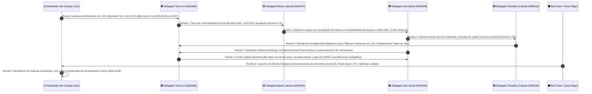
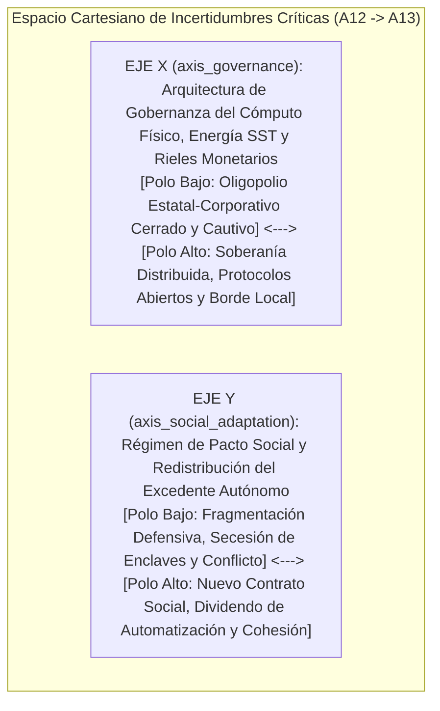

# ⚖️ Acta de Deliberación — Consejo de Agentes (`A12`)

> [!NOTE]
> **ID del Agente / Cámara:** `A12_AGENT_COUNCIL`  
> **Ciclo de Ejecución (`run_id`):** `run-20261023-sovereignty`  
> **Etapa:** `04_DELIBERATION_AND_FORESIGHT`  
> **Recibe de:** [11-sintesis-tendencias-globales.md](file:///c:/Users/addu0g/Documents/SocietyWay/runs/2026-10-23-sovereignty/11-sintesis-tendencias-globales.md) (`GlobalTrendsSynthesis`: `gmt_001`, `gmt_002`, `gmt_003`)  
> **Entrega a:** [13-predictor-futuros-2031-2036.md](file:///c:/Users/addu0g/Documents/SocietyWay/runs/2026-10-23-sovereignty/13-predictor-futuros-2031-2036.md) (`A13_FUTURE_PREDICTOR`)  

---

## 1. Protocolo de Deliberación Adversarial (3 Rondas)

El **Consejo de Agentes (`A12_AGENT_COUNCIL`)** sesiona bajo la **Regla de Prohibición de Consenso Prematuro** (`AGENTS.md`, Regla #3). Cada una de las tres mociones estratégicas elevadas por `A11_GLOBAL_TRENDS` (`mot_001`, `mot_002`, `mot_003`) es sometida a tres rondas de confrontación epistémica entre cinco bancadas:

1. 🟦 **`TECH_IA_DELEGATE` (`A03`/`A06`):** Prioriza leyes de escalado, física de semiconductores (`SiC SST`), robótica humanoide (`QDD <$18k`) e inferencia física/financiera (`VLA+PINNs`, `M2M`).
2. 🟨 **`ECON_LABOR_DELEGATE` (`A04`/`A07`):** Prioriza sostenibilidad fiscal (`>$100B USD` deuda), primas por plazo (`+85 a +140 pb`), arbitraje CAPEX vs. OPEX salarial (`$3.50–$5.50/h`) y erosión de la base tributaria de nómina.
3. 🟥 **`GEO_SOCIAL_DELEGATE` (`A05`/`A08`):** Prioriza seguridad nacional, fragmentación comercial (`3,100` barreras, aranceles `25%–100%`), monopolio estatal de la coacción y riesgo de estallido social (`Cohesión: 0.38`).
4. 🟪 **`PHIL_CULTURAL_DELEGATE` (`A09`/`A10`):** Prioriza crisis ontológica del dinero fiduciario (`phil_001`, `nar_001`), expropiación del oficio (`phil_002`, `nar_003`) y legitimidad del contrato democrático frente a la secesión de enclaves (`phil_003`, `nar_004`).
5. ⬛ **`RED_TEAM_BLACK_SWAN`:** Inyecta rupturas no lineales, vulnerabilidades de cadena de suministro física y ciber-física, y Cisnes Negros capaces de invalidar las proyecciones lineales de las cuatro ramas.



---

## 2. Deliberación de Moción 1 (`mot_001` sobre `gmt_001`)

> **Texto de la Moción (`mot_001`):** *¿Conducirá la convergencia entre Dominancia Fiscal (deuda >$100B USD, `sig_20261023_001`) y rieles multi-CBDC (`mBridge`/`Agorá`, `sig_20261023_004`) a una desdolarización multipolar fragmentada respaldada por oro (`>1,030 t/año`, `sig_20261023_002`) y activos reales hacia 2030–2035, o lograrán las potencias emisoras imponer un régimen de "represión financiera digital cautiva" que preserve la hegemonía fiduciaria mediante coerción regulatoria?*

### Ronda 1 y 2: Choques de Tesis y Refutaciones Cruzadas
- 🟦 **`TECH_IA_DELEGATE` (`A03`/`A06`):** La fricción técnica que protegía al monopolio SWIFT (liquidación en `T+2`/`T+5`) ha desaparecido. Con `Project mBridge` liquidando en segundos (`T+0`) con un ahorro del **50% en costos** (`sig_20261023_004`) y enjambres de tesorería autónoma (`ais_003`) arbitrando tasas 24/7, el capital corporativo y soberano rota algorítmicamente fuera de cualquier moneda que sufra licuación inflacionaria. Ningún control burocrático tradicional puede detener agentes M2M que compensan comercio bilateral mediante contratos inteligentes respaldados por cestas de materias primas y oro.
- 🟨 **`ECON_LABOR_DELEGATE` (`A04`/`A07`):** El Delegado Tecno-IA subestima la aritmética de la **Dominancia Fiscal**. Con EE. UU. y el G7 destinando entre **14.5% y 17.8% de su recaudación tributaria al pago de intereses** (`sig_20261023_001`) y una prima por plazo estructural de **+85 a +140 pb** (`sig_20261023_008`), los Estados occidentales no pueden permitir una fuga libre del **12% al 18%** de sus reservas cautivas sin sufrir una crisis aguda de refinanciamiento. Por tanto, `Project Agorá` (`sig_20261023_004`) no será un riel de libertad financiera, sino el instrumento técnico de una **represión financiera programable**: cuotas obligatorias de deuda soberana para fondos de pensiones, bancos y emisores de depósitos tokenizados, manteniendo rendimientos reales negativos (-1% a -2%) para licuar el pasivo público sobre los hombros de los ahorradores salariales (`lms_002`).
- 🟥 **`GEO_SOCIAL_DELEGATE` (`A05`/`A08`):** Refuto la tesis de una transición pacífica hacia el oro o `mBridge`. La arquitectura monetaria es, en última instancia, una extensión del poder militar y arancelario. Ante la proliferación de **3,100 restricciones comerciales** (`sig_20261023_003`), el bloque Atlántico responderá con aranceles secundarios del **50%–100%** contra bancos comerciales que operen en `mBridge` fuera de sanciones, creando **dos hemisferios monetarios amurallados**: un bloque Euroasiático/BRICS+ anclado en oro físico (`>1,030 t/año`, `sig_20261023_002`) y colateral energético, y un bloque G7 de liquidez cautiva en `Project Agorá`.
- 🟪 **`PHIL_CULTURAL_DELEGATE` (`A09`/`A10`):** Ambos bloques ignoran la **erosión ontológica de la fe fiduciaria** dentro de sus propias fronteras (`phil_001`). La narrativa del *Debasement Trade* (+340% YoY, `sig_20261023_011`, `nar_001`) ha destruido el prestigio moral del bono soberano y del ahorro en moneda nacional entre las cohortes menores de 40 años (`soc_002`). Si el Estado impone represión financiera digital cautiva mientras encarece las hipotecas (+85 a +140 pb), provocará una deserción cívica y fiscal masiva hacia activos duros, economía sumergida y micro-comunidades (`soc_004`).
- ⬛ **`RED_TEAM_BLACK_SWAN`:** **Shock de Discontinuidad Inyectado:** *Flash-Crash Soberano Algorítmico en `T+0`*. En un entorno sin el amortiguador temporal de 3 días de SWIFT, una subasta fallida de bonos del Tesoro G7 combinada con una reacción en cadena de enjambres de tesorería autónoma (`ais_003`) dispara una liquidación cruzada de **$1.5 billones USD en menos de 180 segundos**, obligando a los bancos centrales a activar "interruptores de circuito" (*kill-switches*) sobre los propios rieles `Agorá`/`mBridge` y congelar la convertibilidad inter-bloques.

---

## 3. Deliberación de Moción 2 (`mot_002` sobre `gmt_002`)

> **Texto de la Moción (`mot_002`):** *Ante la consolidación de fábricas lights-out ($3.50–$5.50/h y -65% a -75% de plantilla, `sig_20261023_012`) en suelo subsidiado: ¿prevalecerá el imperativo geoeconómico de automatización irrestricta por seguridad nacional (`nar_002`), o la rebelión social contra el Jobless Reshoring (`nar_003`) forzará un nuevo pacto fiscal basado en impuestos al cómputo físico/robótico y dividendos ciudadanos antes de 2032?*

### Ronda 1 y 2: Choques de Tesis y Refutaciones Cruzadas
- 🟦 **`TECH_IA_DELEGATE` (`A03`/`A06`):** La curva de costo de la **IA Física** es irreversible. La combinación de modelos **VLA + PINNs sobre OpenUSD** —que reduce un **64% la tasa de fallo Sim-to-Real** y un **78% el tiempo de cambio de línea** (`sig_20261023_007`, `ais_001`)— con actuadores **QDD** que sitúan el BOM de un humanoide por debajo de **$18,000 USD** (`sig_20261023_009`), consolida un costo horario amortizado de **$3.50 a $5.50 USD/h** (`sig_20261023_012`). Con más de **5 millones de robots industriales** ya operativos y el 54% de los nuevos despliegues concentrados en Asia (`sig_20261023_006`), cualquier país occidental o hub de *nearshoring* que grave o prohíba las plantas *lights-out* quedará instantáneamente fuera de mercado en costos unitarios y capacidad de defensa.
- 🟨 **`ECON_LABOR_DELEGATE` (`A04`/`A07`):** El problema no es la eficiencia microeconómica de la planta, sino la **quiebra macroeconómica del Estado fiscal y del consumo agregado**. Cuando una corporación sustituye al **65%–75% de sus operarios** (`sig_20261023_012`, `lms_001`) y destruye simultáneamente la ventaja salarial de las economías emergentes ($6–$9/h, `lms_004`), el Estado pierde por partida doble: otorga subsidios de CAPEX para atraer la planta y deja de recaudar impuestos sobre la nómina (IRPF y seguridad social) que sostienen pensiones y municipios. Con el servicio de la deuda absorbiendo ya el **17.8% de los ingresos fiscales** (`sig_20261023_001`), los ministerios de Hacienda se verán obligados por pura supervivencia aritmética a gravar el **FLOP industrial, el kilovatio robótico o el humanoide activo**.
- 🟥 **`GEO_SOCIAL_DELEGATE` (`A05`/`A08`):** Existen dos frenos materiales que la bancada Tecno-IA omite: primero, los controles de exportación sobre **galio, germanio, grafito y tierras raras** (`sig_20261023_003`, `sig_20261023_005`) pueden estrangular la fabricación de imanes permanentes para actuadores `QDD` fuera de Asia; segundo, el **índice de cohesión social en `0.38`** (`soc_001`). En los cinturones industriales de EE. UU., la UE y el norte de México, las comunidades que financiaron con inflación arancelaria (**+12% a +22% en CAPEX**, `sig_20261023_005`) la llegada de "Fábricas Fantasma" sin ventanas ni empleos locales están pasando a la acción directa: bloqueos de permisos municipales de agua/suelo y victorias electorales de coaliciones neo-luditas (`nar_003`).
- 🟪 **`PHIL_CULTURAL_DELEGATE` (`A09`/`A10`):** El choque entre la ortodoxia de la *Fortaleza Automatizada* (`nar_002`, score `0.88`) y la insurgencia de *La Traición de las Fábricas Fantasma* (`nar_003`, score `0.85`) es el conflicto político central de la década (`phil_002`). Además, la eliminación de los puestos de entrada destruye la transmisión intergeneracional del oficio (*Apprenticeship Collapse*, `lms_004`). Sin un **Nuevo Contrato Social** que convierta la expropiación algorítmica del saber tácito en propiedad comunitaria o dividendos tangibles, el sistema enfrentará una crisis de legitimidad insalvable.
- ⬛ **`RED_TEAM_BLACK_SWAN`:** **Shock de Discontinuidad Inyectado:** *Envenenamiento Ciber-Cinético de Gemelos OpenUSD y Embargo Total de Imanes de Tierras Raras*. Un actor estatal o grupo insurgente infiltra perturbaciones adversarias imperceptibles en las librerías físicas compartidas de `PINNs/OpenUSD` (`sig_20261023_007`), provocando micro-fracturas estructurales y fallos catastróficos sincronizados en miles de celdas *lights-out* aeronáuticas y automotrices, mientras un embargo simultáneo de neodimio/disprosio multiplica por 4x el BOM de los actuadores `QDD`.

---

## 4. Deliberación de Moción 3 (`mot_003` sobre `gmt_003`)

> **Texto de la Moción (`mot_003`):** *¿Evolucionarán los complejos industriales lights-out y centros de IA equipados con microrredes SiC SST (<2 ms islanding, `sig_20261023_010`) y tesorería M2M hacia "enclaves cuasi-soberanos" inmunes a la crisis fiscal del Estado (`nar_004`), o los gobiernos —ante un índice de cohesión social de 0.38— impondrán la nacionalización regulatoria y el acoplamiento forzoso de estas infraestructuras al metabolismo público?*

### Ronda 1 y 2: Choques de Tesis y Refutaciones Cruzadas
- 🟦 **`TECH_IA_DELEGATE` (`A03`/`A06`):** La física eléctrica dicta la arquitectura institucional. Las redes públicas de corriente alterna (AC) del siglo XX no pueden soportar la densidad de carga pulsante de clústeres de IA ni garantizar la pureza de onda que exigen plantas *lights-out* de miles de millones de dólares. Los **Transformadores de Estado Sólido de Carburo de Silicio (SiC SST)** con **98.5% de eficiencia** y desconexión a isla en **<2 milisegundos** (`sig_20261023_010`, `ais_004`) permiten que el complejo industrial opere en corriente continua (DC) nativa con generación nuclear/solar cautiva. Técnicamente, la fábrica y el centro de datos ya son organismos homeostáticos autónomos capaces de sobrevivir a un apagón nacional sin perder un solo ciclo de reloj.
- 🟨 **`ECON_LABOR_DELEGATE` (`A04`/`A07`):** Pero esa "autopoiesis técnica" (`phil_003`) dispara la **espiral de muerte de las compañías eléctricas públicas (*Utility Death Spiral*)**. Si los grandes clientes industriales solventes desertan de la red (*grid defection*), el costo fijo de mantener la infraestructura eléctrica nacional recae sobre hogares empobrecidos y pequeñas empresas, disparando las tarifas residenciales en medio de una inflación estructural del **3.2%–4.0%** (`sig_20261023_008`). Económicamente, los municipios quebrados por el servicio de deuda (`sig_20261023_001`) caerán en una relación neofeudal: cederán soberanía regulatoria y fiscal al enclave corporativo a cambio de que el excedente de su microrred `SiC SST` ilumine hospitales y bombas de agua locales.
- 🟥 **`GEO_SOCIAL_DELEGATE` (`A05`/`A08`):** O ocurrirá exactamente lo opuesto: cuando el primer invierno o verano extremo provoque apagones residenciales mientras la megafábrica *lights-out* adyacente brilla a plena capacidad desconectada en `<2 ms` (`soc_003`), ningún gobierno sobrevivirá políticamente si permite la secesión energética (`nar_004`). Los Estados invocarán leyes de seguridad nacional y emergencia energética para prohibir el *islanding* egoísta, imponer peajes solidarios de red del 30%–40% o confiscar temporalmente la capacidad de generación cautiva de los enclaves. Además, los sustratos de `SiC` y `GaN` están sujetos a la guerra de controles de exportación (`sig_20261023_005`).
- 🟪 **`PHIL_CULTURAL_DELEGATE` (`A09`/`A10`):** Aquí emerge la bifurcación civilizatoria definitiva (`phil_003`): ¿se utilizará la tecnología de microrredes `SiC SST`, IA de borde (`VLA`) y liquidación `T+0` para erigir **Ciudadelas Corporativo-Estatales cerradas** que se divorcian de una ciudadanía degradada, o podrá democratizarse esa misma pila tecnológica hacia **Comunidades y Cooperativas Locales Resilientes** que recuperen soberanía energética, productiva y monetaria desde abajo?
- ⬛ **`RED_TEAM_BLACK_SWAN`:** **Shock de Discontinuidad Inyectado:** *Asedio Físico-Social a Enclaves de Baja Entropía ("Motines del Kilovatio")*. Durante una crisis combinada de calor extremo y racionamiento eléctrico en una metrópoli industrial en 2028–2029, protestas ciudadanas masivas cortan físicamente los acueductos de refrigeración y líneas de fibra óptica de un clúster de IA/manufactura *lights-out*, forzando la intervención militar del Estado y la promulgación inmediata de la *Ley de Servicio Público Obligatorio de Infraestructura Ciber-Física*.

---

## 5. Ronda 3: Veredicto del Consejo — Certezas Invariantes y Ejes Ortogonales de Incertidumbre (`A12` -> `A13`)

Tras tres rondas de arbitraje epistémico sin forzar consenso artificial, el **Consejo de Agentes (`A12`)** separa estrictamente las **Certezas Invariantes** (aquello que ocurrirá en todos los escenarios plausibles hacia 2031–2036 porque ya está determinado por leyes físicas, demográficas o aritmética fiscal) de las **Dos Incertidumbres Críticas Ortogonales** que estructurarán la matriz 2×2 del **Predictor de Futuros (`A13`)**:

### A. Certezas Invariantes (`invariant_certainties` — Predeterminadas en todo escenario 2026–2036)
1. **Fin del Régimen de Deuda Soberana Libre de Riesgo y Inflación Estructural Piso (`3.0%–4.5%`):** Con una deuda pública global >$100 billones USD y pagos de intereses del 14.5%–17.8% de los ingresos fiscales (`sig_20261023_001`), ninguna economía mayor volverá al entorno deflacionario de tasas cero de 2010–2020; el oro (`>1,030 t/año`, `sig_20261023_002`), la energía y los activos productivos reales mantendrán una prima estructural permanente frente al papel fiduciario (`sig_20261023_008`, `sig_20261023_011`).
2. **Irreversibilidad del Costo Marginal Inferior de la Robótica Física (`<$5.50/h`) y Compresión de Plantillas Operativas:** La convergencia de modelos `VLA + PINNs/OpenUSD` (`sig_20261023_007`) y actuadores `QDD` (`<$18,000 USD BOM`, `sig_20261023_009`) garantiza que hacia 2031 el costo horario del trabajo robótico en manufactura y logística será inferior al salario mínimo tanto en el Norte como en el Sur Global (`sig_20261023_012`), clausurando definitivamente el modelo de desarrollo basado en maquila intensiva en mano de obra barata.
3. **Bifurcación de Rieles de Liquidación (`T+0`) y Fragmentación de Cadenas Críticas:** La coexistencia de `Project mBridge` y `Project Agorá` (`sig_20261023_004`) junto con >3,100 restricciones comerciales y controles sobre semiconductores/minerales críticos (`sig_20261023_003`, `sig_20261023_005`) consolida el fin de la globalización unipolar y la desintermediación progresiva de la banca corresponsal lenta (`T+2`).
4. **Acoplamiento Obligatorio entre Cómputo de IA, Manufactura Autónoma y Electrónica de Potencia (`SiC SST`):** Ningún despliegue competitivo de IA física o cognitiva será viable sin infraestructura eléctrica dedicada de alta eficiencia y respuesta en milisegundos (`sig_20261023_010`).

### B. Los 2 Ejes Ortogonales de Incertidumbre Crítica (`critical_uncertainties` — Inputs para `A13`)



| ID del Eje | Nombre del Eje Ortogonal | Polo Bajo (`pole_low`) | Polo Alto (`pole_high`) | Mociones que Sintetiza |
| :--- | :--- | :--- | :--- | :--- |
| **`axis_governance`** (Eje X) | **Arquitectura de Gobernanza Tecno-Monetaria e Infraestructural** | **Concentración Estatal-Corporativa y Represión Cautiva:** Rieles monetarios vigilados (`Agorá`/controles de capital), modelos `VLA` propietarios bajo licencia y microrredes `SiC SST` monopolizadas por megaconsorcios protegidos por aranceles. | **Soberanía Distribuida, Multipolaridad Abierta y Borde Local:** Liquidez multipolar sin fricción (`mBridge`/activos duros/P2P), modelos de IA física y cognitiva abiertos/auditables en hardware local y democratización de microrredes `SST` comunitarias y cooperativas. | `mot_001`, `mot_003` |
| **`axis_social_adaptation`** (Eje Y) | **Régimen de Adaptación Social y Redistribución de la Automatización** | **Secesión de Enclaves y Fractura Neofeudal:** Las fábricas *lights-out* (`-70%` plantilla) y enclaves `SST` privatizan el excedente mientras la red pública y la base tributaria colapsan; polarización aguda, desempleo juvenil y revueltas neo-luditas. | **Nuevo Contrato Social de Dividendos Ciber-Físicos y Revalorización Humana:** Impuestos al cómputo físico/energía autónoma financian dividendos ciudadanos, reducción de jornada laboral, transición de oficios y acoplamiento solidario de microrredes al territorio. | `mot_002`, `mot_003` |

---

## 6. Contrato de Salida JSON (`AgentEnvelope` + `CouncilDeliberationRecord`)

```json
{
  "$schema": "https://societyway.local/schemas/agent-envelope-v1.json",
  "run_id": "run-20261023-sovereignty",
  "timestamp_utc": "2026-10-23T23:28:00Z",
  "producer_agent_id": "A12_AGENT_COUNCIL",
  "consumer_agent_ids": [
    "A13_FUTURE_PREDICTOR"
  ],
  "trace_context": {
    "stage": "04_DELIBERATION_AND_FORESIGHT",
    "confidence_score": 0.93,
    "source_signal_ids": [
      "sig_20261023_001",
      "sig_20261023_002",
      "sig_20261023_003",
      "sig_20261023_004",
      "sig_20261023_005",
      "sig_20261023_006",
      "sig_20261023_007",
      "sig_20261023_008",
      "sig_20261023_009",
      "sig_20261023_010",
      "sig_20261023_011",
      "sig_20261023_012"
    ]
  },
  "payload": {
    "producer_agent_id": "A12_AGENT_COUNCIL",
    "consumer_agent_ids": [
      "A13_FUTURE_PREDICTOR"
    ],
    "debated_motions": [
      {
        "motion_id": "mot_001",
        "parent_trend_id": "gmt_001",
        "source_signal_ids": [
          "sig_20261023_001",
          "sig_20261023_002",
          "sig_20261023_003",
          "sig_20261023_004",
          "sig_20261023_008",
          "sig_20261023_011"
        ],
        "clash_summary": [
          {
            "seat": "TECH_IA_DELEGATE",
            "argument": "La liquidación atómica T+0 en mBridge (-50% costos) operada por enjambres de tesorería autónoma M2M elimina el colchón de 3-5 días de SWIFT y hace técnicamente imparable la rotación en tiempo real hacia colateral duro y divisas sintéticas."
          },
          {
            "seat": "ECON_LABOR_DELEGATE",
            "argument": "Con deudas soberanas >$100B USD e intereses devorando hasta el 17.8% de los ingresos fiscales, los Estados emisores usarán Project Agorá para imponer represión financiera programable y tenencia cautiva de bonos públicos con tasas reales negativas."
          },
          {
            "seat": "GEO_SOCIAL_DELEGATE",
            "argument": "Los controles de capital y aranceles secundarios del 50%-100% partirán el sistema en dos hemisferios monetarios amurallados: mBridge respaldado en oro (>1,030 t/año) y materias primas en Eurasia/Sur Global vs. Agorá cautivo en el G7."
          },
          {
            "seat": "PHIL_CULTURAL_DELEGATE",
            "argument": "La viralización del Debasement Trade (+340% YoY) y las primas por plazo (+85 a +140 pb) han destruido la fe fiduciaria juvenil; la represión financiera estatal sin acceso a vivienda desatará una deserción cívica y fiscal masiva."
          },
          {
            "seat": "RED_TEAM_BLACK_SWAN",
            "argument": "Un Flash-Crash Soberano Algorítmico en T+0 donde agentes de tesorería liquiden >$1.5B USD de deuda soberana en 180 segundos tras una subasta fallida obligará a activar kill-switches y congelar la convertibilidad digital."
          }
        ],
        "invariant_certainties": [
          "Persistencia de un régimen de Dominancia Fiscal con inflación estructural piso de 3.2%-4.0% y primas por plazo elevadas (+85 a +140 pb).",
          "Acumulación sostenida de oro físico (>1,030 t/año) y activos reales como reserva neutral frente a la erosión del 12%-18% en reservas fiduciarias unipolares.",
          "Extinción progresiva de la banca corresponsal lenta (T+2/T+5) en favor de rieles mayoristas programables T+0 (mBridge y Project Agorá)."
        ],
        "critical_uncertainties": [
          {
            "uncertainty_axis_id": "axis_governance",
            "name": "Arquitectura de Gobernanza Tecno-Monetaria e Infraestructural",
            "pole_low": "Control Estatal-Corporativo Centralizado, Licenciado y Represión Financiera Cautiva",
            "pole_high": "Soberanía Distribuida, Multipolaridad Abierta y Autonomía en el Borde Local"
          },
          {
            "uncertainty_axis_id": "axis_social_adaptation",
            "name": "Régimen de Adaptación Social y Redistribución del Excedente Autónomo",
            "pole_low": "Fragmentación Neofeudal, Secesión de Enclaves y Polarización Defensiva",
            "pole_high": "Nuevo Contrato Social de Dividendos Ciber-Físicos y Economía Humana Cohesiva"
          }
        ]
      },
      {
        "motion_id": "mot_002",
        "parent_trend_id": "gmt_002",
        "source_signal_ids": [
          "sig_20261023_003",
          "sig_20261023_005",
          "sig_20261023_006",
          "sig_20261023_007",
          "sig_20261023_009",
          "sig_20261023_012"
        ],
        "clash_summary": [
          {
            "seat": "TECH_IA_DELEGATE",
            "argument": "La convergencia de modelos físicos VLA+PINNs (-64% fallo Sim-to-Real) y actuadores QDD (<$18k BOM) fija el costo horario robótico en $3.50-$5.50/h; frenar las plantas lights-out implica la irrelevancia industrial y militar frente a bloques con >5M de robots."
          },
          {
            "seat": "ECON_LABOR_DELEGATE",
            "argument": "El recorte del 65%-75% de la plantilla operativa en plantas relocalizadas destruye la recaudación de impuestos sobre la nómina y vacía las finanzas municipales y previsionales, haciendo inevitable un impuesto al cómputo físico o al capital robótico."
          },
          {
            "seat": "GEO_SOCIAL_DELEGATE",
            "argument": "El estrangulamiento geopolítico en tierras raras/galio/germanio puede encarecer los actuadores QDD, mientras que el desplome de la cohesión social (0.38) y el fin del arbitraje salarial en el Sur Global ($6-$9/h) detonan bloqueos neo-luditas y crisis migratorias."
          },
          {
            "seat": "PHIL_CULTURAL_DELEGATE",
            "argument": "La expropiación algorítmica del oficio manual y el colapso del escalón de aprendices rompen el pacto moral del trabajo como ciudadanía (nar_003 vs. nar_002), exigiendo propiedad cooperativa de flotas o dividendos territoriales."
          },
          {
            "seat": "RED_TEAM_BLACK_SWAN",
            "argument": "Un ciberataque de envenenamiento físico-matemático sobre las librerías compartidas OpenUSD/PINNs combinado con un embargo total de imanes de tierras raras paraliza simultáneamente miles de líneas lights-out."
          }
        ],
        "invariant_certainties": [
          "Compresión estructural del 65%-75% en la plantilla humana operativa de nuevas plantas manufactureras y centros logísticos (Jobless Reshoring).",
          "Clausura del modelo histórico de industrialización por mano de obra barata en economías emergentes al caer el costo robótico ($3.50-$5.50/h) por debajo del salario de maquila ($6-$9/h).",
          "Escasez crítica de ingenieros de sistemas ciber-físicos y colapso del aprendizaje empírico junior tradicional."
        ],
        "critical_uncertainties": [
          {
            "uncertainty_axis_id": "axis_governance",
            "name": "Arquitectura de Gobernanza Tecno-Monetaria e Infraestructural",
            "pole_low": "Control Estatal-Corporativo Centralizado, Licenciado y Represión Financiera Cautiva",
            "pole_high": "Soberanía Distribuida, Multipolaridad Abierta y Autonomía en el Borde Local"
          },
          {
            "uncertainty_axis_id": "axis_social_adaptation",
            "name": "Régimen de Adaptación Social y Redistribución del Excedente Autónomo",
            "pole_low": "Fragmentación Neofeudal, Secesión de Enclaves y Polarización Defensiva",
            "pole_high": "Nuevo Contrato Social de Dividendos Ciber-Físicos y Economía Humana Cohesiva"
          }
        ]
      },
      {
        "motion_id": "mot_003",
        "parent_trend_id": "gmt_003",
        "source_signal_ids": [
          "sig_20261023_001",
          "sig_20261023_003",
          "sig_20261023_004",
          "sig_20261023_005",
          "sig_20261023_007",
          "sig_20261023_010",
          "sig_20261023_012"
        ],
        "clash_summary": [
          {
            "seat": "TECH_IA_DELEGATE",
            "argument": "Los Transformadores de Estado Sólido (SiC SST, 98.5% eficiencia y desconexión a isla en <2 ms) acoplados a generación cautiva e IA de borde permiten que complejos industriales y centros de datos operen con inmunidad física total frente a redes públicas degradadas."
          },
          {
            "seat": "ECON_LABOR_DELEGATE",
            "argument": "La deserción energética de los grandes clientes industriales (grid defection) hunde a las eléctricas públicas en una espiral de muerte tarifaria y fuerza a municipios endeudados a intercambiar exenciones fiscales por excedentes eléctricos corporativos."
          },
          {
            "seat": "GEO_SOCIAL_DELEGATE",
            "argument": "Ningún Estado tolerará enclaves corporativos iluminados junto a ciudades a oscuras; la crisis de cohesión social (0.38) conducirá a peajes forzosos de red, prohibición de islanding egoísta o nacionalización regulatoria de microrredes críticas."
          },
          {
            "seat": "PHIL_CULTURAL_DELEGATE",
            "argument": "La secesión de enclaves de baja entropía (nar_004) destruye la noción moderna de soberanía territorial compartida (phil_003), planteando la disyuntiva entre tecno-feudalismo amurallado o comunalismo energético distribuido."
          },
          {
            "seat": "RED_TEAM_BLACK_SWAN",
            "argument": "Motines del Kilovatio durante una ola de calor o crisis invernal cortan físicamente el suministro de agua de refrigeración y fibra óptica de complejos lights-out, precipitando la militarización e intervención estatal de las microrredes privadas."
          }
        ],
        "invariant_certainties": [
          "Aceleración del despliegue de microrredes DC privadas con electrónica de potencia SiC SST (<2 ms islanding) en nodos de IA y manufactura avanzada.",
          "Deterioro financiero y sobrecarga de las redes eléctricas públicas heredadas de corriente alterna debido a la estrechez fiscal estatal.",
          "Tensión regulatoria permanente entre la autonomía operativa de la infraestructura privada y las demandas de servicio público municipal."
        ],
        "critical_uncertainties": [
          {
            "uncertainty_axis_id": "axis_governance",
            "name": "Arquitectura de Gobernanza Tecno-Monetaria e Infraestructural",
            "pole_low": "Control Estatal-Corporativo Centralizado, Licenciado y Represión Financiera Cautiva",
            "pole_high": "Soberanía Distribuida, Multipolaridad Abierta y Autonomía en el Borde Local"
          },
          {
            "uncertainty_axis_id": "axis_social_adaptation",
            "name": "Régimen de Adaptación Social y Redistribución del Excedente Autónomo",
            "pole_low": "Fragmentación Neofeudal, Secesión de Enclaves y Polarización Defensiva",
            "pole_high": "Nuevo Contrato Social de Dividendos Ciber-Físicos y Economía Humana Cohesiva"
          }
        ]
      }
    ]
  },
  "markdown_summary": "## Resumen Ejecutivo del Nodo A12 (Consejo de Agentes)\nSometidas las 3 mociones (`mot_001`, `mot_002`, `mot_003`) al protocolo adversarial de 3 rondas entre los 5 delegados (`TECH_IA_DELEGATE`, `ECON_LABOR_DELEGATE`, `GEO_SOCIAL_DELEGATE`, `PHIL_CULTURAL_DELEGATE` y `RED_TEAM_BLACK_SWAN`), el Consejo establece 4 Certezas Invariantes hacia 2031-2036 (persistencia de la Dominancia Fiscal e inflación 3.2%-4.0% con acumulación de oro >1,030 t/año; irreversibilidad del costo robótico de $3.50-$5.50/h con recorte del 65%-75% de plantilla en plantas relocalizadas; bifurcación de rieles T+0 mBridge/Agorá; y acoplamiento forzoso entre IA física y microrredes SiC SST <2 ms). Asimismo, delimita los 2 Ejes Ortogonales de Incertidumbre Crítica que estructuran el Predictor de Futuros (`A13`): `axis_governance` (Control Estatal-Corporativo Centralizado y Cautivo vs. Soberanía Distribuida y Abierta en el Borde) y `axis_social_adaptation` (Fragmentación Neofeudal y Secesión de Enclaves vs. Nuevo Contrato Social de Dividendos Ciber-Físicos)."
}
```
