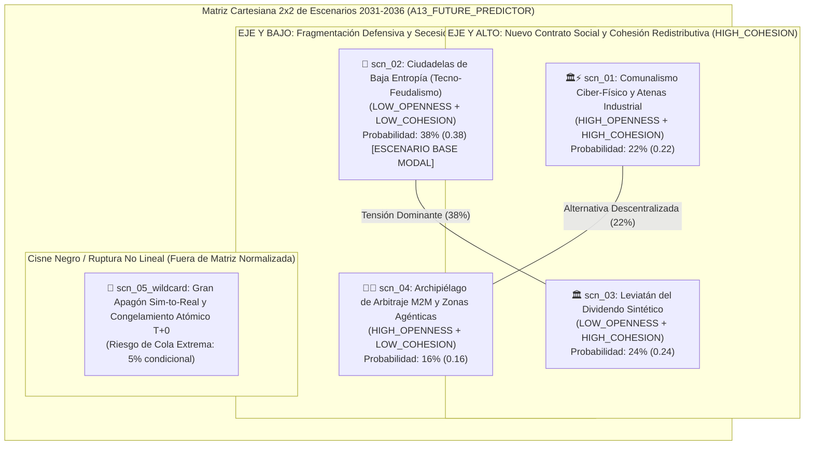

# 🔮 Prospectiva Estratégica: Escenarios a 5 y 10 Años (`2031 - 2036`) (`A13`)

> [!NOTE]
> **ID del Agente:** `A13_FUTURE_PREDICTOR`  
> **Ciclo de Ejecución (`run_id`):** `run-20261023-sovereignty`  
> **Etapa:** `04_DELIBERATION_AND_FORESIGHT`  
> **Recibe de:** [12-consejo-de-agentes-acta.md](file:///c:/Users/addu0g/Documents/SocietyWay/runs/2026-10-23-sovereignty/12-consejo-de-agentes-acta.md) (`CouncilDeliberationRecord`)  
> **Entrega a:** [14-dashboard-estrategico-final.md](file:///c:/Users/addu0g/Documents/SocietyWay/runs/2026-10-23-sovereignty/14-dashboard-estrategico-final.md) (`A14_STRATEGIC_DASHBOARD`)  

---

## 1. Arquitectura del Espacio de Escenarios (`2026 -> 2031 -> 2036`)

Cruzando las **4 Certezas Invariantes** con los **2 Ejes Ortogonales de Incertidumbre Crítica** establecidos por el **Consejo de Agentes (`A12`)**:
- **Eje X (`axis_governance`):** *Arquitectura de Gobernanza Tecno-Monetaria e Infraestructural* (`LOW_OPENNESS`: Oligopolio Estatal-Corporativo Cerrado y Cautivo $\leftrightarrow$ `HIGH_OPENNESS`: Soberanía Distribuida, Multipolaridad Abierta y Borde Local).
- **Eje Y (`axis_social_adaptation`):** *Régimen de Adaptación Social y Redistribución del Excedente Autónomo* (`LOW_COHESION`: Fragmentación Neofeudal y Secesión de Enclaves $\leftrightarrow$ `HIGH_COHESION`: Nuevo Contrato Social y Dividendo Ciber-Físico).

Se estructuran **4 Escenarios Canónicos (`scn_01` a `scn_04`)**, cuyas probabilidades bayesianas subjetivas suman exactamente **`1.00` (`100%`)**, más **1 Escenario Comodín de Cola Extrema / Cisne Negro (`scn_05_wildcard`)** derivado de las vulnerabilidades del *Red Team*.



---

## 2. Tabla Comparativa Maestra de Escenarios (`2031` y `2036`)

| ID | Escenario | Cuadrante (`X` × `Y`) | Probabilidad | Estado a 5 Años (`2031`) | Estado a 10 Años (`2036`) | Signposts Asociados |
| :--- | :--- | :--- | :---: | :--- | :--- | :---: |
| **`scn_01`** | **Comunalismo Ciber-Físico y Atenas Industrial Distribuida** | `HIGH_OPENNESS` × `HIGH_COHESION` | **`0.22` (22%)** | Estandarización abierta de modelos `VLA/PINNs` y microrredes `SiC SST` municipales; cooperativas industriales operan flotas `QDD` locales; primeros fideicomisos locales de automatización. | Jornada laboral industrial/técnica de 26h; renacimiento de gremios ciber-artesanales; red eléctrica pública estabilizada como *mesh* de microrredes ciudadanas y liquidación multipolar abierta. | `sp_01`, `sp_02` |
| **`scn_02`** | **Ciudadelas de Baja Entropía (Tecno-Feudalismo de Enclaves)** | `LOW_OPENNESS` × `LOW_COHESION` | **`0.38` (38%)** | Megafábricas *lights-out* (`-70%` plantilla) se aíslan en microrredes `SiC SST` (`<2 ms`); hemisferios monetarios amurallados (`Agorá` cautivo vs. `mBridge`/oro); crisis fiscal municipal. | Soberanía territorial bifurcada: enclaves corporativos de alta eficiencia intercambiando electricidad/agua por inmunidad fiscal frente a ciudades con redes degradadas y desempleo estructural. | `sp_03`, `sp_04` |
| **`scn_03`** | **Leviatán del Dividendo Sintético y Represión Cautiva** | `LOW_OPENNESS` × `HIGH_COHESION` | **`0.24` (24%)** | Impuesto soberano al FLOP/humanoide activo (`Robot Tax`) y represión financiera digital en `Project Agorá`; prohibición de *islanding* egoísta sin aporte obligatorio a la red pública. | Estado de bienestar sintético financiado por rentas de automatización y deuda cautiva; paz social subsidiada con CBDC programables sujetas a caducidad y control de consumo. | `sp_05`, `sp_06` |
| **`scn_04`** | **Archipiélago de Arbitraje M2M y Mercantilismo Agéntico** | `HIGH_OPENNESS` × `LOW_COHESION` | **`0.16` (16%)** | Proliferación de Zonas Económicas Especiales agénticas; fuga de tesorerías M2M a `mBridge`/oro/colateral energético en `T+0`; colapso del *nearshoring* salarial en mercados emergentes. | Geografía hiper-fragmentada de ciudades-estado corporativas y hubs *off-grid* compitiendo con robots a `$2.50/h`; erosión severa del Estado-nación fiscal tradicional y alta volatilidad migratoria. | `sp_07`, `sp_08` |
| **`scn_05_wildcard`** | **Cisne Negro: Gran Apagón Sim-to-Real y Congelamiento T+0** | `WILDCARD_BLACK_SWAN` | *(Cola 5%)* | Sabotaje adversario en librerías `OpenUSD/PINNs` + embargo total de tierras raras/`SiC` + *flash-crash* de `$1.5B USD` en `T+0` congela el despliegue autónomo global. | Re-humanización forzosa de emergencia en manufactura crítica, controles de capital draconianos y moratoria internacional sobre enjambres financieros y físicos sin supervisión humana en bucle. | Disparo combinado de `sp_04` + shock ciber-físico |

---

## 3. Desarrollo Exhaustivo del Portafolio de Escenarios

### Escenario 1 (`scn_01`): Comunalismo Ciber-Físico y Atenas Industrial Distribuida
- **Cuadrante:** `HIGH_OPENNESS_HIGH_COHESION` (`axis_governance: Alto` × `axis_social_adaptation: Alto`)
- **Peso de Probabilidad (`probability_weight`):** `0.22` (`22%`)
- **Trazabilidad (`source_signal_ids`):** `sig_20261023_002`, `sig_20261023_004`, `sig_20261023_006`, `sig_20261023_007`, `sig_20261023_009`, `sig_20261023_010`, `sig_20261023_012`
- **Horizonte 5 Años (`2031` — Transición e Institucionalización):**
  Ante el riesgo de fractura social por el *Jobless Reshoring* (`sig_20261023_012`), una coalición de gobiernos regionales, cooperativas industriales y consorcios tecnológicos condiciona los subsidios de relocalización (`sig_20261023_005`) a la apertura de protocolos. Los pesos de modelos físicos **VLA + PINNs sobre OpenUSD** (`sig_20261023_007`) se auditan bajo estándares abiertos, permitiendo que pequeñas y medianas manufacturas locales adquieran flotas de humanoides **QDD (<$18,000 USD)** (`sig_20261023_009`) sin depender de tres hiper-escaladores. Las microrredes con transformadores **SiC SST (<2 ms)** (`sig_20261023_010`) se despliegan bajo un modelo de **propiedad mixta municipal-industrial**: las plantas *lights-out* garantizan estabilidad de voltaje y venden su excedente energético a la comunidad local. En el frente monetario, los ciudadanos y PYMEs acceden a cuentas multipolares de liquidación instantánea `T+0` (`sig_20261023_004`) respaldadas parcialmente por cestas de oro (`sig_20261023_002`) y kilovatios-hora locales, protegiendo el ahorro familiar de la inflación fiduciaria (`phil_001`).
- **Horizonte 10 Años (`2036` — Nuevo Equilibrio Estructural):**
  La productividad física extrema (costo robótico de **$2.80–$3.50/h**) se traduce en una reducción de la semana laboral estándar a **26 horas** sin pérdida de ingreso real, complementada por **Fideicomisos Territoriales de Automatización**. Se resuelve el colapso del aprendizaje junior (`lms_004`) mediante "Gremios Ciber-Artesanales" donde maestros humanos entrenan, refinan y certifican comportamientos físicos especializados para gemelos digitales locales. La red eléctrica nacional ha evolucionado hacia una topología celular federada de microrredes `SiC SST` que erradica los apagones sistémicos.
- **Ganadores Estructurales (`winners`):**
  - Cooperativas industriales, PYMEs manufactureras robotizadas y municipios con generación renovable/nuclear distribuida.
  - Ingenieros ciber-físicos, entrenadores de modelos `VLA` de dominio específico y gremios de alta artesanía certificada.
  - Ecosistemas de hardware abierto (actuadores `QDD` modulares) y protocolos de liquidación `T+0` interoperables.
- **Perdedores Estructurales (`losers`):**
  - Monopolios rentistas de software industrial cerrado y banca corresponsal tradicional de alta comisión (`SWIFT T+2`).
  - Modelos de maquila de bajo valor agregado que no reconvirtieron su fuerza laboral hacia orquestación técnica.
- **Indicadores de Alerta Temprana (`early_warning_signposts`):**
  - **`sp_01`** (*Ventana: 12–18 meses*): Al menos 3 jurisdicciones industriales (ej. estados de EE. UU., Länder alemanes o corredores de México/Asia) aprueban leyes de **"Condicionalidad Cívica del Nearshoring"**, exigiendo que toda megafábrica subsidiada comparta al menos el 20% de su capacidad de microrred `SiC SST` con el municipio y aporte a un fondo local de reconversión técnica.
  - **`sp_02`** (*Ventana: 6–18 meses*): Lanzamiento y adopción por >500 fabricantes medianos de un estándar abierto de pesos **VLA + PINNs** sobre `OpenUSD` que permite operar humanoides `QDD` de múltiples marcas a `<$4.50/h` sin pago de regalías en la nube.
- **Coberturas Estratégicas (`strategic_hedges`):**
  - Invertir en arquitecturas modulares de robótica (`OpenUSD`/`PINNs`) agnósticas al proveedor de hardware y formar alianzas energéticas público-privadas con gobiernos locales.
  - Transformar a los operarios senior en "Arquitectos de Telemetría y Entrenamiento Físico" con participación societaria en la productividad de la celda robótica.

---

### Escenario 2 (`scn_02`): Ciudadelas de Baja Entropía (Tecno-Feudalismo de Enclaves) — *[Escenario Base Modal]*
- **Cuadrante:** `LOW_OPENNESS_LOW_COHESION` (`axis_governance: Bajo` × `axis_social_adaptation: Bajo`)
- **Peso de Probabilidad (`probability_weight`):** `0.38` (`38%`)
- **Trazabilidad (`source_signal_ids`):** `sig_20261023_001`, `sig_20261023_002`, `sig_20261023_003`, `sig_20261023_004`, `sig_20261023_005`, `sig_20261023_007`, `sig_20261023_008`, `sig_20261023_010`, `sig_20261023_011`, `sig_20261023_012`
- **Horizonte 5 Años (`2031` — Transición e Institucionalización):**
  El bucle de **Dominancia Fiscal** (`sig_20261023_001`, intereses devorando >18% de los ingresos tributarios) y la guerra comercial (**>4,500 barreras** y aranceles del **25%–100%**, `sig_20261023_003`, `sig_20261023_005`) consolidan una economía de bloques amurallados. Bajo el mantra de la *Fortaleza Automatizada* (`nar_002`), un oligopolio de megacorporaciones captura los subsidios estatales para levantar complejos *lights-out* que operan con **70% menos plantilla humana** (`sig_20261023_012`). Para blindarse del deterioro de la red eléctrica pública, estos complejos instalan microrredes **SiC SST (<2 ms islanding)** (`sig_20261023_010`) y desertan de las *utilities* nacionales (*grid defection*). Mientras las tesorerías corporativas y bancos centrales se protegen en oro (`>1,030 t/año`, `sig_20261023_002`) y rieles mayoristas `mBridge`/`Agorá` (`sig_20261023_004`), la población general sufre una inflación estructural del **3.8%–4.5%** (`sig_20261023_008`) y primas por plazo de **+130 pb** que paralizan el mercado hipotecario juvenil (`soc_002`).
- **Horizonte 10 Años (`2036` — Nuevo Equilibrio Estructural):**
  Se consolida una **Soberanía Territorial Bifurcada** (`phil_003`, `nar_004`). Por un lado, las **"Ciudadelas de Baja Entropía"** (polígonos industriales *lights-out*, clústeres de IA y zonas residenciales de la élite ciber-física) disfrutan de energía de estado sólido ininterrumpida, seguridad privada robótica y liquidación en activos duros. Por otro lado, los municipios circundantes —vaciados de recaudación sobre la nómina (`lms_001`)— caen en el **neofeudalismo infraestructural**: otorgan inmunidad fiscal y derechos preferentes de agua a las megafábricas a cambio de que estas suministren electricidad de emergencia a hospitales y servicios básicos. En el Sur Global, el fin del arbitraje salarial manufacturero (`$3.50/h` robótico vs. `$6–$9/h` humano) estabiliza una crisis crónica de subempleo urbano.
- **Ganadores Estructurales (`winners`):**
  - Megaconsorcios industriales verticalmente integrados (propietarios de modelos `VLA`, fábricas *lights-out* y microrredes `SiC SST`).
  - Productores de oro, uranio, cobre, tierras raras y semiconductores de potencia (`SiC`/`GaN`).
  - Contratistas de seguridad perimetral, defensa autónoma y gestores de tesorería institucional `T+0`.
- **Perdedores Estructurales (`losers`):**
  - Clase media asalariada y jóvenes ahorradores en moneda fiduciaria minorista (licuados por la represión financiera y el costo hipotecario).
  - Compañías eléctricas públicas tradicionales (*utilities* en espiral de muerte tarifaria) y gobiernos municipales dependientes de impuestos sobre la nómina.
  - Economías emergentes dependientes de maquila tradicional e industrias PYME sin acceso a CAPEX autónomo ni sustratos `SiC`.
- **Indicadores de Alerta Temprana (`early_warning_signposts`):**
  - **`sp_03`** (*Ventana: 6–15 meses*): Al menos 5 megacomplejos de IA o manufactura avanzada en Norteamérica/Europa firman acuerdos de desconexión prioritaria (*behind-the-meter* con `SiC SST`) que elevan las tarifas eléctricas residenciales de su región en **>18% anual**.
  - **`sp_04`** (*Ventana: 6–18 meses*): El pago neto de intereses de la deuda federal en al menos dos economías del G7 supera el **18.5% de la recaudación fiscal**, acompañado de aranceles secundarios >50% a la cadena de suministro de robótica y semiconductores de potencia fuera de bloque.
- **Coberturas Estratégicas (`strategic_hedges`):**
  - Asegurar autarquía física y energética en planta: contratos PPA dedicados (nuclear/solar + almacenamiento) con transformadores `SiC SST` capaces de operar 100% en isla (`<2 ms`).
  - Migrar la tesorería corporativa de largo plazo fuera de deuda soberana nominal hacia colateral duro (oro físico, inventarios estratégicos de minerales/componentes `QDD`/`SiC` y liquidación atómica `T+0`).

---

### Escenario 3 (`scn_03`): Leviatán del Dividendo Sintético y Represión Cautiva
- **Cuadrante:** `LOW_OPENNESS_HIGH_COHESION` (`axis_governance: Bajo` × `axis_social_adaptation: Alto`)
- **Peso de Probabilidad (`probability_weight`):** `0.24` (`24%`)
- **Trazabilidad (`source_signal_ids`):** `sig_20261023_001`, `sig_20261023_003`, `sig_20261023_004`, `sig_20261023_005`, `sig_20261023_006`, `sig_20261023_008`, `sig_20261023_010`, `sig_20261023_012`
- **Horizonte 5 Años (`2031` — Transición e Institucionalización):**
  Impulsados por la revuelta electoral contra las *Fábricas Fantasma* (`nar_003`) y la urgencia de financiar déficits públicos con deudas >$100 billones USD (`sig_20261023_001`), los Estados centrales intervienen con mano de hierro. Se promulga el **Impuesto Soberano al Cómputo Físico y la Automatización (*Sovereign Robot & FLOP Levy*)**, que grava cada hora-humanoide (`sig_20261023_009`, `sig_20261023_012`) como si fuera un trabajador cotizante a la seguridad social. Simultáneamente, se prohíbe la secesión energética: toda microrred industrial **SiC SST** (`sig_20261023_010`) es declarada infraestructura de utilidad pública obligada a inyectar potencia estabilizadora a la red nacional. Para evitar la fuga de capitales ante la inflación del **3.2%–4.0%** (`sig_20261023_008`), los gobiernos cierran el cerco monetario mediante `Project Agorá` y CBDCs minoristas (`sig_20261023_004`), imponiendo controles estrictos a la compra privada de oro monetario y divisas externas.
- **Horizonte 10 Años (`2036` — Nuevo Equilibrio Estructural):**
  Nace el **Estado de Bienestar Sintético y Cautivo**. La cohesión social (`soc_001`) se estabiliza artificialmente: los ciudadanos desplazados de la manufactura y la administración reciben un **Dividendo Ciudadano de Automatización** mensual depositado en billeteras digitales estatales programables (con fechas de caducidad e incentivos dirigidos al consumo local de baja huella de carbono). A cambio de esta seguridad material básica y servicios públicos electrificados, la economía pierde dinamismo emprendedor: el cómputo de IA y las flotas robóticas operan como concesiones estatales altamente reguladas y el ahorro privado está cautivo en bonos soberanos de rendimiento real negativo.
- **Ganadores Estructurales (`winners`):**
  - Burocracias reguladoras estatales, bancos centrales emisores de CBDCs programables y consorcios campeones nacionales con licencia exclusiva de operación *lights-out*.
  - Sectores de consumo doméstico subsidiado, entretenimiento digital, educación pública de reconversión y economía del cuidado financiada por el Estado.
- **Perdedores Estructurales (`losers`):**
  - Capital de riesgo independiente, ecosistemas de IA/robótica de código abierto (restringidos por licencias de seguridad y cumplimiento fiscal) y ahorradores que buscan soberanía patrimonial fuera del circuito estatal.
  - Corporaciones industriales con baja capacidad de cabildeo político, cuyas márgenes de ganancia en CAPEX son absorbidos por el *Robot Tax* y los peajes eléctricos solidarios.
- **Indicadores de Alerta Temprana (`early_warning_signposts`):**
  - **`sp_05`** (*Ventana: 12–24 meses*): Aprobación en la Unión Europea, EE. UU. o Japón del primer **"Impuesto de Equivalencia de Nómina para Sistemas Autónomos"** (*Robot/Agent Payroll Tax*) superior al 20% del costo horario ahorrado en plantas con recortes de plantilla >50%.
  - **`sp_06`** (*Ventana: 12–24 meses*): Imposición regulatoria en el bloque G7 de cuotas mínimas de tenencia de deuda soberana doméstica para fondos previsionales y emisores de depósitos tokenizados en `Project Agorá`, junto con límites o sobretasas fiscales (>35%) a la tenencia privada de oro físico y criptoactivos no custodiados.
- **Coberturas Estratégicas (`strategic_hedges`):**
  - Estructurar las inversiones en automatización bajo marcos de "Complementariedad Humano-Robot" auditable y programas de cogestión laboral para calificar a exenciones del *Robot Tax*.
  - Posicionarse como proveedor de infraestructura crítica para el Estado (microrredes `SiC SST` de estabilización pública y sistemas de auditoría fiscal algorítmica).

---

### Escenario 4 (`scn_04`): Archipiélago de Arbitraje M2M y Mercantilismo Agéntico
- **Cuadrante:** `HIGH_OPENNESS_LOW_COHESION` (`axis_governance: Alto` × `axis_social_adaptation: Bajo`)
- **Peso de Probabilidad (`probability_weight`):** `0.16` (`16%`)
- **Trazabilidad (`source_signal_ids`):** `sig_20261023_001`, `sig_20261023_002`, `sig_20261023_004`, `sig_20261023_006`, `sig_20261023_007`, `sig_20261023_009`, `sig_20261023_010`, `sig_20261023_011`, `sig_20261023_012`
- **Horizonte 5 Años (`2031` — Transición e Institucionalización):**
  La velocidad de descentralización tecnológica y financiera supera por completo la capacidad de control regulatorio de los Estados endeudados (`sig_20261023_001`). Enjambres de tesorería autónoma **M2M** (`ais_003`) arbitran instantáneamente cualquier intento de represión financiera o impuesto al robot, desplazando el CAPEX líquido en segundos a través de `Project mBridge` (`sig_20261023_004`) y protocolos descentralizados respaldados en oro (`sig_20261023_002`) y futuros de energía. Gobiernos pequeños y regiones costeras en Asia, Golfo Pérsico y Latinoamérica compiten en una carrera desregulatoria creando **Zonas Económicas Especiales Agénticas (ZEEA)**: territorios con cero impuestos a la automatización, microrredes **SiC SST** privadas (`sig_20261023_010`) y fábricas *lights-out* modulares operadas por humanoides `QDD` de pesos abiertos (`sig_20261023_007`, `sig_20261023_009`).
- **Horizonte 10 Años (`2036` — Nuevo Equilibrio Estructural):**
  El mapa geoeconómico global se convierte en un **Archipiélago Hiper-Competitivo de Nodos Ciber-Físicos** (`nar_004`). Existen corporaciones manufactureras y logísticas 95% autónomas registradas en jurisdicciones algorítmicas cuyos agentes de IA compran materias primas, contratan capacidad en plantas *lights-out* a **$2.50/h**, despachan buques autónomos y liquidan en oro/energía `T+0` sin intervención humana. La innovación tecnológica es vertiginosa y el costo de los bienes manufacturados cae drásticamente, pero los Estados-nación tradicionales sufren una crisis fiscal terminal al no poder gravar flujos M2M ni nóminas inexistentes, dejando vastas regiones interiores en la obsolescencia económica y provocando flujos migratorios de alta fricción.
- **Ganadores Estructurales (`winners`):**
  - Corporaciones nativas agénticas (*Zero-Employee / Low-Headcount Industrial Swarms*), fondos cuantitativos M2M y desarrolladores de IA física abierta.
  - Jurisdicciones ágiles / Ciudades-Estado (Golfo, ASEAN, puertos libres) que ofrecen soberanía energética `SiC SST`, neutralidad monetaria `T+0` y seguridad jurídica para agentes autónomos.
- **Perdedores Estructurales (`losers`):**
  - Estados de bienestar grandes con alta deuda soberana y rigidez regulatoria (cuya base fiscal se evapora por arbitraje jurisdiccional).
  - Sindicatos industriales tradicionales y regiones manufactureras del siglo XX incapaces de competir con Zonas Agénticas libres de impuestos.
- **Indicadores de Alerta Temprana (`early_warning_signposts`):**
  - **`sp_07`** (*Ventana: 6–18 meses*): Al menos 2 jurisdicciones soberanas o Zonas Económicas Especiales (ej. en el Golfo Pérsico, Sudeste Asiático o Centroamérica) otorgan personalidad jurídica comercial a tesorerías agénticas M2M con liquidación directa en `mBridge`/oro y exención fiscal del 100% a fábricas *lights-out*.
  - **`sp_08`** (*Ventana: 12–24 meses*): El volumen mensual de comercio industrial transfronterizo liquidado de máquina a máquina (`M2M T+0`) fuera del sistema de banca corresponsal SWIFT supera los **$500,000 millones USD**, impulsado por cadenas de suministro de robótica y electrónica asiáticas.
- **Coberturas Estratégicas (`strategic_hedges`):**
  - Desacoplar la estructura societaria y de propiedad intelectual de una única jurisdicción fiscal; diseñar plantas de manufactura como módulos móviles de rápido despliegue (*Factory-in-a-Box* sobre `OpenUSD`).
  - Integrar agentes autónomos de tesorería y compras capaces de operar nativamente en rieles `T+0` multi-moneda y contratos respaldados por materias primas.

---

### Escenario 5 Comodín (`scn_05_wildcard`): Cisne Negro — El Gran Apagón Sim-to-Real y Congelamiento Atómico `T+0`
- **Categoría:** `WILDCARD_BLACK_SWAN` (Riesgo de Cola Extrema: `5%` condicional; originado en la bancada `RED_TEAM_BLACK_SWAN` de `A12`)
- **Trazabilidad (`source_signal_ids`):** `sig_20261023_001`, `sig_20261023_003`, `sig_20261023_004`, `sig_20261023_005`, `sig_20261023_007`, `sig_20261023_009`, `sig_20261023_010`
- **Mecanismo de Disparo y Estado a 5 Años (`2031`):**
  La monocultura técnica creada por la adopción acelerada de las mismas librerías físicas **PINNs/OpenUSD** (`sig_20261023_007`) y rieles de liquidación atómica `T+0` (`sig_20261023_004`) produce una fragilidad sistémica oculta. En 2029, durante una escalada geopolítica por el control de sustratos de carburo de silicio (`SiC`), galio y tierras raras (`sig_20261023_003`, `sig_20261023_005`), se activa un ataque ciber-cinético de cadena de suministro que inyecta errores de resonancia armónica en los controladores de transformadores `SiC SST` (`sig_20261023_010`) y en los pesos cinemáticos de millones de robots industriales. Simultáneamente, el pánico de los enjambres de tesorería autónoma desencadena un *flash-crash* soberano en `T+0` que drena la liquidez de tres bancos centrales en minutos.
- **Estado a 10 Años (`2036`):**
  Tras el colapso sincronizado de miles de líneas *lights-out* —y al haberse desmantelado previamente el escalón de aprendices y operarios humanos (`lms_004`)—, las economías avanzadas descubren que han perdido la memoria muscular para operar sus propias fábricas manualmente. Se firma el **Tratado de Ginebra sobre Seguridad Ciber-Física (2032)**, que prohíbe la liquidación financiera M2M sin retardo prudencial (`T+0` pasa a `T+1h` auditado), exige aislamiento físico (*air-gapping*) de microrredes `SST` y obliga por ley a mantener un **35% de plantilla humana certificada y controles analógicos de respaldo** en toda planta manufacturera crítica.
- **Coberturas de Supervivencia (`strategic_hedges`):**
  - Mantener **"Reserva Cognitiva y Manual Humana"** (*Human-in-the-Loop Fallback*): nunca eliminar el 100% del saber hacer empírico ni la capacidad de operar líneas críticas sin conexión a gemelos en la nube.
  - Implementar validación criptográfica local de pesos `VLA/PINNs` con interruptores físicos electromecánicos independientes de los transformadores `SiC SST` controlados por software.

---

## 4. Contrato de Salida JSON (`AgentEnvelope` + `FutureScenariosPortfolio`)

```json
{
  "$schema": "https://societyway.local/schemas/agent-envelope-v1.json",
  "run_id": "run-20261023-sovereignty",
  "timestamp_utc": "2026-10-23T23:36:00Z",
  "producer_agent_id": "A13_FUTURE_PREDICTOR",
  "consumer_agent_ids": [
    "A14_STRATEGIC_DASHBOARD"
  ],
  "trace_context": {
    "stage": "04_DELIBERATION_AND_FORESIGHT",
    "confidence_score": 0.91,
    "source_signal_ids": [
      "sig_20261023_001",
      "sig_20261023_002",
      "sig_20261023_003",
      "sig_20261023_004",
      "sig_20261023_005",
      "sig_20261023_006",
      "sig_20261023_007",
      "sig_20261023_008",
      "sig_20261023_009",
      "sig_20261023_010",
      "sig_20261023_011",
      "sig_20261023_012"
    ]
  },
  "payload": {
    "producer_agent_id": "A13_FUTURE_PREDICTOR",
    "consumer_agent_ids": [
      "A14_STRATEGIC_DASHBOARD"
    ],
    "horizon_window": {
      "base_year": 2026,
      "mid_horizon_year": 2031,
      "long_horizon_year": 2036
    },
    "orthogonal_axes": {
      "x_axis": "axis_governance (Control Estatal-Corporativo Centralizado y Cautivo <-> Soberanía Distribuida, Multipolaridad Abierta y Borde Local)",
      "y_axis": "axis_social_adaptation (Fragmentación Neofeudal y Secesión de Enclaves <-> Nuevo Contrato Social de Dividendos Ciber-Físicos)"
    },
    "scenarios": [
      {
        "scenario_id": "scn_01",
        "codename": "Comunalismo Ciber-Físico y Atenas Industrial Distribuida",
        "quadrant": "HIGH_OPENNESS_HIGH_COHESION",
        "probability_weight": 0.22,
        "source_signal_ids": [
          "sig_20261023_002",
          "sig_20261023_004",
          "sig_20261023_006",
          "sig_20261023_007",
          "sig_20261023_009",
          "sig_20261023_010",
          "sig_20261023_012"
        ],
        "state_at_5_years": "Hacia 2031, los subsidios de relocalización industrial se condicionan a la apertura de protocolos: pesos VLA+PINNs abiertos sobre OpenUSD permiten a PYMEs y cooperativas operar humanoides QDD (<$18k) a $3.50/h; las microrredes SiC SST (<2 ms) se despliegan bajo copropiedad municipal-industrial estabilizando la red pública, y los hogares protegen su ahorro en cuentas T+0 multipolares respaldadas por oro y kilovatios-hora locales.",
        "state_at_10_years": "Hacia 2036, la productividad robótica financia Fideicomisos Territoriales de Automatización y reduce la jornada laboral a 26 horas semanales; surgen Gremios Ciber-Artesanales donde maestros humanos entrenan y auditan gemelos físicos, mientras la red eléctrica opera como una malla federada de microrredes de estado sólido sin apagones.",
        "winners": [
          "Cooperativas industriales, PYMEs robotizadas y municipios con microrredes SiC SST compartidas",
          "Ingenieros ciber-físicos y gremios de entrenadores/auditores de modelos físicos VLA",
          "Ecosistemas de robótica modular abierta (QDD) y rieles de liquidación T+0 multipolares"
        ],
        "losers": [
          "Monopolios rentistas de software industrial cerrado y banca corresponsal lenta (SWIFT T+2)",
          "Modelos de maquila tradicional que no reconvirtieron su fuerza laboral hacia la orquestación técnica"
        ],
        "early_warning_signposts": [
          {
            "signpost_id": "sp_01",
            "indicator": "Aprobación en al menos 3 jurisdicciones industriales de leyes de 'Condicionalidad Cívica del Nearshoring' que exigen compartir >=20% de la capacidad de microrred SiC SST con el municipio y aportar a fondos locales de reconversión.",
            "threshold_window": "12-18 meses"
          },
          {
            "signpost_id": "sp_02",
            "indicator": "Adopción por >500 fabricantes medianos de un estándar abierto de pesos físicos VLA+PINNs sobre OpenUSD capaz de operar humanoides QDD multimarca a <$4.50/h sin licencias propietarias en la nube.",
            "threshold_window": "6-18 meses"
          }
        ],
        "strategic_hedges": [
          "Adoptar arquitecturas abiertas (OpenUSD/PINNs) agnósticas al proveedor de hardware robótico y firmar convenios de microrred compartida con gobiernos municipales.",
          "Reconvertir a la plantilla operativa senior en entrenadores de telemetría física con participación en los dividendos de productividad de la planta."
        ]
      },
      {
        "scenario_id": "scn_02",
        "codename": "Ciudadelas de Baja Entropía (Tecno-Feudalismo de Enclaves)",
        "quadrant": "LOW_OPENNESS_LOW_COHESION",
        "probability_weight": 0.38,
        "source_signal_ids": [
          "sig_20261023_001",
          "sig_20261023_002",
          "sig_20261023_003",
          "sig_20261023_004",
          "sig_20261023_005",
          "sig_20261023_007",
          "sig_20261023_008",
          "sig_20261023_010",
          "sig_20261023_011",
          "sig_20261023_012"
        ],
        "state_at_5_years": "Hacia 2031, la Dominancia Fiscal (>18% de ingresos tributarios en intereses) y >4,500 barreras comerciales consolidan bloques amurallados; megaconsorcios operan plantas lights-out (-70% plantilla) aisladas en microrredes privadas SiC SST (<2 ms) mientras desertan de las eléctricas públicas, y la población enfrenta una inflación estructural de 3.8%-4.5% con primas por plazo de +130 pb que bloquean el acceso juvenil a la vivienda.",
        "state_at_10_years": "Hacia 2036, se institucionaliza una soberanía territorial bifurcada: Ciudadelas corporativas de baja entropía con energía propia, seguridad robótica y tesorería en oro/T+0 coexisten con municipios desfinanciados que ceden autonomía fiscal y derechos de agua a las megafábricas a cambio de suministro eléctrico de emergencia, mientras el Sur Global sufre desindustrialización prematura.",
        "winners": [
          "Megaconsorcios verticalmente integrados propietarios de modelos VLA, plantas lights-out y microrredes SiC SST",
          "Productores de oro, uranio, cobre, tierras raras y semiconductores de potencia (SiC/GaN)",
          "Contratistas de defensa autónoma, ciberseguridad industrial y tesorerías institucionales T+0"
        ],
        "losers": [
          "Trabajadores asalariados y ahorradores jóvenes en moneda fiduciaria minorista",
          "Compañías eléctricas públicas tradicionales (utilities en espiral de muerte) y presupuestos municipales",
          "Hubs de maquila emergente desplazados por el costo robótico de $3.50-$5.50/h"
        ],
        "early_warning_signposts": [
          {
            "signpost_id": "sp_03",
            "indicator": "Desconexión prioritaria (behind-the-meter con SiC SST) de al menos 5 megacomplejos de IA/manufactura en Norteamérica o Europa acompañada de alzas >18% anual en las tarifas eléctricas residenciales de su región.",
            "threshold_window": "6-15 meses"
          },
          {
            "signpost_id": "sp_04",
            "indicator": "El servicio neto de intereses de la deuda soberana supera el 18.5% de los ingresos fiscales en al menos dos economías G7 junto con aranceles >50% a componentes robóticos y sustratos SiC fuera de bloque.",
            "threshold_window": "6-18 meses"
          }
        ],
        "strategic_hedges": [
          "Blindar la autarquía energética y física de las operaciones mediante generación cautiva y transformadores SiC SST con capacidad de islanding instantáneo (<2 ms).",
          "Rotar reservas de tesorería corporativa desde deuda soberana nominal hacia oro físico, inventarios estratégicos de componentes críticos (QDD/SiC) y liquidación atómica T+0."
        ]
      },
      {
        "scenario_id": "scn_03",
        "codename": "Leviatán del Dividendo Sintético y Represión Cautiva",
        "quadrant": "LOW_OPENNESS_HIGH_COHESION",
        "probability_weight": 0.24,
        "source_signal_ids": [
          "sig_20261023_001",
          "sig_20261023_003",
          "sig_20261023_004",
          "sig_20261023_005",
          "sig_20261023_006",
          "sig_20261023_008",
          "sig_20261023_010",
          "sig_20261023_012"
        ],
        "state_at_5_years": "Hacia 2031, ante la presión electoral contra las Fábricas Fantasma y la crisis fiscal estatal, los gobiernos imponen un Impuesto Soberano al Cómputo Físico y Humanoide (Robot Payroll Tax), prohíben la desconexión egoísta de microrredes SiC SST obligándolas a estabilizar la red pública y despliegan controles de capital programables sobre Project Agorá para colocar deuda pública cautiva.",
        "state_at_10_years": "Hacia 2036, opera un Estado de Bienestar Sintético donde las rentas del CAPEX robótico financian un Dividendo Ciudadano de Automatización pagado en CBDCs programables con fecha de caducidad; se preserva la paz social y el suministro eléctrico público a costa de una fuerte represión financiera, sobrecarga regulatoria y estancamiento de la innovación privada independiente.",
        "winners": [
          "Estados reguladores, bancos centrales emisores de CBDCs programables y campeones nacionales concesionados",
          "Sectores de consumo básico local, servicios públicos electrificados y economía del cuidado subsidiada"
        ],
        "losers": [
          "Ecosistemas de IA/robótica independientes y ahorradores privados sujetos a represión financiera y controles sobre el oro",
          "Corporaciones manufactureras cuyos márgenes de automatización son absorbidos por impuestos al robot y peajes eléctricos forzosos"
        ],
        "early_warning_signposts": [
          {
            "signpost_id": "sp_05",
            "indicator": "Promulgación en la UE, EE. UU. o Japón del primer Impuesto de Equivalencia de Nómina para Sistemas Autónomos (Robot Tax >=20% del ahorro salarial) en plantas con recorte de plantilla superior al 50%.",
            "threshold_window": "12-24 meses"
          },
          {
            "signpost_id": "sp_06",
            "indicator": "Mandatos regulatorios en el G7 que obligan a fondos de pensiones y consorcios en Project Agorá a mantener cuotas mínimas de deuda soberana doméstica junto con sobretasas fiscales (>35%) al oro monetario privado.",
            "threshold_window": "12-24 meses"
          }
        ],
        "strategic_hedges": [
          "Diseñar líneas de producción bajo esquemas auditables de 'Complementariedad Humano-Máquina' para reducir la exposición fiscal al Robot Tax.",
          "Alinear el modelo de negocio con contratos de concesión pública para estabilización de red eléctrica (SiC SST) y cumplimiento regulatorio."
        ]
      },
      {
        "scenario_id": "scn_04",
        "codename": "Archipiélago de Arbitraje M2M y Mercantilismo Agéntico",
        "quadrant": "HIGH_OPENNESS_LOW_COHESION",
        "probability_weight": 0.16,
        "source_signal_ids": [
          "sig_20261023_001",
          "sig_20261023_002",
          "sig_20261023_004",
          "sig_20261023_006",
          "sig_20261023_007",
          "sig_20261023_009",
          "sig_20261023_010",
          "sig_20261023_011",
          "sig_20261023_012"
        ],
        "state_at_5_years": "Hacia 2031, enjambres de tesorería M2M evaden la represión fiscal rotando capital en segundos hacia mBridge, oro y colateral energético; proliferan Zonas Económicas Especiales Agénticas (ZEEA) en el Golfo, Asia y puertos libres que ofrecen cero impuestos a fábricas lights-out modulares ($3.50/h) y autonomía energética SiC SST total.",
        "state_at_10_years": "Hacia 2036, una red global de ciudades-estado corporativas y enclaves off-grid domina la producción manufacturera con corporaciones 95% autónomas que liquidan de máquina a máquina a $2.50/h, provocando el vaciamiento tributario de los Estados-nación tradicionales y una aguda polarización geográfica y migratoria.",
        "winners": [
          "Corporaciones industriales nativas agénticas (Low-Headcount Swarms) y fondos cuantitativos de arbitraje M2M",
          "Ciudades-estado y Zonas Económicas Especiales con neutralidad monetaria T+0 y energía abundante"
        ],
        "losers": [
          "Estados de bienestar endeudados incapaces de gravar flujos M2M o retener CAPEX industrial móvil",
          "Fuerza laboral manufacturera tradicional tanto en economías avanzadas como en mercados emergentes"
        ],
        "early_warning_signposts": [
          {
            "signpost_id": "sp_07",
            "indicator": "Creación en al menos 2 jurisdicciones soberanas de Zonas Económicas Especiales Agénticas que reconocen personalidad jurídica a tesorerías M2M con liquidación en mBridge/oro y 0% de impuestos a plantas lights-out.",
            "threshold_window": "6-18 meses"
          },
          {
            "signpost_id": "sp_08",
            "indicator": "El volumen mensual de comercio industrial transfronterizo liquidado de máquina a máquina (M2M T+0) fuera de SWIFT supera los $500,000 millones USD.",
            "threshold_window": "12-24 meses"
          }
        ],
        "strategic_hedges": [
          "Estructurar plantas de manufactura como activos modulares reubicables (Factory-in-a-Box sobre OpenUSD) y diversificar presencia en Zonas Económicas Especiales.",
          "Desplegar tesorería algorítmica capaz de liquidar contratos inteligentes de suministro directamente en colateral energético, metales y rieles multi-CBDC."
        ]
      }
    ],
    "wildcard_scenario": {
      "scenario_id": "scn_05_wildcard",
      "codename": "Cisne Negro: El Gran Apagón Sim-to-Real y Congelamiento Atómico T+0",
      "quadrant": "WILDCARD_BLACK_SWAN",
      "conditional_tail_probability": 0.05,
      "source_signal_ids": [
        "sig_20261023_001",
        "sig_20261023_003",
        "sig_20261023_004",
        "sig_20261023_005",
        "sig_20261023_007",
        "sig_20261023_009",
        "sig_20261023_010"
      ],
      "state_at_5_years": "Un ciberataque adversario de contaminación matemática sobre librerías físicas compartidas OpenUSD/PINNs coincide con un embargo total de tierras raras/SiC y un flash-crash algorítmico de $1.5B USD en T+0, provocando fallos mecánicos sincronizados en miles de plantas lights-out y el apagado de emergencia de los rieles financieros autónomos.",
      "state_at_10_years": "Bajo el Tratado de Ginebra sobre Seguridad Ciber-Física, se prohíbe la liquidación M2M sin retardo prudencial, se exige aislamiento físico de microrredes SST y se impone por ley una reserva mínima del 35% de plantilla humana certificada y controles analógicos en toda industria crítica.",
      "strategic_hedges": [
        "Preservar una 'Reserva Cognitiva y Manual Humana' (Human-in-the-Loop Fallback) capaz de operar líneas críticas sin conexión a la nube ni gemelos externos.",
        "Instalar protecciones electromecánicas analógicas independientes y verificación criptográfica local antes de actualizar pesos VLA/PINNs en planta."
      ]
    }
  },
  "markdown_summary": "## Resumen Ejecutivo del Nodo A13 (Predictor de Futuros 2031-2036)\nCruzando las Certezas Invariantes y los 2 Ejes Ortogonales del Consejo de Agentes (`axis_governance` × `axis_social_adaptation`), se modela el portafolio de 4 escenarios canónicos (cuya probabilidad suma `1.00`) más 1 escenario comodín Cisne Negro (`scn_05_wildcard`): (1) `scn_02` — **Ciudadelas de Baja Entropía / Tecno-Feudalismo de Enclaves** (`38%`, escenario modal: oligopolio lights-out desconectado en microrredes SiC SST <2 ms, hemisferios monetarios amurallados y crisis fiscal municipal); (2) `scn_03` — **Leviatán del Dividendo Sintético y Represión Cautiva** (`24%`: Robot Tax, nacionalización regulatoria de microrredes y dividendo ciudadano pagado en CBDC programable cautiva); (3) `scn_01` — **Comunalismo Ciber-Físico y Atenas Industrial Distribuida** (`22%`: protocolos VLA/PINNs abiertos, microrredes SST cooperativas-municipales y jornada de 26h con gremios ciber-artesanales); y (4) `scn_04` — **Archipiélago de Arbitraje M2M y Mercantilismo Agéntico** (`16%`: fuga de CAPEX hacia Zonas Económicas Especiales autónomas con liquidación T+0 en oro/mBridge). Se definen 8 indicadores tempranos medibles (`sp_01` a `sp_08`) y coberturas estratégicas accionables."
}
```
