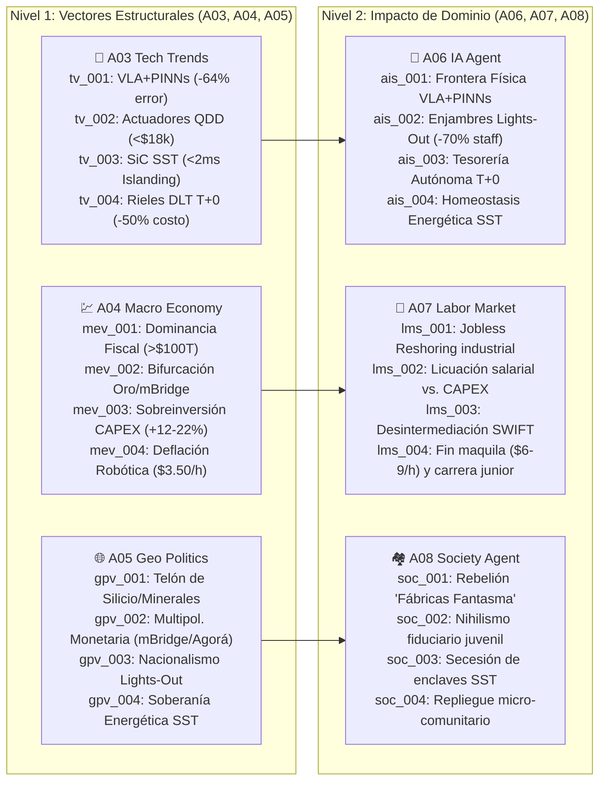
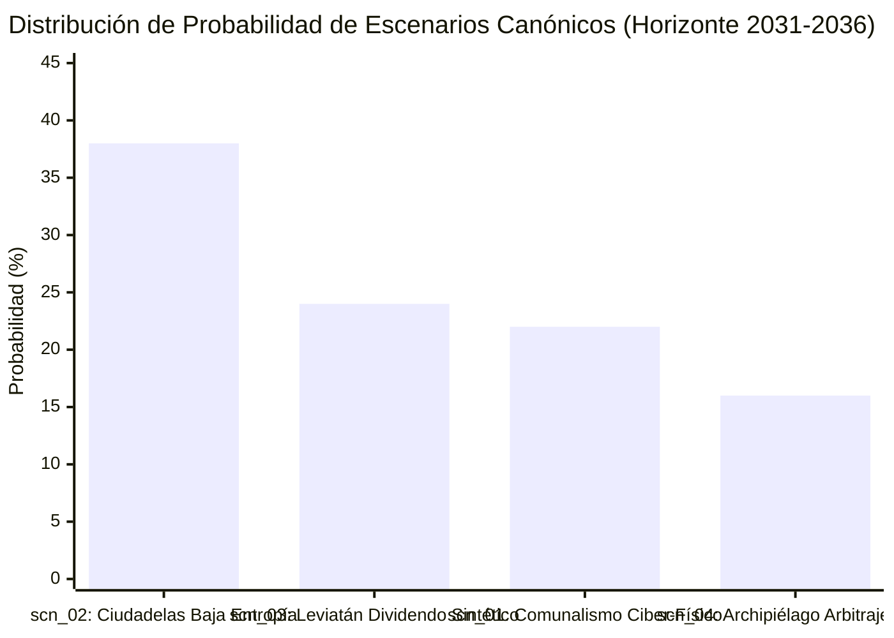

# 🧭 SocietyWay — Dashboard Estratégico de Prospectiva Global (`A14`)

> [!IMPORTANT]
> **Ciclo de Inteligencia (`run_id`):** `run-20261023-sovereignty` | **Fecha de Corte:** `2026-10-23` | **Horizonte Prospectivo:** `2026 -> 2031 (T+5Y) -> 2036 (T+10Y)`  
> **Cobertura del Pipeline:** 14 Nodos Ejecutados (`A01` a `A14`) | **Trazabilidad Verificada:** 12 Señales Primarias (`sig_20261023_001` a `sig_20261023_012`)

---

## I. Pulso Global del Ciclo y Termómetro Sistémico (`A01` – `A08`)

El ciclo `run-20261023-sovereignty` diagnostica una **transición de fase estructural en el sistema-mundo**: el agotamiento simultáneo de la **hegemonía monetaria fiduciaria unipolar**, del **empleo manufacturero como mecanismo de integración social** y de la **red eléctrica/infraestructural centralizada**.

| Dimensión Sistémica | Índice `[0-1]` | Tendencia | Diagnóstico Cuantitativo Verificado (`A01`–`A08`) | Señales Trazables |
| :--- | :---: | :---: | :--- | :--- |
| **Aceleración Tecnológica y Ciber-Física (`A03`/`A06`)** | **`0.91`** | ⬆️ Crítica | Modelos físicos `VLA+PINNs/OpenUSD` (**-64%** fallo *Sim-to-Real*, **-78%** cambio de línea); humanoides `QDD` (**<$18,000 USD BOM**); microrredes `SiC SST` (**98.5%** eficiencia, **<2 ms** *islanding*); liquidación atómica `T+0` (`mBridge`/`Agorá`). | `sig_004`, `sig_006`, `sig_007`, `sig_009`, `sig_010`, `sig_012` |
| **Fragilidad Macro-Fiscal y Monetaria (`A04`)** | **`0.84`** | ⬆️ Alta | Deuda soberana global **>$100B USD (93% PIB)**; intereses absorben **14.5%–17.8%** de ingresos fiscales; bancos centrales compran **>1,030 t/año de oro**; inflación piso de **3.2%–4.0%** y prima por plazo de **+85 a +140 pb**. | `sig_001`, `sig_002`, `sig_004`, `sig_008`, `sig_011` |
| **Compresión y Fractura Laboral (`A07`)** | **`0.82`** | ⬆️ Alta | Costo horario robótico de **$3.50–$5.50/h** (inferior a maquila emergente de `$6–$9/h`); recorte del **65%–75% en plantilla humana** en plantas *lights-out* (*Jobless Reshoring*); vida media de habilidades técnicas de **2.1 años**. | `sig_006`, `sig_007`, `sig_009`, `sig_011`, `sig_012` |
| **Fragmentación Geopolítica y Comercial (`A05`)** | **`0.86`** | ⬆️ Alta | **3,100 restricciones comerciales** activas (**3.1x** vs. base); aranceles estratégicos del **25%–100%**; controles de exportación sobre litografía `EUV/GAA`, galio, germanio, tierras raras y sustratos `SiC` (**+12% a +22%** CAPEX). | `sig_002`, `sig_003`, `sig_004`, `sig_005`, `sig_010` |
| **Cohesión Social y Confianza Institucional (`A08`)** | **`0.38`** | ⬇️ Crítica | Viralización del *Debasement Trade* (**+340% YoY**); desencanto obrero ante las "Fábricas Fantasma"; exclusión hipotecaria juvenil; tensión entre enclaves energéticos privados `SST` y redes públicas degradadas. | `sig_001`, `sig_005`, `sig_008`, `sig_010`, `sig_011`, `sig_012` |

> [!WARNING]
> **Estado de Ánimo Cultural Dominante (`dominant_cultural_mood`):** `DESERTOR_FIDUCIARIO_Y_PUGNA_POR_SOBERANIA_DE_ENCLAVES`  
> La ciudadanía, las corporaciones industriales y los propios bancos centrales actúan bajo la premisa de que el centro fiduciario e infraestructural ya no puede garantizar estabilidad, desatando una carrera hacia el **colateral físico duro (oro, energía `SiC SST`, silicio y robots `QDD`)**.

---

## II. Radar Sectorial de las 6 Ramas Especializadas (`A03` a `A08`)



| Rama | Agente | Vectores / Síntesis Clave | Hallazgo Ejecutivo |
| :--- | :--- | :--- | :--- |
| **02A-N1** | `A03_TECH_TRENDS` ([ver reporte](file:///c:/Users/addu0g/Documents/SocietyWay/runs/2026-10-23-sovereignty/03-rama-tecnologia-trends.md)) | `tv_001`, `tv_002`, `tv_003`, `tv_004` | Convergencia de IA física (`VLA+PINNs`), actuadores `QDD` (`<$18k`), transformadores `SiC SST` (`98.5%` efic., `<2 ms`) y liquidación `T+0`. |
| **02A-N2** | `A06_IA_AGENT` ([ver reporte](file:///c:/Users/addu0g/Documents/SocietyWay/runs/2026-10-23-sovereignty/06-rama-ia-agent.md)) | `ais_001`, `ais_002`, `ais_003`, `ais_004` | La IA abandona el chatbot para encarnarse en la fábrica (*lights-out*), la tesorería mayorista (`M2M T+0`) y el control de potencia eléctrica. |
| **02B-N1** | `A04_ECON_MACRO` ([ver reporte](file:///c:/Users/addu0g/Documents/SocietyWay/runs/2026-10-23-sovereignty/04-rama-economia-macro.md)) | `mev_001`, `mev_002`, `mev_003`, `mev_004` | Choque entre inflación fiscal/arancelaria (**3.2%–4.0%**, prima **+85 a +140 pb**) y deflación tecnológica del costo manufacturero (**$3.50–$5.50/h**). |
| **02B-N2** | `A07_LABOR_MARKET` ([ver reporte](file:///c:/Users/addu0g/Documents/SocietyWay/runs/2026-10-23-sovereignty/07-rama-mercado-laboral.md)) | `lms_001`, `lms_002`, `lms_003`, `lms_004` | Compresión simultánea del operario físico (**-65% a -75%**), del analista bancario SWIFT y del hub emergente de mano de obra barata (`$6–$9/h`). |
| **02C-N1** | `A05_POLITICS_GEO` ([ver reporte](file:///c:/Users/addu0g/Documents/SocietyWay/runs/2026-10-23-sovereignty/05-rama-politica-geo.md)) | `gpv_001`, `gpv_002`, `gpv_003`, `gpv_004` | El poder geopolítico se redefine por la posesión de gigavatios estables (`SiC SST`), minerales críticos (galio/tierras raras), oro y densidad robótica. |
| **02C-N2** | `A08_SOCIETY_AGENT` ([ver reporte](file:///c:/Users/addu0g/Documents/SocietyWay/runs/2026-10-23-sovereignty/08-rama-sociedad-agent.md)) | `soc_001`, `soc_002`, `soc_003`, `soc_004` | Índice de Cohesión Social en **`0.38`**: ruptura del pacto generacional fiduciario y rechazo local a los complejos industriales sin trabajadores. |

---

## III. Brújula Filosófica, de Narrativas y Macro-Tendencias (`A09` → `A11`)

| Nivel | ID | Título / Concepto | Métrica / Estado | Síntesis de Sentido y Acción Colectiva |
| :--- | :--- | :--- | :---: | :--- |
| **Filosofía (`A09`)** | `phil_001` | **Ontología del Dinero:** De la Fe Cívica Fiduciaria a la Verdad Termodinámica y Áurea | Polaridad Alta | El valor migra de la promesa del Estado endeudado (`>$100B USD`) a la prueba física (oro `>1,030 t/año`, energía y liquidación atómica `T+0`). |
| **Filosofía (`A09`)** | `phil_002` | **Antropología del Trabajo:** Fin del Ciudadano-Obrero y Expropiación del Saber Tácito | Polaridad Crítica | Los modelos `VLA+PINNs` codifican la destreza manual en pesos de software replicables a `$3.50/h`, vaciando de empleo el *nearshoring*. |
| **Filosofía (`A09`)** | `phil_003` | **Filosofía Política:** Autopoiesis de Enclaves Ciber-Físicos vs. Democracia Endeudada | Polaridad Alta | Microrredes `SiC SST` (`<2 ms`) permiten la secesión metabólica de fábricas y centros de datos frente a redes públicas en crisis fiscal. |
| **Narrativa (`A10`)** | `nar_001` | *"El Gran Desanclaje Fiduciario y el Arca de los Activos Duros"* | `ASCENDING_CHALLENGER` (**`0.91`**) | Impulsa el *Debasement Trade* (+340%) y la rotación masiva de reservas y ahorros hacia oro, energía y activos reales fuera de bonos G7. |
| **Narrativa (`A10`)** | `nar_002` | *"Fortaleza Automatizada: Soberanía por Kilovatio y Silicio"* | `DOMINANT_ORTHODOXY` (**`0.88`**) | Legitima aranceles del 25%–100% y subsidios públicos para levantar megafábricas *lights-out* en nombre de la seguridad nacional. |
| **Narrativa (`A10`)** | `nar_003` | *"La Traición de las Fábricas Fantasma y el Nuevo Ludismo Cívico"* | `ASCENDING_CHALLENGER` (**`0.85`**) | Moviliza a municipios y sindicatos contra el *Jobless Reshoring* (`-70%` plantilla), exigiendo *Robot Taxes* y dividendos territoriales. |
| **Narrativa (`A10`)** | `nar_004` | *"Secesión de Baja Entropía y Archipiélago de Micro-Soberanías"* | `LATENT_FRINGE` (**`0.79`**) | Promueve la desconexión infraestructural mediante microrredes `SiC SST`, plantas autónomas y liquidación `M2M` fuera del Estado fiscal. |
| **Tendencia (`A11`)** | `gmt_001` | **Bifurcación Monetaria Multipolar y Dominancia Fiscal (`T+0` + Oro)** | Certeza **`0.91`** (`2 años`) | Erosión del 12%–18% en reservas fiduciarias tradicionales hacia 2035; pugna entre `mBridge`/activos duros y represión financiera en `Agorá`. |
| **Tendencia (`A11`)** | `gmt_002` | **Reindustrialización sin Empleo (*Jobless Reshoring*) e IA Física** | Certeza **`0.89`** (`3 años`) | Comoditización del trabajo manual a `$3.50–$5.50/h`; colapso del arbitraje salarial emergente y crisis de recaudación previsional. |
| **Tendencia (`A11`)** | `gmt_003` | **Autarquización de Enclaves Ciber-Físicos (`SiC SST` + Borde + `M2M`)** | Certeza **`0.85`** (`4 años`) | Espiral de muerte de eléctricas públicas tradicionales y surgimiento de enclaves industriales cuasi-soberanos con inmunidad energética. |

---

## IV. Síntesis del Consejo de Agentes (`A12`): Certezas vs. Disensos Críticos

> [!IMPORTANT]
> **Veredicto de la Cámara Deliberativa ([ver acta completa](file:///c:/Users/addu0g/Documents/SocietyWay/runs/2026-10-23-sovereignty/12-consejo-de-agentes-acta.md)):**  
> Tras 3 rondas de debate adversarial entre `TECH_IA_DELEGATE`, `ECON_LABOR_DELEGATE`, `GEO_SOCIAL_DELEGATE`, `PHIL_CULTURAL_DELEGATE` y `RED_TEAM_BLACK_SWAN`, el Consejo dictamina que **la eficiencia técnica de la fábrica *lights-out* (`$3.50/h`), la microrred `SiC SST` (`<2 ms`) y la liquidación `T+0` es físicamente irreversible**, pero choca frontalmente con **la insolvencia fiscal de los Estados (`>$100B USD`) y el colapso de la cohesión social (`0.38`)**.

### 1. Certezas Invariantes (`invariant_certainties` — Comunes a todo escenario 2026–2036)
- **Piso Inflacionario y Prima por Plazo Estructural:** La Dominancia Fiscal mantendrá la inflación de equilibrio en **3.2%–4.0%** y las primas por plazo en **+85 a +140 pb**, sosteniendo la demanda estructural de oro (**>1,030 t/año**) y activos reales.
- **Compresión Irreversible del Empleo Operativo Directo:** Las nuevas plantas industriales operarán con **65%–75% menos personal humano** a un costo robótico de **$3.50–$5.50/h**, cerrando la ventana histórica del desarrollo por mano de obra barata.
- **Acoplamiento Energía-Cómputo-Acero:** La competitividad industrial y de IA dependerá del acceso a semiconductores de potencia (`SiC SST`), minerales críticos y liquidación programable `T+0`.

### 2. Los 2 Ejes Ortogonales de Incertidumbre Crítica (`critical_uncertainties`)
1. **Eje X (`axis_governance`) — Arquitectura de Gobernanza Tecno-Monetaria e Infraestructural:**
   - *Polo Bajo (`LOW_OPENNESS`):* Control Estatal-Corporativo Centralizado, Licenciado y Represión Financiera Cautiva (`Project Agorá`, oligopolios cerrados y aranceles).
   - *Polo Alto (`HIGH_OPENNESS`):* Soberanía Distribuida, Multipolaridad Abierta y Autonomía en el Borde Local (`mBridge`/oro, pesos `VLA/PINNs` abiertos y microrredes cooperativas).
2. **Eje Y (`axis_social_adaptation`) — Régimen de Adaptación Social y Redistribución del Excedente Autónomo:**
   - *Polo Bajo (`LOW_COHESION`):* Fragmentación Neofeudal, Secesión de Enclaves de Baja Entropía y Polarización Defensiva.
   - *Polo Alto (`HIGH_COHESION`):* Nuevo Contrato Social de Dividendos Ciber-Físicos, Impuesto al Cómputo/Robot y Economía Humana Cohesiva.

---

## V. Portafolio de Escenarios a 5 y 10 Años (`2031 - 2036`) (`A13`)



| ID | Escenario ([ver detalle en A13](file:///c:/Users/addu0g/Documents/SocietyWay/runs/2026-10-23-sovereignty/13-predictor-futuros-2031-2036.md)) | Cuadrante | Prob. | Estado a 5 Años (`2031`) | Estado a 10 Años (`2036`) | Ganadores Clave |
| :--- | :--- | :--- | :---: | :--- | :--- | :--- |
| **`scn_02`** | **🏰 Ciudadelas de Baja Entropía (Tecno-Feudalismo de Enclaves)** | `LOW_OPENNESS` × `LOW_COHESION` | **`38%`** | Megafábricas *lights-out* (`-70%` plantilla) se desconectan en microrredes `SiC SST` (`<2 ms`); hemisferios monetarios amurallados; inflación `3.8%–4.5%` y crisis hipotecaria juvenil. | Soberanía territorial bifurcada: enclaves corporativos de alta eficiencia intercambian energía/agua por inmunidad fiscal con municipios quebrados; crisis en el Sur Global. | Megaconsorcios `VLA/SST`, productores de oro/uranio/`SiC`, defensa autónoma. |
| **`scn_03`** | **🏛️ Leviatán del Dividendo Sintético y Represión Cautiva** | `LOW_OPENNESS` × `HIGH_COHESION` | **`24%`** | Impuesto soberano al humanoide/FLOP (*Robot Tax* `>=20%`), prohibición de *islanding* egoísta y represión financiera cautiva sobre `Project Agorá`. | Estado de bienestar sintético: dividendo ciudadano pagado en CBDC programable con fecha de caducidad; estabilidad social con estancamiento privado. | Burocracias estatales, campeones nacionales concesionados, consumo básico subsidiado. |
| **`scn_01`** | **🏛️⚡ Comunalismo Ciber-Físico y Atenas Industrial Distribuida** | `HIGH_OPENNESS` × `HIGH_COHESION` | **`22%`** | Estándares abiertos `VLA+PINNs` en `OpenUSD`; cooperativas operan humanoides `QDD <$18k`; microrredes `SiC SST` de copropiedad municipal-industrial. | Jornada laboral de 26h; Fideicomisos Territoriales de Automatización; Gremios Ciber-Artesanales y red eléctrica pública en malla celular sin apagones. | Cooperativas industriales, municipios con energía propia, gremios de ingenieros ciber-físicos. |
| **`scn_04`** | **🏴‍☠️ Archipiélago de Arbitraje M2M y Mercantilismo Agéntico** | `HIGH_OPENNESS` × `LOW_COHESION` | **`16%`** | Enjambres de tesorería `M2M` rotan capital en segundos a `mBridge`/oro; nacen Zonas Económicas Especiales Agénticas con 0% impuestos a plantas *lights-out*. | Ciudades-estado corporativas y fábricas móviles (*Factory-in-a-Box* a `$2.50/h`) vacían la base fiscal de los Estados-nación endeudados; alta fricción migratoria. | Corporaciones nativas agénticas, ciudades-estado/puertos libres (`T+0`), fondos M2M. |
| **`scn_05`** | **🦢 Cisne Negro: Gran Apagón Sim-to-Real y Congelamiento `T+0`** | `WILDCARD_BLACK_SWAN` | *(Cola 5%)* | Sabotaje adversario en librerías `OpenUSD/PINNs` + embargo total de tierras raras/`SiC` + *flash-crash* de `$1.5B USD` en `T+0` paraliza la industria autónoma. | Tratado de Ginebra (2032): prohibición de liquidación M2M instantánea y obligación legal de mantener **35% de plantilla humana y controles analógicos** en planta. | Industrias con reserva humana empírica, controles analógicos y cadenas locales. |

---

## VI. Tablero de Alertas Tempranas (*Signposts Watchlist*) y Hoja de Ruta de Decisiones (*Decision Playbook*)

### 1. Monitor de Signposts Activos (Horizonte de Observación: `6 a 24 meses`)

| ID Signpost | Indicador Observable y Falsable | Ventana | Estado Actual | Desplaza Probabilidad Hacia |
| :---: | :--- | :---: | :---: | :---: |
| **`sp_01`** | Aprobación en >=3 jurisdicciones industriales de leyes de *"Condicionalidad Cívica del Nearshoring"* (20% de capacidad `SiC SST` compartida con el municipio + fondo laboral). | `12–18m` | 🟡 `WATCHING` | **`scn_01`** (+Cohesión Distribuida) |
| **`sp_02`** | Adopción por >500 fabricantes medianos de un estándar abierto `VLA+PINNs` en `OpenUSD` que opere humanoides `QDD` multimarca a `<$4.50/h` sin regalías de nube. | `6–18m` | 🟡 `WATCHING` | **`scn_01` / `scn_04`** (+Apertura Técnica) |
| **`sp_03`** | Desconexión prioritaria (*behind-the-meter* con `SiC SST`) de >=5 megacomplejos de IA/manufactura en EE. UU./UE con alzas >18% en tarifas eléctricas residenciales locales. | `6–15m` | 🟠 `TRIGGERED_PARTIAL` | **`scn_02`** (+Ciudadelas Feudales) |
| **`sp_04`** | Pago neto de intereses supera el **18.5% de ingresos fiscales** en >=2 economías G7 junto con aranceles >50% a componentes robóticos y sustratos `SiC` fuera de bloque. | `6–18m` | 🟠 `TRIGGERED_PARTIAL` | **`scn_02`** (+Bloques y Dominancia Fiscal) |
| **`sp_05`** | Promulgación en UE, EE. UU. o Japón del primer *Impuesto de Equivalencia de Nómina para Sistemas Autónomos* (*Robot Tax* >=20%) en plantas con recorte >50% de personal. | `12–24m` | 🟡 `WATCHING` | **`scn_03`** (+Leviatán Redistributivo) |
| **`sp_06`** | Mandatos regulatorios G7 de tenencia mínima obligatoria de deuda pública para pensiones/consorcios en `Agorá` y sobretasas (>35%) al oro monetario privado. | `12–24m` | 🟡 `WATCHING` | **`scn_03`** (+Represión Cautiva) |
| **`sp_07`** | Al menos 2 Zonas Económicas Especiales otorgan personalidad jurídica a tesorerías M2M con liquidación en `mBridge`/oro y 0% de impuestos a plantas *lights-out*. | `6–18m` | 🟡 `WATCHING` | **`scn_04`** (+Archipiélago Agéntico) |
| **`sp_08`** | El volumen mensual de comercio industrial transfronterizo liquidado de máquina a máquina (`M2M T+0`) fuera de SWIFT supera los **$500,000 millones USD**. | `12–24m` | 🟠 `TRIGGERED_PARTIAL` | **`scn_04` / `scn_02`** (+Bifurcación `T+0`) |

---

### 2. Hoja de Ruta Estratégica (*Decision Playbook*)

> [!TIP]
> #### 🛡️ Cinco Movimientos Sin Arrepentimiento (*No-Regret Moves* — Robustos en los 4 Escenarios + Wildcard)
> 1. **Autonomía Energética de Estado Sólido con Pacto Comunitario (`SiC SST Dual-Mode`):** Diseñar toda nueva infraestructura de cómputo o manufactura sobre microrredes DC con transformadores `SiC SST` capaces de desconectarse en `<2 ms` (`scn_02`/`scn_04`), pero estructurar desde el día uno un protocolo de inyección de respaldo del 15%–20% hacia servicios críticos del municipio local para obtener licencia social y blindarse frente a expropiaciones regulatorias (`scn_01`/`scn_03`).
> 2. **Tesorería Bimodal Antifragilidad (Colateral Duro + Rieles `T+0`):** Reducir la exposición de largo plazo a deuda soberana fiduciaria nominal (vulnerable a la inflación estructural de `3.2%–4.0%` y primas de `+85 a +140 pb`), reasignando entre un **15% y un 25% de las reservas estratégicas** hacia oro físico, contratos de energía/cobre, inventarios críticos (`QDD`/`SiC`) y capacidad de liquidación multi-riel (`mBridge` y `Project Agorá`).
> 3. **Arquitectura Ciber-Física Abierta con Reserva Empírica Humana (*Human-in-the-Loop Fallback*):** Desplegar celdas *lights-out* basadas en estándares interoperables (`OpenUSD` + `PINNs`) y actuadores `QDD` modulares para capturar el costo unitario de `$3.50–$5.50/h`, pero **preservar un núcleo del 25%–30% de maestros de oficio e ingenieros ciber-físicos** con controles analógicos desconectables que eviten el colapso del aprendizaje junior (`lms_004`) y aseguren la continuidad ante un Cisne Negro (`scn_05_wildcard`).
> 4. **Abandono del Arbitraje Salarial Puro en Estrategias de *Nearshoring*:** Cancelar cualquier proyecto de inversión industrial a 5–10 años cuya rentabilidad dependa exclusivamente de mano de obra barata (`$6–$9/h`); reorientar el CAPEX hacia nodos geográficos que garanticen **abundancia de kilovatios limpios, agua, seguridad jurídica y proximidad a mercados finales**.
> 5. **Auditoría de Productividad Humano-Máquina para Mitigación Fiscal:** Documentar contable y operativamente cómo cada flota de agentes o robots eleva la productividad y seguridad de los trabajadores humanos restantes, creando el expediente probatorio necesario para obtener exenciones o tasas reducidas ante la inminente llegada de impuestos a la automatización (*Robot/FLOP Taxes*).

#### ⚡ Disparadores Contingentes (*Trigger-Based Actions*)
- **SI se activa `sp_03` o `sp_04` (Aceleración hacia `scn_02` — *Ciudadelas de Baja Entropía*):** Adelantar compras de inventario para 24 meses de semiconductores `SiC`, imanes para actuadores `QDD` y transformadores de potencia; cerrar contratos PPA energéticos dedicados tras el medidor (*behind-the-meter*) antes de que las *utilities* públicas impongan moratorias de desconexión.
- **SI se activa `sp_05` o `sp_06` (Viraje hacia `scn_03` — *Leviatán del Dividendo Sintético*):** Reclasificar las flotas robóticas como herramientas de asistencia ergonómica co-operadas por humanos (evitando el umbral legal de "planta *lights-out* sujeta a sobretasa de nómina") y trasladar la liquidez excedente hacia activos productivos físicos e infraestructura concesionada indexada a la inflación antes del cierre de controles de capital en `Project Agorá`.
- **SI se activa `sp_01` o `sp_02` (Impulso hacia `scn_01` — *Comunalismo Ciber-Físico*):** Lanzar consorcios de entrenamiento compartido de modelos `VLA` con proveedores locales y convertir parte de los bonos corporativos en fideicomisos de participación para empleados técnicos y municipios anfitriones.
- **SI se activa `sp_07` o `sp_08` (Aceleración hacia `scn_04` — *Archipiélago M2M*):** Establecer una subsidiaria de tesorería y procura algorítmica en una Zona Económica Especial neutral con acceso nativo a liquidación atómica `T+0` en `mBridge` y contratos respaldados en materias primas.

---

## VII. Contrato de Salida JSON (`AgentEnvelope` + `StrategicDashboardArtifact`)

```json
{
  "$schema": "https://societyway.local/schemas/agent-envelope-v1.json",
  "run_id": "run-20261023-sovereignty",
  "timestamp_utc": "2026-10-23T23:45:00Z",
  "producer_agent_id": "A14_STRATEGIC_DASHBOARD",
  "consumer_agent_ids": [
    "DECISION_MAKERS_FINAL_USER"
  ],
  "trace_context": {
    "stage": "04_DELIBERATION_AND_FORESIGHT",
    "confidence_score": 0.94,
    "source_signal_ids": [
      "sig_20261023_001",
      "sig_20261023_002",
      "sig_20261023_003",
      "sig_20261023_004",
      "sig_20261023_005",
      "sig_20261023_006",
      "sig_20261023_007",
      "sig_20261023_008",
      "sig_20261023_009",
      "sig_20261023_010",
      "sig_20261023_011",
      "sig_20261023_012"
    ]
  },
  "payload": {
    "producer_agent_id": "A14_STRATEGIC_DASHBOARD",
    "run_id": "run-20261023-sovereignty",
    "generated_at_utc": "2026-10-23T23:45:00Z",
    "system_thermometer": {
      "technological_acceleration_index": 0.91,
      "macroeconomic_fragility_index": 0.84,
      "labor_compression_index": 0.82,
      "geopolitical_fragmentation_index": 0.86,
      "social_cohesion_index": 0.38,
      "dominant_cultural_mood": "DESERTOR_FIDUCIARIO_Y_PUGNA_POR_SOBERANIA_DE_ENCLAVES"
    },
    "scenario_probabilities": [
      {
        "scenario_id": "scn_02",
        "codename": "Ciudadelas de Baja Entropía (Tecno-Feudalismo de Enclaves)",
        "probability": 0.38
      },
      {
        "scenario_id": "scn_03",
        "codename": "Leviatán del Dividendo Sintético y Represión Cautiva",
        "probability": 0.24
      },
      {
        "scenario_id": "scn_01",
        "codename": "Comunalismo Ciber-Físico y Atenas Industrial Distribuida",
        "probability": 0.22
      },
      {
        "scenario_id": "scn_04",
        "codename": "Archipiélago de Arbitraje M2M y Mercantilismo Agéntico",
        "probability": 0.16
      }
    ],
    "wildcard_reference": {
      "scenario_id": "scn_05_wildcard",
      "codename": "Cisne Negro: Gran Apagón Sim-to-Real y Congelamiento Atómico T+0",
      "conditional_tail_probability": 0.05
    },
    "active_signposts_watchlist": [
      {
        "signpost_id": "sp_01",
        "indicator": "Leyes de Condicionalidad Cívica del Nearshoring (>=20% de capacidad SiC SST compartida con el municipio) en >=3 jurisdicciones industriales",
        "status": "WATCHING",
        "shifts_probability_toward": "scn_01"
      },
      {
        "signpost_id": "sp_02",
        "indicator": "Adopción por >500 fabricantes medianos de un estándar abierto VLA+PINNs sobre OpenUSD operando humanoides QDD a <$4.50/h",
        "status": "WATCHING",
        "shifts_probability_toward": "scn_01"
      },
      {
        "signpost_id": "sp_03",
        "indicator": "Desconexión prioritaria (behind-the-meter con SiC SST) de >=5 megacomplejos de IA/manufactura con alzas >18% en tarifas eléctricas residenciales",
        "status": "TRIGGERED_PARTIAL",
        "shifts_probability_toward": "scn_02"
      },
      {
        "signpost_id": "sp_04",
        "indicator": "Pago neto de intereses supera el 18.5% de ingresos fiscales en >=2 economías G7 junto con aranceles >50% a robótica y sustratos SiC",
        "status": "TRIGGERED_PARTIAL",
        "shifts_probability_toward": "scn_02"
      },
      {
        "signpost_id": "sp_05",
        "indicator": "Promulgación en UE, EE. UU. o Japón del primer Impuesto de Equivalencia de Nómina para Sistemas Autónomos (Robot Tax >=20%)",
        "status": "WATCHING",
        "shifts_probability_toward": "scn_03"
      },
      {
        "signpost_id": "sp_06",
        "indicator": "Cuotas obligatorias de deuda pública doméstica sobre Project Agorá y sobretasas fiscales (>35%) al oro monetario privado en el G7",
        "status": "WATCHING",
        "shifts_probability_toward": "scn_03"
      },
      {
        "signpost_id": "sp_07",
        "indicator": "Creación de >=2 Zonas Económicas Especiales Agénticas con personalidad jurídica para tesorerías M2M en mBridge/oro y 0% impuestos a plantas lights-out",
        "status": "WATCHING",
        "shifts_probability_toward": "scn_04"
      },
      {
        "signpost_id": "sp_08",
        "indicator": "Volumen mensual de comercio industrial transfronterizo liquidado M2M en T+0 fuera de SWIFT supera los $500,000 millones USD",
        "status": "TRIGGERED_PARTIAL",
        "shifts_probability_toward": "scn_04"
      }
    ],
    "decision_playbook": {
      "no_regret_moves": [
        "Desplegar microrredes DC con transformadores SiC SST (<2 ms islanding) en modo dual: autarquía para plantas críticas + inyección solidaria del 15%-20% al municipio para asegurar licencia social.",
        "Estructurar una tesorería bimodal antifragilidad: rotar 15%-25% de reservas desde deuda soberana nominal hacia oro físico, colateral energético/mineral e interoperabilidad T+0 (mBridge/Agorá).",
        "Adoptar arquitecturas abiertas de IA física (OpenUSD/PINNs + actuadores QDD modulares) manteniendo un 25%-30% de Reserva Cognitiva y Manual Humana con controles analógicos de emergencia.",
        "Descartar inversiones de nearshoring basadas únicamente en arbitraje salarial ($6-$9/h) y priorizar nodos con abundancia de kilovatios limpios, agua y cercanía a demanda final.",
        "Instrumentar auditorías de complementariedad humano-máquina para blindar las operaciones frente a futuros Impuestos de Equivalencia de Nómina Robótica (Robot/FLOP Taxes)."
      ],
      "contingent_triggers": [
        {
          "if_signpost": "sp_03",
          "then_action": "Cerrar contratos PPA energéticos dedicados behind-the-meter y asegurar inventarios para 24 meses de sustratos SiC e imanes QDD antes de moratorias eléctricas públicas."
        },
        {
          "if_signpost": "sp_04",
          "then_action": "Reducir duración de bonos soberanos G7 en cartera y cubrir exposición cambiaria mediante oro físico y contratos de suministro denominados en activos reales."
        },
        {
          "if_signpost": "sp_05",
          "then_action": "Reconfigurar celdas lights-out bajo esquemas certificados de co-pilotaje humano-robot y cogestión formativa que califiquen a deducciones del Robot Tax."
        },
        {
          "if_signpost": "sp_07",
          "then_action": "Constituir una filial de procura y tesorería algorítmica M2M en una Zona Económica Especial con liquidación atómica T+0 sobre mBridge y colateral energético."
        }
      ]
    }
  },
  "markdown_summary": "## Resumen Ejecutivo Final del Ciclo SocietyWay (`run-20261023-sovereignty`)\nEl Dashboard Estratégico (`A14`) consolida la cadena completa de inteligencia (`A01` a `A13`) con trazabilidad total sobre las 12 señales primarias (`sig_20261023_001..012`). El Termómetro Sistémico refleja una combinación crítica de alta aceleración tecnológica (`0.91`), fragilidad macro-fiscal (`0.84`), fragmentación geopolítica (`0.86`) y baja cohesión social (`0.38`). El escenario modal hacia 2031-2036 es `scn_02` — **Ciudadelas de Baja Entropía / Tecno-Feudalismo de Enclaves** (`38%`), seguido por `scn_03` — **Leviatán del Dividendo Sintético** (`24%`), `scn_01` — **Comunalismo Ciber-Físico Distribuido** (`22%`) y `scn_04` — **Archipiélago de Arbitraje M2M** (`16%`), más el comodín Cisne Negro `scn_05_wildcard` (`5%` condicional). Se activan 8 *signposts* observables (`sp_01` a `sp_08`) y 5 *No-Regret Moves* inmediatos centrados en microrredes duales `SiC SST`, tesorería bimodal en colateral duro/`T+0` y arquitecturas abiertas de IA física con reserva de maestría humana."
}
```
